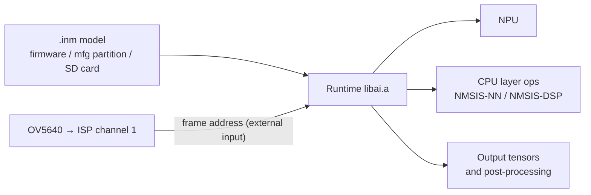

# AI & NPU

The IPRO7AI NPU runs `.inm` models through a prebuilt runtime, `components/ai/lib/libai.a`, with public headers (how the chip differs from IPRO7 is on the [IPRO7AI](../hardware/chips/ipro7ai.md) page). On the IPRO7AI Reef EVK three applications use it: `ipro7_uvc_cam` with `defconfig_reef_rps` (a webcam game against the NPU), `ipro_ai_link` (runs any model from the SD card on command) and `ipro_reef_teach` (the Edge AI firmware behind [IPRO AI Teach](../teach/index.md)). Start from one of them with its own model before you bring your own.

!!! abstract "At a glance"
    - Included: the prebuilt runtime and its headers (`iproai_core.h` for one model, `ipro_ai.h` and the other Edge AI layers for several), example `.inm` models, and the Reef applications above.
    - Enable with `CONFIG_AI_SUPPORT=y`, and write `CONFIG_USE_PSRAM=y` into `.config` yourself: models and tensors live in PSRAM.
    - A model is linked into the firmware, stored in the `mfg` flash partition, or read from the SD card.
    - Not part of the SDK package: runtime source code and model conversion tools (contact INTELPRO); IPRO AI Studio ships separately (see [Install IPRO AI Studio](../teach/install.md)).

## Architecture { #architecture }



Each layer of a model runs on either the NPU or the CPU, as the model itself specifies; `iproai_getNetInfo()` reports the total and NPU layer counts. Do not assume that any model runs entirely on the NPU.

| Path | Model format | How it runs | Reef example |
|---|---|---|---|
| NPU | `.inm` | `libai.a` loads the model and dispatches each layer to the NPU or the CPU | `ipro7_uvc_cam` (`defconfig_reef_rps`), `ipro_ai_link`, `ipro_reef_teach` |
| CPU | `.tflite` | TensorFlow Lite Micro with NMSIS-NN kernels (`components/3rdparty`) | — (IPRO7 EVB examples `ipro_tflm_test`, `ipro_tflm_yolo`) |

The two formats are not interchangeable; renaming a file does not convert it.

## Runtime and API { #iproai-framework }

```text title="components/ai/"
components/ai/
├── CMakeLists.txt        # links lib/libai.a and adds the include paths below
├── iproai_def.h
├── lib/libai.a           # prebuilt runtime
├── src/core/include/     # iproai_core.h: one model, direct
├── src/inst/include/     # NPU, CPU ops, post-processing; detect/, audio/
├── runtime/include/      # ipro_ai.h: several models, shared NPU
├── store/include/        # ipro_ai_store.h: model slots in flash
├── source/include/       # ipro_ai_source.h: data sources
├── preproc/include/      # ipro_ai_preproc.h, sensor_front.h
└── app/include/          # ipro_ai_app.h: source → model → results
```

The package has no runtime source, so `.config` cannot change how `libai.a` was compiled.

**Direct API (`iproai_core.h`)**, used by `ipro_ai_link` and the rock-paper-scissors build:

| Function | Purpose |
|---|---|
| `iproai_create()` | Create a model instance |
| `iproai_load_model_from_buffer(hdl, buf)` | Load from memory: a model linked into the firmware, or the `mfg` partition read through XIP |
| `iproai_load_model_from_file(hdl, "sd:/…")` | Read the whole `.inm` into PSRAM through FatFS, then load it |
| `iproai_getNetInfo(hdl)` | Input size, layer count, NPU layer count |
| `iproai_getInputBuffer(hdl)`, `iproai_getOutputBuffer(hdl, &size)` | Input and output buffers |
| `iproai_startCompute(hdl)` | Run inference (synchronous) |
| `iproai_setResultCB()`, `iproai_setCustom_Postproc_CB()` | Result callback, custom post-processing |
| `iproai_free(hdl)` | Release the model |

Calls return `IPROAI_STATUS_NO_ERROR` on success. Ungate the multimedia clock (`GLB_PER_Clock_UnGate(GLB_AHB_CLOCK_MM)`) and call `iproai_npu_init()` (`iproai_inst_npu.h`) before the first load, as `ipro_ai_link` does.

- **Input**: models that take camera frames read an external input. The runtime reads from `imgBuffer + 4` (the first 4 bytes are a size header); `NPU_Img_Ext_Addr_Cfg()` (`hal_npu.h`) sets the frame address before each run. The Reef camera path delivers 4 bytes per pixel (ARGB).
- **Output**: the size returned by `iproai_getOutputBuffer()` is the patch size, not the whole tensor. The NPU pads the channel count to a multiple of 4 (`BALI_CHN_ALIGN`, `iproai_inst_util.h`); read the output with the padded stride.
- The NPU's base-address and external-input registers are written only when a model is loaded. With one model per image this does not matter; with several, use the runtime below.

**Edge AI layers**, used by `ipro_reef_teach` (all in `libai.a`):

| Header | Purpose |
|---|---|
| `ipro_ai.h` | `ipro_ai_init()`, `ipro_ai_model_open()`, `ipro_ai_invoke()`, `ipro_ai_model_close()`: any number of models open at once; one NPU lock, and before every run the NPU is pointed back at the model being run. Code that still calls `iproai_*` directly in the same image holds `ipro_ai_npu_lock()` around it |
| `ipro_ai_store.h` | Model slots in a flash partition: install with a record sector and a commit word, so a power cut leaves the previous model, the new one or an empty slot, never half a model |
| `ipro_ai_source.h` | Data sources (sample streams such as the PDM microphone or a sensor, or camera frames) with one lifecycle |
| `ipro_ai_preproc.h`, `sensor_front.h` | Shared preprocessing: quantisation, voice log-mel features, sensor windows to the 64×64×8 input, image crop and resize |
| `ipro_ai_app.h` | Source → preprocessing → model → task adapter (classification, embeddings, anomaly score) → callbacks |

## Configuration { #configuration }

```ini title=".config (AI on the Reef)"
CONFIG_IPRO7AI_REEF=y
CONFIG_BOARD="IPRO7AI_REEF"
CONFIG_USE_PSRAM=y           # required: models and tensors live in PSRAM
CONFIG_AI_SUPPORT=y          # adds components/ai and links libai.a
CONFIG_MM_SUPPORT=y          # applications that feed the camera to the NPU
```

| Key | Notes |
|---|---|
| `CONFIG_AI_SUPPORT` | Adds the AI component. Together with `CONFIG_MM_SUPPORT` it also shrinks the OCRAM region; see [memory planning](#dev-guide) |
| `CONFIG_USE_PSRAM` | Set by every AI application. The build does not apply Kconfig `select`, so it must be written in `.config` |
| `CONFIG_AI_MODEL_FROM_FILE` | Set by `ipro_ai_link`, which loads models from the SD card (with FatFS: `CONFIG_EVFS=y`, `CONFIG_EVFS_USE_FATFS=y`, `CONFIG_COMPONENTS_FATFS_ENABLE=y`) |
| `CONFIG_AI_CPU_NN_OPS` | Set by `ipro_ai_link` and `ipro_reef_teach` for models with CPU layers; `ipro_ai_link` also sets `CONFIG_COMPONENTS_NMSIS_NN_ENABLE` |
| `CONFIG_AI_CYCLE_PROFILE` | Set by `ipro_ai_link`: per-layer cycle counts for `ai_prof` |
| `CONFIG_UVC_RPS`, `CONFIG_RPS_EMBED_MODEL` | Application keys of `ipro7_uvc_cam`'s `defconfig_reef_rps`: build the game and link `rps_v3.inm` into the firmware |

## Hands-on on the Reef { #hands-on }

Build the webcam that plays rock-paper-scissors against you: ISP channel 1 crops the centre of the OV5640 picture to 128×128 and feeds it to a 4-class CNN on the NPU, and the result is drawn into the USB video.

<div class="ipro-steps" markdown>

1. **Configuration**

    `defconfig_reef_rps` is the plain Reef webcam configuration (`defconfig_reef_ov5640`) plus three lines:

    ```ini title="apps/multimedia/ipro7_uvc_cam/defconfig_reef_rps (excerpt)"
    #
    # Rock-paper-scissors on the stream (uvc_rps.c): the EVK app's classifier and
    # game, model linked into the image.
    #
    CONFIG_AI_SUPPORT=y
    CONFIG_UVC_RPS=y
    CONFIG_RPS_EMBED_MODEL=y
    ```

    The webcam configuration already sets `CONFIG_USE_PSRAM=y`, `CONFIG_MM_SUPPORT=y` and `CONFIG_SENSOR_OV5640=y`.

2. **Code**

    The model is pulled into the image by an assembly file:

    ```text title="apps/ai/ipro7ai_evk_rps/src/model_blob.S (excerpt)"
        .section .rodata.rps_model, "a", @progbits
        .balign 16

        .global g_rps_model
        .type   g_rps_model, @object
    g_rps_model:
        .incbin "rps_v3.inm"
        .global g_rps_model_end
    g_rps_model_end:
        .size   g_rps_model, g_rps_model_end - g_rps_model
    ```

    and loaded from that buffer at start-up. The Reef build compiles the classifier source of the IPRO7AI EVK application unchanged:

    ```c title="apps/ai/ipro7ai_evk_rps/src/rps_model.c (excerpt from load_model)"
    s_hdl = iproai_create();
    if (!s_hdl) {
        s_fail = "NPU CREATE FAILED";
        return -1;
    }
    t0 = xTaskGetTickCount();
    st = iproai_load_model_from_buffer(s_hdl, xip);
    s_stats.load_ms = (uint32_t)((xTaskGetTickCount() - t0) * portTICK_PERIOD_MS);
    if (st != IPROAI_STATUS_NO_ERROR) {
        IPRO_LOGE(LOG_TAG, "NPU load failed (status %d)", (int)st);
        s_fail = "NPU LOAD FAILED";
        return -1;
    }
    s_net = iproai_getNetInfo(s_hdl);
    ```

    Each frame then goes to the NPU in the model task:

    ```c title="apps/ai/ipro7ai_evk_rps/src/rps_model.c (excerpt from the model task)"
    feed(addr);
    IPROAI_Status_e st = iproai_startCompute(s_hdl);
    TickType_t t1 = xTaskGetTickCount();

    if (st != IPROAI_STATUS_NO_ERROR) {
        s_stats.errors++;
        IPRO_LOGE(LOG_TAG, "NPU compute failed (status %d)", (int)st);
    } else {
        uint32_t osz = 0;
        const uint8_t *out = iproai_getOutputBuffer(s_hdl, &osz);
        /* ... */
    }
    ```

    For this model `feed()` only calls `NPU_Img_Ext_Addr_Cfg(addr)`: the NPU reads the 128×128 ARGB frame that ISP channel 1 wrote. The four outputs are turned into probabilities on the CPU.

    `apps/multimedia/ipro7_uvc_cam/CMakeLists.txt` adds `rps_model.c`, `rps_game.c` and `model_blob.S` when `CONFIG_UVC_RPS` is set. The same pattern works for your own model in your own application; see [Create your first application](../tutorials/first-own-app.md).

3. **Build**

    ```bash
    make -C apps/multimedia/ipro7_uvc_cam DEFCONFIG=defconfig_reef_rps
    ```

    Output: `apps/multimedia/ipro7_uvc_cam/build_reef_rps/build_out/ipro7_uvc_cam_IPRO7.bin`

4. **Flash**

    SW7 on **CAM**, download mode (hold SW1, tap SW2, release SW1), then from the IntelProCube directory:

    ```bash
    cd <ICUBE>
    ./ipro_iot_tool_macos --chipname ipro7 --chip-variant IPRO7AI \
        --port /dev/cu.usbserial-XXXX --baudrate 921600 \
        --pt chips/ipro7/partition/partition_cfg_2M.toml \
        --firmware <SDK>/apps/multimedia/ipro7_uvc_cam/build_reef_rps/build_out/ipro7_uvc_cam_IPRO7.bin
    ```

    The model is inside the firmware, so there is nothing else to flash. Check for `[All Success]`, press SW2; see [Flashing & Serial Console](../get-started/flash-and-monitor.md) for the other hosts.

5. **Run and check**

    On the U6 console (115200 baud) the boot log includes:

    ```text
    [UVC] Bringing up USB UVC webcam (720p MJPEG)...
    I (…) RPS_MODEL: model: … B linked into the firmware at 0x…
    I (…) RPS_MODEL: loaded in … ms: input 128x128x…, 1 outputs, ext_input …, unsigned …, … layers (… NPU), out scale … zp …
    I (…) RPS_MODEL: PSRAM heap left after the model: … KB
    [UVC] Streaming pipeline started
    ```

    Connect the Reef's USB-C to a computer and open it in any camera application. Hold your hand in the box in the middle of the picture; after the countdown each round is logged, and `rps` shows the model and NPU state:

    ```text
    [GAME] round 1: you ROCK, me PAPER -> I WIN  (you 0 me 1 draw 0)
    ipro /> rps
    model   : ready, … B from firmware, loaded in … ms, … KB heap left
    npu     : … frames, 0 errors, … fps, last … ms
    now     : … …%  (r … p … s … n …)
    game    : round 1, you 0 me 1 draw 0, conf >= …%, mirror on
    ```

    If the model does not load, the console prints `[RPS] model not loaded: … - streaming without the game` and the stream says why.

</div>

Turning such checks into a test you can repeat is covered in [Test your application](../tutorials/testing.md).

## Bundled models { #supported-models }

| File | Used by |
|---|---|
| `apps/ai/ipro7ai_evk_rps/model/rps_v3.inm` (default), `rps_v1.inm` | 4-class int8 rock-paper-scissors classifier, 128×128 input; linked into `ipro7_uvc_cam` `defconfig_reef_rps` |
| `apps/ai/ipro_reef_teach/model/model_b.spkb` | Voiceprint model of `ipro_reef_teach` `voice` mode, flashed into the `mfg` partition with `mfg_payload.py` |
| `tools/teach_web/assets/mnv1_025.inm`, `mnv2_035.inm` | Image feature models used by the browser version of image Teach (`tools/teach_web/`) |
| `apps/platform/ipro7_demo/demo/ai/ai_model/*.inm`, `apps/test/ipro_npu_yolo/src/person_pet_detect.inm` | Person and person/pet detectors of the IPRO7 EVB and IPRO7AI EVK examples |
| `apps/test/ipro_tflm_test/src/*.tflite`, `apps/test/ipro_tflm_yolo/src/*.tflite` | TensorFlow Lite Micro (CPU) examples for the IPRO7 EVB |

## Deploying a model { #model-pipeline }

| Where the model lives | How | Reef example |
|---|---|---|
| Linked into the firmware | An assembly file pulls the `.inm` into the image with `.incbin`; load it with `iproai_load_model_from_buffer()`. Changing the model means rebuilding | `ipro7_uvc_cam` `defconfig_reef_rps` |
| `mfg` flash partition | Flashed with IntelProCube's `--mfg` option, read through XIP. The stock `partition_cfg_2M.toml` has `mfg` at 0x12A000 (824 KB) after a 1,180 KB firmware partition | `ipro_reef_teach`: its own `partition_reef_teach.toml` (firmware 640 KB, `mfg` 1,364 KB) with one slot per mode, managed by `ipro_ai_store.h` |
| SD card | `iproai_load_model_from_file()` reads it through FatFS; use `sd:/` paths, not `/sdcard/` | `ipro_ai_link` |

`ipro_reef_teach` writes its first `mfg` payload with `mfg_payload.py`; models taught later are deployed from IPRO AI Studio into their slots without reflashing. The full flash command and the slot map are in [Flash the Edge AI Firmware](../teach/firmware.md) and in the application README.

**Your own models**: the model conversion tools are not part of the SDK package; contact INTELPRO. Before deploying, check operator support, tensor shapes, quantisation parameters and memory needs; `ipro_ai_link` (below) shows the layer split and the input and output shapes of any `.inm`.

## Example applications { #reference-apps }

| Application | Reef configuration | What it does |
|---|---|---|
| `apps/multimedia/ipro7_uvc_cam` | `defconfig_reef_rps` | USB webcam with the NPU rock-paper-scissors game drawn into the stream |
| `apps/test/ipro_ai_link` | `defconfig_reef` | Board firmware for IPRO AI Studio "Run on board": models and inputs from the SD card |
| `apps/ai/ipro_reef_teach` | `.config` | Edge AI firmware: `image`, `voice` and `sensor` Teach, one at a time; see [IPRO AI Teach](../teach/index.md) |
| `apps/multimedia/ipro_agora_sentino` | `.config` | Cloud voice assistant; see [Cloud AI](#cloud-llm) |

The NPU examples for the IPRO7AI EVK (`ipro7ai_evk_person_detect`, `ipro7ai_evk_rps`, `ipro7ai_evk_launcher`) and the IPRO7 EVB (`ipro_npu_yolo`, `ipro_ai_bench`, `ipro_tflm_*`, `ipro_nmsis_nn_test`, `ipro_tinymaix_demo`) are listed in [Examples](../examples/index.md).

### IPRO AI Studio board firmware (ipro_ai_link) { #ai-link }

Flash `ipro_ai_link` once; after that the host swaps models and inputs, runs inference and collects results by command, without reflashing. Models and inputs are read from the SD card, and output lines carry machine-readable prefixes (`AIINFO`, `AIRUN`, `AIOUT`, `AIERR`). The Reef build also enumerates a USB CDC device on USB-C (VID 0x3896, PID 0x0704) for fast file transfer.

```bash
make -C apps/test/ipro_ai_link DEFCONFIG=defconfig_reef   # output in build_reef/build_out/
```

You can drive it by hand. Copy a model to a FAT-formatted microSD card (for example `rps_v3.inm` from `apps/ai/ipro7ai_evk_rps/model/`), insert it, flash the build with `--chip-variant IPRO7AI`, and on the U6 console (115200 baud):

```text
ipro /> ai_mount
AIMOUNT ok
ipro /> ai_load sd:/rps_v3.inm
AILOAD ok sd:/rps_v3.inm
ipro /> ai_info
AIINFO path=sd:/rps_v3.inm layers=… npu=… in=…x…x… out=…x…x… patch_size=… patch_count=… app_type=… feed=0
```

| Command | Purpose |
|---|---|
| `ai_mount` / `ai_unmount` | Mount / release the SD card |
| `ai_ls [dir]` | List files |
| `ai_load sd:/model.inm` | Load a model |
| `ai_input sd:/input.bin` | Load raw input bytes in the model's input layout |
| `ai_run [reps]` | Run inference (1–100 times); prints `AIRUN rep=… total=… npu=… dispatches=…` cycle counts |
| `ai_out [max_bytes]` | Dump the output |
| `ai_info` | Model information (layers, NPU layers, input and output shapes) |
| `ai_prof` | Per-layer cycles of the last run |

## Integration and memory planning { #dev-guide }

**OCRAM**: with both `CONFIG_AI_SUPPORT` and `CONFIG_MM_SUPPORT`, the linker shrinks the OCRAM region to 64 KB without BLE (`CONFIG_EM_SIZE` 0 or unset) or 48 KB with BLE; every combination is in [Build System & Configuration](build-system.md#memory-layout). Check the memory usage the linker prints at the end of the build.

**PSRAM**: models, intermediate tensors and camera frames are allocated from PSRAM. Measure the free heap (`xPortGetFreeHeapSize()`) before and after loading and during continuous inference; the rock-paper-scissors build logs it after loading.

**Camera to NPU**: hand the NPU one frame at a time, so the ISP cannot overwrite a buffer while it is being inferred, and keep the caches coherent (the NPU is a bus master and does not see the CPU's D-cache).

**Several models**: open them through `ipro_ai.h` rather than calling `iproai_startCompute()` on two handles; otherwise the second load leaves the NPU pointed at the last-loaded model.

**Error handling**: check the return values of `iproai_create()`, the load call and `iproai_startCompute()`; on failure release the model with `iproai_free()` and free your own buffers. `ipro_reef_teach` also arms the AON watchdog so that a stalled SoC restarts.

**Floating point**: the IPRO7 FreeRTOS port saves the floating-point registers on task switches and interrupts, so tasks running beside the NPU task may use floating point.

## Benchmarking { #performance }

| Tool | Commands | What it measures |
|---|---|---|
| `ipro_ai_link` | `ai_run [reps]`, `ai_prof` | Total and NPU cycles and NPU dispatches per run; per-layer cycles of your own model |
| `ipro7_uvc_cam` `defconfig_reef_rps` | `rps` | NPU frames, errors, frame rate and the last inference time of the live game |

Record the model file, input size, build configuration, heap usage and repeated inference times, and measure pre-processing, inference and post-processing separately. The first run includes the cold-start cost of PSRAM and the caches; use the runs after it. For reference, the `ipro7ai_evk_rps` README reports 7 ms per inference for `rps_v3.inm` (11 layers, all on the NPU), measured on the same IPRO7AI chip on the IPRO7AI EVK.

## Cloud AI { #cloud-llm }

There is no general-purpose cloud AI client component. `apps/multimedia/ipro_agora_sentino` is a cloud voice assistant for the Reef: it is provisioned over BLE, joins Wi-Fi through the IPRO6S FIN card ([Networking](networking.md)) and talks through the Sentino platform and Agora RTC. A plain `make` builds it for the Reef (`BOARD=reef` is the default).

- It needs the AOSL core, which is not part of the SDK. Fetch it once, at the commit the Agora RTC library was built against; the build stops with these steps while the directory is empty:

    ```bash
    git clone https://github.com/AgoraIO-Community/aosl components/3rdparty/agora/aosl
    git -C components/3rdparty/agora/aosl checkout d825607
    ```

- It also needs a Sentino device triple, which is not included in V2.2.1; contact INTELPRO.

## Limitations in this release { #limitations }

- The runtime ships only as the prebuilt `libai.a`; its internal options cannot be changed from `.config`.
- Model conversion tools are not part of the SDK package; contact INTELPRO.
- No NPU driver under Zephyr; all AI applications are FreeRTOS applications.
- With AI, the camera and BLE enabled together, the OCRAM region is 48 KB; see [memory planning](#dev-guide).

## Related documents { #related }

- [IPRO AI Teach](../teach/index.md): teach image, voice and sensor models on the Reef from IPRO AI Studio
- [Camera & Imaging](camera.md): the ISP and the camera pipeline
- [Build System & Configuration](build-system.md): `.config`, `DEFCONFIG=` and the memory layout
- [AI API](../reference/api/ai.md)
- [IPRO7AI Reef EVK](../hardware/boards/reef-evk.md)
