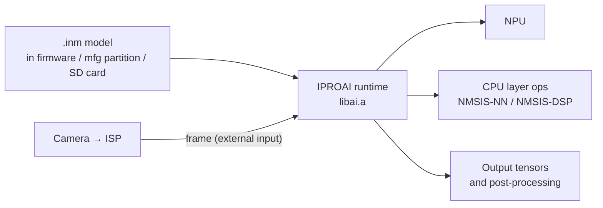

# AI & NPU

The IPRO7AI NPU runs `.inm` models through the IPROAI runtime (for how the chip differs from IPRO7, see [IPRO7AI](../hardware/chips/ipro7ai.md)). The SDK ships the runtime as a prebuilt library with public headers, together with example models and applications you can flash as they are; TensorFlow Lite Micro examples run `.tflite` models on the CPU. Get a reproducible result with a bundled model and its matching example before you swap in your own model.

!!! abstract "At a glance"
    - Included: the prebuilt runtime `components/ai/lib/libai.a` and its headers, example `.inm` and `.tflite` models, and the training scripts of `ipro7ai_evk_rps`.
    - Enable with `CONFIG_AI_SUPPORT=y`, and add `CONFIG_USE_PSRAM=y` yourself (it is not turned on for you).
    - Quickest try: `ipro7_uvc_cam` (`defconfig_reef_rps`) on the IPRO7AI Reef EVK; the IPRO7AI EVK has three NPU applications.
    - Not included: runtime source code, model conversion tools, IPRO AI Studio. Contact INTELPRO.

## Architecture { #architecture }



Each layer of a model runs on either the NPU or the CPU, as the model itself specifies; `iproai_getNetInfo()` reports the total and NPU layer counts. Do not assume that any model will run entirely on the NPU.

The SDK's inference paths are listed below. Their model formats are not interchangeable — renaming a file does not convert it:

| Path | Model format | How it runs | Examples |
|---|---|---|---|
| NPU (IPROAI) | `.inm` | `libai.a` loads the model and dispatches each layer to the NPU or the CPU | `ipro_npu_yolo`, the IPRO7AI EVK apps, `ipro_ai_link` |
| CPU | `.tflite` | TensorFlow Lite Micro with NMSIS-NN kernels | `ipro_tflm_test`, `ipro_tflm_yolo` |
| CPU | TinyMaix | TinyMaix INT8 | `ipro_tinymaix_demo` |

## Runtime and API { #iproai-framework }

```text title="components/ai/"
components/ai/
├── CMakeLists.txt        # links lib/libai.a directly
├── iproai_def.h
├── lib/libai.a           # prebuilt runtime
└── src/
    ├── core/include/iproai_core.h
    └── inst/include/     # NPU, CPU ops, post-processing; detect/, audio/
```

The package contains no runtime source, so an application's `.config` cannot change how `libai.a` was compiled. For a differently configured library, contact INTELPRO.

| Function (`iproai_core.h`) | Purpose |
|---|---|
| `iproai_create()` | Create a model instance |
| `iproai_load_model_from_buffer(hdl, buf)` | Load from memory (a model linked into the firmware, or the mfg partition read through XIP) |
| `iproai_load_model_from_file(hdl, "sd:/…")` | Read the whole `.inm` into PSRAM through FatFS, then load it |
| `iproai_getNetInfo(hdl)` | Input size, layer count, NPU layer count |
| `iproai_getInputBuffer(hdl)`, `iproai_getOutputBuffer(hdl, &size)` | Input and output buffers |
| `iproai_getInputResolution()`, `iproai_setSourceResolution()` | Model input size; source image size (for coordinate mapping) |
| `iproai_startCompute(hdl)` | Run inference (synchronous; returns when done) |
| `iproai_setResultCB()`, `iproai_setCustom_Postproc_CB()` | Result callback, custom post-processing callback |
| `iproai_free(hdl)` | Release the model |

Calls return `IPROAI_STATUS_NO_ERROR` on success. Call `iproai_npu_init()` (`iproai_inst_npu.h`) before first use. Post-processing headers are in `src/inst/include/detect/` (YOLOv8, YOLOv8 person/pet, gestures and more) and `src/inst/include/audio/` (speaker embedding, speaker recognition, fbank).

This flow follows `apps/test/ipro_ai_link/main.c`:

```c title="Load a model from the SD card and run it once"
#include <stdio.h>
#include "iproai_core.h"
#include "iproai_def.h"
#include "iproai_inst_npu.h"
#include "drv_glb.h"

static iproai_model_hdl_t s_hdl;

int model_run_once(void)
{
    /* Mount sd: with FatFS first (see ai_mount in ipro_ai_link) */
    GLB_PER_Clock_UnGate(GLB_AHB_CLOCK_MM);
    iproai_npu_init();

    s_hdl = iproai_create();
    if (s_hdl == NULL) {
        return -1;
    }
    if (iproai_load_model_from_file(s_hdl, "sd:/model.inm") != IPROAI_STATUS_NO_ERROR) {
        iproai_free(s_hdl);
        return -1;
    }

    struct iproai_net_info_t *net = iproai_getNetInfo(s_hdl);
    printf("layers %d, on NPU %d\r\n", net->layer_cnt, net->npu_layer_cnt);

    /* Prepare the input for this model (see below), then run */
    if (iproai_startCompute(s_hdl) != IPROAI_STATUS_NO_ERROR) {
        iproai_free(s_hdl);
        return -1;
    }

    uint32_t patch = 0;
    const uint8_t *out = iproai_getOutputBuffer(s_hdl, &patch);
    (void)out;
    return 0;
}
```

- **Input**: the bundled models that take camera frames (`person_pet_detect`, `rps_v3`) use the external input. The runtime reads from `imgBuffer + 4` (the first 4 bytes are a size header), and `NPU_Img_Ext_Addr_Cfg()` (`hal_npu.h`) sets the frame address. See `apps/test/ipro_npu_yolo/main.c`.
- **Output**: the size returned by `iproai_getOutputBuffer()` is the patch size, not the whole tensor. The NPU pads the channel count to a multiple of 4 (`BALI_CHN_ALIGN`, `iproai_inst_util.h`), so read the output with the padded stride.

## Configuration { #configuration }

```ini title=".config (AI application)"
CONFIG_AI_SUPPORT=y          # adds components/ai and links libai.a
CONFIG_USE_PSRAM=y           # required: models and intermediate tensors live in PSRAM
CONFIG_MM_SUPPORT=y          # applications that use the camera / ISP
CONFIG_AI_MODEL_FROM_FILE=y  # applications that load models from the SD card (also needs FatFS and the SD driver)
```

| Key | Notes |
|---|---|
| `CONFIG_AI_SUPPORT` | Adds the AI component. It also changes the linker's OCRAM layout; see [memory planning](#dev-guide) |
| `CONFIG_USE_PSRAM` | Set by every AI example. The build does not resolve dependencies, so it must be written in `.config` |
| `CONFIG_MM_SUPPORT` | Multimedia (camera, ISP). Together with `CONFIG_AI_SUPPORT` it shrinks the OCRAM region |
| `CONFIG_AI_MODEL_FROM_FILE` | Set by `ipro_ai_link`, `ipro_ai_bench` and `ipro7ai_evk_launcher`, which load models from the SD card |
| `CONFIG_RPS_EMBED_MODEL` | Application-specific: `ipro7ai_evk_rps` and `ipro7_uvc_cam`'s `defconfig_reef_rps` link `rps_v3.inm` into the firmware |

V2.1.0 always links the prebuilt `libai.a`; there is no option to build the runtime from source. Lines such as `CONFIG_AI_PREBUILT` left in some `.config` files have no effect on the library.

## Bundled models { #supported-models }

| Directory | Files | Used by |
|---|---|---|
| `apps/platform/ipro7_demo/demo/ai/ai_model/` | `person_detect.inm`, `person_pet_detect.inm`, `res2dnet.inm`, `mbv2.inm` | The AI demo in `ipro7_demo` (`defconfig_boot2`); `person_pet_detect.inm` is also the model of `ipro7ai_evk_person_detect` and the launcher's detection page |
| `apps/test/ipro_npu_yolo/src/` | `person_pet_detect.inm` | NPU timing with the model linked in |
| `apps/ai/ipro7ai_evk_rps/model/` | `rps_v3.inm` (default), `rps_v1.inm`, plus the pre-conversion `*_int8.tflite` and `*_numbers.json` | 4-class int8 rock-paper-scissors classifier; the launcher's gestures; `ipro7_uvc_cam`'s `defconfig_reef_rps` |
| `apps/test/ipro_tflm_test/src/` | `hello_world.tflite`, `person_detect.tflite`, `micro_speech.tflite`, `keyword_scrambled.tflite` | TensorFlow Lite Micro (CPU) |
| `apps/test/ipro_tflm_yolo/src/` | `yolov8_person_pet.tflite` | The same YOLOv8 as `ipro_npu_yolo`, run on the CPU |
| `apps/test/ipro_ai_bench/src/bench_models.S` | 8 built-in models (for example `movenet_192`, `nanodet_320`, `retinaface_320`) | Whole-model timing |

## Deploying a model { #model-pipeline }

| Where the model lives | How | Examples |
|---|---|---|
| Linked into the firmware | An assembly file pulls the `.inm` into the image with `.incbin`; load it with `iproai_load_model_from_buffer()` | `ipro_npu_yolo` (`src/model_inm.S`), `ipro7ai_evk_rps` (`src/model_blob.S`) |
| mfg partition | The model sits in the `mfg` partition (at partition start + 0x1000) and is read through XIP at boot; flash it with IntelProCube's `--mfg` | `ipro7ai_evk_person_detect`, `ipro7ai_evk_launcher` (gesture model) |
| SD card | `iproai_load_model_from_file()` reads it through FatFS; use `sd:/` paths, not `/sdcard/` | `ipro_ai_link`, `ipro_ai_bench`, `ipro7ai_evk_launcher` (its detection page needs `sd:/models/person.inm`) |

The IPRO7AI EVK has only 1 MB of flash, so a model cannot share the firmware partition. The EVK applications therefore bring their own partition table (for example `partition_cfg_1M_person_lcd.toml`: FW at 0x3000, 320 KB; `mfg` at 0x53000, 688 KB) and a `flash.sh`:

```bash
cd apps/ai/ipro7ai_evk_person_detect
PORT=/dev/cu.usbserial-XXXX ./flash.sh --full    # first time: partition table + firmware + model
PORT=/dev/cu.usbserial-XXXX ./flash.sh --model   # swap the model only
```

`flash.sh` drives the IntelProCube command-line tool (`IPRO_FLASH_TOOL`, or found on `PATH`) and always passes the partition table; without it the tool writes its default table, which has no `mfg` entry. For EVK flashing settings see [IPRO7AI EVK](../hardware/boards/ipro7ai-evk.md) and [Flashing & Serial Console](../get-started/flash-and-monitor.md).

**Your own models**: model conversion tools are not included in V2.1.0; contact INTELPRO. The only training scripts in the package are in `ipro7ai_evk_rps/train/` (Keras, int8 `.tflite` export). Before deploying, check operator support, tensor shapes, quantization parameters and memory needs.

## Example applications { #reference-apps }

| Application | Board | What it does |
|---|---|---|
| `apps/multimedia/ipro7_uvc_cam` (`defconfig_reef_rps`) | IPRO7AI Reef EVK | USB webcam with an NPU rock-paper-scissors game drawn into the stream |
| `apps/test/ipro_ai_link` (`defconfig_reef`) | Reef; the default `.config` is the IPRO7 EVB | Board firmware for IPRO AI Studio "Run on board" |
| `apps/ai/ipro7ai_evk_person_detect` | IPRO7AI EVK | Camera preview on the LCD with YOLOv8 person/pet boxes |
| `apps/ai/ipro7ai_evk_rps` | IPRO7AI EVK | Rock-paper-scissors against a 4-class CNN on the NPU; model and training scripts included |
| `apps/platform/ipro7ai_evk_launcher` | IPRO7AI EVK | Camera, LCD, microphone and speaker in one image; hand gestures switch pages, and a second model detects people and pets |
| `apps/test/ipro_npu_yolo` | IPRO7 EVB | YOLOv8 NPU timing (`npu_run [iters]`) |
| `apps/test/ipro_ai_bench` | IPRO7 EVB | Whole-model timing of the built-in models |
| `apps/test/ipro_tflm_test`, `ipro_tflm_yolo` | IPRO7 EVB | TensorFlow Lite Micro (CPU) |
| `apps/test/ipro_nmsis_nn_test` | IPRO7 EVB | NMSIS-NN operator tests |
| `apps/test/ipro_tinymaix_demo` | IPRO7 EVB | TinyMaix INT8 MNIST |
| `apps/platform/ipro7_demo` (`defconfig_boot2`) | IPRO7 EVB | The AI demo is enabled only in this configuration |

### Try it on the IPRO7AI Reef EVK

<div class="ipro-steps" markdown>

1. **Build**

    ```bash
    make -C apps/multimedia/ipro7_uvc_cam DEFCONFIG=defconfig_reef_rps
    ```

    Output: `apps/multimedia/ipro7_uvc_cam/build_reef_rps/build_out/ipro7_uvc_cam_IPRO7.bin`

2. **Flash** the file as described in [Flashing & Serial Console](../get-started/flash-and-monitor.md#flashing), using the Reef settings (`--chip-variant IPRO7AI`).

3. **Run**: connect the Reef's USB-C port (USB1) to a computer and open it in any UVC camera app. Put your hand in the box in the middle of the picture and throw after the countdown. The console is on U6 at 115200 baud.

</div>

### IPRO AI Studio board firmware (ipro_ai_link) { #ai-link }

Flash `ipro_ai_link` once; after that the host swaps models and inputs, runs inference and collects results by command, with no reflashing. Models and inputs are read from the SD card (`sd:/`), and raw outputs go back to the host over USB. Output lines carry prefixes such as `AIINFO`, `AIRUN` and `AIOUT` so the host can parse them. IPRO AI Studio itself is not included in V2.1.0; contact INTELPRO.

```bash
make -C apps/test/ipro_ai_link DEFCONFIG=defconfig_reef   # output in build_reef/build_out/
```

| Command | Purpose |
|---|---|
| `ai_mount` / `ai_unmount` | Mount / release the SD card |
| `ai_ls [dir]` | List files |
| `ai_load sd:/model.inm` | Load a model |
| `ai_input sd:/input.bin` | Load input data |
| `ai_run [reps]` | Run inference |
| `ai_out [max_bytes]` | Dump the output |
| `ai_info` | Model information (layers, NPU layers, input and output sizes) |
| `ai_prof` | Per-layer cycles of the last run |

## Integration and memory planning { #dev-guide }

**OCRAM**: with both `CONFIG_AI_SUPPORT` and `CONFIG_MM_SUPPORT` enabled, the linker shrinks the OCRAM region to 64 KB (`CONFIG_EM_SIZE` 0) or 48 KB (with BLE); every combination is listed in [Build System & Configuration](build-system.md#memory-layout). The `ipro7ai_evk_demo` README notes that the BLE controller and host need about 67 KB of OCRAM, which is why the IPRO7AI EVK examples keep AI and BLE in separate configurations. If you need both, check the linker output of an actual build first.

**PSRAM**: models, intermediate tensors and camera frames are allocated from PSRAM. Budget for weights, intermediate tensors, input images, post-processing and your other tasks, and measure the free heap (`xPortGetFreeHeapSize()`) before and after loading and during continuous inference. Usage varies widely between models; do not estimate it from a fixed ratio.

**Camera to NPU**: hand the NPU one frame at a time so the ISP cannot overwrite a buffer that is being inferred. The IPRO7AI EVK does this in `components/board/ipro7ai_evk` (`evk_cam`) and `ipro7ai_evk_person_detect`. Keep an external image buffer valid until inference finishes, and keep the caches coherent.

**Error handling**: check the return values of `iproai_create()`, the load call and `iproai_startCompute()`, and on failure release the model with `iproai_free()` and free your own buffers.

**Floating point**: in V2.1.0 the IPRO7 FreeRTOS port saves the floating-point registers on task switches and interrupts, so tasks running beside the NPU task may use floating point. Some example source comments still ask for integer-only code; that was a limit of the older port.

## Benchmarking { #performance }

| Tool | Commands | What it measures |
|---|---|---|
| `ipro_ai_bench` | `bench_list`, `bench_run <name>`, `bench_all`; `bench_file <path> <w> <h> <c>` (model on a mounted SD card) | Whole-model time of the built-in models (median of 5 runs), with NPU and CPU cycles and dispatch counts listed separately; the input comes from an on-board PRNG |
| `ipro_npu_yolo` | `npu_run [iters]` | YOLOv8 inference cycles on the NPU |
| `ipro_tflm_yolo` | `yolo_run [iters]` | The same YOLOv8 on the CPU (TFLM) |
| `ipro_ai_link` | `ai_run [reps]`, `ai_prof` | Inference time and per-layer cycles of your own model |

Record the model file, input size, build configuration, heap usage and repeated inference times, and measure pre-processing, inference and post-processing separately. The first run includes the cold-start cost of PSRAM and the caches, so use the runs after it.

Measurements stated in the package READMEs (IPRO7AI EVK, 2026-09-18):

| Model | Input | NPU inference | Other | Source |
|---|---|---|---|---|
| `person_pet_detect.inm` (YOLOv8 person/pet, 700,088 bytes) | 640×360 ARGB | 103 ms | Box decode + NMS 16 ms; detection at 5.9 fps | `ipro7ai_evk_person_detect` README |
| `rps_v3.inm` (4-class CNN, 11 layers, all on the NPU) | 128×128×3 int8 | 7 ms | 14.9 fps with one frame in flight | `ipro7ai_evk_rps` README |

Detection thresholds, NMS limits and input formats are example settings, not NPU specifications. After changing the model or the resolution, check output correctness, peak memory and long-run stability again.

## Cloud AI { #cloud-llm }

V2.1.0 has no general-purpose cloud AI client component. The bundled cloud voice example is `apps/multimedia/ipro_agora_sentino`: the IPRO7AI Reef EVK joins Wi-Fi through the IPRO6S FIN card, is provisioned over BLE, and holds voice conversations through the Sentino platform (MQTT) and Agora RTC. Running it needs a Sentino device triple and the FIN card firmware, neither of which is included in V2.1.0 (contact INTELPRO); building it also needs the AOSL submodule (see the application README). For network setup see [Networking](networking.md).

## Limitations in this release { #limitations }

- The runtime ships only as the prebuilt `libai.a`, without source, and its internal options cannot be changed from `.config`.
- Model conversion tools and IPRO AI Studio are not included in V2.1.0; contact INTELPRO.
- There is no NPU driver under Zephyr RTOS; all AI examples are FreeRTOS applications. See [Zephyr RTOS](zephyr.md).
- With AI, multimedia and BLE enabled together, the OCRAM region is only 48 KB; see [memory planning](#dev-guide).

## Related documents { #related }

- [Camera & Imaging](camera.md): the ISP and camera pipeline.
- [Build System & Configuration](build-system.md): `.config` and `DEFCONFIG=`.
- [IPRO7AI EVK](../hardware/boards/ipro7ai-evk.md), [IPRO7AI Reef EVK](../hardware/boards/reef-evk.md): boards and flashing settings.
