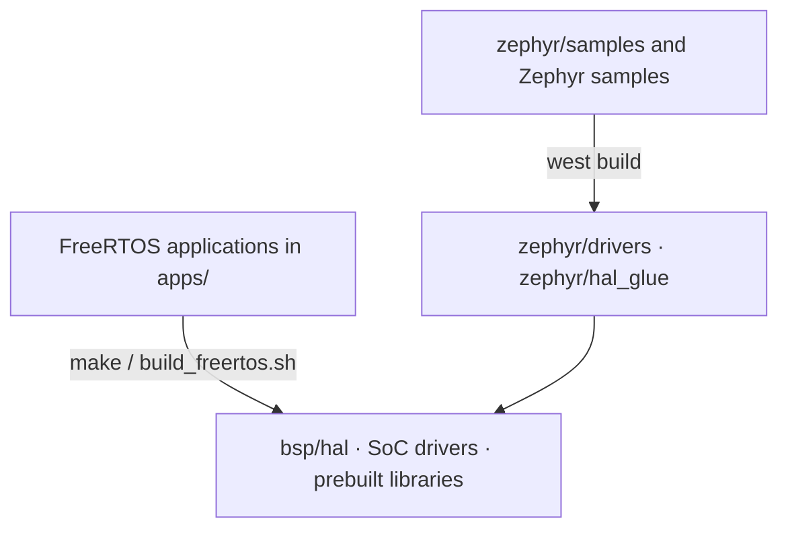

# Architecture

One source tree serves two chips and two RTOSes: 40 FreeRTOS applications under `apps/` (37 for IPRO7 and IPRO7AI, 3 for IPRO6S), and a Zephyr v4.4.0 module for IPRO7. Both paths share the HAL, the SoC drivers and the prebuilt libraries. The build flow and memory layout are in [Build System & Configuration](build-system.md).

!!! abstract "At a glance"
    - Layers: applications (`apps/`) → components (`components/`) → RTOS (FreeRTOS V11.1.0 or Zephyr v4.4.0) → BSP (`bsp/`) → chip.
    - IPRO7 and IPRO7AI: RISC-V RV32IMAFC with DSP extensions, BLE 5.4 with LE Audio, IEEE 802.15.4; IPRO7AI adds the NPU and ISP. Networking is Ethernet (RMII) or Wi-Fi through an IPRO6S over SDIO; on the IPRO7AI Reef EVK the IPRO6S is the FIN card in the microSD slot.
    - IPRO6S: the same core with on-chip Wi-Fi 6, FreeRTOS only.
    - The BLE controller, RF drivers, Wi-Fi 6 MAC, low-power framework, AI inference runtime, ISP algorithms and LC3 codec ship as prebuilt libraries; everything else is source.
    - Every example on this site runs on the IPRO7AI Reef EVK; other INTELPRO boards are named where an application needs one.

## System overview { #overview }

<div class="ipro-stack">
  <div class="l-app"><strong>Applications apps/</strong><span>ai · bluetooth · multimedia · platform · test</span></div>
  <div class="l-host"><strong>Components components/</strong><span>BLE host · lwIP · mbedTLS · CherryUSB · audio · ai · fs · shell</span></div>
  <div class="l-hci"><strong>RTOS</strong><span>FreeRTOS V11.1.0 · Zephyr v4.4.0 (module, IPRO7)</span></div>
  <div class="l-ctlr"><strong>BSP bsp/</strong><span>HAL · SoC drivers · board configuration · linker scripts</span></div>
  <div style="--layer: #64748b"><strong>Chip</strong><span>IPRO7 / IPRO7AI: BLE 5.4 · 802.15.4 · ISP · NPU — IPRO6S: Wi-Fi 6</span></div>
</div>

| Layer | Location | Role |
|---|---|---|
| Applications | `apps/<category>/<app>/` | Each application has its own `.config`, `CMakeLists.txt` and `Makefile` and builds on its own |
| Components | `components/` | Middleware and libraries, pulled into the build by the `CONFIG_*` keys in the application's `.config` |
| RTOS | `components/os/`, `zephyr/` | FreeRTOS scheduling, queues and timers plus the shared `freertos_app_hooks`; or the Zephyr kernel |
| BSP | `bsp/` | HAL API, registers and SoC drivers, board headers, linker script generator |

Prebuilt libraries ship with their public headers and are linked automatically; nothing has to be configured to use them. Debug information is stripped but symbol names are kept, so map files and `nm` still work.

## FreeRTOS and Zephyr { #rtos-paths }



| | FreeRTOS | Zephyr |
|---|---|---|
| Applications and samples | 40 applications under `apps/` | SDK samples in `zephyr/samples/` and upstream Zephyr samples; driver tests in `zephyr/tests/` |
| Build | `make -C apps/<category>/<app>` or `./build_freertos.sh` | Create a workspace with `tools/zephyr/bootstrap.sh`, then `west build` |
| Chips | IPRO7, IPRO7AI, IPRO6S | IPRO7, IPRO7AI |
| Boards | IPRO7AI Reef EVK (11 configurations in 9 applications) and other INTELPRO boards | `ipro7_evb`, `ipro7ai_evk`; no Reef board in this release |
| BLE | Zephyr v4.4 host running on FreeRTOS through a port layer, with the IPRO BLE controller (prebuilt library) | Zephyr's host with the same controller archives |
| IEEE 802.15.4 / Thread | Not provided | Zephyr IEEE 802.15.4 driver and OpenThread |
| Low power, camera, audio codec, USB, SD host, Ethernet, NPU | Provided | Not yet |
| Console | Per application, `CONFIG_PLATFORM_UART_BAUDRATE`; 115200 when unset | UART0 at 2,000,000 baud |

On the Reef, and for any product that needs low power, the camera, audio or the NPU, use the FreeRTOS path. Zephyr boards, samples and flashing are covered in [Zephyr RTOS](zephyr.md).

## Components { #components }

All paths below are under `components/`.

| Area | Path | Contents |
|---|---|---|
| Bluetooth | `wireless/bluetooth/ipro_bt_host/` | BLE host, port of Zephyr v4.4.0 (source) |
| | `wireless/bluetooth/ipro_ble_controller/` | IPRO7 BLE controller (prebuilt library) |
| Radio | `wireless/rf/ipro7_rf/`, `wireless/rf/ipro6_rf/` | IPRO7 and IPRO6S RF drivers (prebuilt libraries) |
| | `wireless/ieee802154/` | IEEE 802.15.4 MAC for Zephyr (prebuilt library) |
| Wi-Fi 6 (IPRO6S) | `wireless/macsw/`, `wireless/wifi6/` | MAC, fhost API, wpa_supplicant and lwIP adapter (prebuilt libraries) |
| Networking | `network/lwip/` | lwIP 2.1.2 |
| | `network/ipronet_host/` | IPRO7 side of Wi-Fi through an IPRO6S over SDIO (netif `iproeth0`); used with the Reef's FIN card |
| | `network/rtsp_server/` | RTSP MJPEG video streaming |
| Security | `crypto/mbedtls/` | mbedTLS 2.28.2 |
| OS | `os/freertos/` | FreeRTOS V11.1.0 kernel and shared hooks (`freertos_app_hooks`) |
| | `os/freertos_posix/`, `os/ipro_osal/` | POSIX layer, OS abstraction layer |
| System services | `sys/shell/`, `sys/ipro_event/`, `sys/ipro_pm/`, `sys/usb_console/` | Shell, event framework, power management, USB console |
| | `utils/` | Logging (`ipro_log.h`) and shared utilities |
| Audio | `audio/` | Audio capture and output (DAC, I2S, UAC), resampling, speaker EQ, MP3 decoding |
| AI | `ai/` | NPU inference runtime (`lib/libai.a` and headers) |
| Imaging | `isp_firmware/`, `isp_algorithm/`, `isp_iq_param/`, `isp_iq_cmd/` | ISP control, ISP algorithms (prebuilt), IQ parameters |
| | `sensor/` | Camera sensor drivers |
| Board library | `board/ipro7ai_evk/` | Library for the IPRO7AI EVK (another INTELPRO board); not used on the Reef |
| USB | `cherryusb/` | USB device classes: CDC, CDC-ECM, HID, MSC, UAC, UVC |
| File systems | `fs/` | FatFS, LittleFS, EasyFlash4, EVFS, ROMFS |
| Third party | `3rdparty/` | LC3 (prebuilt), SBC, Opus, minimp3, TensorFlow Lite Micro, NMSIS-NN, TinyMaix, cJSON, xz, zmodem, Agora RTC SDK (prebuilt) and more |

How IPRO7 reaches a network, and the IPRO6S applications on the other end of the SDIO link, are in [Networking](networking.md).

## Directory layout { #directory }

```text
IPRO-SDK-V2.2.1/
├── apps/                    FreeRTOS applications (40)
│   ├── ai/                  NPU and Edge AI applications
│   ├── bluetooth/ble/       BLE examples
│   ├── bluetooth/le_audio/  LE Audio headset
│   ├── multimedia/          USB webcam, JPEG decoding, PDM recording, cloud voice
│   ├── platform/            chip and board references, IPRO6S Wi-Fi; common/ holds shared OTA code
│   ├── test/                driver tests, hardware bring-up and benchmarks (19)
│   └── turnkey/common/      shared USB console code
├── bsp/                     HAL, SoC drivers (ipro7_soc, ipro6_soc), board configuration, linker scripts
├── components/              middleware and libraries
├── cmake/                   toolchain detection, build macros, autoconf.h generator
├── tools/                   serial_monitor.py, create_ota.py, teach_web/, zephyr/ scripts, bundled CMake, Android example app source
├── zephyr/                  Zephyr module: boards, soc, dts, drivers, samples, tests
├── build_freertos.sh        front end for FreeRTOS build, flash and monitor
├── project.build            build driver called by every application Makefile
├── west.yml                 Zephyr west manifest
├── CMakeLists.txt
├── Kconfig
└── VERSION.txt
```

Run `./build_freertos.sh -l` for the full list of applications, or see [Examples](../examples/index.md).

## BLE stack { #ble-stack }

<div class="ipro-stack">
  <div class="l-app"><strong>Application</strong><span>Zephyr bt_* API</span></div>
  <div class="l-host"><strong>BLE host (Zephyr v4.4.0)</strong><span>ipro_bt_host: GAP · GATT · L2CAP · SMP · ISO · LE Audio</span></div>
  <div class="l-hci"><strong>On-chip HCI</strong><span>in-memory byte stream (ipro_ble_ctlr_hcitl)</span></div>
  <div class="l-ctlr"><strong>IPRO BLE controller (prebuilt library)</strong><span>ipro_ble_controller/lib/ · RF driver ipro7_rf</span></div>
</div>

The host ships as source and runs on FreeRTOS through the `ipro_bt_host/port/` layer; there is no UART HCI between the host and the controller. Three `.config` keys pick one of 16 IPRO7 controller archives to link. The IPRO6S Bluetooth controller is not part of this release; the IPRO6S applications are Wi-Fi only. Archive selection, bring-up order and API usage are in [BLE Development](ble.md).

## BSP and drivers { #bsp }

| Path | Contents |
|---|---|
| `bsp/hal/` | HAL API (`inc/hal_*.h`, `src/hal_*.c`) |
| `bsp/hal/lp_framework/` | Low-power framework: IPRO7 PDS (prebuilt `liblp_framework.a`), IPRO6S low-power firmware image |
| `bsp/drivers/ipro7_soc/` | Register definitions, startup code (`startup/`), standard drivers (`std_drv/`), prebuilt NMSIS-DSP libraries (`DSP/`) |
| `bsp/drivers/ipro6_soc/` | IPRO6S SoC drivers |
| `bsp/drivers/soc_common/` | Drivers shared across chips |
| `bsp/board/ipro7/` | Board headers and `board.c`; `board_config.h` picks the header from the board key, `ipro7ai_reef_board_config.h` for `CONFIG_IPRO7AI_REEF` (see [Board keys](build-system.md#board-keys)) |
| `bsp/board/ipro6/` | IPRO6S board files |
| `bsp/board/linker/` | Linker script generator (template and `configs/ipro7_flash.cmake`) |
| `bsp/common/platform_utils/` | Platform init, console UART baud rate |

Peripherals covered by the HAL:

| Area | HAL |
|---|---|
| Communication | UART, SPI, I2C, I2S, SDIO |
| Storage | SPI flash, PSRAM, SD host (SDH), PIO software SD host |
| Analog and timing | ADC, DAC, AUADC (audio ADC), analog comparator, PWM, timer, RTC, watchdog |
| Input | GPIO, QDEC, keyscan |
| Imaging and AI | DVP camera, ISP, MJPEG encoding, NPU |
| Networking | EMAC Ethernet, lwIP netif, Ethernet PHY |
| Security | AES, SHA, ECDSA, P-256, GMAC, TRNG |
| System | DMA, clocks, power management, boot2 partition table |

Reef pin assignments, the speaker enable and similar definitions are in `bsp/board/ipro7/ipro7ai_reef_board_config.h` as `BOARD_*` macros; the board's pinout is on the [IPRO7AI Reef EVK](../hardware/boards/reef-evk.md#pinout) page and the chip's pin functions in [Pinout & Peripheral Mapping](../hardware/pinmux.md).

## Hands-on on the Reef { #hands-on }

See the layers meet in the out-of-box firmware `ipro7ai_reef_demo`: its `.config` chooses the RTOS and components, its `main.c` calls the shared platform init and the board header, and the FreeRTOS shell shows the result at run time.

<div class="ipro-steps" markdown>

1. **The configuration picks the layers.** These lines of the shipped `.config` select the chip, the board header, FreeRTOS and the shell:

    ```ini title="apps/platform/ipro7ai_reef_demo/.config (excerpt)"
    CONFIG_IPRO7=y
    CONFIG_CHIP="IPRO7"
    CONFIG_IPRO7AI_REEF=y
    CONFIG_BOARD="IPRO7AI_REEF"
    CONFIG_USE_PSRAM=y
    CONFIG_PLATFORM_UART_BAUDRATE=115200
    CONFIG_FREERTOS_SUPPORT=y
    CONFIG_COMPONENTS_FREERTOS_ENABLE=y
    CONFIG_SHELL=y
    CONFIG_IPRO_LOG_ENABLE=y
    ```

2. **`main()` touches each layer once.** `ipro_platform_init()` comes from `components/os/freertos/freertos_app_hooks`, the `BOARD_*` pins from the Reef board header in `bsp/board/ipro7/`, and the task from FreeRTOS:

    ```c title="apps/platform/ipro7ai_reef_demo/main.c (excerpt)"
    int main(void)
    {
        static StackType_t  s_app_stack[2048];
        static StaticTask_t s_app_tcb;

        ipro_platform_init();   /* heap + boot2 + log + shell */
        ...
        IPRO_LOGI(LOG_TAG, "  IPRO7AI Reef carrier demo");
        IPRO_LOGI(LOG_TAG, "  UART0 TX=%d RX=%d  RGB=G%d  SPK_EN=G%d(hi)",
                  BOARD_UART_TX_PIN, BOARD_UART_RX_PIN, BOARD_RGB_LED_PIN, BOARD_SPK_EN_PIN);
        ...
        xTaskCreateStatic(app_task, "evk_app",
                          sizeof(s_app_stack) / sizeof(StackType_t), NULL,
                          configMAX_PRIORITIES - 2,
                          s_app_stack, &s_app_tcb);
        vTaskStartScheduler();
        ...
    }
    ```

3. **Build it.**

    ```bash
    make -C apps/platform/ipro7ai_reef_demo
    ```

    The linker map `apps/platform/ipro7ai_reef_demo/build/build_out/ipro7ai_reef_demo_IPRO7.map` lists every component archive that went into the image.

4. **Flash it** and open the console at 115200 baud, as in [Flashing & Serial Console](../get-started/flash-and-monitor.md).

5. **Look at the running system.** The banner prints the pins from the board header (log prefixes left out):

    ```text
      IPRO7AI Reef carrier demo
      UART0 TX=20 RX=21  RGB=G24  SPK_EN=G25(hi)
    ```

    Then type `free` and `ps`, two FreeRTOS commands of the shell in `components/sys/shell`:

    ```text
    Heap: total <bytes>, free <bytes>, min free <bytes>

    Task             State  Prio  Stack   #   CPU%
    ---------------------------------------------------
    ```

    The task list includes `evk_app`, the application task created in `main()`. `help` lists every command the image registered.

</div>

Next: build the same structure yourself in [Create Your First Application](../tutorials/first-own-app.md), then check it with [Test Your Application](../tutorials/testing.md).

## Related documents { #related }

- [Build System & Configuration](build-system.md): build flow, `.config`, memory layout, new applications
- [BLE Development](ble.md): archive selection, bring-up order, GATT example
- [Networking](networking.md): Ethernet, lwIP, Wi-Fi through an IPRO6S over SDIO
- [Zephyr RTOS](zephyr.md): Zephyr boards, samples and flashing
- [IPRO7AI Reef EVK](../hardware/boards/reef-evk.md): the board every example uses
- [IPRO7](../hardware/chips/ipro7.md), [IPRO7AI](../hardware/chips/ipro7ai.md), [IPRO6S](../hardware/chips/ipro6s.md): chip specifications
