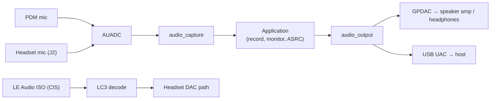
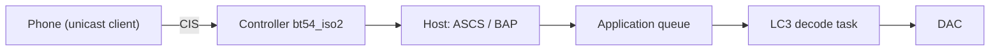

# Audio & LE Audio

IPRO7 has an audio ADC (AUADC) for analog and PDM microphones, a 10-bit DAC (GPDAC) and I2S. The SDK puts a capture and an output framework on top of them in `components/audio`, adds LC3 and other codecs, USB audio through CherryUSB, and the LE Audio profiles of the BLE host. On the IPRO7AI Reef EVK the out-of-box firmware `ipro7ai_reef_demo` drives every audio block from the shell, and its `src/audio.c` is the reference code for this page.

!!! abstract "At a glance"
    - Reef audio: PDM microphone, headset microphone on jack J2, speaker amplifier and headphone output from the GPDAC. `ipro7ai_reef_demo` records, plays, monitors, records WAV files to the SD card (`mic sdrec`) and turns the board into a USB microphone (`mic usb`).
    - Configuration: `CONFIG_AUDIO_CAPTURE=y`, `CONFIG_AUDIO_OUTPUT=y`, `CONFIG_DMA_CHANNEL_ALLOCATOR=y`; add `CONFIG_CHERRYUSB_DEVICE_AUDIO=y` for USB audio.
    - LE Audio: unicast headset `ipro_le_audio_headset` (`defconfig_reef`), controller `bt54_iso2` with `CONFIG_EM_SIZE=32`, LC3 as a prebuilt library. Its README lists audio playback from a phone as not yet validated.
    - Not included in V2.3.0: a FreeRTOS LE Audio broadcast example and a USB-to-BLE audio bridge.

## Architecture { #overview }



| Part | Location | Description |
|---|---|---|
| Audio HAL | `bsp/hal/inc/hal_auadc.h`, `hal_dac.h`, `hal_i2s.h` | Audio ADC, DAC, I2S |
| Capture | `components/audio/include/audio_capture.h` | Analog microphone (`AUDIO_SRC_AMIC`), PDM microphone (`AUDIO_SRC_DMIC`) or I2S (`AUDIO_SRC_I2S`) to 16-bit mono PCM frames; several consumers each read their own copy |
| Output | `components/audio/include/audio_output.h` | One API for `AUDIO_OUTPUT_DAC`, `AUDIO_OUTPUT_UAC`, `AUDIO_OUTPUT_I2S` and `AUDIO_OUTPUT_DUMP` |
| Processing | `audio_resampler.h`, `audio_asrc.h`, `audio_speaker_eq.h`, `audio_bass_boost.h`, `mp3_decoder.h` | Resampling, clock-drift resampler with level controller, speaker EQ, bass boost, MP3 decoding |
| Codecs | `components/3rdparty/liblc3` (prebuilt), `libsbc`, `opus`, `minimp3` | LC3 serves LE Audio |
| LE Audio | `components/wireless/bluetooth/ipro_bt_host/upstream/zephyr/subsys/bluetooth/audio/` | Zephyr v4.4.0 LE Audio profile sources |
| USB audio | `components/cherryusb/class/audio/` | USB Audio Class device |

## Audio hardware { #audio-hardware }

The audio blocks of the IPRO7AI Reef EVK V4.0 and the board-header names that code uses for them (`bsp/board/ipro7/ipro7ai_reef_board_config.h`):

| Block | Pins | Board header |
|---|---|---|
| PDM microphone MK1 | CLK GPIO16, DATA GPIO17, left slot | `BOARD_MIC_CLK_PIN`, `BOARD_MIC_DAT_PIN`, `BOARD_MIC_PDM_CHANNEL` |
| Headset microphone (jack J2) | AIN7 (GPIO13) +, AIN6 (GPIO12) −, differential | `BOARD_HSMIC_POS_CH`, `BOARD_HSMIC_NEG_CH` |
| GPDAC output | DAC channel A, GPIO23; feeds the headphone stage (J2) and the speaker amplifier at the same time | `BOARD_SPK_DAC_PIN` |
| Speaker amplifier PAM8302A (J_SPK) | Enable GPIO25, high = on | `BOARD_SPK_EN_PIN`, `BOARD_SPK_EN_ACTIVE` (1) |
| Headset plug detect | GPIO26, low = plug inserted | `BOARD_HP_DET_PIN`, `BOARD_HP_DET_ACTIVE` (0) |

- The headphone jack always gets the DAC signal. "Headphones only" means keeping the speaker amplifier off; there is no other routing switch.
- The PDM path does not run at exactly 16,000 Hz: nominally 15,875 Hz (2.032 MHz / 128), measured at about 15,872 Hz on a Reef. `mic sdrec` writes the measured rate into the WAV header, and `mic usb` converts to the host's 16,000 Hz with `audio_asrc`.
- The DAC backend of `audio_output` runs at a fixed 32 kHz (`DAC_RATE` in `audio_capture.h`); other sample rates are resampled.
- The amplifier gain is high (30 V/V in the demo README); the demo plays tones at 20 % amplitude by default.
- Set `CONFIG_DMA_CHANNEL_ALLOCATOR=y` so capture, playback and the USB isochronous endpoint get DMA channels at run time without clashing.

Jack type, connector and the full pin map are on the [IPRO7AI Reef EVK](../hardware/boards/reef-evk.md) page. The IPRO7 EVB and the IPRO7AI EVK have their own audio examples (`ipro_pdm_mic_demo`, `ipro7ai_evk_demo`); see their board pages.

## Audio framework { #audio-framework }

```ini title=".config (audio, from apps/platform/ipro7ai_reef_demo/.config)"
CONFIG_AUDIO_OUTPUT=y
CONFIG_AUDIO_CAPTURE=y
CONFIG_DMA_CHANNEL_ALLOCATOR=y
# USB microphone through the audio_output UAC backend
CONFIG_COMPONENTS_CHERRYUSB_ENABLE=y
CONFIG_CHERRYUSB_DEVICE=y
CONFIG_CHERRYUSB_DEVICE_AUDIO=y
```

| Key | Effect |
|---|---|
| `CONFIG_AUDIO_CAPTURE` | Builds `audio_capture.c` and the PDM microphone chain `audio_pdm_mic.c` |
| `CONFIG_AUDIO_OUTPUT` | Builds `audio_output.c` with the DAC and dump backends |
| `CONFIG_CHERRYUSB_DEVICE_AUDIO` | With `CONFIG_AUDIO_OUTPUT`, also builds the UAC backend `audio_output_uac.c` |
| `CONFIG_AUDIO_OUTPUT_UAC_EXCLUDE` | Leaves the UAC backend out, for an application that implements its own USB audio device (both would define the `usbd_audio_*` callbacks) |
| `CONFIG_BSP_USING_I2S0` | With `CONFIG_AUDIO_OUTPUT`, builds the I2S backend |

The resampler, the clock-drift resampler (`audio_asrc`), the speaker EQ and bass boost are always built.

How the pieces are used:

- `audio_capture_init()` takes an `audio_capture_cfg_t` (source type, sample rate, frame size, and the PDM or analog settings), `audio_capture_add_consumer()` returns a consumer id with its own buffer, `audio_capture_start()` starts the DMA, and `audio_capture_read(id, buf, bytes, timeout_ms)` returns PCM.
- `audio_output_create()` takes an `audio_output_cfg_t`. In `AUDIO_OUTPUT_MODE_STREAMING` the output plays continuously from a cyclic DMA ring and `audio_output_write(out, pcm, samples)` blocks only briefly when the ring is full; `AUDIO_OUTPUT_MODE_ONESHOT` blocks until the whole buffer has played. The third argument of `audio_output_write()` counts samples per channel, not bytes.
- For the DAC backend, pass the amplifier enable pin and its active level (`dac_spk_gpio`, `dac_spk_en_active`); `audio_output_start()` switches the amplifier on.

## Hands-on on the Reef { #hands-on }

Record three seconds from the PDM microphone, play them back on the headphones, then record a WAV file to the SD card and use the board as a USB microphone. Everything runs in `ipro7ai_reef_demo`; the excerpts show the code you reuse in your own application.

<div class="ipro-steps" markdown>

1. **Configuration**

    The audio lines of the demo's `.config` (shown under [Audio framework](#audio-framework)) are all an application needs, together with the Reef board lines:

    ```ini title="apps/platform/ipro7ai_reef_demo/.config (excerpt)"
    CONFIG_IPRO7AI_REEF=y
    CONFIG_BOARD="IPRO7AI_REEF"
    CONFIG_USE_PSRAM=y
    CONFIG_AUDIO_OUTPUT=y
    CONFIG_AUDIO_CAPTURE=y
    CONFIG_DMA_CHANNEL_ALLOCATOR=y
    ```

2. **Code**

    Opening the PDM microphone and the DAC output. The pin and level macros come from the Reef board header:

    ```c title="apps/platform/ipro7ai_reef_demo/src/audio.c (excerpt)"
    static audio_output_t *sink_open(uint32_t rate, audio_route_t route)
    {
        audio_output_cfg_t cfg = {
            .type             = AUDIO_OUTPUT_DAC,
            .mode             = AUDIO_OUTPUT_MODE_STREAMING,
            .sample_rate      = rate,
            .channels         = 1,
            .dac_spk_gpio     = BOARD_SPK_EN_PIN,
            .dac_spk_en_active = BOARD_SPK_EN_ACTIVE ? 1 : -1,
        };
        audio_output_t *out = audio_output_create(&cfg);

        if (!out) {
            IPRO_LOGE(LOG_TAG, "audio_output_create failed");
            return NULL;
        }
        if (audio_output_start(out) != 0) {
            IPRO_LOGE(LOG_TAG, "audio_output_start failed");
            audio_output_destroy(out);
            return NULL;
        }
        /* start() switched the amplifier on; the route decides whether it stays. */
        route_apply(route);
        return out;
    }

    static int capture_open(audio_in_t src, uint32_t consumer_bytes, int *consumer)
    {
        audio_capture_cfg_t cfg = {
            .sample_rate   = AUDIO_RATE_HZ,          /* 16000 */
            .frame_samples = AUDIO_FRAME_SAMPLES,    /* 320 = 20 ms */
        };

        switch (src) {
        case AUDIO_IN_PDM:
            cfg.type = AUDIO_SRC_DMIC;
            cfg.dmic.clk_pin         = BOARD_MIC_CLK_PIN;
            cfg.dmic.data_pin        = BOARD_MIC_DAT_PIN;
            cfg.dmic.channel         = (uint8_t)s_pdm_ch;
            cfg.dmic.digital_gain_db = MIC_DIGITAL_GAIN_DB;   /* 18.0f */
            break;
        case AUDIO_IN_HSMIC:
            cfg.type = AUDIO_SRC_AMIC;
            cfg.amic.single_ended = 0;
            cfg.amic.pos_ch       = BOARD_HSMIC_POS_CH;
            cfg.amic.neg_ch       = BOARD_HSMIC_NEG_CH;
            cfg.amic.gain_db      = HSMIC_ANALOG_GAIN_DB; /* 24 */
            break;
        /* ... */
        }

        if (audio_capture_init(&cfg) != 0) {
            return -1;
        }
        *consumer = audio_capture_add_consumer(consumer_bytes);
        if (*consumer < 0) {
            audio_capture_deinit();
            return -1;
        }
        if (audio_capture_start() != 0) {
            audio_capture_deinit();
            return -1;
        }
        return 0;
    }
    ```

    The live monitor (`mic loop`) then moves frames from one to the other:

    ```c title="apps/platform/ipro7ai_reef_demo/src/audio.c (excerpt from do_loop)"
    while (!s_stop_req && (frames == 0 || done < frames)) {
        size_t got = audio_capture_read(consumer, chunk, sizeof(chunk), 200);
        if (got == 0) {
            IPRO_LOGW(LOG_TAG, "capture stalled");
            break;
        }
        gain_apply(chunk, got / sizeof(int16_t));
        audio_output_write(out, chunk, got / sizeof(int16_t));
        done++;
    }
    ```

    To use the same code in your own application, add `src/audio.c` of the demo to your `CMakeLists.txt` the way `ipro_ble_remote` does for its Reef build (it also lists `rgb_led.c`, `keys.c` and `sdcard.c`, which `audio.c` calls). Creating an application is covered in [Create your first application](../tutorials/first-own-app.md).

3. **Build**

    ```bash
    make -C apps/platform/ipro7ai_reef_demo
    ```

    Output: `apps/platform/ipro7ai_reef_demo/build/build_out/ipro7ai_reef_demo_IPRO7.bin`

4. **Flash**

    Put the Reef in download mode (hold SW1, tap SW2, release SW1) and run the flash tool from the IntelProCube directory:

    ```bash
    cd <ICUBE>
    ./ipro_iot_tool_macos --chipname ipro7 --chip-variant IPRO7AI \
        --port /dev/cu.usbserial-XXXX --baudrate 921600 \
        --pt chips/ipro7/partition/partition_cfg_2M.toml \
        --firmware <SDK>/apps/platform/ipro7ai_reef_demo/build/build_out/ipro7ai_reef_demo_IPRO7.bin
    ```

    Check for `[All Success]`, then press SW2. Other hosts and `build_freertos.sh` are covered in [Flashing & Serial Console](../get-started/flash-and-monitor.md).

5. **Run and check**

    Plug headphones into J2 and open the console on U6 at 115200 baud. The boot banner ends with a `REEF: shell ready` line that lists the command groups. Then:

    ```text
    ipro /> spk tone 1000 500
    1000 Hz for 500 ms at 20% -> speaker+headphone
    ipro /> mic rec pdm 3
    recording 3 s from pdm...
    I (…) AUDIO: recorded 48000 samples from pdm: peak … dBFS, rms … dBFS, dc …, voice band (300-3400 Hz) rms … dBFS; first 100 ms left out (peak there … dBFS)
    ipro /> mic play hp
    playing 48000 samples, +20 dB
    ```

    You hear the tone on the speaker and in the headphones, then your recording in the headphones only (`hp` keeps the amplifier off). With a FAT-formatted microSD card in the slot:

    ```text
    ipro /> mic sdrec pdm take1 10
    recording 10 s from pdm to sd:/rec/take1.wav (LED red; `mic stop` ends it)
    I (…) AUDIO: sdrec: sd:/rec/take1.wav … samples (10 s) at … Hz, measured … Hz, peak … dBFS, stalls 0
    ipro /> mic usb pdm
    USB microphone from pdm: 16 kHz mono UAC on the board's USB-C (LED red; `mic stop` ends it)
    ```

    While `mic usb` runs, a computer connected to the Reef's USB-C sees a USB microphone (VID 0x3896, PID 0x0003) and can record from it; `mic status` shows the USB queue level and `mic stop` ends it.

</div>

To turn these checks into repeatable tests, see [Test your application](../tutorials/testing.md).

## LE Audio { #le-audio-pipeline }

LE Audio carries LC3 audio over ISO channels: CIS for unicast, BIS for broadcast. On the receiving side the data path is:



Settings needed in `.config` (excerpt from `ipro_le_audio_headset/defconfig_reef`):

```ini title="apps/bluetooth/le_audio/ipro_le_audio_headset/defconfig_reef (excerpt)"
CONFIG_BT_CTLR_IPRO=y
CONFIG_IPRO_BLE_CTLR_LIB="link1_periph"
CONFIG_IPRO_BLE_CTLR_FEATURE="bt54_iso2"
CONFIG_IPRO_BLE_CTLR_CFG_DBG=y
CONFIG_EM_SIZE=32
CONFIG_BT_CONN=1
CONFIG_BT_SETTINGS=y
CONFIG_BT_AUDIO=y
CONFIG_BT_AUDIO_RX=y
CONFIG_COMPONENTS_LC3_ENABLE=y
```

The build does not resolve Kconfig dependencies, so start from the whole `defconfig_reef` rather than this excerpt; it also enables BAP, PACS, ASCS, ISO, CAP, CSIP and VCP. The controller archive rules are in [BLE Development](ble.md#controller-variants).

### Unicast headset { #unicast-audio }

`apps/bluetooth/le_audio/ipro_le_audio_headset` advertises as `IPRO-LE-Audio`; an LE Audio unicast client connects and sets up a CIS to the board.

!!! info "Status in this release"
    The application README describes it as a bring-up of the LE Audio profiles and the ISO receive path, not a finished headset: CIS setup and the ISO receive path are validated with a two-board test, while audio playback from a phone is listed as not yet validated.

| Item | Details |
|---|---|
| Roles | BAP unicast server, PACS, ASCS (sink ASEs only), CAP acceptor with CSIP set member, VCP volume renderer |
| PACS capability | LC3 at 16/32/48 kHz, 7.5/10 ms frames, mono, 26–155 octets per frame |
| Security | SMP pairing; bonds stored in flash with `CONFIG_BT_SETTINGS` |
| Controller | `link1_periph` / `bt54_iso2`, 32 KB EM, debug archive (`CONFIG_IPRO_BLE_CTLR_CFG_DBG=y`) |

```bash
make -C apps/bluetooth/le_audio/ipro_le_audio_headset DEFCONFIG=defconfig_reef   # output in build_reef/build_out/
```

On the Reef, `defconfig_reef` is the DAC variant: the output goes to the GPDAC (headphones on J2, speaker amplifier while no plug is in J2), SW3 and SW4 turn the volume down and up and SW5 mutes, through the VCP volume renderer. The other configurations of this application (`.config`, `DAC.config`, `UAC.config`) build for the IPRO7 EVB. Building, pairing and what to check are in [Getting Started with LE Audio](../tutorials/le-audio.md).

How `src/bap_server.c` registers PACS and ASCS (excerpt, simplified: logging and conditional compilation removed; `unicast_server_cb` is defined in the same file):

```c title="apps/bluetooth/le_audio/ipro_le_audio_headset/src/bap_server.c (excerpt)"
static const struct bt_audio_codec_cap lc3_sink_codec_cap =
	BT_AUDIO_CODEC_CAP_LC3(BT_AUDIO_CODEC_CAP_FREQ_16KHZ |
				       BT_AUDIO_CODEC_CAP_FREQ_32KHZ |
				       BT_AUDIO_CODEC_CAP_FREQ_48KHZ,
			       BT_AUDIO_CODEC_CAP_DURATION_7_5 |
				       BT_AUDIO_CODEC_CAP_DURATION_10 |
				       BT_AUDIO_CODEC_CAP_DURATION_PREFER_10,
			       BT_AUDIO_CODEC_CAP_CHAN_COUNT_SUPPORT(1),
			       26, 155, 1,
			       BT_AUDIO_CONTEXT_TYPE_MEDIA |
				       BT_AUDIO_CONTEXT_TYPE_CONVERSATIONAL);

static struct bt_pacs_cap lc3_sink_cap = {
	.codec_cap = &lc3_sink_codec_cap,
};

int bap_server_init(void)
{
	struct bt_pacs_register_param pacs_param = {
		.snk_pac = true,
		.snk_loc = true,
	};
	struct bt_bap_unicast_server_register_param server_param = {
		.snk_cnt = CONFIG_BT_ASCS_MAX_ASE_SNK_COUNT,
		.src_cnt = CONFIG_BT_ASCS_MAX_ASE_SRC_COUNT,
	};
	int err;

	err = bt_pacs_register(&pacs_param);                     /* 1. PACS service */
	if (err != 0 && err != -EALREADY) {
		return err;
	}
	err = bt_pacs_cap_register(BT_AUDIO_DIR_SINK, &lc3_sink_cap);  /* 2. LC3 capability */
	if (err != 0) {
		return err;
	}
	err = bt_pacs_set_location(BT_AUDIO_DIR_SINK, BT_AUDIO_LOCATION_FRONT_LEFT);
	if (err != 0) {
		return err;
	}
	bt_pacs_set_supported_contexts(BT_AUDIO_DIR_SINK,
				       BT_AUDIO_CONTEXT_TYPE_MEDIA |
				       BT_AUDIO_CONTEXT_TYPE_CONVERSATIONAL |
				       BT_AUDIO_CONTEXT_TYPE_UNSPECIFIED);
	bt_pacs_set_available_contexts(BT_AUDIO_DIR_SINK,
				       BT_AUDIO_CONTEXT_TYPE_MEDIA |
				       BT_AUDIO_CONTEXT_TYPE_CONVERSATIONAL |
				       BT_AUDIO_CONTEXT_TYPE_UNSPECIFIED);

	err = bt_bap_unicast_server_register(&server_param);      /* 3. ASCS endpoints */
	if (err != 0 && err != -EALREADY) {
		return err;
	}
	return bt_bap_unicast_server_register_cb(&unicast_server_cb);  /* 4. BAP callbacks */
}
```

### Broadcast { #broadcast-audio }

No FreeRTOS application in this release does BIS broadcast. The host includes the `bt_bap_broadcast_source_*` and `bt_bap_broadcast_sink_*` APIs, and `zephyr/samples/bap_broadcast_source` and `bap_broadcast_sink` show them under Zephyr on the IPRO7 EVB and the IPRO7AI EVK; there is no Zephyr board for the Reef (see [Zephyr RTOS](zephyr.md)).

### Profiles { #audio-profiles }

The host's `subsys/bluetooth/audio/` holds the Zephyr v4.4.0 LE Audio profile sources (BAP, CAP, PACS, ASCS, VCP, CSIP, MICP, MCP, TMAP and more). The headset enables:

| Profile | `.config` | Role |
|---|---|---|
| BAP | `CONFIG_BT_BAP_UNICAST_SERVER=y` | Unicast server |
| PACS | `CONFIG_BT_PACS=y`, `CONFIG_BT_PAC_SNK=y` | Publishes the sink capability |
| ASCS | `CONFIG_BT_ASCS=y` | Audio stream endpoints |
| CAP | `CONFIG_BT_CAP_ACCEPTOR=y` | Acceptor |
| CSIP | `CONFIG_BT_CSIP_SET_MEMBER=y` | Set member |
| VCP | `CONFIG_BT_VCP_VOL_REND=y` | Volume renderer |

### LC3 { #lc3 }

- Prebuilt library `components/3rdparty/liblc3/lib/libliblc3.a` with header `lc3.h`; add it with `CONFIG_COMPONENTS_LC3_ENABLE=y`.
- Bit rates from 16 to 320 kbps (`LC3_MIN_BITRATE`, `LC3_MAX_BITRATE`).
- Other codecs in `components/3rdparty`: SBC (`libsbc`), Opus (`opus`, used by `ipro_agora_sentino`), minimp3.

## USB audio { #usb-audio }

USB audio uses CherryUSB's UAC device class on the Reef's USB-C (Full Speed):

```ini
CONFIG_COMPONENTS_CHERRYUSB_ENABLE=y
CONFIG_CHERRYUSB_DEVICE=y
CONFIG_CHERRYUSB_DEVICE_AUDIO=y
```

With `CONFIG_AUDIO_OUTPUT=y` as well, `audio_output` gets its UAC backend: create the output with `.type = AUDIO_OUTPUT_UAC` and write PCM to it as to the DAC. `ipro7ai_reef_demo` uses it in two commands:

| Command | USB device | What it does |
|---|---|---|
| `mic usb <pdm\|headset>` | 16 kHz mono microphone | Streams the chosen microphone to the host. The capture runs through `audio_asrc` with a level controller that holds the UAC queue near 1,800 samples, so the slower PDM clock does not underrun the host |
| `mic usb host` | 16 kHz mono speaker and microphone | Loopback for digital injection: what the host plays into the board comes back as the microphone, through the weak hook `audio_usbhost_process()` |

Both enumerate as VID 0x3896, PID 0x0003. An application that implements its own USB audio device sets `CONFIG_AUDIO_OUTPUT_UAC_EXCLUDE=y`. The IPRO7 EVB examples `ipro_pdm_mic_demo` and the `UAC.config` of `ipro_le_audio_headset` have their own UAC devices.

## PDM recording { #pdm-recording }

`ipro7ai_reef_demo` records from the PDM microphone (`pdm`) or the headset microphone (`headset`):

| Command | Where it records | Limit |
|---|---|---|
| `mic rec <src> <s>` | PSRAM, 16 kHz mono; `mic play [hp]` plays it back with make-up gain | 10 s |
| `mic sdrec <src> <name> <s>` | `sd:/rec/<name>.wav`, 16-bit mono; the header carries the measured rate | 2 h |
| `mic loop <src> [s] [hp]` | Live monitor to the output; omit the time to run until `mic stop` | — |

- `mic gain <dB>` sets the playback make-up gain (0–40 dB, default 20 dB); `mic ch <0|1>` selects the PDM slot.
- `mic status` reports the last recording's peak, RMS and voice-band (300–3,400 Hz) level in dBFS. The first 100 ms after start are left out of those numbers because the decimator starts with a step.
- `mic sdrec` flushes the file every 30 s, so pulling the power loses at most the last 30 s. A measured rate more than 80 Hz away from the nominal 15,875 Hz is reported as lost samples, and the header then carries 15,875 Hz.
- A microphone monitored on the speaker howls; use headphones and `hp`.

The PDM recording example for the IPRO7 EVB and the IPRO7AI EVK is `ipro_pdm_mic_demo` (BLE transfer with LC3, Android companion source in `tools/android/IproMicDemo/`).

## Limitations in this release { #limitations }

- `ipro_le_audio_headset`: audio playback from a phone is not yet validated (see its README); the headset has no source ASE and sends no microphone audio back.
- No FreeRTOS LE Audio broadcast example; broadcast exists only as Zephyr samples for the IPRO7 EVB and the IPRO7AI EVK.
- `bt54_iso2` needs at least 32 KB of EM, while controller PDS sleep supports only the 16 KB EM profile, so the controller does not enter PDS in an LE Audio configuration.
- The Reef V4.0 has no line input; the `aux` source and the AUX-IN notes in the demo README describe the previous board.
- A USB-to-BLE audio bridge example is not included.

## Related examples and documents { #reference-apps }

| Example | Reef configuration | Contents |
|---|---|---|
| `ipro7ai_reef_demo` | `.config` | Speaker, headphones, PDM and headset microphones, SD-card recording, USB microphone; see [ipro7ai_reef_demo](../examples/ipro7ai_reef_demo.md) |
| `ipro_le_audio_headset` | `defconfig_reef` | LE Audio unicast headset, DAC variant; see [ipro_le_audio_headset](../examples/ipro_le_audio_headset.md) |
| `ipro_ble_remote` | `defconfig_reef` | Reuses the demo's `audio.c` for its Reef hardware service |
| `ipro_reef_teach` | `.config` | `voice` mode: speaker recognition from the PDM microphone; see [Voiceprint Recognition](../teach/voice.md) |

- [Getting Started with LE Audio](../tutorials/le-audio.md)
- [BLE Development](ble.md): controller selection, bring-up order and GATT
- [Audio API](../reference/api/audio.md)
- [IPRO7AI Reef EVK](../hardware/boards/reef-evk.md): jack, speaker connector and pins
