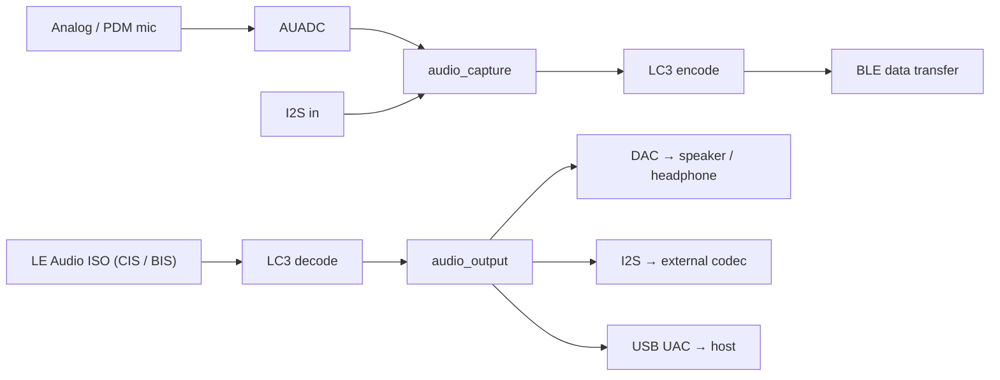
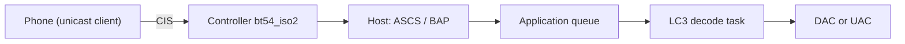

# Audio & LE Audio

IPRO7 has an on-chip audio ADC (for analog or PDM microphones), a DAC and I2S. On top of them the SDK provides capture and output components in `components/audio`, LC3 and other codecs, USB audio through CherryUSB, and the LE Audio profiles of the BLE host. The speaker, headphone and microphones on the IPRO7AI Reef EVK are described on the [IPRO7AI Reef EVK](../hardware/boards/reef-evk.md) page.

!!! abstract "At a glance"
    - LE Audio: the FreeRTOS examples are unicast receivers (the headset role): `ipro_le_audio_headset`, and `ipro7ai_evk_demo` with `config_bt`. Broadcast source and sink exist only as Zephyr samples.
    - LE Audio needs the `bt54_iso2` controller and `CONFIG_EM_SIZE=32`. LC3 is a prebuilt library, added with `CONFIG_COMPONENTS_LC3_ENABLE=y`.
    - USB audio: the headset's `UAC.config` sends the decoded audio to the host as a 48 kHz mono USB microphone; `ipro_pdm_mic_demo` exposes its PDM capture as a 16 kHz mono USB microphone.
    - Not included in V2.1.0: a USB-to-BLE audio bridge example and a FreeRTOS LE Audio broadcast example.

## Architecture { #overview }



| Part | Location | Description |
|---|---|---|
| Audio HAL | `bsp/hal/inc/hal_auadc.h`, `hal_dac.h`, `hal_i2s.h` | Audio ADC, DAC, I2S |
| Capture | `components/audio/include/audio_capture.h` | Analog mic, PDM mic or I2S input to 16-bit mono PCM, read independently by up to 4 consumers |
| Output | `components/audio/include/audio_output.h` | One API for DAC, I2S, UAC or dump output |
| Processing | `audio_resampler.h`, `audio_asrc.h`, `audio_speaker_eq.h`, `audio_bass_boost.h`, `mp3_decoder.h` | Resampling, clock-drift compensation, speaker EQ, bass boost, MP3 decoding |
| Codecs | `components/3rdparty/liblc3` (prebuilt), `libsbc`, `opus`, `minimp3` | LC3 serves LE Audio and BLE voice streaming |
| LE Audio | `components/wireless/bluetooth/ipro_bt_host/upstream/zephyr/subsys/bluetooth/audio/` | Zephyr v4.4.0 LE Audio profile sources |
| USB audio | `components/cherryusb/class/audio/` | USB Audio Class device |

## Audio hardware { #audio-hardware }

| Block | HAL | Description |
|---|---|---|
| AUADC | `hal_auadc.h` | Audio ADC for an analog microphone or a PDM digital microphone; the driver offers 16- or 20-bit resolution |
| GPDAC | `hal_dac.h` | Two 10-bit DAC channels, driving an external amplifier or headphone buffer |
| I2S | `hal_i2s.h` | External audio codec |
| DMA | `hal_dma.h` | Data movement for capture and playback |

- The DAC backend of `audio_output` runs at a fixed 32 kHz; other sample rates are resampled first.
- The speaker amplifier's enable pin and polarity come from the board header: `BOARD_SPK_EN_PIN` and `BOARD_SPK_EN_ACTIVE` (the level that turns the amplifier on). Without `BOARD_SPK_EN_ACTIVE` the enable is treated as active low. Set both for your amplifier when porting to a new board.
- To capture and play at the same time (a microphone monitor, for example), set `CONFIG_DMA_CHANNEL_ALLOCATOR=y` so DMA channels are assigned at run time.

Microphones and speakers on each board:

| Board | Microphone | Speaker output |
|---|---|---|
| IPRO7AI Reef EVK | PDM mic, headset mic, AUX-IN | DAC → speaker amplifier and headphone jack; see [IPRO7AI Reef EVK](../hardware/boards/reef-evk.md) |
| IPRO7AI EVK | IM69D129 PDM mic (GPIO18/19) | DAC (GPIO23) → TPA2037D1, enable on GPIO22, active high; see [IPRO7AI EVK](../hardware/boards/ipro7ai-evk.md) |
| IPRO7 EVB | External PDM mic module (`ipro_pdm_mic_demo` uses GPIO0 CLK, GPIO1 DATA) | DAC → on-board amplifier; see [IPRO7 EVB](../hardware/boards/ipro7-evb.md) |

## Audio framework { #audio-framework }

Add to `.config`:

```ini
CONFIG_AUDIO_CAPTURE=y
CONFIG_AUDIO_OUTPUT=y
CONFIG_DMA_CHANNEL_ALLOCATOR=y
```

`audio_capture` produces 16-bit mono PCM frames, and `audio_capture_read()` reads them from each consumer's own StreamBuffer. In streaming mode (`AUDIO_OUTPUT_MODE_STREAMING`) `audio_output` plays continuously from a cyclic DMA ring, and `audio_output_write()` blocks only briefly when the ring is full; one-shot mode (`AUDIO_OUTPUT_MODE_ONESHOT`) blocks until the whole buffer has played.

The example below sends the PDM microphone straight to the speaker on the Reef. `BOARD_MIC_*` and `BOARD_SPK_*` are defined by the Reef board header:

```c title="PDM microphone monitor (after apps/platform/ipro7ai_reef_demo/src/audio.c)"
#include <FreeRTOS.h>
#include <task.h>

#include "board_config.h"
#include "audio_capture.h"
#include "audio_output.h"

#define RATE_HZ        16000u
#define FRAME_SAMPLES  320u    /* 20 ms */

static void mic_monitor_task(void *arg)
{
    static int16_t frame[FRAME_SAMPLES];
    audio_capture_cfg_t in_cfg = {
        .type          = AUDIO_SRC_DMIC,
        .sample_rate   = RATE_HZ,
        .frame_samples = FRAME_SAMPLES,
        .dmic = {
            .clk_pin         = BOARD_MIC_CLK_PIN,
            .data_pin        = BOARD_MIC_DAT_PIN,
            .channel         = 0,       /* left */
            .digital_gain_db = 18.0f,
        },
    };
    audio_output_cfg_t out_cfg = {
        .type              = AUDIO_OUTPUT_DAC,
        .mode              = AUDIO_OUTPUT_MODE_STREAMING,
        .sample_rate       = RATE_HZ,
        .channels          = 1,
        .dac_spk_gpio      = BOARD_SPK_EN_PIN,
        .dac_spk_en_active = BOARD_SPK_EN_ACTIVE ? 1 : -1,
    };
    audio_output_t *out;
    int id;

    (void)arg;
    if (audio_capture_init(&in_cfg) != 0) {
        vTaskDelete(NULL);
    }
    id = audio_capture_add_consumer(sizeof(frame) * 8);
    out = audio_output_create(&out_cfg);
    if (id < 0 || out == NULL ||
        audio_capture_start() != 0 || audio_output_start(out) != 0) {
        vTaskDelete(NULL);
    }
    for (;;) {
        size_t n = audio_capture_read(id, frame, sizeof(frame), 100);
        if (n > 0) {
            /* the third argument counts samples per channel */
            audio_output_write(out, frame, n / sizeof(int16_t));
        }
    }
}
```

An application that implements its own USB audio device instead of using the `audio_output` UAC backend must set `CONFIG_AUDIO_OUTPUT_UAC_EXCLUDE=y`; otherwise both define the same `usbd_audio_*` callbacks.

## LE Audio { #le-audio-pipeline }

LE Audio carries LC3 audio over ISO channels: CIS for unicast, BIS for broadcast. On the receiving side the data path is:



Settings needed in `.config` (excerpt from `ipro_le_audio_headset`):

```ini title=".config (excerpt)"
CONFIG_BLUETOOTH_LE_ENABLE=y
CONFIG_BT_CTLR_IPRO=y
CONFIG_BT_HOST_IPRO_V44=y
CONFIG_IPRO_BLE_CTLR_LIB="link1_periph"
CONFIG_IPRO_BLE_CTLR_FEATURE="bt54_iso2"
CONFIG_EM_SIZE=32
CONFIG_BT_CONN=1
CONFIG_BT_PERIPHERAL=y
CONFIG_BT_EXT_ADV=y
CONFIG_BT_SMP=y
CONFIG_BT_AUDIO=y
CONFIG_BT_AUDIO_RX=y
CONFIG_BT_BAP_UNICAST_SERVER=y
CONFIG_BT_PACS=y
CONFIG_BT_PAC_SNK=y
CONFIG_BT_ASCS=y
CONFIG_BT_ASCS_MAX_ASE_SNK_COUNT=2
CONFIG_BT_ASCS_MAX_ASE_SRC_COUNT=0
CONFIG_BT_ISO=y
CONFIG_BT_ISO_RX=y
CONFIG_BT_ISO_PERIPHERAL=y
CONFIG_BT_VCP_VOL_REND=y
CONFIG_BT_CAP_ACCEPTOR=y
CONFIG_BT_CSIP_SET_MEMBER=y
CONFIG_COMPONENTS_LC3_ENABLE=y
```

The build does not resolve Kconfig dependencies, so start from the whole `apps/bluetooth/le_audio/ipro_le_audio_headset/.config` rather than the excerpt. The controller archive rules are in [BLE Development](ble.md#controller-variants).

### Unicast headset { #unicast-audio }

`apps/bluetooth/le_audio/ipro_le_audio_headset` advertises as `IPRO-LE-Audio`; a phone connects with LE Audio unicast and streams LC3 to the board.

!!! info "What this example is"
    This application is a reference for the LE Audio profiles and the ISO data path, not a finished headset product.

| Item | Details |
|---|---|
| Roles | BAP unicast server, PACS, ASCS (2 sink ASEs, no source ASE), CAP acceptor with CSIP set member, VCP volume renderer |
| PACS capability | LC3 at 16/32/48 kHz, 7.5/10 ms frames, mono, 26–155 octets per frame, 1 frame per SDU, front-left location |
| Security | SMP pairing; bonds are stored in flash with `CONFIG_BT_SETTINGS` |
| Controller | `link1_periph` / `bt54_iso2`, 32 KB EM; every configuration uses the debug archive (`CONFIG_IPRO_BLE_CTLR_CFG_DBG=y`) |

The configuration file decides where the audio goes:

| Configuration | Board | Decoded audio goes to |
|---|---|---|
| `.config` | IPRO7 EVB | On-chip DAC and speaker |
| `UAC.config` | IPRO7 EVB | The host, as a USB microphone (48 kHz mono) |
| `defconfig_reef` | IPRO7AI Reef EVK | DAC, speaker and headphone jack |

```bash
make -C apps/bluetooth/le_audio/ipro_le_audio_headset                           # IPRO7 EVB, DAC output
make -C apps/bluetooth/le_audio/ipro_le_audio_headset DEFCONFIG=defconfig_reef  # Reef, builds in build_reef/
```

Select `UAC.config` by copying it over `.config`: `cp UAC.config .config && make clean && make`.

How `src/bap_server.c` registers PACS and ASCS (excerpt, simplified: logging and conditional compilation removed; the `unicast_server_cb` callback structure is defined in the same file):

```c title="apps/bluetooth/le_audio/ipro_le_audio_headset/src/bap_server.c (excerpt)"
static const struct bt_audio_codec_cap lc3_sink_codec_cap =
	BT_AUDIO_CODEC_CAP_LC3(BT_AUDIO_CODEC_CAP_FREQ_16KHZ |
				       BT_AUDIO_CODEC_CAP_FREQ_32KHZ |
				       BT_AUDIO_CODEC_CAP_FREQ_48KHZ,
			       BT_AUDIO_CODEC_CAP_DURATION_7_5 |
				       BT_AUDIO_CODEC_CAP_DURATION_10 |
				       BT_AUDIO_CODEC_CAP_DURATION_PREFER_10,
			       BT_AUDIO_CODEC_CAP_CHAN_COUNT_SUPPORT(1),
			       26, 155, 1,
			       BT_AUDIO_CONTEXT_TYPE_MEDIA |
				       BT_AUDIO_CONTEXT_TYPE_CONVERSATIONAL);

static struct bt_pacs_cap lc3_sink_cap = {
	.codec_cap = &lc3_sink_codec_cap,
};

int bap_server_init(void)
{
	struct bt_pacs_register_param pacs_param = {
		.snk_pac = true,
		.snk_loc = true,
	};
	struct bt_bap_unicast_server_register_param server_param = {
		.snk_cnt = CONFIG_BT_ASCS_MAX_ASE_SNK_COUNT,
		.src_cnt = CONFIG_BT_ASCS_MAX_ASE_SRC_COUNT,
	};
	int err;

	err = bt_pacs_register(&pacs_param);                     /* 1. PACS service */
	if (err != 0 && err != -EALREADY) {
		return err;
	}
	err = bt_pacs_cap_register(BT_AUDIO_DIR_SINK, &lc3_sink_cap);  /* 2. LC3 capability */
	if (err != 0) {
		return err;
	}
	err = bt_pacs_set_location(BT_AUDIO_DIR_SINK, BT_AUDIO_LOCATION_FRONT_LEFT);
	if (err != 0) {
		return err;
	}
	bt_pacs_set_supported_contexts(BT_AUDIO_DIR_SINK,
				       BT_AUDIO_CONTEXT_TYPE_MEDIA |
				       BT_AUDIO_CONTEXT_TYPE_CONVERSATIONAL |
				       BT_AUDIO_CONTEXT_TYPE_UNSPECIFIED);
	bt_pacs_set_available_contexts(BT_AUDIO_DIR_SINK,
				       BT_AUDIO_CONTEXT_TYPE_MEDIA |
				       BT_AUDIO_CONTEXT_TYPE_CONVERSATIONAL |
				       BT_AUDIO_CONTEXT_TYPE_UNSPECIFIED);

	err = bt_bap_unicast_server_register(&server_param);      /* 3. ASCS endpoints */
	if (err != 0 && err != -EALREADY) {
		return err;
	}
	return bt_bap_unicast_server_register_cb(&unicast_server_cb);  /* 4. BAP callbacks */
}
```

`config_bt` of `apps/platform/ipro7ai_evk_demo` is a second unicast receiver: it runs on the IPRO7AI EVK with `link1` / `bt54_iso2` and plays through the on-board speaker via `audio_output`. Build it with `make -C apps/platform/ipro7ai_evk_demo DEFCONFIG=config_bt`.

### Broadcast { #broadcast-audio }

No FreeRTOS application in V2.1.0 does BIS broadcast. The host sources include the `bt_bap_broadcast_source_*` and `bt_bap_broadcast_sink_*` APIs, and the reference implementations are the Zephyr samples:

| Zephyr sample | Board | What it does |
|---|---|---|
| `zephyr/samples/bap_broadcast_source` | `ipro7_evb`, `ipro7ai_evk` | Broadcasts a 16 kHz LC3 sine on 2 BIS as `IPRO7 Broadcast Source` |
| `zephyr/samples/bap_broadcast_sink` | `ipro7ai_evk` | Syncs to that broadcast, decodes it and plays it on the EVK speaker |
| `zephyr/samples/le_audio_headset` | `ipro7ai_evk` | Unicast headset using the same controller archive and PACS capability as the FreeRTOS version |

Build them from the Zephyr workspace:

```bash
west build -p always -b ipro7_evb ../zephyr/samples/bap_broadcast_source
west build -p always -b ipro7ai_evk ../zephyr/samples/bap_broadcast_sink
```

Setting up the workspace and flashing are covered in [Zephyr RTOS](zephyr.md).

### Profiles { #audio-profiles }

The host's `subsys/bluetooth/audio/` holds the Zephyr v4.4.0 LE Audio profile sources (BAP, CAP, PACS, ASCS, VCP, CSIP, MICP, MCP, TMAP and more). The shipped FreeRTOS headset enables:

| Profile | `.config` | Role |
|---|---|---|
| BAP | `CONFIG_BT_BAP_UNICAST_SERVER=y` | Unicast server |
| PACS | `CONFIG_BT_PACS=y`, `CONFIG_BT_PAC_SNK=y` | Publishes the sink capability |
| ASCS | `CONFIG_BT_ASCS=y` | Audio stream endpoints |
| CAP | `CONFIG_BT_CAP_ACCEPTOR=y` | Acceptor |
| CSIP | `CONFIG_BT_CSIP_SET_MEMBER=y` | Set member |
| VCP | `CONFIG_BT_VCP_VOL_REND=y` | Volume renderer |

No shipped example enables MCP (media control).

### LC3 { #lc3 }

- Prebuilt library `components/3rdparty/liblc3/lib/libliblc3.a` with header `lc3.h`; add it with `CONFIG_COMPONENTS_LC3_ENABLE=y`.
- Bit rates from 16 to 320 kbps (`LC3_MIN_BITRATE`, `LC3_MAX_BITRATE`).
- Users: `ipro_le_audio_headset` and `ipro7ai_evk_demo` (`config_bt`) decode LE Audio streams; `ipro_pdm_mic_demo` encodes 16 kHz audio in 10 ms frames of 40 bytes (32 kbps) and sends it over BLE.
- Other codecs: SBC (`3rdparty/libsbc`), Opus (`3rdparty/opus`, used by `ipro_agora_sentino`), minimp3 (used by `ipro7_demo`).

## USB audio { #usb-audio }

USB audio uses CherryUSB's UAC device class:

```ini
CONFIG_COMPONENTS_CHERRYUSB_ENABLE=y
CONFIG_CHERRYUSB_DEVICE=y
CONFIG_CHERRYUSB_DEVICE_AUDIO=y
```

| Example | USB device | Audio source |
|---|---|---|
| `ipro_le_audio_headset` (`UAC.config`) | 48 kHz mono microphone | The decoded LE Audio stream |
| `ipro_pdm_mic_demo` | 16 kHz mono microphone (`src/uac_mic.c`) | The PDM microphone, so the host can record it directly |
| `ipro7_demo` | USB audio device demo | `demo/soc/usb_demo/uac_v1_template.c` |

The `audio_output` UAC backend is built whenever `CONFIG_CHERRYUSB_DEVICE_AUDIO=y`. An application with its own UAC device, such as `ipro_pdm_mic_demo`, sets `CONFIG_AUDIO_OUTPUT_UAC_EXCLUDE=y`.

## PDM recording { #pdm-recording }

`apps/multimedia/ipro_pdm_mic_demo` shows PDM microphone capture, DAC playback and transfer over BLE:

- Capture: 16 kHz, 16-bit mono, DMA ping-pong buffers.
- Recording: up to 4 hours logically; a PSRAM ring keeps the latest 240 seconds (about 7.68 MB), and every 30 seconds a `CHUNK_READY` notification tells the phone to fetch that slice.
- BLE: commands and data over the Nordic UART Service, device name `IPRO-MIC`; live streaming can be LC3-compressed. Controller `link2` / `bt52`, 16 KB EM, `CONFIG_BT_CONN=1`.
- Bonds are stored in flash with `CONFIG_BT_SETTINGS` and `CONFIG_EASYFLASH4`, so after waking from PDS31 sleep the phone reconnects with the existing bond.
- USB: the board also enumerates as a 16 kHz mono USB microphone.
- Android example app source: `tools/android/IproMicDemo/`.

| Board | Build | Output | Console |
|---|---|---|---|
| IPRO7 EVB | `make -C apps/multimedia/ipro_pdm_mic_demo` | `build/build_out/` | 115200 baud |
| IPRO7AI EVK | `make -C apps/multimedia/ipro_pdm_mic_demo BOARD=evk` | `build_config_evk/build_out/` | 921600 baud |

Common shell commands:

| Command | Description |
|---|---|
| `pdm_rec [seconds]` | Record (1–14400 s, default 5 s) |
| `pdm_stats` | Duration, peak, RMS, dBFS |
| `pdm_dump [offset] [count]` | Print PCM sample values |
| `pdm_gain <dB>` | PDM digital gain |
| `pdm_ch left\|right` | Select the PDM channel |
| `pdm_stream on\|off` | Start or stop live BLE streaming |
| `pdm_lc3 on\|off` | Use LC3 compression for streaming |

## Limitations in this release { #limitations }

- FreeRTOS has no LE Audio broadcast example; use the Zephyr samples above for broadcast.
- The shipped LE Audio examples only receive: the headset has no source ASE and does not send microphone audio back to the phone.
- `bt54_iso2` needs at least 32 KB of EM, while controller PDS sleep supports only the 16 KB EM profile, so the controller does not enter PDS in an LE Audio configuration.
- A USB-to-BLE audio bridge example is not included.

## Related examples and documents { #reference-apps }

| Example | Contents |
|---|---|
| `ipro_le_audio_headset` | LE Audio unicast headset with DAC or USB output |
| `ipro7ai_evk_demo` (`config_bt`) | LE Audio unicast receiver with speaker playback on the IPRO7AI EVK |
| `ipro_pdm_mic_demo` | PDM recording, BLE transfer with LC3, USB microphone |
| `ipro7ai_reef_demo` | Shell commands for the Reef speaker, headphone, PDM / headset mic and AUX-IN; see [IPRO7AI Reef EVK](../hardware/boards/reef-evk.md) |
| `ipro7ai_evk_launcher` | Microphone and speaker pages on the IPRO7AI EVK |
| `ipro7_demo` | I2S, DAC, audio ADC and USB audio demos |

- [Getting Started with LE Audio](../tutorials/le-audio.md): run the headset example on a board
- [BLE Development](ble.md): controller selection, bring-up order and GATT
- [Zephyr RTOS](zephyr.md): the Zephyr LE Audio samples
