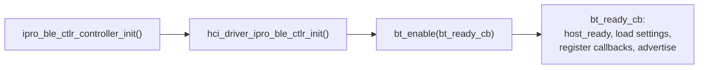

# BLE Development

BLE in a FreeRTOS application has two parts: the Zephyr v4.4.0 BLE host (source) and the IPRO BLE controller (prebuilt library). Applications use Zephyr's callback-based `bt_*` API, and `.config` picks one of 16 controller archives to link. The code below is taken from `apps/bluetooth/ble/ipro_ble_remote`.

!!! abstract "At a glance"
    - Host: Zephyr v4.4.0 with GAP, GATT, L2CAP, SMP, ISO and LE Audio. Host and controller talk over on-chip HCI; there is no UART.
    - Controller: 16 IPRO7 archives, selected by `CONFIG_IPRO_BLE_CTLR_LIB`, `CONFIG_IPRO_BLE_CTLR_FEATURE` and `CONFIG_IPRO_BLE_CTLR_CFG_DBG`. LE Audio needs `bt54_iso2` and `CONFIG_EM_SIZE=32`.
    - Bring-up order: `ipro_ble_ctlr_controller_init()` → `hci_driver_ipro_ble_ctlr_init()` → `bt_enable()`.
    - Not included in V2.1.0: controller source, PAwR/ESL applications. IPRO6S (BLE and BR/EDR) uses SDK V2.0.1; see [IPRO6S](../hardware/chips/ipro6s.md).

## Stack architecture { #stack-architecture }

<div class="ipro-stack">
  <div class="l-app"><strong>Application</strong><span>Zephyr bt_* API: GAP · GATT · SMP · LE Audio</span></div>
  <div class="l-host"><strong>BLE host (Zephyr v4.4.0)</strong><span>ipro_bt_host: GAP · GATT · L2CAP · SMP · ISO</span></div>
  <div class="l-hci"><strong>On-chip HCI</strong><span>in-memory byte stream (ipro_ble_ctlr_hcitl)</span></div>
  <div class="l-ctlr"><strong>IPRO BLE controller (prebuilt library)</strong><span>Link Layer · 1M / 2M / Coded PHY</span></div>
</div>

```text title="components/wireless/bluetooth/"
ipro_bt_host/
├── upstream/zephyr/        Zephyr v4.4.0 host source (include/, subsys/bluetooth/)
├── port/                   FreeRTOS port: HCI driver, kernel interface, settings storage, crypto
└── tinycrypt/
ipro_ble_controller/
├── include/                public header ipro_ble_controller.h
├── hcitl/                  on-chip HCI transport
├── lib/                    16 prebuilt archives
└── cmake/                  archive selection rules (ipro7_build.cmake)
```

Every BLE application's `.config` needs:

```ini
CONFIG_BLUETOOTH_LE_ENABLE=y
CONFIG_BT_CTLR_IPRO=y
CONFIG_BT_HOST_IPRO_V44=y
```

Without `CONFIG_BT_CTLR_IPRO` or `CONFIG_BT_HOST_IPRO_V44` the build stops during CMake configuration. The host and controller components export their own include paths, so an application's `CMakeLists.txt` does not need to add the `zephyr/bluetooth/*.h` paths.

Zephyr RTOS applications use Zephyr's own host with the same controller archives; see [Zephyr RTOS](zephyr.md).

## Controller selection { #controller-variants }

| Setting | Values | When unset | Meaning |
|---|---|---|---|
| `CONFIG_IPRO_BLE_CTLR_LIB` | `link1_periph`, `link1`, `link2`, `link4` | `link1_periph` | `link1_periph` has only the peripheral and broadcaster roles; for the others the number is the connection count |
| `CONFIG_IPRO_BLE_CTLR_FEATURE` | `bt52`, `bt54_iso2` | `bt52` | `bt54_iso2` adds ISO channels (LE Audio) |
| `CONFIG_IPRO_BLE_CTLR_CFG_DBG` | `y` or unset | unset | Unset selects the `_release` archive; `y` selects the debug archive |

Archive names follow `libipro_ble_controller_ipro7_<LIB>[_bt54_iso2][_release].a`; `bt52` has no feature suffix. The 16 archives in `lib/`:

| LIB | `bt52` | `bt52` release | `bt54_iso2` | `bt54_iso2` release |
|---|---|---|---|---|
| `link1_periph` | `…_link1_periph.a` | `…_link1_periph_release.a` | `…_link1_periph_bt54_iso2.a` | `…_link1_periph_bt54_iso2_release.a` |
| `link1` | `…_link1.a` | `…_link1_release.a` | `…_link1_bt54_iso2.a` | `…_link1_bt54_iso2_release.a` |
| `link2` | `…_link2.a` | `…_link2_release.a` | `…_link2_bt54_iso2.a` | `…_link2_bt54_iso2_release.a` |
| `link4` | `…_link4.a` | `…_link4_release.a` | `…_link4_bt54_iso2.a` | `…_link4_bt54_iso2_release.a` |

Checks at configure time:

- `CONFIG_EM_SIZE` (BLE Exchange Memory, in KB) must be set.
- `bt54_iso2` needs `CONFIG_EM_SIZE` of at least 32.
- If no archive matches the configuration, the build stops.

In addition, `CONFIG_BT_CONN` (the host's connection count) must not exceed the archive's connection count. Exchange Memory is reserved at the top of OCRAM; see [Memory layout](build-system.md#memory-layout).

The shipped applications make good starting points:

| Application | LIB | FEATURE | `CONFIG_BT_CONN` | `CONFIG_EM_SIZE` |
|---|---|---|---|---|
| `ipro_ble_remote` | `link1_periph` | `bt52` | 1 | 16 |
| `ipro_ble_transparent` | `link1` | `bt52` | 1 | 32 |
| `ipro_ble_hid_keyboard` | `link1` | `bt52` | 1 | 32 |
| `ipro_throughput_test` | `link2` | `bt52` | 2 | 32 |
| `ipro_pdm_mic_demo` | `link2` | `bt52` | 1 | 16 |
| `ipro_le_audio_headset` | `link1_periph` | `bt54_iso2` | 1 | 32 |

```ini title=".config (excerpt from ipro_ble_remote)"
CONFIG_BLUETOOTH_LE_ENABLE=y
CONFIG_BT_CTLR_IPRO=y
CONFIG_IPRO_BLE_CTLR_LIB="link1_periph"
CONFIG_IPRO_BLE_CTLR_FEATURE="bt52"
CONFIG_EM_SIZE=16
CONFIG_BT_CONN=1
CONFIG_BT_PERIPHERAL=y
CONFIG_BT_BROADCASTER=y
CONFIG_PHY_UPDATE=y
CONFIG_BT_DATA_LEN_UPDATE=y
CONFIG_BT_HOST_IPRO_V44=y
CONFIG_BT_SMP=y
CONFIG_BT_GATT_CLIENT=y
CONFIG_ENABLE_NVDS=y
CONFIG_CFG_NVDS=y
```

The build does not resolve Kconfig dependencies, so copy the whole `.config` of the closest shipped application and edit it.

## Bring-up order { #bring-up }



```c
ipro_ble_ctlr_controller_init(configMAX_PRIORITIES - 1);
vTaskDelay(pdMS_TO_TICKS(50));
hci_driver_ipro_ble_ctlr_init();
vTaskDelay(pdMS_TO_TICKS(50));
bt_enable(bt_ready_cb);
```

- Run this in a FreeRTOS task with the scheduler already started (the `vTaskDelay()` calls need it).
- `ipro_ble_ctlr_controller_init()` creates the controller task. The controller has hard radio deadlines, so give it a higher priority than your application tasks; the shipped applications use `configMAX_PRIORITIES - 1`. Call it once only: a second call returns -1.
- In `bt_ready_cb`, call `ipro_ble_ctlr_hcitl_host_ready()` first. It tells the controller that HCI initialization is complete, which lets it sleep between events.
- With `CONFIG_BT_SETTINGS`, call `settings_load_subtree("bt")` in `bt_ready_cb` to load bonds before you start advertising.

## API usage { #api-patterns }

Put the three snippets below in one `.c` file, in order, and it compiles. They come from `src/services/remote_services.c` and `src/app/remote_app.c` in `ipro_ble_remote`. Applications use Zephyr's callback-based API; the controller's internal messaging is not exposed to applications.

### GATT service { #gatt-service }

`BT_GATT_SERVICE_DEFINE` defines a service at compile time. This one exposes a readable temperature that can also be notified (the UUIDs are those of the `ipro_ble_remote` environment service, 0xFF30/0xFF31):

```c title="GATT service"
#include <FreeRTOS.h>
#include <task.h>

#include <zephyr/bluetooth/bluetooth.h>
#include <zephyr/bluetooth/conn.h>
#include <zephyr/bluetooth/gatt.h>
#include <zephyr/bluetooth/uuid.h>
#include <zephyr/settings/settings.h>
#include <hci_driver_ipro_ble_ctlr.h>
#include <ipro_ble_controller.h>

#define BT_UUID_ENV_SVC   BT_UUID_DECLARE_16(0xFF30)
#define BT_UUID_ENV_TEMP  BT_UUID_DECLARE_16(0xFF31)

static int16_t temperature = 2500;      /* 0.01 °C */
static bool temp_notify_enabled;

static ssize_t temp_read(struct bt_conn *conn, const struct bt_gatt_attr *attr,
                         void *buf, uint16_t len, uint16_t offset)
{
    return bt_gatt_attr_read(conn, attr, buf, len, offset,
                             &temperature, sizeof(temperature));
}

static void temp_ccc_changed(const struct bt_gatt_attr *attr, uint16_t value)
{
    temp_notify_enabled = (value == BT_GATT_CCC_NOTIFY);
}

BT_GATT_SERVICE_DEFINE(env_svc,
    BT_GATT_PRIMARY_SERVICE(BT_UUID_ENV_SVC),
    BT_GATT_CHARACTERISTIC(BT_UUID_ENV_TEMP,
                           BT_GATT_CHRC_READ | BT_GATT_CHRC_NOTIFY,
                           BT_GATT_PERM_READ,
                           temp_read, NULL, NULL),
    BT_GATT_CCC(temp_ccc_changed, BT_GATT_PERM_READ | BT_GATT_PERM_WRITE),
);

/* attr_env_svc[1] is the temperature characteristic declaration;
 * bt_gatt_notify() uses the value attribute that follows it */
static int notify_temperature(struct bt_conn *conn)
{
    if (!temp_notify_enabled) {
        return 0;
    }
    return bt_gatt_notify(conn, &attr_env_svc[1], &temperature, sizeof(temperature));
}
```

### Advertising and connections { #gap-connection }

```c title="Advertising and connection callbacks"
#define DEVICE_NAME     "IPRO-Remote"
#define DEVICE_NAME_LEN (sizeof(DEVICE_NAME) - 1)

static struct bt_conn *current_conn;

static const struct bt_data ad[] = {
    BT_DATA_BYTES(BT_DATA_FLAGS, (BT_LE_AD_GENERAL | BT_LE_AD_NO_BREDR)),
    BT_DATA(BT_DATA_NAME_COMPLETE, DEVICE_NAME, DEVICE_NAME_LEN),
};

static int start_advertising(void)
{
    struct bt_le_adv_param adv_param = {
        .id = BT_ID_DEFAULT,
        .options = BT_LE_ADV_OPT_CONN,   /* connectable */
        .interval_min = 160,             /* 100 ms, in 0.625 ms units */
        .interval_max = 320,             /* 200 ms */
    };

    return bt_le_adv_start(&adv_param, ad, ARRAY_SIZE(ad), NULL, 0);
}

static void connected(struct bt_conn *conn, uint8_t err)
{
    if (err) {
        return;
    }
    current_conn = bt_conn_ref(conn);
    (void)notify_temperature(current_conn);
}

static void disconnected(struct bt_conn *conn, uint8_t reason)
{
    (void)conn;
    (void)reason;
    if (current_conn) {
        bt_conn_unref(current_conn);
        current_conn = NULL;
    }
    /* This callback runs in the host thread and must not block. ipro_ble_remote
     * restarts advertising from a FreeRTOS timer 500 ms later instead of here. */
}

static struct bt_conn_cb conn_callbacks = {
    .connected = connected,
    .disconnected = disconnected,
};
```

The host in this release has no `BT_LE_ADV_CONN_NAME` macro. Put the device name in the advertising data as shown, or use one of the host's predefined parameter macros such as `BT_LE_ADV_CONN_FAST_1`.

### Start-up { #ble-init }

```c title="Initialization"
static void bt_ready_cb(int err)
{
    if (err) {
        return;
    }
    ipro_ble_ctlr_hcitl_host_ready();

#if defined(CONFIG_BT_SETTINGS)
    (void)settings_load_subtree("bt");
#endif
    bt_conn_cb_register(&conn_callbacks);
    (void)start_advertising();
}

/* call from an application task */
int ble_init(void)
{
    int err;

    err = ipro_ble_ctlr_controller_init(configMAX_PRIORITIES - 1);
    if (err) {
        return err;
    }
    vTaskDelay(pdMS_TO_TICKS(50));

    err = hci_driver_ipro_ble_ctlr_init();
    if (err) {
        return err;
    }
    vTaskDelay(pdMS_TO_TICKS(50));

    return bt_enable(bt_ready_cb);
}
```

- To keep bonds in flash, set `CONFIG_BT_SETTINGS=y` and `CONFIG_EASYFLASH4=y` (the host's settings storage uses EasyFlash), and use a partition table with the PSM area EasyFlash needs. `ipro_pdm_mic_demo` and `ipro_le_audio_headset` do this; the default `ipro_ble_remote` configuration does not.
- To raise throughput after connecting, `ipro_ble_remote` exchanges the MTU with `bt_gatt_exchange_mtu()` in `connected`, and with `CONFIG_BT_USER_DATA_LEN_UPDATE` requests 251-byte DLE with `bt_conn_le_data_len_update()`.

## Performance and throughput { #throughput }

Measured in the `ipro_throughput_test` README: two IPRO7AI Reef EVKs, `link2` controller, ATT MTU 247, DLE 251 octets, 244-byte payloads, 50 ms connection interval, `CONFIG_IPRO7_BLE_HOTCODE=y`:

| PHY | One-way throughput |
|---|---|
| 2M | 1.34 Mbps |
| 1M | 747 kbps |

- `CONFIG_IPRO7_BLE_HOTCODE=y` runs the per-packet path of the controller, the host and the FreeRTOS kernel from OCRAM, at a cost of about 88 KB of OCRAM. Under the same conditions without it (code in flash), 2M PHY reaches only about 0.6 Mbps.
- The option cannot be combined with the AI-plus-imaging OCRAM layout or with low-power settings (`CONFIG_HAL_LP`, `CONFIG_IPRO_PM_*`, `CONFIG_OCRAM_NORET_SPLIT`).
- For bulk data use 2M PHY, a 30–50 ms connection interval and 244-byte payloads.

For a step-by-step run, see [BLE Throughput Test](../tutorials/ble-throughput.md).

## LE Audio { #le-audio }

LE Audio needs `CONFIG_IPRO_BLE_CTLR_FEATURE="bt54_iso2"` and `CONFIG_EM_SIZE=32`, plus `CONFIG_BT_AUDIO=y` and role settings for BAP, PACS, ASCS and so on; LC3 comes in with `CONFIG_COMPONENTS_LC3_ENABLE=y`. The host's LE Audio headers are in `ipro_bt_host/upstream/zephyr/include/zephyr/bluetooth/audio/`. The shipped FreeRTOS example is the unicast headset `ipro_le_audio_headset`; configuration, profiles and the audio path are in [Audio & LE Audio](audio.md).

## Low power { #low-power }

- `ipro_pdm_mic_demo` shows BLE with PDS31 sleep: bonds are kept in flash, and after waking the phone reconnects with the existing bond.
- Controller PDS sleep supports only the 16 KB EM profile; with `bt54_iso2` (32 KB EM) the controller does not enter PDS.
- `CONFIG_IPRO_PM_BLE` and `CONFIG_IPRO_PM_PDS_CONNECTED` force a controller source build, which V2.1.0 cannot do; see [Limitations](#limitations).
- Zephyr RTOS has no low-power modes yet, and the BLE controller does not sleep there.

Sleep modes, wake sources and measurement are covered in [Low Power](low-power.md).

## Limitations in this release { #limitations }

- The controller ships only as prebuilt libraries. These settings force a controller source build and cannot be built with V2.1.0: `CONFIG_IPRO_BLE_CTLR_FORCE_SOURCE_BUILD`, `CONFIG_IPRO_BLE_CTLR_SUBRATING`, `CONFIG_IPRO_BLE_CTLR_CSSA`, `CONFIG_IPRO_PM_BLE`, `CONFIG_IPRO_PM_PDS_CONNECTED`. The `defconfig_lowpower` of `ipro_ble_remote` uses the last two.
- PAwR and ESL: the host headers include the periodic advertising APIs, but V2.1.0 has no PAwR/ESL application. Not included in V2.1.0; contact INTELPRO.
- The OTA service of `ipro_ble_remote` is enabled only in `defconfig_reef`; the default `.config` has no OTA.
- BLE and BR/EDR development for IPRO6S uses SDK V2.0.1; see [IPRO6S](../hardware/chips/ipro6s.md).

## Reference applications { #reference-apps }

| Application | Contents |
|---|---|
| `ipro_ble_remote` | GATT service examples: LED, button, environment, UART, PIR image and image upload; `defconfig_reef` adds OTA and a Reef hardware service. Ships the Android app `ipro_remote_demo.apk` |
| `ipro_ble_transparent` | Transparent UART-to-BLE link with an AT command interface |
| `ipro_ble_hid_keyboard` | HID over GATT keyboard |
| `ipro_throughput_test` | Two-board throughput test: 1M / 2M / Coded PHY, DLE, MTU 247 |
| `ipro_le_audio_headset` | LE Audio unicast headset |
| `ipro_pdm_mic_demo` | Nordic UART Service, LC3 streaming, stored bonds, reconnection after PDS31 sleep |

- [Your First BLE Application](../tutorials/first-ble-app.md)
- [BLE Throughput Test](../tutorials/ble-throughput.md)
- [Audio & LE Audio](audio.md)
- [API Reference](../reference/api.md)
