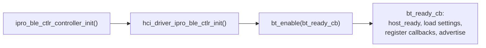

# BLE Development

BLE in a FreeRTOS application has two parts: the Zephyr v4.4.0 BLE host (source) and the IPRO BLE controller (prebuilt library). You write the application against Zephyr's callback-based `bt_*` API, and three `.config` keys pick which of the 16 controller archives gets linked. The examples on this page come from `apps/bluetooth/ble/ipro_ble_remote`, built for the IPRO7AI Reef EVK with `defconfig_reef`.

!!! abstract "At a glance"
    - Host: Zephyr v4.4.0 with GAP, GATT, L2CAP, SMP, ISO and LE Audio. Host and controller talk over on-chip HCI; there is no UART in between.
    - Controller: 16 IPRO7 archives, `link1_periph` / `link1` / `link2` / `link4` × `bt52` / `bt54_iso2` × debug / release, picked by `CONFIG_IPRO_BLE_CTLR_LIB`, `CONFIG_IPRO_BLE_CTLR_FEATURE` and `CONFIG_IPRO_BLE_CTLR_CFG_DBG`.
    - Bring-up order: `ipro_ble_ctlr_controller_init()` → `hci_driver_ipro_ble_ctlr_init()` → `bt_enable()`.
    - Reef BLE configurations: `ipro_ble_remote`, `ipro_throughput_test` and `ipro_le_audio_headset` with `DEFCONFIG=defconfig_reef`, and `ipro_agora_sentino` (BLE provisioning).
    - Not included in V2.2.0: controller source, PAwR/ESL applications, the IPRO6S BLE controller.

## Stack architecture { #stack-architecture }

<div class="ipro-stack">
  <div class="l-app"><strong>Application</strong><span>Zephyr bt_* API: GAP · GATT · SMP · LE Audio</span></div>
  <div class="l-host"><strong>BLE host (Zephyr v4.4.0)</strong><span>ipro_bt_host: GAP · GATT · L2CAP · SMP · ISO</span></div>
  <div class="l-hci"><strong>On-chip HCI</strong><span>in-memory byte stream (ipro_ble_ctlr_hcitl)</span></div>
  <div class="l-ctlr"><strong>IPRO BLE controller (prebuilt library)</strong><span>Link Layer · 1M / 2M / Coded PHY</span></div>
</div>

```text title="components/wireless/bluetooth/"
ipro_bt_host/
├── upstream/zephyr/        Zephyr v4.4.0 host source (include/, subsys/bluetooth/)
├── port/                   FreeRTOS port: HCI driver, kernel interface, settings storage, crypto
└── tinycrypt/
ipro_ble_controller/
├── include/                public header ipro_ble_controller.h
├── hcitl/                  on-chip HCI transport
├── plf/ipro7/              controller API headers (init, low power, NVDS)
├── lib/                    16 prebuilt IPRO7 archives
└── cmake/                  archive selection rules (ipro7_build.cmake)
```

Every BLE application's `.config` needs:

```ini
CONFIG_BLUETOOTH_LE_ENABLE=y
CONFIG_BT_CTLR_IPRO=y
CONFIG_BT_HOST_IPRO_V44=y
```

Without `CONFIG_BT_CTLR_IPRO` or `CONFIG_BT_HOST_IPRO_V44` the build stops during CMake configuration. The host and controller components export their own include paths, so your `CMakeLists.txt` does not need to add the `zephyr/bluetooth/*.h` paths.

Zephyr RTOS images use Zephyr's own host with the same controller archives; Zephyr in V2.2.0 has boards for the IPRO7 EVB and the IPRO7AI EVK only, see [Zephyr RTOS](zephyr.md).

## Controller selection { #controller-variants }

| Setting | Values | When unset | Meaning |
|---|---|---|---|
| `CONFIG_IPRO_BLE_CTLR_LIB` | `link1_periph`, `link1`, `link2`, `link4` | `link1_periph` | `link1_periph` has only the peripheral and broadcaster roles; for the others the number is the connection count |
| `CONFIG_IPRO_BLE_CTLR_FEATURE` | `bt52`, `bt54_iso2` | `bt52` | `bt54_iso2` adds ISO channels (LE Audio) |
| `CONFIG_IPRO_BLE_CTLR_CFG_DBG` | `y` or unset | unset | Unset links the `_release` archive; `y` links the debug archive |

Archive names follow `libipro_ble_controller_ipro7_<LIB>[_bt54_iso2][_release].a`; `bt52` has no feature suffix. The 16 archives in `lib/`:

| LIB | `bt52` | `bt52` release | `bt54_iso2` | `bt54_iso2` release |
|---|---|---|---|---|
| `link1_periph` | `…_link1_periph.a` | `…_link1_periph_release.a` | `…_link1_periph_bt54_iso2.a` | `…_link1_periph_bt54_iso2_release.a` |
| `link1` | `…_link1.a` | `…_link1_release.a` | `…_link1_bt54_iso2.a` | `…_link1_bt54_iso2_release.a` |
| `link2` | `…_link2.a` | `…_link2_release.a` | `…_link2_bt54_iso2.a` | `…_link2_bt54_iso2_release.a` |
| `link4` | `…_link4.a` | `…_link4_release.a` | `…_link4_bt54_iso2.a` | `…_link4_bt54_iso2_release.a` |

Checks at configure time:

- `CONFIG_EM_SIZE` (BLE Exchange Memory, in KB) must be set.
- `bt54_iso2` needs `CONFIG_EM_SIZE` of at least 32.
- An unknown `LIB` or `FEATURE` value stops the build.

`CONFIG_BT_CONN` (the host's connection count) must not exceed the archive's connection count. Exchange Memory is reserved at the top of OCRAM; see [Memory layout](build-system.md#memory-layout).

The Reef configurations that ship with V2.2.0 are good starting points:

| Application and configuration | LIB | FEATURE | Debug archive | `CONFIG_BT_CONN` | `CONFIG_EM_SIZE` |
|---|---|---|---|---|---|
| `ipro_ble_remote` `defconfig_reef` | `link1_periph` | `bt52` | no | 1 | 16 |
| `ipro_throughput_test` `defconfig_reef` | `link2` | `bt52` | no | 2 | 32 |
| `ipro_le_audio_headset` `defconfig_reef` | `link1_periph` | `bt54_iso2` | yes | 1 | 32 |
| `ipro_agora_sentino` `.config` | `link1_periph` | `bt52` | no | 1 | 16 |

`ipro_ble_transparent`, `ipro_ble_hid_keyboard` and `ipro_pdm_mic_demo` are BLE examples for the IPRO7 EVB and IPRO7AI EVK; they do not build for the Reef.

```ini title="apps/bluetooth/ble/ipro_ble_remote/defconfig_reef (excerpt)"
CONFIG_BLUETOOTH_LE_ENABLE=y
CONFIG_BT_CTLR_IPRO=y
CONFIG_IPRO_BLE_CTLR_LIB="link1_periph"
CONFIG_IPRO_BLE_CTLR_FEATURE="bt52"
CONFIG_EM_SIZE=16
CONFIG_BT_CONN=1
CONFIG_BT_PERIPHERAL=y
CONFIG_BT_OBSERVER=y
CONFIG_BT_BROADCASTER=y
CONFIG_PHY_UPDATE=y
CONFIG_BT_DATA_LEN_UPDATE=y
CONFIG_BT_HOST_IPRO_V44=y
CONFIG_BT_SMP=y
CONFIG_BT_GATT_CLIENT=y
CONFIG_ENABLE_NVDS=y
CONFIG_CFG_NVDS=y
```

The build does not resolve Kconfig dependencies, so copy the whole configuration file of the closest shipped application and edit it; see [Build System & Configuration](build-system.md).

## Bring-up order { #bring-up }



```c title="apps/bluetooth/ble/ipro_ble_remote/src/app/remote_app.c (excerpt, error handling removed)"
ipro_ble_ctlr_controller_init(configMAX_PRIORITIES - 1);
vTaskDelay(pdMS_TO_TICKS(50));
hci_driver_ipro_ble_ctlr_init();
vTaskDelay(pdMS_TO_TICKS(50));
bt_enable(bt_ready_cb);
```

- Run this from a FreeRTOS task after the scheduler has started; the `vTaskDelay()` calls need it.
- `ipro_ble_ctlr_controller_init()` creates the controller task. The controller has hard radio deadlines, so give it a higher priority than your application tasks; the shipped applications use `configMAX_PRIORITIES - 1`. It returns 0 on success, -1 if the controller is already running and -2 if the task could not be created.
- In `bt_ready_cb`, call `ipro_ble_ctlr_hcitl_host_ready()` first. It tells the controller that HCI initialization is complete, which lets it sleep between events.
- With `CONFIG_BT_SETTINGS`, call `settings_load_subtree("bt")` in `bt_ready_cb` to load bonds before you start advertising.
- The Reef has no 32.768 kHz crystal. According to the `ipro_throughput_test` README, a Reef prints its BLE-ready line about 7 s after reset, because the controller first qualifies the 32 kHz clock and then falls back to RC32K (`XTAL32K rejected` in the log).

## API usage { #api-patterns }

Put the three snippets below in one `.c` file, in order, and it compiles. They come from `src/services/remote_services.c` and `src/app/remote_app.c` in `ipro_ble_remote`. Applications use Zephyr's callback-based API; the controller's internal messaging is not exposed.

### GATT service { #gatt-service }

`BT_GATT_SERVICE_DEFINE` defines a service at compile time. This one exposes a readable temperature that can also be notified (the UUIDs are those of the `ipro_ble_remote` environment service, 0xFF30/0xFF31; on the Reef it reports the on-chip temperature sensor):

```c title="GATT service"
#include <FreeRTOS.h>
#include <task.h>

#include <zephyr/bluetooth/bluetooth.h>
#include <zephyr/bluetooth/conn.h>
#include <zephyr/bluetooth/gatt.h>
#include <zephyr/bluetooth/uuid.h>
#include <zephyr/settings/settings.h>
#include <hci_driver_ipro_ble_ctlr.h>
#include <ipro_ble_controller.h>

#define BT_UUID_ENV_SVC   BT_UUID_DECLARE_16(0xFF30)
#define BT_UUID_ENV_TEMP  BT_UUID_DECLARE_16(0xFF31)

static int16_t temperature = 2500;      /* 0.01 °C */
static bool temp_notify_enabled;

static ssize_t temp_read(struct bt_conn *conn, const struct bt_gatt_attr *attr,
                         void *buf, uint16_t len, uint16_t offset)
{
    return bt_gatt_attr_read(conn, attr, buf, len, offset,
                             &temperature, sizeof(temperature));
}

static void temp_ccc_changed(const struct bt_gatt_attr *attr, uint16_t value)
{
    temp_notify_enabled = (value == BT_GATT_CCC_NOTIFY);
}

BT_GATT_SERVICE_DEFINE(env_svc,
    BT_GATT_PRIMARY_SERVICE(BT_UUID_ENV_SVC),
    BT_GATT_CHARACTERISTIC(BT_UUID_ENV_TEMP,
                           BT_GATT_CHRC_READ | BT_GATT_CHRC_NOTIFY,
                           BT_GATT_PERM_READ,
                           temp_read, NULL, NULL),
    BT_GATT_CCC(temp_ccc_changed, BT_GATT_PERM_READ | BT_GATT_PERM_WRITE),
);

/* attr_env_svc[1] is the temperature characteristic declaration;
 * bt_gatt_notify() uses the value attribute that follows it */
static int notify_temperature(struct bt_conn *conn)
{
    if (!temp_notify_enabled) {
        return 0;
    }
    return bt_gatt_notify(conn, &attr_env_svc[1], &temperature, sizeof(temperature));
}
```

### Advertising and connections { #gap-connection }

```c title="Advertising and connection callbacks"
#define DEVICE_NAME     "IPRO-Remote"
#define DEVICE_NAME_LEN (sizeof(DEVICE_NAME) - 1)

static struct bt_conn *current_conn;

static const struct bt_data ad[] = {
    BT_DATA_BYTES(BT_DATA_FLAGS, (BT_LE_AD_GENERAL | BT_LE_AD_NO_BREDR)),
    BT_DATA(BT_DATA_NAME_COMPLETE, DEVICE_NAME, DEVICE_NAME_LEN),
};

static int start_advertising(void)
{
    struct bt_le_adv_param adv_param = {
        .id = BT_ID_DEFAULT,
        .options = BT_LE_ADV_OPT_CONN,   /* connectable */
        .interval_min = 160,             /* 100 ms, in 0.625 ms units */
        .interval_max = 320,             /* 200 ms */
    };

    return bt_le_adv_start(&adv_param, ad, ARRAY_SIZE(ad), NULL, 0);
}

static void connected(struct bt_conn *conn, uint8_t err)
{
    if (err) {
        return;
    }
    current_conn = bt_conn_ref(conn);
    (void)notify_temperature(current_conn);
}

static void disconnected(struct bt_conn *conn, uint8_t reason)
{
    (void)conn;
    (void)reason;
    if (current_conn) {
        bt_conn_unref(current_conn);
        current_conn = NULL;
    }
    /* This callback runs in the host thread and must not block. ipro_ble_remote
     * restarts advertising from a FreeRTOS timer 500 ms later instead of here. */
}

static struct bt_conn_cb conn_callbacks = {
    .connected = connected,
    .disconnected = disconnected,
};
```

The host in this release has no `BT_LE_ADV_CONN_NAME` macro. Put the device name in the advertising data as shown, or use one of the host's predefined parameter macros such as `BT_LE_ADV_CONN_FAST_1`.

### Start-up { #ble-init }

```c title="Initialization"
static void bt_ready_cb(int err)
{
    if (err) {
        return;
    }
    ipro_ble_ctlr_hcitl_host_ready();

#if defined(CONFIG_BT_SETTINGS)
    (void)settings_load_subtree("bt");
#endif
    bt_conn_cb_register(&conn_callbacks);
    (void)start_advertising();
}

/* call from an application task */
int ble_init(void)
{
    int err;

    err = ipro_ble_ctlr_controller_init(configMAX_PRIORITIES - 1);
    if (err) {
        return err;
    }
    vTaskDelay(pdMS_TO_TICKS(50));

    err = hci_driver_ipro_ble_ctlr_init();
    if (err) {
        return err;
    }
    vTaskDelay(pdMS_TO_TICKS(50));

    return bt_enable(bt_ready_cb);
}
```

- To keep bonds in flash, set `CONFIG_BT_SETTINGS=y` and `CONFIG_EASYFLASH4=y` (the host's settings storage uses EasyFlash, which stores into the `PSM` partition of the partition table). `ipro_le_audio_headset` `defconfig_reef` does this; `ipro_ble_remote` `defconfig_reef` does not keep bonds.
- To raise throughput after connecting, `ipro_ble_remote` exchanges the MTU with `bt_gatt_exchange_mtu()` in `connected`, and with `CONFIG_BT_USER_DATA_LEN_UPDATE` requests 251-byte DLE with `bt_conn_le_data_len_update()`.

## Hands-on on the Reef { #hands-on }

Build `ipro_ble_remote` for the Reef, connect from a phone or a computer, and change the colour of the Reef's RGB LED over GATT. You need a Reef with a console cable on U6, the IntelProCube command-line tool (`<ICUBE>` below), and either a phone with a generic BLE app (nRF Connect, LightBlue) or a macOS/Linux computer with Python and Bluetooth.

<div class="ipro-steps" markdown>

1. **Check the configuration**

    `defconfig_reef` is complete as shipped. These are its lines that matter here: the Reef board with 2 MB flash and a boot2 partition table, the application's OTA switch, and the BLE block. A new Reef BLE application keeps the board and BLE lines; `CONFIG_IPRO_BLE_REMOTE_OTA` belongs to `ipro_ble_remote` only.

    ```ini title="apps/bluetooth/ble/ipro_ble_remote/defconfig_reef (excerpt)"
    CONFIG_IPRO7AI_REEF=y
    CONFIG_IPRO7_FLASH_2M=y
    CONFIG_PARTITION=y
    CONFIG_IPRO_BLE_REMOTE_OTA=y

    CONFIG_BLUETOOTH_LE_ENABLE=y
    CONFIG_BT_CTLR_IPRO=y
    CONFIG_IPRO_BLE_CTLR_LIB="link1_periph"
    CONFIG_IPRO_BLE_CTLR_FEATURE="bt52"
    CONFIG_EM_SIZE=16
    CONFIG_BT_CONN=1
    CONFIG_BT_PERIPHERAL=y
    CONFIG_BT_BROADCASTER=y
    CONFIG_BT_HOST_IPRO_V44=y
    CONFIG_BT_SMP=y
    ```

2. **Read the characteristic you will write**

    The Reef-only service 0xFF80 has an LED Colour characteristic, 0xFF81: three bytes R, G, B. Its write handler checks the length, logs the colour and hands it to the LED driver:

    ```c title="apps/bluetooth/ble/ipro_ble_remote/src/services/reef_service.c (excerpt)"
    static ssize_t color_write(struct bt_conn *conn, const struct bt_gatt_attr *attr,
                               const void *buf, uint16_t len, uint16_t offset, uint8_t flags)
    {
        const uint8_t *d = buf;

        (void)conn; (void)attr; (void)flags;
        if (offset != 0u) {
            return BT_GATT_ERR(BT_ATT_ERR_INVALID_OFFSET);
        }
        if (len != sizeof(s_ctx.rgb)) {
            return BT_GATT_ERR(BT_ATT_ERR_INVALID_ATTRIBUTE_LEN);
        }
        memcpy(s_ctx.rgb, d, sizeof(s_ctx.rgb));
        IPRO_LOGI(LOG_TAG, "[LED] Colour %u,%u,%u", d[0], d[1], d[2]);
        if (s_ctx.h.led_color) {
            s_ctx.h.led_color(d[0], d[1], d[2]);
        }
        return len;
    }

    BT_GATT_SERVICE_DEFINE(reef_svc,
        BT_GATT_PRIMARY_SERVICE(BT_UUID_REEF_SVC),
        BT_GATT_CHARACTERISTIC(BT_UUID_REEF_LED_COLOR,
                               BT_GATT_CHRC_READ | BT_GATT_CHRC_WRITE,
                               BT_GATT_PERM_READ | BT_GATT_PERM_WRITE,
                               color_read, color_write, NULL),
        /* ... key event, sound level, tone and board info characteristics ... */
    );
    ```

    `LOG_TAG` is `"REEF_SVC"` in this file. Add your own characteristic the same way: one more `BT_GATT_CHARACTERISTIC` entry and a read or write handler.

3. **Build**

    ```bash
    make -C apps/bluetooth/ble/ipro_ble_remote DEFCONFIG=defconfig_reef
    ```

    Output: `apps/bluetooth/ble/ipro_ble_remote/build_reef/build_out/ipro_ble_remote_IPRO7.bin`.

4. **Flash with boot2 and the A/B partition table**

    Put the Reef in download mode (hold SW1 BOOT, tap SW2 RESET, release SW1; or type `reboot_dl` at a running console), then flash from the IntelProCube directory:

    ```bash
    cd <ICUBE>
    ./ipro_iot_tool_macos --chipname ipro7 --chip-variant IPRO7AI \
        --port /dev/cu.usbserial-XXXX --baudrate 921600 \
        --boot2 chips/ipro7/builtin_imgs/boot2_v0.6.0/ipro_boot2_IPRO7_v0.6.0.bin \
        --pt <SDK>/apps/bluetooth/ble/ipro_ble_remote/partition_cfg_2M_remote_ab.toml \
        --firmware <SDK>/apps/bluetooth/ble/ipro_ble_remote/build_reef/build_out/ipro_ble_remote_IPRO7.bin
    ```

    The tool exits 0 even when flashing fails; look for `[All Success]`. Press SW2 (RESET). The partition table is the one [OTA Updates](ota.md) uses; flashing details are in [Flashing & Serial Console](../get-started/flash-and-monitor.md).

5. **Watch the console and connect**

    Open the console at 115200 baud. After the boot2 banner `[BOOT2] IPRO7 Boot2 v0.6.0`, the application prints, among other lines (log prefixes left out):

    ```text
    [BLE] Initialized
    [BLE] Services ready
    [OTA] Service ready
    [BLE] All services initialized
    [BLE] Advertising: IPRO-Remote
    ```

    Connect to `IPRO-Remote` and write `FF 00 00` to characteristic 0xFF81. The console prints `Connected! Peer: …`, then `[LED] Colour 255,0,0`. Writing `01` to 0xFF11 (LED State) turns the LED on in that colour. Without a phone, run the bundled bleak test on a computer, which writes the colour and reads back board information:

    ```bash
    python3 -m venv .venv && .venv/bin/pip install bleak
    .venv/bin/python apps/bluetooth/ble/ipro_ble_remote/tools/reef_ble_test.py info led
    ```

    It prints `board info:` and `LED colour [255, 0, 0] …`, and the LED blinks red. `reef status` at the console shows the same state from the board side.

</div>

Next: start your own application from a Reef configuration in [Create your first application](../tutorials/first-own-app.md), and check it with the console and host scripts in [Test your application](../tutorials/testing.md). The full GATT walk-through with the Android app is in [Your First BLE Application](../tutorials/first-ble-app.md).

## Performance and throughput { #throughput }

Measured in the `ipro_throughput_test` README: two Reef EVKs running `defconfig_reef` (`link2` controller), ATT MTU 247, DLE 251 octets, 244-byte payloads, 50 ms connection interval, `CONFIG_IPRO7_BLE_HOTCODE=y`:

| PHY | One-way throughput |
|---|---|
| 2M | 1.34 Mbps |
| 1M | 747 kbps |

- `CONFIG_IPRO7_BLE_HOTCODE=y` runs the per-packet path of the controller, the host and the FreeRTOS kernel from OCRAM, at a cost of about 88 KB of OCRAM. Under the same conditions without it (code in flash), 2M PHY reaches about 0.6 Mbps.
- The option cannot be combined with the AI-plus-imaging OCRAM layout or with low-power settings (`CONFIG_HAL_LP`, `CONFIG_IPRO_PM_*`, `CONFIG_OCRAM_NORET_SPLIT`); the linker script generator rejects it.
- For bulk data use 2M PHY, a 30–50 ms connection interval and 244-byte payloads.

The test is driven from the console with `tp slave`, `tp master`, `tp conn`, `tp phy` and `tp start`; see [BLE Throughput Test](../tutorials/ble-throughput.md).

## LE Audio { #le-audio }

LE Audio needs `CONFIG_IPRO_BLE_CTLR_FEATURE="bt54_iso2"` and `CONFIG_EM_SIZE=32`, plus `CONFIG_BT_AUDIO=y` and role settings for BAP, PACS, ASCS and so on; LC3 comes in with `CONFIG_COMPONENTS_LC3_ENABLE=y`. The host's LE Audio headers are in `ipro_bt_host/upstream/zephyr/include/zephyr/bluetooth/audio/`. The shipped FreeRTOS example is the unicast headset `ipro_le_audio_headset`, which builds for the Reef with `DEFCONFIG=defconfig_reef`; configuration, profiles, the audio path and its current status are in [Audio & LE Audio](audio.md).

## Low power { #low-power }

- `ipro_ble_remote` `defconfig_reef` does not use PDS: the Reef runs from USB power and the camera and audio need their clocks.
- Controller PDS sleep is accepted only with the 16 KB EM profile; with `bt54_iso2` (32 KB EM) the controller keeps its native sleep but does not enter PDS.
- `CONFIG_IPRO_PM_BLE` and `CONFIG_IPRO_PM_PDS_CONNECTED` force a controller source build, which V2.2.0 cannot do; see [Limitations](#limitations).
- BLE with PDS31 sleep and a bonded reconnect is shown by `ipro_pdm_mic_demo`, an IPRO7 EVB / IPRO7AI EVK example.

Sleep modes, wake sources and measurement are covered in [Low Power](low-power.md).

## Limitations in this release { #limitations }

- The controller ships only as prebuilt libraries; its source is not part of V2.2.0. These settings need a controller source build and stop the build: `CONFIG_IPRO_BLE_CTLR_FORCE_SOURCE_BUILD`, `CONFIG_IPRO_BLE_CTLR_SUBRATING`, `CONFIG_IPRO_BLE_CTLR_CSSA`, `CONFIG_IPRO_PM_BLE`, `CONFIG_IPRO_PM_PDS_CONNECTED`.
- PAwR and ESL: the host headers include the periodic advertising APIs, but there is no PAwR/ESL application. Not included in V2.2.0; contact INTELPRO.
- The OTA service of `ipro_ble_remote` is enabled only in `defconfig_reef`; the default `.config` builds the IPRO7 EVB image without OTA.
- The IPRO6S BLE controller is not part of V2.2.0; the IPRO6S applications in this package are Wi-Fi only.

## Reference applications { #reference-apps }

| Application (Reef build) | Contents |
|---|---|
| `ipro_ble_remote` (`DEFCONFIG=defconfig_reef`) | GATT services for the Reef: WS2812 LED, keys, on-chip temperature, UART, OV5640 JPEG capture with motion detection, image upload, PDM microphone level, tones, and BLE OTA. Ships the Android app `ipro_remote_demo.apk` and the host scripts `tools/reef_ble_test.py` and `tools/reef_ota.py` |
| `ipro_throughput_test` (`DEFCONFIG=defconfig_reef`) | Two-board throughput test: 1M / 2M / Coded PHY, DLE, MTU 247 |
| `ipro_le_audio_headset` (`DEFCONFIG=defconfig_reef`) | LE Audio unicast headset |
| `ipro_agora_sentino` (`.config`) | BLE provisioning for a cloud voice application, with Wi-Fi through the IPRO6S FIN card |

`ipro_ble_transparent` (AT-style data pipe), `ipro_ble_hid_keyboard` (HID over GATT) and `ipro_pdm_mic_demo` build for the IPRO7 EVB or IPRO7AI EVK only.

- [Your First BLE Application](../tutorials/first-ble-app.md)
- [BLE Throughput Test](../tutorials/ble-throughput.md)
- [OTA Updates](ota.md)
- [Audio & LE Audio](audio.md)
- [API Reference](../reference/api/index.md)
