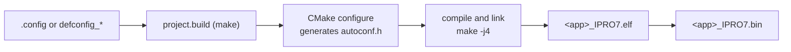

# Build System & Configuration

FreeRTOS applications are built by `make` driving CMake. The `.config` file of an application lists every `CONFIG_*` setting; the build turns it into the C header `autoconf.h` and uses it to pick the components to compile. This page explains that flow and how to build the Reef configurations; Zephyr builds with `west`, see [Zephyr RTOS](zephyr.md).

!!! abstract "At a glance"
    - Build with `make -C apps/<category>/<app>` or `./build_freertos.sh build <app>`. The image is `build/build_out/<app>_<CONFIG_CHIP>.bin`: `_IPRO7.bin` for IPRO7 and IPRO7AI applications, `_IPRO6.bin` for the IPRO6S ones.
    - `.config` is read as it is. Kconfig files only document options: `select`, `depends on` and defaults are not applied. The one exception is the Reef crystal trim, which the build sets to 95 when `.config` leaves it out.
    - Most Reef builds are alternate configurations: `DEFCONFIG=defconfig_reef` builds into `build_reef/`. Only `ipro7ai_reef_demo`, `ipro_reef_teach` and `ipro_agora_sentino` build the Reef with a plain `make`.
    - `make menuconfig` and `make defconfig` do not work in the release package; edit `.config` or a `defconfig_*` file with a text editor.
    - The toolchain (GCC 14, `/opt/toolchain/riscv_ipro7/`) is not part of the SDK; get it from INTELPRO.

## Build flow { #build-pipeline }



Run every command from the SDK root:

```bash
make -C apps/platform/ipro7ai_reef_demo          # build the out-of-box firmware
make -C apps/platform/ipro7ai_reef_demo clean    # delete build/
./build_freertos.sh -l                           # list every application by category
./build_freertos.sh build ipro7ai_reef_demo      # build by name; the log goes to build/build.log
```

What happens during a build:

1. The application's `Makefile` runs `make -C <SDK> -f project.build PROJECT_PATH=<app dir>`. The project name is the application directory's name.
2. `project.build` reads `CONFIG_CPU_ID` and `CONFIG_CROSS_COMPILE` from the configuration file and finds CMake: the `cmake` on your `PATH` first, then the bundled `tools/cmake/` (CMake 3.15, Linux x86-64 only). Without either it stops with `No cmake found`.
3. CMake configures the build directory with the Unix Makefiles generator. `cmake/generate_autoconf.cmake` writes `include/generated/autoconf.h` from the configuration, then `bsp/`, `components/` and the application directory are added.
4. `make -j4` compiles and links. Most SDK component libraries are compiled with `-Werror`, so a warning in one of them stops the build. The linker prints the usage of each memory region at the end, and `objcopy` produces the `.bin`.
5. `compile_commands.json` is copied to the SDK root for editor code indexing.

The build prints `[INFO] Build Path: <dir>` and `CPU: intelpro_ipro7` before CMake starts, so you can see which directory and toolchain target it uses.

### Toolchain prefix { #toolchain }

The compiler prefix is taken from the first of these that is set:

1. `CROSS_COMPILE` in the environment or on the make command line: `make -C <app> CROSS_COMPILE=<dir>/bin/riscv64-unknown-elf-`.
2. `CONFIG_CROSS_COMPILE` in the configuration file. Most shipped configurations set `/opt/toolchain/riscv_ipro7/bin/riscv64-unknown-elf-`.
3. `/opt/toolchain/riscv_ipro7/bin/riscv64-unknown-elf-` (not on Windows).

`cmake/toolchain.cmake` appends `gcc`, `g++`, `ld` and `objcopy` to that prefix; it does not search other paths. It then test-compiles the DSP extension instructions: if the compiler accepts them, the DSP flags are added, otherwise the standard GCC flags are used.

The release package documents macOS and Linux with a bash shell as the build host. `project.build` has a Windows branch (it parses the configuration with `python` and uses the `cmake` on `PATH`), but sets no default prefix there, so `CROSS_COMPILE` must always be given; `build_freertos.sh` and `tools/serial_monitor.py` need a POSIX shell.

### Output files { #outputs }

In `build/build_out/` (or `build_<name>/build_out/` for an alternate configuration):

| File | Contents |
|---|---|
| `<app>_<CHIP>.elf` | Image with symbols, for debugging and `size` |
| `<app>_<CHIP>.bin` | Binary to flash |
| `<app>_<CHIP>.map` | Linker map |
| `<app>_<CHIP>.asm` | Disassembly, only with `CONFIG_GENERATE_ASM=y` |

`<CHIP>` is the value of `CONFIG_CHIP`: `IPRO7` for every IPRO7 and IPRO7AI configuration (the Reef included), `IPRO6` for `ipro6_demo`, `ipro6_if_wifi` and `ipro6_fmac`. Other `build_freertos.sh` actions and options are in [Tool Command Lines](../reference/tools.md).

## The .config file { #configuration }

`.config` has one setting per line, in the Linux kernel format. The build converts it as follows:

| `.config` | `autoconf.h` |
|---|---|
| `CONFIG_SHELL=y` | `#define CONFIG_SHELL 1` |
| `CONFIG_EM_SIZE=16` | `#define CONFIG_EM_SIZE 16` |
| `CONFIG_CHIP="IPRO7"` | `#define CONFIG_CHIP "IPRO7"` |
| `# CONFIG_EASYFLASH4 is not set` or `CONFIG_X=n` | `#undef`, not defined |
| Other comment lines | C comments |

Each setting is also passed to the compiler as `-D` and set as a CMake variable of the same name, so an application's `CMakeLists.txt` can test `if(CONFIG_SHELL)` directly.

Options are documented in the root `Kconfig`, `bsp/Kconfig`, `components/**/Kconfig` and some application `Kconfig` files, but the build reads only the configuration file and never evaluates Kconfig. As a result:

- `select` has no effect. `CONFIG_IPRO7AI_REEF` and `CONFIG_MM_SUPPORT`, for example, select `USE_PSRAM` in Kconfig, yet the configuration must still state `CONFIG_USE_PSRAM=y`.
- Kconfig defaults are not applied. An option the file does not mention is not set.
- One default is supplied by the build anyway: on the Reef, when the configuration has no `CONFIG_IPRO7_XTAL_CAPCODE`, `bsp/board/ipro7/CMakeLists.txt` adds `-DCONFIG_IPRO7_XTAL_CAPCODE=95` and prints `[board] IPRO7AI Reef: CONFIG_IPRO7_XTAL_CAPCODE=95 (board default)`. An explicit value in the configuration wins; `0` keeps the value the chip booted with. It is a compiler definition, not an `autoconf.h` line.
- Start a new configuration from the closest shipped one rather than from an empty file.

### Board keys { #board-keys }

The board key selects the board header in `bsp/board/ipro7/` through `board_config.h`. Set exactly one. `board_config.h` tests the keys in a fixed order, and `CONFIG_EVB` / `CONFIG_DVK` and `CONFIG_IPRO7AI_EVK` come before `CONFIG_IPRO7AI_REEF`: a configuration that sets both `CONFIG_EVB=y` and `CONFIG_IPRO7AI_REEF=y` builds for the IPRO7 EVB without any message.

| Key | Board header |
|---|---|
| `CONFIG_IPRO7AI_REEF=y` | `ipro7ai_reef_board_config.h` (IPRO7AI Reef EVK) |
| `CONFIG_EVB=y`, `CONFIG_IPRO7AI_EVK=y`, `CONFIG_IPRO7_ARDUINO=y` and others | Other INTELPRO boards |

Every shipped Reef configuration sets `CONFIG_IPRO7AI_REEF=y` and `CONFIG_BOARD="IPRO7AI_REEF"` and no other board key.

### Common settings { #common-settings }

| Setting | Meaning |
|---|---|
| `CONFIG_IPRO7=y`, `CONFIG_CHIP="IPRO7"` | Chip; `CONFIG_CHIP` is also the output file name suffix (`CONFIG_IPRO6=y`, `CONFIG_CHIP="IPRO6"` for IPRO6S) |
| `CONFIG_CPU_ID="intelpro_ipro7"` | Toolchain target, the same for both chips |
| `CONFIG_CROSS_COMPILE="…/riscv64-unknown-elf-"` | Toolchain prefix; see [Toolchain prefix](#toolchain) |
| `CONFIG_IPRO7AI_REEF=y`, `CONFIG_BOARD="IPRO7AI_REEF"` | Board; see [Board keys](#board-keys) |
| `CONFIG_FREERTOS_SUPPORT=y` | Use FreeRTOS |
| `CONFIG_LINK_FLASH=y` | Run code directly from flash (XIP) |
| `CONFIG_IPRO7_FLASH_2M=y` (or `_4M`, `_8M`) | Flash size to link for; 1 MB when unset |
| `CONFIG_USE_PSRAM=y` | Enable the 8 MB PSRAM |
| `CONFIG_PLATFORM_UART_BAUDRATE=115200` | Console baud rate; 115200 when unset |
| `CONFIG_SHELL=y` | Console shell |
| `CONFIG_MM_SUPPORT=y` | ISP, camera and MJPEG; also set `CONFIG_USE_PSRAM=y` |
| `CONFIG_AI_SUPPORT=y` | NPU inference runtime; also set `CONFIG_USE_PSRAM=y` |
| `CONFIG_BLUETOOTH_LE_ENABLE=y` | BLE; controller and host settings are in [BLE Development](ble.md) |

After a build, `include/generated/autoconf.h` in the build directory shows the values that took effect. For `make -C apps/bluetooth/ble/ipro_ble_remote DEFCONFIG=defconfig_reef`:

```c title="apps/bluetooth/ble/ipro_ble_remote/build_reef/include/generated/autoconf.h (excerpt)"
#define CONFIG_IPRO7 1
#define CONFIG_CHIP "IPRO7"
#define CONFIG_IPRO7AI_REEF 1
#define CONFIG_BOARD "IPRO7AI_REEF"
#define CONFIG_IPRO7_FLASH_2M 1
/* CONFIG_EASYFLASH4 is not set */
#undef CONFIG_EASYFLASH4
#define CONFIG_IPRO_BLE_REMOTE_OTA 1
#define CONFIG_IPRO_BLE_CTLR_LIB "link1_periph"
#define CONFIG_EM_SIZE 16
```

### Configuration tools { #config-tools }

| Tool | In the release package |
|---|---|
| A text editor | Edit `.config` or a `defconfig_*` file directly; this is the supported way |
| `make menuconfig` | Does not work: it needs `tools/kconfig/menuconfig.py`, which is not shipped, and the application Makefiles do not forward the target |
| `make defconfig`, `make list-defconfigs` | Some Makefiles (`ipro_ble_remote`, for example) have these targets. They look in a `configs/` directory that is not shipped, then copy the application's local `defconfig` over `.config` |
| `make savedefconfig`, `make show-config` | Copy `.config` to `defconfig`; print `.config` |
| `tools/script/parse_kconfig_dynamic.py` | Prints a Kconfig tree as JSON (needs `kconfiglib`); not used by the build |

## Alternate configurations { #variants }

Applications that support several boards or features ship more than one configuration file. Pick one without touching `.config`:

| Method | Example | Build directory |
|---|---|---|
| `DEFCONFIG=<file>` | `make -C apps/bluetooth/ble/ipro_ble_remote DEFCONFIG=defconfig_reef` | `build_reef/` |
| `build_freertos.sh -d <file>` | `./build_freertos.sh -d defconfig_reef build ipro_ble_remote` | `build_reef/` |
| `BOARD=<board>` | `make -C apps/multimedia/ipro_agora_sentino` (default `BOARD=reef`, `.config`) | `build/` |

- `DEFCONFIG=` copies the file to `build_<name>/.config` and builds there. `<name>` is the file name without the `defconfig_` prefix and without an extension: `defconfig_reef_ov5640` builds into `build_reef_ov5640/`, `config_evk` into `build_config_evk/`.
- The output file name does not change: it is still `<app>_IPRO7.bin`, in `build_<name>/build_out/`.
- `BOARD=` is implemented by two Makefiles only: `ipro_agora_sentino` (default `reef`, `.config`; `BOARD=evk` selects `config_evk`) and `ipro_pdm_mic_demo` (an IPRO7 EVB / IPRO7AI EVK application). Elsewhere it is ignored. `build_freertos.sh` has no `BOARD` option; pass the file with `-d`.
- `make clean` depends on the application's Makefile. Where `clean` is handed to `project.build` (`ipro_ble_remote`, `ipro_throughput_test`, `ipro_le_audio_headset`, `ipro7_uvc_cam`, `ipro_agora_sentino`), `make clean DEFCONFIG=<file>` removes `build_<name>/`. `ipro7ai_reef_demo`, `ipro_reef_teach` and `ipro_ai_link` remove only `build/`, and `ipro7_jpeg_decode` removes `build/` and every `build_*/`; delete other build directories by hand.
- `-j N` on the command line, or `build_freertos.sh -j N`, applies to the outer make only; the compile step always runs with `-j4`.

The Reef configurations in this release:

| Application | Build command | Flash linked for | Console |
|---|---|---|---|
| `ipro7ai_reef_demo` | `make -C apps/platform/ipro7ai_reef_demo` | 1 MB | 115200 |
| `ipro7ai_reef_demo` + Wi-Fi | `make -C apps/platform/ipro7ai_reef_demo DEFCONFIG=defconfig_wifi_ipro6s` | 1 MB | 115200 |
| `ipro_reef_teach` | `make -C apps/ai/ipro_reef_teach` | 2 MB | 115200 |
| `ipro_ble_remote` | `make -C apps/bluetooth/ble/ipro_ble_remote DEFCONFIG=defconfig_reef` | 2 MB | 115200 |
| `ipro_throughput_test` | `make -C apps/bluetooth/ble/ipro_throughput_test DEFCONFIG=defconfig_reef` | 1 MB | 115200 |
| `ipro_le_audio_headset` | `make -C apps/bluetooth/le_audio/ipro_le_audio_headset DEFCONFIG=defconfig_reef` | 2 MB | 115200 |
| `ipro7_uvc_cam` webcam | `make -C apps/multimedia/ipro7_uvc_cam DEFCONFIG=defconfig_reef_ov5640` | own `ipro7_uvc_cam.ld` | 115200 |
| `ipro7_uvc_cam` RPS game | `make -C apps/multimedia/ipro7_uvc_cam DEFCONFIG=defconfig_reef_rps` | own `ipro7_uvc_cam.ld` | 115200 |
| `ipro7_jpeg_decode` | `make -C apps/multimedia/ipro7_jpeg_decode DEFCONFIG=defconfig_reef` | 1 MB | **921600** |
| `ipro_ai_link` | `make -C apps/test/ipro_ai_link DEFCONFIG=defconfig_reef` | 2 MB | 115200 |
| `ipro_agora_sentino` | `make -C apps/multimedia/ipro_agora_sentino` | 2 MB | 115200 |

A plain `make` of `ipro_ble_remote`, `ipro_throughput_test`, `ipro_le_audio_headset`, `ipro7_uvc_cam`, `ipro_ai_link` or `ipro7_jpeg_decode` builds for another board; on the Reef always pass the Reef file. Every Reef configuration sets `CONFIG_USE_PSRAM=y` except `ipro_throughput_test/defconfig_reef`. Flashing each of them, including partition tables, boot2 and the `mfg` payload, is in [Examples](../examples/index.md) and the application's README.

## Memory layout { #memory-layout }

| Region | Start address | Size | Use |
|---|---|---|---|
| Flash | `0x13000000` | Linked for 1 MB by default; `CONFIG_IPRO7_FLASH_2M` / `_4M` / `_8M` select 2 / 4 / 8 MB | Code and read-only data, executed in place |
| PSRAM | `0x1e000000` | 8 MB | With `CONFIG_USE_PSRAM=y`, holds `.data`, `.bss` and the main heap |
| OCRAM | `0x11010000` | 256 KB, minus the reservations below | Main RAM when PSRAM is off; `.ocram_*` sections, stacks and code that must run fast |
| HBNRAM | `0x20090000` | 4 KB | Data kept through hibernation |

How much OCRAM the linker gets depends on the configuration:

| Configuration | OCRAM available to the linker |
|---|---|
| AI off (the usual case) | 256 KB minus `CONFIG_EM_SIZE` (BLE Exchange Memory, reserved at the top of OCRAM) |
| `CONFIG_AI_SUPPORT=y` and `CONFIG_MM_SUPPORT=y`, no BLE (`CONFIG_EM_SIZE` 0 or unset) | 64 KB |
| `CONFIG_AI_SUPPORT=y` and `CONFIG_MM_SUPPORT=y`, with BLE | 48 KB |

With AI and imaging both on, the NPU takes over the upper part of OCRAM; add the BLE Exchange Memory and OCRAM gets tight, so an application that needs all three may have to split them into separate configurations.

- Never link for more flash than the board has; the 1 MB default keeps an image from silently outgrowing the part. The Reef's IPRO7AI has 2 MB of in-package flash ([IPRO7AI Reef EVK](../hardware/boards/reef-evk.md)); the Reef configurations above link for 1 MB or 2 MB as listed. The `ipro7ai_reef_demo` `.config` notes that its 1 MB layout fits either in-package part and that `CONFIG_IPRO7_FLASH_2M=y` hands the linker the whole part.
- Linking for 2 MB does not enlarge the firmware partition: the image must still fit the firmware slot of the partition table you flash with (`partition_cfg_2M.toml`: 1180 KB).
- The linker script is generated from `bsp/board/linker/` (template `ipro7/ipro7_common.ld.in`, memory parameters in `configs/ipro7_flash.cmake`). If the application directory contains `<app>.ld` (`ipro7_uvc_cam.ld`, for example), or the configuration sets `CONFIG_LINKER_SCRIPT="<file>"`, that script is used instead and the flash-size keys do not apply.
- The memory usage printed at the end of the build is what tells you whether the image fits.

## Application structure { #app-structure }

```text
apps/<category>/<app>/
├── .config            build configuration (required)
├── Makefile           calls project.build in the SDK root
├── CMakeLists.txt     sources, include paths and setup_project()
├── main.c             entry point
├── Kconfig            (optional) documents application options
├── defconfig_*        (optional) alternate configurations
├── <app>.ld           (optional) application linker script
├── src/  include/
└── build/             build output (generated)
    ├── include/generated/autoconf.h
    └── build_out/<app>_IPRO7.{elf,bin,map}
```

An application `CMakeLists.txt` needs no `cmake_minimum_required()` or `project()`; it uses the SDK build macros directly:

| Macro or property | Effect |
|---|---|
| `__component_add_include_dirs(<dir>)` | Add an include path |
| `target_sources(app PRIVATE ...)` | Add sources to the `app` library; do not list `main.c` here |
| `set_property(GLOBAL APPEND PROPERTY SDK_LIBS app)` | Link the `app` library |
| `set_property(GLOBAL APPEND PROPERTY SDK_WHOLE_ARCHIVE_LIBS app)` | Link it whole-archive; required when the application registers shell commands |
| `__set_main_file(main.c)` | Name the main file, compiled into the ELF only |
| `setup_project(<app>)` | Produce `<app>_<CHIP>.elf`, `.bin` and `.map`; the name must match the directory name |

`if(CONFIG_…)` in `CMakeLists.txt` adds sources only for the configurations that need them. The out-of-box firmware adds its Wi-Fi and RTSP sources this way, so one directory builds both `.config` and `defconfig_wifi_ipro6s`:

```cmake title="apps/platform/ipro7ai_reef_demo/CMakeLists.txt (excerpt)"
# Wi-Fi through the IPRO6S_FIN in CARD1 (ipronet_host over SDIO).
if(CONFIG_WIFI_USE_IPRO6S)
    target_sources(app PRIVATE ${CMAKE_CURRENT_SOURCE_DIR}/src/wifi_ipro6s.c)
    ...
endif()

# RTSP MJPEG camera stream over that Wi-Fi; camera ch0 at sensor / 2.
if(CONFIG_WIFI_USE_IPRO6S AND CONFIG_RTSP_SERVER)
    target_sources(app PRIVATE ${CMAKE_CURRENT_SOURCE_DIR}/src/wifi_rtsp.c)
    target_compile_definitions(app PRIVATE CAM_SCALE_DIV=2u)
endif()
```

Every FreeRTOS application shares `components/os/freertos/freertos_app_hooks`: the heap, the FreeRTOS hooks (idle, tick, stack overflow, malloc failed) and assert all have weak default implementations. `main()` only calls `ipro_platform_init()`, creates its tasks and starts the scheduler.

- `ipro_platform_init()` runs platform init (board setup and the console UART), the heap, the boot2 partition table, logging and, with `CONFIG_SHELL=y`, the shell. Do not initialize the shell a second time in your application.
- Do not add heap, hook or assert boilerplate to `main.c`. To override a hook such as `vApplicationIdleHook`, define a non-weak version with the same name in your own source; the linker picks it automatically.

## Hands-on on the Reef { #hands-on }

Make your own alternate configuration of the out-of-box firmware, check what the build did with it, and run it. The example links `ipro7ai_reef_demo` for the full 2 MB of in-package flash, as its `.config` suggests.

<div class="ipro-steps" markdown>

1. **Create the configuration file.** Copy `.config` and add one line:

    ```bash
    cp apps/platform/ipro7ai_reef_demo/.config apps/platform/ipro7ai_reef_demo/defconfig_2m
    echo 'CONFIG_IPRO7_FLASH_2M=y' >> apps/platform/ipro7ai_reef_demo/defconfig_2m
    ```

    ```ini title="apps/platform/ipro7ai_reef_demo/defconfig_2m (added line)"
    CONFIG_IPRO7_FLASH_2M=y
    ```

2. **See where the key is used.** The linker-script generator turns it into the size of the `flash` memory region:

    ```cmake title="bsp/board/linker/configs/ipro7_flash.cmake (excerpt)"
    elseif(CONFIG_IPRO7_FLASH_2M)
        set(FLASH_SIZE "2M")
        message(STATUS "IPRO7 flash: 2M (CONFIG_IPRO7_FLASH_2M=y, SF3 external flash)")
    ...
    else()
        set(FLASH_SIZE "1M")
        message(STATUS "IPRO7 flash: 1M (default, on-chip)")
    endif()
    ```

3. **Build it.**

    ```bash
    make -C apps/platform/ipro7ai_reef_demo DEFCONFIG=defconfig_2m
    ```

    Among the build output (paths shortened):

    ```text
    [INFO] Using defconfig: defconfig_2m -> <SDK>/apps/platform/ipro7ai_reef_demo/build_2m/.config
    [INFO] Build Path: <SDK>/apps/platform/ipro7ai_reef_demo/build_2m
    -- IPRO7 flash: 2M (CONFIG_IPRO7_FLASH_2M=y, SF3 external flash)
    -- [board] IPRO7AI Reef: CONFIG_IPRO7_XTAL_CAPCODE=95 (board default)
    Memory region         Used Size  Region Size  %age Used
               flash:          …         2 MB       …%
    ```

    The image is `apps/platform/ipro7ai_reef_demo/build_2m/build_out/ipro7ai_reef_demo_IPRO7.bin`; your `.config` and `build/` are untouched.

4. **Check what took effect.**

    ```bash
    grep -E '^#define CONFIG_(IPRO7AI_REEF|IPRO7_FLASH_2M) ' \
        apps/platform/ipro7ai_reef_demo/build_2m/include/generated/autoconf.h
    ```

    ```text
    #define CONFIG_IPRO7AI_REEF 1
    #define CONFIG_IPRO7_FLASH_2M 1
    ```

5. **Flash and run it.** Flash it like the out-of-box firmware ([Flashing & Serial Console](../get-started/flash-and-monitor.md)), with the image from `build_2m/`, or in one command:

    ```bash
    export IPRO_FLASH_TOOL=<ICUBE>/ipro_iot_tool_macos
    ./build_freertos.sh -d defconfig_2m -p /dev/cu.usbserial-XXXX \
        -P <ICUBE>/chips/ipro7/partition/partition_cfg_2M.toml \
        build flash monitor ipro7ai_reef_demo
    ```

6. **Read the console** (115200 baud). Among the first lines (log prefixes left out), the `Build:` line carries the time of your build and the `[XTAL]` line shows the trim the build supplied:

    ```text
    Build:<time>,<date>
    [XTAL] capcode <boot value> -> 95
      IPRO7AI Reef carrier demo
      UART0 TX=20 RX=21  RGB=G24  SPK_EN=G25(hi)
    shell ready - `reef`, `led`, `btn`, `spk`, `mic`, `sd`, `fin`, `cam`, `hp`
    ```

</div>

To go back, flash the image from `build/` again. Next: write an application of your own in [Create Your First Application](../tutorials/first-own-app.md), then check it with [Test Your Application](../tutorials/testing.md).

## Creating a new application { #creating-apps }

[Create Your First Application](../tutorials/first-own-app.md) builds a Reef application from an empty directory step by step. The rules it follows:

- Place the application at `apps/<category>/<app>/`. The copied Makefile finds the SDK root with `IPRO_SDK_BASE ?= $(abspath ../../../)`; one level deeper, as in `apps/bluetooth/ble/<app>`, it must be `../../../../`. Copy the Makefile rather than pasting it: recipe lines must start with a tab.
- Start `.config` from `apps/platform/ipro7ai_reef_demo/.config` and remove what you do not need. The comment on its first line is the description `./build_freertos.sh -l` prints.
- Write `CMakeLists.txt` with the macros in [Application structure](#app-structure); the name passed to `setup_project()` must match the directory name.
- Keep `main.c` minimal:

    ```c title="main.c"
    #include <FreeRTOS.h>
    #include <task.h>

    #include "freertos_app_hooks.h"

    static void app_task(void *arg)
    {
        (void)arg;
        for (;;) {
            vTaskDelay(pdMS_TO_TICKS(1000));
        }
    }

    int main(void)
    {
        ipro_platform_init();   /* platform, heap, boot2, log, shell */
        xTaskCreate(app_task, "app", 1024, NULL, 5, NULL);
        vTaskStartScheduler();
        for (;;) {
        }
    }
    ```

## Limitations in this release { #limitations }

- No interactive configuration: `make menuconfig` and `make defconfig` do not work in the release package (see [Configuration tools](#config-tools)).
- Kconfig is not evaluated; dependent options must be written into the configuration file. The Reef crystal trim is the only default the build supplies.
- `BOARD=` works in `ipro_agora_sentino` and `ipro_pdm_mic_demo` only.
- The release package documents macOS and Linux build hosts only.

## Related documents { #related }

- [Create Your First Application](../tutorials/first-own-app.md): a Reef application from an empty directory.
- [Test Your Application](../tutorials/testing.md): console checks, self-tests and `build_freertos.sh test`.
- [Architecture](architecture.md): layers, components and directories.
- [BLE Development](ble.md): BLE settings in `.config`.
- [Tool Command Lines](../reference/tools.md): every `build_freertos.sh` action and option.
- [Examples](../examples/index.md): the configurations each application ships.
