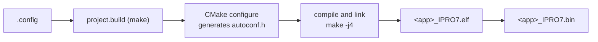

# Build System & Configuration

FreeRTOS applications are built by `make` driving CMake. The `.config` file in each application directory lists every `CONFIG_*` setting; the build turns it into the C header `autoconf.h` and uses it to decide which components to compile. Zephyr applications build with `west`; see [Zephyr RTOS](zephyr.md).

!!! abstract "At a glance"
    - Build with `make -C apps/<category>/<app>` or `./build_freertos.sh <app> build`; the output is `build/build_out/<app>_IPRO7.bin`.
    - `.config` is the build configuration. Kconfig files only document options: `select`, `depends on` and defaults are not applied, so dependent options must be written into `.config` yourself.
    - Pick an alternate configuration with `DEFCONFIG=<file>`; it builds into `build_<name>/`. Only `ipro_pdm_mic_demo` and `ipro_agora_sentino` support `BOARD=`.
    - The toolchain lives in `/opt/toolchain/riscv_ipro7/`. It is not part of the SDK; get it from INTELPRO.

## Build flow { #build-pipeline }



```bash
make -C apps/platform/ipro7ai_reef_demo          # build
make -C apps/platform/ipro7ai_reef_demo clean    # delete build/
./build_freertos.sh -l                           # list every application by category
./build_freertos.sh ipro7ai_reef_demo build      # build by name; the log goes to build/build.log
```

What happens during a build:

1. The application's `Makefile` runs `make -C <SDK> -f project.build PROJECT_PATH=<app dir>`. The project name is the name of the application directory.
2. `project.build` reads `CONFIG_CPU_ID` and `CONFIG_CROSS_COMPILE` from `.config` (a `CROSS_COMPILE` environment variable takes precedence) and uses the `cmake` on your PATH, falling back to the bundled `tools/cmake/` (Linux x86-64 only). The top-level `CMakeLists.txt` requires CMake 3.15 or later.
3. CMake configures `build/` with the Unix Makefiles generator. `cmake/generate_autoconf.cmake` converts `.config` into `build/include/generated/autoconf.h`, then `bsp/`, `components/` and the application directory are added.
4. `make -j4` compiles and links. The linker prints the usage of each memory region at the end, and `objcopy` produces the `.bin`.
5. `build/compile_commands.json` is copied to the SDK root for editor code indexing.

Output files in `build/build_out/`:

| File | Contents |
|---|---|
| `<app>_IPRO7.elf` | Image with symbols, for debugging and `size` |
| `<app>_IPRO7.bin` | Binary to flash |
| `<app>_IPRO7.map` | Linker map |
| `<app>_IPRO7.asm` | Disassembly, only with `CONFIG_GENERATE_ASM=y` |

The file name suffix comes from `CONFIG_CHIP` in `.config`; it is `IPRO7` for every V2.1.0 application. `cmake/toolchain.cmake` first test-compiles the DSP extension instructions: if they are available it adds the DSP flags, otherwise it uses the standard GCC flags. Other `build_freertos.sh` actions and options are in [Tool Command Lines](../reference/tools.md).

## The .config file { #configuration }

`.config` has one setting per line, in the Linux kernel format. The build converts it as follows:

| `.config` | `autoconf.h` |
|---|---|
| `CONFIG_SHELL=y` | `#define CONFIG_SHELL 1` |
| `CONFIG_EM_SIZE=16` | `#define CONFIG_EM_SIZE 16` |
| `CONFIG_CHIP="IPRO7"` | `#define CONFIG_CHIP "IPRO7"` |
| `# CONFIG_IPRO_BLE_REMOTE_OTA is not set` or `CONFIG_X=n` | `#undef`, not defined |

A CMake variable of the same name is set as well, so an application's `CMakeLists.txt` can test `if(CONFIG_SHELL)` directly.

Options are documented in the root `Kconfig`, `bsp/Kconfig`, `components/**/Kconfig` and some application `Kconfig` files, but the build reads only `.config` and never parses Kconfig. As a result:

- `select` has no effect. `CONFIG_IPRO7AI_REEF` and `CONFIG_MM_SUPPORT`, for example, select `USE_PSRAM` in Kconfig, yet `.config` must still state `CONFIG_USE_PSRAM=y`.
- Kconfig defaults are not applied. An option that `.config` does not mention is not set.
- Start a new application from the `.config` of the closest shipped application rather than from an empty file.

Common settings:

| Setting | Meaning |
|---|---|
| `CONFIG_IPRO7=y`, `CONFIG_CHIP="IPRO7"` | Chip; `CONFIG_CHIP` is also the output file name suffix |
| `CONFIG_CPU_ID="intelpro_ipro7"` | Toolchain target |
| `CONFIG_CROSS_COMPILE="/opt/toolchain/riscv_ipro7/bin/riscv64-unknown-elf-"` | Toolchain prefix |
| `CONFIG_EVB=y`, `CONFIG_IPRO7AI_EVK=y`, `CONFIG_IPRO7AI_REEF=y` | Board, exactly one; selects the board header in `bsp/board/ipro7/` |
| `CONFIG_FREERTOS_SUPPORT=y` | Use FreeRTOS |
| `CONFIG_LINK_FLASH=y` | Run code directly from flash (XIP) |
| `CONFIG_IPRO7_FLASH_2M=y` (or `_4M`, `_8M`) | Flash size to link for; 1 MB when unset |
| `CONFIG_USE_PSRAM=y` | Enable the 8 MB PSRAM |
| `CONFIG_PLATFORM_UART_BAUDRATE=115200` | Console baud rate; 115200 when unset |
| `CONFIG_SHELL=y` | Console shell |
| `CONFIG_MM_SUPPORT=y` | ISP, camera and MJPEG; also set `CONFIG_USE_PSRAM=y` |
| `CONFIG_AI_SUPPORT=y` | NPU inference runtime; also set `CONFIG_USE_PSRAM=y` |
| `CONFIG_BLUETOOTH_LE_ENABLE=y` | BLE; controller and host settings are in [BLE Development](ble.md) |

After a build, `build/include/generated/autoconf.h` shows the values that actually took effect. For `ipro_ble_remote`:

```c title="build/include/generated/autoconf.h (excerpt)"
#define CONFIG_IPRO7 1
#define CONFIG_CHIP "IPRO7"
#define CONFIG_IPRO_BLE_CTLR_LIB "link1_periph"
#define CONFIG_EM_SIZE 16
/* CONFIG_IPRO_BLE_REMOTE_OTA is not set */
#undef CONFIG_IPRO_BLE_REMOTE_OTA
```

## Alternate configurations { #variants }

Some applications ship several configuration files for different boards or features. To pick one:

| Method | Example | Output directory |
|---|---|---|
| `DEFCONFIG=<file>` | `make -C apps/multimedia/ipro7_uvc_cam DEFCONFIG=defconfig_reef_ov5640` | `build_reef_ov5640/` |
| | `make -C apps/platform/ipro7ai_evk_demo DEFCONFIG=config_ai` | `build_config_ai/` |
| `BOARD=<board>` | `make -C apps/multimedia/ipro_pdm_mic_demo BOARD=evk` | `build_config_evk/` |
| `build_freertos.sh -d` | `./build_freertos.sh build -d defconfig_reef ipro_ble_remote` | `build_reef/` |
| Copy over `.config` | `cp UAC.config .config && make clean && make` (`ipro_le_audio_headset`) | `build/` |

- `DEFCONFIG=` copies the file to `build_<name>/.config` and builds there; the `.config` in the application directory is left alone. `<name>` is the file name with the `defconfig_` prefix removed; a file that does not start with `defconfig_` keeps its name.
- Only two application Makefiles implement `BOARD=`: `ipro_pdm_mic_demo` (default `evb`; `BOARD=evk` selects `config_evk`) and `ipro_agora_sentino` (default `reef`; `BOARD=evk` selects `config_evk`).
- The output file name does not change: it is still `<app>_IPRO7.bin`, in the matching `build_<name>/build_out/`.
- Which configuration files each application ships is listed in [Examples](../examples/index.md) and the application's README.

## Memory layout { #memory-layout }

| Region | Start address | Size | Use |
|---|---|---|---|
| Flash | `0x13000000` | Linked for 1 MB by default; `CONFIG_IPRO7_FLASH_2M` / `_4M` / `_8M` select 2 / 4 / 8 MB | Code and read-only data, executed in place |
| PSRAM | `0x1e000000` | 8 MB | With `CONFIG_USE_PSRAM=y`, holds `.data`, `.bss` and the main heap |
| OCRAM | `0x11010000` | 256 KB, minus the reservations below | Main RAM when PSRAM is off; `.ocram_*` sections, stacks and code that must run fast |
| HBNRAM | `0x20090000` | 4 KB | Data kept through hibernation |

How much OCRAM the linker gets depends on the configuration:

| Configuration | OCRAM available to the linker |
|---|---|
| AI off (the usual case) | 256 KB minus `CONFIG_EM_SIZE` (BLE Exchange Memory, reserved at the top of OCRAM) |
| `CONFIG_AI_SUPPORT=y` and `CONFIG_MM_SUPPORT=y`, no BLE (`CONFIG_EM_SIZE` 0 or unset) | 64 KB |
| `CONFIG_AI_SUPPORT=y` and `CONFIG_MM_SUPPORT=y`, with BLE | 48 KB |

With AI and imaging both on, the NPU takes over the upper part of OCRAM; add the BLE Exchange Memory and OCRAM gets tight. That is why `ipro7ai_evk_demo` splits AI and Bluetooth into separate `config_ai` and `config_bt` configurations.

- Never link for more flash than the board has. The 1 MB default keeps an image from silently outgrowing the physical part. Flash sizes are on the board pages. The `ipro7ai_reef_demo` `.config` links for 1 MB by default; if the board reports JEDEC ID 0xEF4015 (2 MB) at boot, you can add `CONFIG_IPRO7_FLASH_2M=y`.
- The linker script is generated from `bsp/board/linker/` (template `ipro7/ipro7_common.ld.in`, memory parameters in `configs/ipro7_flash.cmake`). If the application directory contains `<app>.ld` (for example `ipro7_uvc_cam.ld`), or `.config` sets `CONFIG_LINKER_SCRIPT="<file>"`, the application's own linker script is used instead.
- The memory usage printed at the end of the build is what tells you whether the image fits.

## Application structure { #app-structure }

```text
apps/<category>/<app>/
├── .config            build configuration (required)
├── Makefile           calls project.build in the SDK root
├── CMakeLists.txt     sources, include paths and setup_project()
├── main.c             entry point
├── Kconfig            (optional) documents application options
├── defconfig_*        (optional) alternate configurations
├── <app>.ld           (optional) application linker script
├── src/  include/
└── build/             build output (generated)
    ├── include/generated/autoconf.h
    └── build_out/<app>_IPRO7.{elf,bin,map}
```

An application `CMakeLists.txt` needs no `cmake_minimum_required()` or `project()`; it uses the SDK build macros directly:

| Macro or property | Effect |
|---|---|
| `__component_add_include_dirs(<dir>)` | Add an include path |
| `target_sources(app PRIVATE ...)` | Add sources to the `app` library; do not list `main.c` here |
| `set_property(GLOBAL APPEND PROPERTY SDK_LIBS app)` | Link the `app` library |
| `set_property(GLOBAL APPEND PROPERTY SDK_WHOLE_ARCHIVE_LIBS app)` | Link it whole-archive; required when the application registers shell commands |
| `__set_main_file(main.c)` | Name the main file, compiled into the ELF only |
| `setup_project(<app>)` | Produce `<app>_IPRO7.elf`, `.bin` and `.map`; the name must match the directory name |

Every FreeRTOS application shares `components/os/freertos/freertos_app_hooks`: the heap, the FreeRTOS hooks (idle, tick, stack overflow, malloc failed) and assert all have weak default implementations. `main()` only calls `ipro_platform_init()`, creates its tasks and starts the scheduler.

- `ipro_platform_init()` runs platform init (including board setup), the heap, the boot2 partition table, logging and, with `CONFIG_SHELL=y`, the shell. Do not initialize the shell a second time in your application.
- Do not add heap, hook or assert boilerplate to `main.c`. To override a hook such as `vApplicationIdleHook`, define a non-weak version with the same name in your own source; the linker picks it automatically.

## Creating a new application { #creating-apps }

This example creates `apps/platform/my_app` for the IPRO7AI Reef EVK, starting from the `ipro7ai_reef_demo` configuration.

<div class="ipro-steps" markdown>

1. **Create the directory and copy the configuration and Makefile**

    ```bash
    mkdir -p apps/platform/my_app
    cp apps/platform/ipro7ai_reef_demo/.config apps/platform/my_app/
    cp apps/platform/ipro7ai_reef_demo/Makefile apps/platform/my_app/
    ```

    - The comment on the first line of `.config` becomes the description that `./build_freertos.sh -l` prints, so change it to your own. For another board, copy `.config` from an application for that board instead (for the IPRO7 EVB, `apps/bluetooth/ble/ipro_ble_remote/.config`).
    - The Makefile only hands the build to `project.build` in the SDK root. Its `IPRO_SDK_BASE ?= $(abspath ../../../)` is the SDK root relative to the application directory, which fits `apps/<category>/<app>`; one level deeper, as in `apps/bluetooth/ble/my_app`, change it to `../../../../`. Copy the file rather than pasting from this page: Makefile recipe lines must start with a tab.

2. **Create CMakeLists.txt**

    ```cmake title="apps/platform/my_app/CMakeLists.txt"
    __component_add_include_dirs(.)

    # Add further sources here; main.c goes to __set_main_file() only
    # target_sources(app PRIVATE ${CMAKE_CURRENT_SOURCE_DIR}/src/my_module.c)

    set_property(GLOBAL APPEND PROPERTY SDK_LIBS app)
    set_property(GLOBAL APPEND PROPERTY SDK_WHOLE_ARCHIVE_LIBS app)

    __set_main_file(main.c)
    setup_project(my_app)
    ```

3. **Write main.c**

    ```c title="apps/platform/my_app/main.c"
    #include <FreeRTOS.h>
    #include <task.h>

    #include "freertos_app_hooks.h"
    #include "ipro_log.h"

    #define LOG_TAG "MY_APP"

    static void app_task(void *arg)
    {
        (void)arg;
        for (;;) {
            IPRO_LOGI(LOG_TAG, "running");
            vTaskDelay(pdMS_TO_TICKS(1000));
        }
    }

    int main(void)
    {
        ipro_platform_init();   /* platform, heap, boot2, log, shell */
        xTaskCreate(app_task, "app", 1024, NULL, 5, NULL);
        vTaskStartScheduler();
        for (;;) {
        }
    }
    ```

4. **Build**

    ```bash
    make -C apps/platform/my_app
    ```

    A successful build ends with the memory usage and produces `apps/platform/my_app/build/build_out/my_app_IPRO7.bin`. `./build_freertos.sh my_app build` works too.

</div>

Flashing and opening the console are covered in [Flashing & Serial Console](../get-started/flash-and-monitor.md).

## Related documents { #related }

- [Architecture](architecture.md): layers, components and directories
- [BLE Development](ble.md): BLE settings in `.config`
- [Tool Command Lines](../reference/tools.md): every `build_freertos.sh` action and option
- [First FreeRTOS Application](../get-started/first-app-freertos.md): the full build, flash and run cycle
