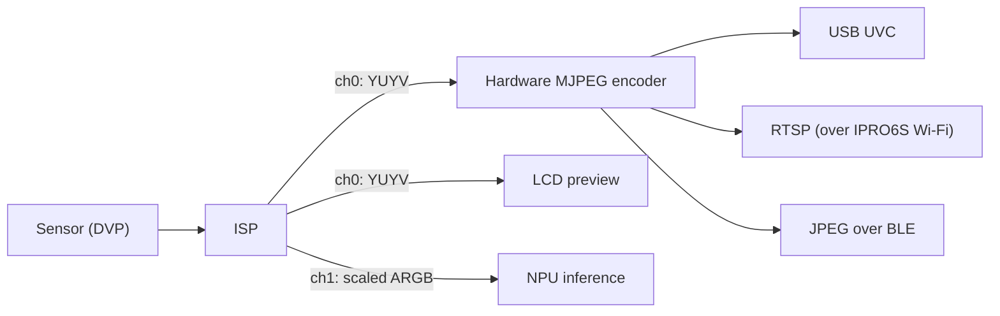

# Camera & Imaging

IPRO7 connects a camera sensor over DVP. The image goes through the on-chip ISP, which has two outputs: one for preview or the hardware MJPEG encoder, the other scaled down for the NPU. The SDK provides sensor drivers, ISP components, MJPEG and CherryUSB's UVC class, and the examples cover a USB webcam, LCD preview, NPU detection and RTSP streaming.

!!! abstract "At a glance"
    - Sensors: SC101IOT (IPRO7 EVB, IPRO7AI EVK); OV5640 and OV2640 (IPRO7AI Reef EVK, enabled in `.config`).
    - Imaging needs `CONFIG_MM_SUPPORT=y` together with `CONFIG_USE_PSRAM=y`; frame buffers live in PSRAM.
    - USB webcam: `ipro7_uvc_cam`, DVP → ISP → hardware MJPEG → UVC.
    - Zephyr has no camera driver yet; use FreeRTOS for camera work.

## Image pipeline { #camera-video }



- Each ISP output channel has its own resolution and frame rate: channel 0 feeds the preview or the encoder, and channel 1 takes a region of the sensor image, scales it to the model's input size and hands it to the NPU.
- For SC101IOT the ISP firmware runs 3A (auto exposure, white balance and so on) with the IQ parameters in `components/isp_iq_param/sc101iot/`; OV5640 and OV2640 use the sensor's own 3A.
- MJPEG encoding and decoding are both hardware-accelerated (`hal_mjpeg.h`, `hal_mjdec.h`).

## Components and configuration { #configuration }

| Part | Location | Description |
|---|---|---|
| Camera HAL | `bsp/hal/inc/hal_cam.h`, `hal_isp.h`, `hal_mjpeg.h`, `hal_mjdec.h` | DVP capture, ISP, MJPEG encode and decode |
| Sensors | `components/sensor/` | Sensor drivers and SCCB; `camera_module_init()` probes the registered sensors in turn |
| ISP control | `components/isp_firmware/` | ISP setup, 3A, image parameter handling |
| ISP algorithms | `components/isp_algorithm/` | Prebuilt `libisp_algorithm.a` |
| IQ parameters | `components/isp_iq_param/`, `components/isp_iq_cmd/` | Sensor IQ parameters and tuning commands |
| UVC | `components/cherryusb/class/video/` | USB Video Class device |
| RTSP | `components/network/rtsp_server/` | RTSP MJPEG streaming (`CONFIG_RTSP_SERVER`) |
| EVK camera | `components/board/ipro7ai_evk/` | Camera library for the IPRO7AI EVK (`evk_cam.h`) |

```ini title=".config (camera and USB webcam)"
CONFIG_USE_PSRAM=y
CONFIG_MM_SUPPORT=y
CONFIG_COMPONENTS_SENSOR_ENABLE=y
# Reef sensors are enabled separately:
# CONFIG_SENSOR_OV5640=y
# CONFIG_SENSOR_OV2640=y
CONFIG_COMPONENTS_CHERRYUSB_ENABLE=y
CONFIG_CHERRYUSB_DEVICE=y
CONFIG_CHERRYUSB_DEVICE_VIDEO=y
```

In Kconfig `CONFIG_MM_SUPPORT` selects `USE_PSRAM`, but the build does not parse Kconfig, so `CONFIG_USE_PSRAM=y` has to be in `.config`; see [Build System & Configuration](build-system.md#configuration).

### Supported sensors { #sensors }

| Sensor | `.config` | Output | Boards |
|---|---|---|---|
| SC101IOT | Included with `CONFIG_COMPONENTS_SENSOR_ENABLE=y` | 1280×720, DVP, SCCB address 0x68 | IPRO7 EVB, IPRO7AI EVK |
| OV5640 | `CONFIG_SENSOR_OV5640=y` | 1280×720 YUV422 (2×2 binning), SCCB 0x3C | IPRO7AI Reef EVK |
| OV2640 | `CONFIG_SENSOR_OV2640=y` | 1280×720 YUV422 (scaled from UXGA), SCCB 0x30 | IPRO7AI Reef EVK |

`components/sensor/` also contains GC6133 and GC032A drivers, which no shipped example uses.

## USB webcam ipro7_uvc_cam { #uvc-cam }

`apps/multimedia/ipro7_uvc_cam` makes the board enumerate as an ordinary UVC webcam: DVP sensor → ISP → hardware MJPEG → USB isochronous transfer. Once the host opens the stream it runs continuously.

| Configuration | Board and sensor | UVC frames | Console |
|---|---|---|---|
| `.config` | IPRO7 EVB + SC101IOT | 320×240 MJPEG | 921600 baud |
| `defconfig_reef_ov5640` | IPRO7AI Reef EVK + OV5640 | 1280×720 and 640×360 MJPEG, chosen by the host | 115200 baud |
| `defconfig_reef_rps` | IPRO7AI Reef EVK + OV5640 | 640×360 MJPEG with a rock-paper-scissors game against the NPU drawn in | 115200 baud |

```bash
make -C apps/multimedia/ipro7_uvc_cam DEFCONFIG=defconfig_reef_ov5640   # builds in build_reef_ov5640/build_out/
make -C apps/multimedia/ipro7_uvc_cam DEFCONFIG=defconfig_reef_rps      # builds in build_reef_rps/build_out/
make -C apps/multimedia/ipro7_uvc_cam                                   # IPRO7 EVB
```

- The stream advertises 30 fps. USB runs at Full Speed, so busy 720p scenes produce large frames and the real frame rate drops; let the host pick 640×360 when you need a steady 30 fps.
- Resolution and format are fixed in the source (the descriptors in `uvc.c` and `uvc_isp.h`); there is no `.config` setting for them.
- The default `.config` enables `CONFIG_AI_SUPPORT`: at boot it tries to load an NPU model from the `mfg` partition and draws detection boxes into the image. If loading fails, it streams without detection.
- `defconfig_reef_rps` takes its model and game logic from `apps/ai/ipro7ai_evk_rps` and links the model into the firmware (`CONFIG_RPS_EMBED_MODEL=y`).
- This application uses its own linker script, `ipro7_uvc_cam.ld`.

## IPRO7AI EVK camera library { #evk-camera }

`components/board/ipro7ai_evk` wraps the EVK's SC101IOT camera in the `evk_cam_*` API:

- Channel 0: YUYV at 320×180 (scaled whole, with black bars; the default) or 320×240 (centre crop), in PSRAM ping-pong buffers for the LCD preview.
- Channel 1: ARGB, a region of the sensor image scaled to the model input, with one frame at a time in flight to the NPU.

```ini title=".config (IPRO7AI EVK camera)"
CONFIG_IPRO7AI_EVK=y
CONFIG_COMPONENTS_IPRO7AI_EVK_ENABLE=y
CONFIG_EVK_CAMERA=y
CONFIG_MM_SUPPORT=y
CONFIG_COMPONENTS_SENSOR_ENABLE=y
CONFIG_USE_PSRAM=y
```

The frame callback runs in interrupt context; it only records the address and wakes the processing task:

```c title="EVK camera preview skeleton (after apps/ai/ipro7ai_evk_rps/src/rps_ui.c)"
#include <FreeRTOS.h>
#include <task.h>
#include <semphr.h>

#include "evk.h"

static SemaphoreHandle_t s_sem;
static volatile uint32_t s_latest;

static void frame_cb(uint32_t yuyv_addr, void *arg)   /* interrupt context */
{
    BaseType_t woken = pdFALSE;

    (void)arg;
    s_latest = yuyv_addr;
    xSemaphoreGiveFromISR(s_sem, &woken);
    portYIELD_FROM_ISR(woken);
}

static void preview_task(void *arg)
{
    (void)arg;
    s_sem = xSemaphoreCreateBinary();
    evk_begin();                                /* panel up; camera parked, amplifier off */
    evk_cam_set_fit(EVK_CAM_FIT_LETTERBOX);     /* 320×180 */
    evk_cam_set_frame_cb(frame_cb, NULL);
    if (evk_cam_start() != EVK_CAM_OK) {
        vTaskDelete(NULL);
    }
    for (;;) {
        xSemaphoreTake(s_sem, portMAX_DELAY);
        /* s_latest is the address of a channel-0 YUYV frame; draw or process it here */
    }
}
```

To feed channel 1 to the NPU, call `evk_cam_set_npu_input()` before `evk_cam_start()` with the buffer address, output size and sensor region, and receive frames through `evk_cam_set_npu_frame_cb()`. See `apps/ai/ipro7ai_evk_rps` and `apps/ai/ipro7ai_evk_person_detect` for complete code, and [AI & NPU](ai-npu.md) for the NPU side.

## Examples that use the camera { #camera-apps }

| Example | Board and sensor | What it does |
|---|---|---|
| `ipro7_uvc_cam` | EVB + SC101IOT; Reef + OV5640 | USB webcam |
| `ipro7ai_reef_demo` | Reef + OV5640 / OV2640 | `cam` commands check the camera; `defconfig_wifi_ipro6s` streams MJPEG over RTSP through Wi-Fi on the IPRO6S FIN card; see [IPRO7AI Reef EVK](../hardware/boards/reef-evk.md) |
| `ipro_ble_remote` (`defconfig_reef`) | Reef + OV5640 | Takes 1280×720 JPEG photos and sends them to a phone through the BLE image service; motion detection on the image |
| `ipro7ai_evk_person_detect` | EVK + SC101IOT | LCD preview with person and pet boxes from the NPU |
| `ipro7ai_evk_rps` | EVK + SC101IOT | Rock-paper-scissors against the NPU |
| `ipro7ai_evk_launcher` | EVK + SC101IOT | Camera, LCD, microphone and speaker in one image; NPU-recognised gestures switch pages |
| `ipro7ai_evk_demo` | EVK + SC101IOT | Hardware bring-up commands for the panel, camera and audio |
| `ipro7_demo` | EVB | ISP, MJPEG encode and decode test programs (`demo/mm/`) |

## Limitations in this release { #limitations }

- Zephyr has no camera, ISP or USB driver yet.
- ISP IQ parameters ship only for SC101IOT; OV5640 and OV2640 use the sensor's own 3A.
- No GUI library such as LVGL is included; the EVK LCD is driven by the row-at-a-time drawing functions in `components/board/ipro7ai_evk`.

## Related documents { #related }

- [AI & NPU](ai-npu.md): models, the inference runtime and NPU examples
- [Networking](networking.md): the Wi-Fi and lwIP used for RTSP streaming
- [IPRO7AI Reef EVK](../hardware/boards/reef-evk.md), [IPRO7AI EVK](../hardware/boards/ipro7ai-evk.md): camera connectors and pins on the boards
- [Build System & Configuration](build-system.md): `DEFCONFIG=` and the memory layout
