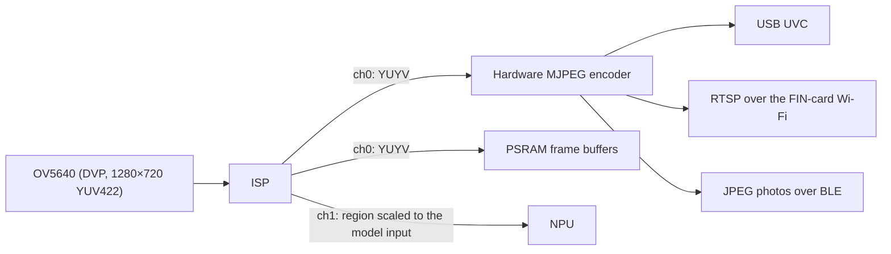

# Camera & Imaging

IPRO7AI takes a camera sensor over an 8-bit DVP port. The on-chip ISP gives two output channels: channel 0 for a preview or the hardware MJPEG encoder, channel 1 scaled down for the NPU. The SDK provides the sensor drivers, the ISP and MJPEG components and CherryUSB's UVC class. On the IPRO7AI Reef EVK the camera is an OV5640 module on connector FPC1; `ipro7ai_reef_demo` brings it up from the shell and `ipro7_uvc_cam` turns the board into a USB webcam.

!!! abstract "At a glance"
    - Reef camera: OV5640 FLEX-24 module on FPC1, 1280×720 YUV422 with the sensor's own auto exposure and white balance. Set SW7 to **CAM** and unplug USB-C before you connect the cable.
    - Configuration: `CONFIG_MM_SUPPORT=y`, `CONFIG_USE_PSRAM=y`, `CONFIG_COMPONENTS_SENSOR_ENABLE=y`, `CONFIG_SENSOR_OV5640=y`; add the UVC keys for a webcam.
    - Examples: `ipro7ai_reef_demo` (`cam` commands), `ipro7_uvc_cam` (`defconfig_reef_ov5640` webcam, `defconfig_reef_rps` NPU game), RTSP over Wi-Fi in `defconfig_wifi_ipro6s`, JPEG decoding in `ipro7_jpeg_decode`.
    - The MJPEG block encodes only; JPEG pictures are decoded on the CPU. Zephyr has no camera driver.

## Image pipeline { #camera-video }



- Each ISP channel has its own output size. Channel 0 is the picture the host or your code sees; channel 1 takes a region of the sensor image and scales it to the model's input (for example the centred 512×512 square to 128×128 in the rock-paper-scissors build).
- The OV5640 and OV2640 drivers keep auto exposure, gain and white balance on the sensor, so the ISP firmware's own 3A is not started for them. IQ parameter tables ship only for the SC101IOT sensor of the other INTELPRO boards.
- The ISP's DMA writes frames into PSRAM. Invalidate the D-cache range before the CPU reads a frame (`L1C_DCACHE_INVALID_RANGE`).
- On the Reef the OV5640 module reads out mirrored top to bottom; `ipro7ai_reef_demo/src/cam.c` flips in the capture DMA (`CAM_DVP_VFLIP`) rather than in the sensor.

## Components and configuration { #configuration }

| Part | Location | Description |
|---|---|---|
| Camera HAL | `bsp/hal/inc/hal_cam.h`, `hal_isp.h`, `hal_mjpeg.h` | DVP capture, ISP, MJPEG encoder |
| Sensors | `components/sensor/` | Sensor drivers and SCCB; `camera_module_init()` probes the registered sensors in turn |
| ISP control | `components/isp_firmware/` | ISP setup and image parameter handling |
| ISP algorithms | `components/isp_algorithm/` | Prebuilt `libisp_algorithm.a` |
| IQ parameters | `components/isp_iq_param/`, `components/isp_iq_cmd/` | IQ tables and tuning commands (SC101IOT) |
| UVC | `components/cherryusb/class/video/` | USB Video Class device |
| RTSP | `components/network/rtsp_server/` | RTSP MJPEG streaming (`CONFIG_RTSP_SERVER`) |

```ini title=".config (Reef camera, from apps/multimedia/ipro7_uvc_cam/defconfig_reef_ov5640)"
CONFIG_IPRO7AI_REEF=y
CONFIG_BOARD="IPRO7AI_REEF"
CONFIG_USE_PSRAM=y
CONFIG_MM_SUPPORT=y
CONFIG_COMPONENTS_SENSOR_ENABLE=y
CONFIG_SENSOR_OV5640=y
# USB webcam
CONFIG_COMPONENTS_CHERRYUSB_ENABLE=y
CONFIG_CHERRYUSB_DEVICE=y
CONFIG_CHERRYUSB_DEVICE_VIDEO=y
```

In Kconfig `CONFIG_MM_SUPPORT` and `CONFIG_IPRO7AI_REEF` select `USE_PSRAM`, but the build does not apply Kconfig `select`, so `CONFIG_USE_PSRAM=y` has to be in `.config`; see [Build System & Configuration](build-system.md#configuration).

### Supported sensors { #sensors }

| Sensor | `.config` | Output | Notes |
|---|---|---|---|
| OV5640 | `CONFIG_SENSOR_OV5640=y` | 1280×720 YUV422 (2×2 binning), SCCB address 0x3C | The Reef's FPC1 has the OV5640 FLEX-24 pinout. 30 fps, dropping to 15 fps in dim light |
| OV2640 | `CONFIG_SENSOR_OV2640=y` | 1280×720 YUV422 (scaled from UXGA), SCCB 0x30 | Enabled in `ipro7ai_reef_demo` next to the OV5640 driver |
| SC101IOT | built with `CONFIG_COMPONENTS_SENSOR_ENABLE=y` | 1280×720 | Sensor of the IPRO7 EVB and the IPRO7AI EVK |

The OV5640 and OV2640 drivers are opt-in, so other boards do not pay for them. `components/sensor/` also contains GC6133 and GC032A drivers, which no shipped example uses.

## Hands-on on the Reef { #hands-on }

Probe the OV5640, start the stream, check frame rate and errors, and look at a frame as ASCII art. This runs in `ipro7ai_reef_demo`, whose camera module `src/cam.c` you can reuse in your own application.

<div class="ipro-steps" markdown>

1. **Hardware and configuration**

    Unplug USB-C, connect the camera cable to FPC1, set SW7 to **CAM**, then plug USB-C back in. The camera lines of the demo's `.config`:

    ```ini title="apps/platform/ipro7ai_reef_demo/.config (excerpt)"
    CONFIG_IPRO7AI_REEF=y
    CONFIG_BOARD="IPRO7AI_REEF"
    CONFIG_USE_PSRAM=y
    CONFIG_MM_SUPPORT=y
    CONFIG_COMPONENTS_SENSOR_ENABLE=y
    CONFIG_SENSOR_OV5640=y
    CONFIG_SENSOR_OV2640=y
    ```

2. **Code**

    `cam.h` wraps the power sequence, the SCCB probe and an ISP channel-0 stream into PSRAM (sensor size divided by `CAM_SCALE_DIV`, 4 by default). The `cam` shell command calls it like this:

    ```c title="apps/platform/ipro7ai_reef_demo/src/app_cli.c (excerpt from cmd_cam)"
    if (strcmp(argv[1], "probe") == 0) {
        if (cam_probe() == 0) {
            uint16_t w, h;
            cam_sensor_size(&w, &h);
            printf("sensor %s at SCCB 0x%02X, %ux%u\n", cam_sensor_name(),
                   cam_sensor_addr(), w, h);
        } else {
            printf("no sensor found\n");
        }
    } else if (strcmp(argv[1], "start") == 0) {
        int rc = cam_start();
        printf(rc == CAM_OK ? "streaming - `cam status` in a second\n"
                            : "start failed (%d)\n", rc);
    } else if (strcmp(argv[1], "status") == 0) {
        cam_stats_t st;
        uint16_t w, h, ow, oh;
        /* ... */
        cam_get_stats(&st);
        cam_out_size(&ow, &oh);
        printf("ch0     : YUYV %ux%u, frames %u, %u.%u fps, luma mean %u\n", ow, oh,
               (unsigned)st.frames, (unsigned)(st.fps_x10 / 10), (unsigned)(st.fps_x10 % 10),
               (unsigned)st.luma_mean);
        printf("errors  : fifo %u, vsync %u, hsync %u\n", (unsigned)st.fifo_err,
               (unsigned)st.vsync_err, (unsigned)st.hsync_err);
    }
    ```

    `cam_latest_frame()` returns the address of the newest complete YUYV frame for your own processing. `ipro_ble_remote` reuses the module for its Reef build by adding it in CMake, with a different scale:

    ```cmake title="apps/bluetooth/ble/ipro_ble_remote/CMakeLists.txt (excerpt)"
    if(CONFIG_IPRO7AI_REEF)
        set(REEF_DEMO_SRC ${CMAKE_SOURCE_DIR}/apps/platform/ipro7ai_reef_demo/src)
        __component_add_include_dirs(${REEF_DEMO_SRC})
        target_sources(app PRIVATE
            ${REEF_DEMO_SRC}/cam.c
            # ... the remote's other Reef sources
        )
        target_compile_definitions(app PRIVATE CAM_SCALE_DIV=1u)
    endif()
    ```

    Creating an application of your own is covered in [Create your first application](../tutorials/first-own-app.md).

3. **Build**

    ```bash
    make -C apps/platform/ipro7ai_reef_demo
    ```

4. **Flash**

    Download mode (hold SW1, tap SW2, release SW1), then from the IntelProCube directory:

    ```bash
    cd <ICUBE>
    ./ipro_iot_tool_macos --chipname ipro7 --chip-variant IPRO7AI \
        --port /dev/cu.usbserial-XXXX --baudrate 921600 \
        --pt chips/ipro7/partition/partition_cfg_2M.toml \
        --firmware <SDK>/apps/platform/ipro7ai_reef_demo/build/build_out/ipro7ai_reef_demo_IPRO7.bin
    ```

    Check for `[All Success]` and press SW2. See [Flashing & Serial Console](../get-started/flash-and-monitor.md) for the other hosts.

5. **Run and check**

    On the U6 console at 115200 baud:

    ```text
    ipro /> cam probe
    sensor __rti_name_ov5640 at SCCB 0x3C, 1280x720
    ipro /> cam start
    streaming - `cam status` in a second
    ipro /> cam status
    sensor  : __rti_name_ov5640 @0x3C 1280x720, streaming
    ch0     : YUYV 320x180, frames …, … fps, luma mean …
    errors  : fifo 0, vsync 0, hsync 0
    dvp     : byte order lower-first, vsync high, hsync high
    ```

    Run `cam status` twice a second apart: the frame count climbs and the error counters stay flat. Then `cam bar on` and `cam snap` print an ASCII thumbnail with vertical bands (the sensor's color bars); `cam bar off` and `cam snap` show the real scene. `no sensor found` means the cable, SW7 or the module; the demo README's camera section lists what to check next (`cam pins`, `cam sync`, `cam order`).

</div>

To check the camera automatically after every build, see [Test your application](../tutorials/testing.md).

## USB webcam ipro7_uvc_cam { #uvc-cam }

`apps/multimedia/ipro7_uvc_cam` makes the Reef enumerate on its USB-C port as an ordinary UVC webcam: OV5640 → ISP → hardware MJPEG → isochronous endpoint at USB Full Speed. Hosts use their built-in UVC driver.

| Reef configuration | Stream (MJPEG) | NPU | Output |
|---|---|---|---|
| `defconfig_reef_ov5640` | 1280×720 (about 15 fps for a busy scene, limited by Full-Speed USB) or 640×360 (30 fps), chosen by the host | not used | `build_reef_ov5640/build_out/ipro7_uvc_cam_IPRO7.bin` |
| `defconfig_reef_rps` | 640×360 with a rock-paper-scissors game drawn in | 128×128 classifier, model linked into the firmware | `build_reef_rps/build_out/ipro7_uvc_cam_IPRO7.bin` |

```bash
make -C apps/multimedia/ipro7_uvc_cam DEFCONFIG=defconfig_reef_ov5640
```

Flash it like the demo, with `--chip-variant IPRO7AI` and `--pt chips/ipro7/partition/partition_cfg_2M.toml`. The console runs at 115200 baud and shows:

```text
[UVC] Bringing up USB UVC webcam (720p MJPEG)...
[UVC] Streaming pipeline started
```

Connect the Reef's USB-C to a computer and open it in any camera application (USB VID 0x3896, PID 0x0701). Sensor tuning from the shell: `cam rd <reg> [n]`, `cam wr <reg> <hexbytes>`, `cam grid [cols rows]`.

- Frame sizes and formats are fixed in the descriptors of the shared camera pipeline (`apps/ai/ipro_reef_teach/image/uvc.c`, `uvc_isp.h`); there is no `.config` setting for them.
- The application has its own linker script, `ipro7_uvc_cam.ld`.
- The plain `.config` builds for the IPRO7 EVB with the SC101IOT sensor.
- The rock-paper-scissors build is walked through in [AI & NPU](ai-npu.md#hands-on).

## JPEG decoding { #jpeg-decode }

The IPRO7 MJPEG block is supported for encoding only: `hal_mjdec.h` exists, but the hardware decoder never completes a frame on IPRO7. `apps/multimedia/ipro7_jpeg_decode` decodes JPEG pictures on the CPU with TJpgDec R0.03 and a wrapper, `jdec_rgb`, that outputs true RGB565 (little- or big-endian) or RGB888 and adds the standard Huffman tables that camera MJPEG frames leave out.

```bash
make -C apps/multimedia/ipro7_jpeg_decode DEFCONFIG=defconfig_reef   # output in build_reef/build_out/
```

This build's console runs at **921600** baud. `jdec run all` decodes the built-in test images, checks each against the PC build of the same decoder and ends with `14 images, 0 failed -> ALL PASS`. A 1280×720 4:2:0 picture takes about 570 ms at 192 MHz when built with CMake 3.18 or later, which compiles the decoder at `-O2` (application README). To use the decoder in your own application, copy `jdec_rgb.c`, `jdec_rgb.h` and `tjpgd/`.

## IPRO7AI EVK camera library { #evk-camera }

`components/board/ipro7ai_evk` (`evk_cam_*`) is the camera library of the IPRO7AI EVK and its SC101IOT sensor; it is not used on the Reef. Contact INTELPRO for that board.

## Examples that use the camera { #camera-apps }

| Example | Reef configuration | What it does |
|---|---|---|
| `ipro7ai_reef_demo` | `.config` | `cam` commands: probe, stream, status, ASCII snapshot, color bars, register access, DVP pad activity |
| `ipro7ai_reef_demo` | `defconfig_wifi_ipro6s` | RTSP MJPEG stream of channel 0 (640×360) at `rtsp://<ip>:8554/av0_0` through Wi-Fi on the IPRO6S FIN card; see [Networking](networking.md) and [Wi-Fi and RTSP streaming](../tutorials/wifi-rtsp.md) |
| `ipro7_uvc_cam` | `defconfig_reef_ov5640`, `defconfig_reef_rps` | USB webcam; NPU rock-paper-scissors drawn into the stream |
| `ipro7_jpeg_decode` | `defconfig_reef` | Software JPEG decoding to RGB565 / RGB888 |
| `ipro_ble_remote` | `defconfig_reef` | 1280×720 JPEG photos to a phone through the BLE image service; motion detection on the picture starts a capture; photos are also saved to `sd:/REMOTE/` when a card is in |
| `ipro_reef_teach` | `.config` | `image` mode: USB camera plus an on-device classifier taught from IPRO AI Studio; see [Image Recognition](../teach/image.md) |

The IPRO7 EVB and IPRO7AI EVK camera examples (`ipro7ai_evk_*`, `ipro7_demo`) are listed in [Examples](../examples/index.md).

## Limitations in this release { #limitations }

- No hardware JPEG decoding on IPRO7; use `ipro7_jpeg_decode`.
- USB runs at Full Speed, which caps 720p MJPEG at about 15 fps for busy scenes.
- ISP IQ tables ship only for SC101IOT; the OV5640 and OV2640 use the sensor's own 3A.
- Zephyr has no camera, ISP or USB driver.

## Related documents { #related }

- [AI & NPU](ai-npu.md): feeding ISP channel 1 to the NPU
- [Networking](networking.md): the Wi-Fi used for RTSP streaming
- [IPRO7AI Reef EVK](../hardware/boards/reef-evk.md): FPC1, SW7 and the camera pins
- [Camera API](../reference/api/camera.md)
- [Build System & Configuration](build-system.md): `DEFCONFIG=` and the memory layout
