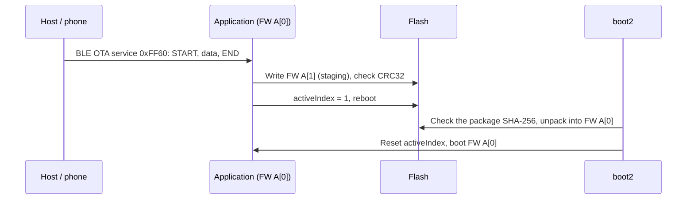

# OTA Updates

For FreeRTOS applications, boot2 performs the update: the application writes an OTA package into the idle FW slot of the partition table and switches the active index; after a reboot, boot2 checks the package, unpacks it into the execution slot and boots it. The SDK ships the packaging tool `tools/create_ota.py` and a complete reference for updating the IPRO7AI Reef EVK over BLE, `ipro_ble_remote` (`defconfig_reef`). Zephyr applications use MCUboot and MCUmgr instead.

!!! abstract "At a glance"
    - Package: `tools/create_ota.py` wraps the `whole_img.bin` produced by IntelProCube into an `.xz.ota` (512-byte header + XZ-compressed payload).
    - Reference: `ipro_ble_remote` with `defconfig_reef` + `partition_cfg_2M_remote_ab.toml` + boot2 v0.5.2; the default `.config` has no OTA.
    - Zephyr: `zephyr/samples/ble_ota`, MCUboot (swap-move) + MCUmgr SMP over BLE.
    - Not included: the product file that signed packages need, and the IPRO6S FIN card firmware package. boot2 and the standard partition tables come with IntelProCube.

## Architecture { #architecture }



According to the `ipro_ble_remote` README, if the package fails verification, boot2 enters its USB rescue mode instead of erasing the existing execution slot.

## Partition table and A/B layout { #partitions }

`apps/bluetooth/ble/ipro_ble_remote/partition_cfg_2M_remote_ab.toml` (2 MB flash, with boot2):

| Address | Partition | Size | Use |
|---|---|---|---|
| 0x000000 | boot2 | 64 KB | boot2 v0.5.2 from IntelProCube |
| 0x010000 | PT0 / PT1 | 4 KB + 4 KB | Partition tables |
| 0x012000 | FW A[0] | 824 KB | Execution slot; boot2 unpacks packages here |
| 0x0E0000 | FW A[1] | 512 KB | OTA staging; the application writes the `.xz.ota` here |
| 0x160000 | PSM | 112 KB | Persistent settings |
| 0x17C000 | backup | 4 KB | |
| 0x17D000 | media | 16 KB | |
| 0x1FF000 | factory | 4 KB | |

- This layout needs 2 MB of flash; `defconfig_reef` sets `CONFIG_IPRO7_FLASH_2M=y`.
- The boot2 image is `chips/ipro7/builtin_imgs/boot2_v0.5.2/ipro_boot2_IPRO7_v0.5.2.bin` in the IntelProCube directory; it is not part of the SDK package.

!!! danger "Do not run OTA with the standard partition table"
    On the IPRO7AI Reef EVK, do not run OTA with the standard `partition_cfg_2M.toml`: after an image is written to its second FW slot and made active, the board shows no output at all and has to be reflashed in download mode. Use `partition_cfg_2M_remote_ab.toml`.

## OTA packaging (create_ota.py) { #ota-package }

The input of `tools/create_ota.py` must be a combined image with a boot header, such as the `chips/ipro7/img_create_iot/whole_img.bin` that the IntelProCube command-line tool produces with `--build` — not the `.bin` from the SDK build. The script stops if the input has the wrong format.

```bash
# 1. Produce whole_img.bin with IntelProCube (run in the IntelProCube directory; the tool
#    exits 0 even on failure, so look for "PT Check: whole_img.bin" in its output)
./ipro_iot_tool_macos --chipname ipro7 --chip-variant IPRO7AI --build \
    --boot2 chips/ipro7/builtin_imgs/boot2_v0.5.2/ipro_boot2_IPRO7_v0.5.2.bin \
    --pt <SDK>/apps/bluetooth/ble/ipro_ble_remote/partition_cfg_2M_remote_ab.toml \
    --firmware <SDK>/apps/bluetooth/ble/ipro_ble_remote/build_reef/build_out/ipro_ble_remote_IPRO7.bin

# 2. Package it (XZ-compressed by default)
python3 <SDK>/tools/create_ota.py chips/ipro7/img_create_iot/whole_img.bin \
    --hw-ver <hw-version> --fw-ver <fw-version> -o firmware.xz.ota
```

| Argument | Meaning |
|---|---|
| `<input>` | Combined image (starts with the `IPNP` boot header) |
| `--raw` | No compression. Without `-o`, the output is the input name with its extension replaced by `.ota` (`--raw`) or `.xz.ota` |
| `-o FILE` | Output file |
| `--hw-ver`, `--fw-ver` | Hardware and firmware version strings written into the header (up to 15 characters each); always set them explicitly rather than relying on the defaults |
| `--sign-key`, `--product`, `--hw-id`, `--fw-version`, `--force-version`, `--key-id` | For signed packages; they need `tools/ota_products.py`, which V2.1.0 does not include, so they cannot be used |

| Header offset | Contents |
|---|---|
| 0–15 | Magic string `IPRO_OTA_Ver1.0` |
| 16–19 | Type: `XZ  ` or `RAW ` |
| 20–23 | Payload length (little-endian) |
| 32–47, 48–63 | Hardware and firmware version strings |
| 64–95 | SHA-256 of the payload |
| 96–511 | Reserved (0xFF); holds the signature block in signed packages |
| 512 onward | Payload (XZ with a 32 KB dictionary, matching the boot2 decoder) |

`tools/make_reef_ota.sh` in `ipro_ble_remote` wraps both steps into one command; see the next section.

## BLE OTA (ipro_ble_remote) { #ble-ota }

The default `.config` of `ipro_ble_remote` (IPRO7 EVB) has no OTA (`# CONFIG_IPRO_BLE_REMOTE_OTA is not set`). Only `defconfig_reef` sets `CONFIG_IPRO_BLE_REMOTE_OTA=y`, together with boot2 and the A/B partition table, and the package documents only this IPRO7AI Reef EVK flow. Other boards need boot2 and a similar A/B partition table to use the OTA service.

<div class="ipro-steps" markdown>

1. **Build**

    ```bash
    make -C apps/bluetooth/ble/ipro_ble_remote DEFCONFIG=defconfig_reef
    ```

    Output: `apps/bluetooth/ble/ipro_ble_remote/build_reef/build_out/ipro_ble_remote_IPRO7.bin`

2. **First flash: boot2, the A/B partition table and the firmware**: run in the IntelProCube directory (macOS shown; the Linux and Windows commands are in step 3 of [Your First BLE Application](../tutorials/first-ble-app.md#steps)):

    ```bash
    ./ipro_iot_tool_macos --chipname ipro7 --chip-variant IPRO7AI \
        --port /dev/cu.usbserial-XXXX --baudrate 921600 \
        --boot2 chips/ipro7/builtin_imgs/boot2_v0.5.2/ipro_boot2_IPRO7_v0.5.2.bin \
        --pt <SDK>/apps/bluetooth/ble/ipro_ble_remote/partition_cfg_2M_remote_ab.toml \
        --firmware <SDK>/apps/bluetooth/ble/ipro_ble_remote/build_reef/build_out/ipro_ble_remote_IPRO7.bin
    ```

    The tool exits 0 even when flashing fails, so look for `[All Success]` in its output. At boot, `[BOOT2] IPRO7 Boot2 v0.5.2` appears first, then the application starts from FW A (0x12000).

3. **Create the OTA package** after changing and rebuilding your code (on Linux use `ipro_iot_tool_linux`):

    ```bash
    IPRO_FLASH_TOOL=<IntelProCube>/ipro_iot_tool_macos \
        sh apps/bluetooth/ble/ipro_ble_remote/tools/make_reef_ota.sh
    ```

    Output: `apps/bluetooth/ble/ipro_ble_remote/build_reef/build_out/ipro_ble_remote_reef.xz.ota`

4. **Push it over BLE**: `tools/reef_ota.py` uses bleak to connect to the device named `IPRO-Remote` (override with the `REMOTE_NAME` environment variable) and sends the package.

    ```bash
    python3 -m venv .venv && .venv/bin/pip install bleak
    .venv/bin/python apps/bluetooth/ble/ipro_ble_remote/tools/reef_ota.py \
        apps/bluetooth/ble/ipro_ble_remote/build_reef/build_out/ipro_ble_remote_reef.xz.ota
    ```

    When the transfer finishes the device reboots, and boot2 installs the new firmware and starts it from FW A. Measured in the README (2026-10-06, macOS, MTU 247): a 345 KB package transfers in 13–17 seconds.

</div>

A phone app must also send the `.xz.ota` package, not the `.bin`. The OTA service (full description in `apps/bluetooth/ble/ipro_ble_remote/OTA_IMPLEMENTATION_GUIDE.md`):

| Characteristic | UUID | Properties | Format |
|---|---|---|---|
| OTA Control | `0xFF61` | Write | `01` + size (u32 LE) START; `02` + CRC32 (u32 LE) END; `03` ABORT; `04` VERIFY; `05` REBOOT |
| OTA Data | `0xFF62` | Write Without Response | Sequence u16, length u16, reserved u16, then the data; at most MTU − 9 bytes of data per packet (512 maximum) |
| OTA Status | `0xFF63` | Read, Notify | Status, error code, progress %, reserved u16; status 0 idle, 1 receiving, 2 verifying, 3 ready, 4 complete (send REBOOT), 0xFF error |

- The CRC32 is the standard CRC-32 (the same as `zlib.crc32`) over the whole file sent.
- The device queues up to 20 packets and writes flash as they arrive. Pace the sender — for example, read OTA Status after every 8 packets, as `reef_ota.py` does — or packets are dropped and END reports an error.

## Other update paths { #other-paths }

| Path | Details |
|---|---|
| IPRO6S FIN card firmware | `ipro6s_ota <http url>` (in `ipro7ai_reef_demo`'s `defconfig_wifi_ipro6s` and in `ipro7_sdio_wifi`) downloads a package over HTTP and hands it to the IPRO6S with `ipronet_ota_update()` (`components/network/ipronet_host/ipronet_ota.h`). The package is an IntelProCube-built `.xz.ota` with an IPRO6 hardware version; the FIN card firmware package is not included in V2.1.0 (contact INTELPRO) |
| Shared OTA code | `apps/platform/common/ota/`: a core that writes a package into the second FW slot, checks its SHA-256 and switches the active index, plus UART (zmodem) and USB CDC receivers and the `ota_sig` signature check. No V2.1.0 application builds these files; use them as a reference for your own implementation |

## Zephyr: MCUboot and MCUmgr { #zephyr-mcuboot }

A Zephyr application boots through boot2 → MCUboot (`boot_partition`) → image-0 (`slot0_partition`); a new image is uploaded to `slot1_partition` and MCUboot swaps it in with swap-move. `zephyr/samples/ble_ota` uploads images over BLE with MCUmgr SMP and advertises as `IPRO7 OTA`.

```bash
cd zephyr-workspace
# v1: MCUboot + the signed application; west flash merges them before flashing
west build -p always -b ipro7ai_evk --sysbuild ../zephyr/samples/ble_ota -d build/ota
west flash -d build/ota

# v2: the image to upload is build/ota_v2/ble_ota/zephyr/zephyr.signed.bin
west build -p always -b ipro7ai_evk --sysbuild ../zephyr/samples/ble_ota -d build/ota_v2 \
    -- -Dble_ota_CONFIG_MCUBOOT_IMGTOOL_SIGN_VERSION=\"2.0.0\"
```

- Upload `zephyr.signed.bin` with a phone app that supports MCUmgr, or with the `mcumgr` / `smpmgr` command-line tools, in "Test and confirm" or "Test only" mode. The new image confirms itself on its first boot (`boot_write_img_confirmed()`), so later resets keep it.
- Images are signed with MCUboot's development key (`bootloader/mcuboot/root-rsa-2048.pem`); a product must use its own key.
- The sample also enables MCUmgr over the shell, but uploading an image over the 2000000 baud console is unreliable; use BLE.
- `zephyr/samples/mcuboot_app` is the minimal sample that checks the boot chain. `tools/zephyr/merge_mcuboot.py` merges MCUboot with the application, and `west flash` calls it for you.

## Limitations in this release { #limitations }

- `tools/ota_products.py`, which signed OTA packages (`create_ota.py --sign-key`) need, is not included in V2.1.0.
- BLE OTA has a reference flow only for the IPRO7AI Reef EVK (`defconfig_reef`); the default `ipro_ble_remote` build has no OTA.
- There is no example that updates IPRO7 firmware over Wi-Fi or Ethernet; `ipro6s_ota` updates the IPRO6S only.
- The boot2 image and the standard partition tables come with IntelProCube, not with the SDK package.
- Zephyr's `ble_ota` uses the MCUboot development key.

## Related documents { #related }

- [IPRO7AI Reef EVK](../hardware/boards/reef-evk.md): flashing settings and jumpers.
- [Flashing & Serial Console](../get-started/flash-and-monitor.md): the IntelProCube command-line tool.
- [BLE Development](ble.md): the GATT services of `ipro_ble_remote`.
- [Zephyr RTOS](zephyr.md): sysbuild and `west flash`.
- [Networking](networking.md): `ipronet_host` and the FIN card.
