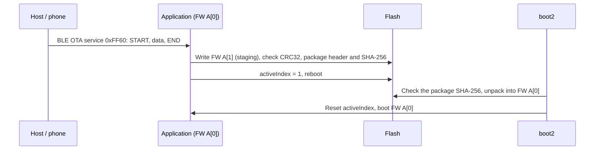

# OTA Updates

For FreeRTOS applications, boot2 performs the update: the running application writes an OTA package into the idle FW slot of the partition table and switches the active index; after a reboot, boot2 checks the package, unpacks it into the execution slot and boots it. The SDK ships the packaging tool `tools/create_ota.py`, the OTA component `components/sys/ipro_ota` that every transport shares (from V2.3.0), and a complete reference for updating the IPRO7AI Reef EVK over BLE: `ipro_ble_remote` with `defconfig_reef`, its A/B partition table, a packaging script, a Python sender and an Android app.

!!! abstract "At a glance"
    - Reference: `ipro_ble_remote` `defconfig_reef` + `partition_cfg_2M_remote_ab.toml` + boot2 v0.6.0 (from IntelProCube); the default `.config` has no OTA.
    - Package: `tools/create_ota.py` wraps IntelProCube's combined `whole_img.bin` into an `.xz.ota` (512-byte header + XZ payload); `make_reef_ota.sh` runs both steps for the Reef.
    - Component: `components/sys/ipro_ota` (`CONFIG_IPRO_OTA`) checks the header and SHA-256 of the package written to flash before it switches the partition table; the transports are the BLE OTA service 0xFF60 (`CONFIG_IPRO_OTA_BLE`) and the console UART command `ota_uart` (`CONFIG_IPRO_OTA_UART`).
    - Senders: `tools/reef_ota.py` (Python, bleak) or `ipro_remote_demo.apk` (Android) over BLE; the OTA Package page of IPRO Workbench 0.2.0 over the console UART.
    - The IPRO6S FIN card updates over Wi-Fi with `ipro6s_ota <http url>` from `ipro7ai_reef_demo` `defconfig_wifi_ipro6s`.
    - Never run OTA with the standard `partition_cfg_2M.toml` on the Reef. Not included: signed-package product settings (`tools/ota_products.py`).

## Architecture { #architecture }



From V2.3.0, before the application switches the partition table, the OTA component reads the staging slot back and checks the package header and SHA-256: a `.bin` sent by mistake, or a package damaged in transfer, is refused at this point instead of at the next boot. According to the `ipro_ble_remote` README, boot2 erases the execution slot only after the package passes its SHA-256 check. A package that fails the check leaves boot2 in its USB rescue mode, with the existing execution slot untouched.

## Partition table and A/B layout { #partitions }

`apps/bluetooth/ble/ipro_ble_remote/partition_cfg_2M_remote_ab.toml` (2 MB flash, with boot2):

| Address | Partition | Size | Use |
|---|---|---|---|
| 0x000000 | boot2 | 64 KB | boot2 v0.6.0 from IntelProCube |
| 0x010000 | PT0 / PT1 | 4 KB + 4 KB | Partition tables |
| 0x012000 | FW A[0] | 824 KB | Execution slot; boot2 unpacks packages here |
| 0x0E0000 | FW A[1] | 512 KB | OTA staging; the application writes the `.xz.ota` here |
| 0x160000 | PSM | 112 KB | Persistent settings |
| 0x17C000 | backup | 4 KB | |
| 0x17D000 | media | 16 KB | |
| 0x1FF000 | factory | 4 KB | |

- This layout needs 2 MB of flash; `defconfig_reef` sets `CONFIG_IPRO7_FLASH_2M=y`.
- The boot2 image is `chips/ipro7/builtin_imgs/boot2_v0.6.0/ipro_boot2_IPRO7_v0.6.0.bin` in the IntelProCube directory; it is not part of the SDK package.
- The table has no boot2 entry on purpose: with one, the flash tool writes a boot2 header that the boot ROM does not load. Pass boot2 with `--boot2` instead.

!!! danger "Do not run OTA with the standard partition table"
    On the IPRO7AI Reef EVK, never run OTA with the standard `partition_cfg_2M.toml`: an image written to its second FW slot (0x12A000) and made active never boots, the console stays silent, and the board has to be reflashed in download mode. Use `partition_cfg_2M_remote_ab.toml`.

## OTA packaging (create_ota.py) { #ota-package }

The input of `tools/create_ota.py` must be a combined image that starts with the `IPNP` boot header, such as the `chips/ipro7/img_create_iot/whole_img.bin` that the IntelProCube command-line tool produces with `--build` — not the `.bin` from the SDK build. The script stops if the input has the wrong format.

```bash
# 1. Produce whole_img.bin with IntelProCube (in the IntelProCube directory; the tool
#    exits 0 even on failure, so look for "PT Check: whole_img.bin" in its output)
cd <ICUBE>
./ipro_iot_tool_macos --chipname ipro7 --chip-variant IPRO7AI --build \
    --boot2 chips/ipro7/builtin_imgs/boot2_v0.6.0/ipro_boot2_IPRO7_v0.6.0.bin \
    --pt <SDK>/apps/bluetooth/ble/ipro_ble_remote/partition_cfg_2M_remote_ab.toml \
    --firmware <SDK>/apps/bluetooth/ble/ipro_ble_remote/build_reef/build_out/ipro_ble_remote_IPRO7.bin

# 2. Package it (XZ-compressed by default)
python3 <SDK>/tools/create_ota.py chips/ipro7/img_create_iot/whole_img.bin \
    --fw-ver <fw-version> -o firmware.xz.ota
```

| Argument | Meaning |
|---|---|
| `<input>` | Combined image (starts with the `IPNP` boot header) |
| `--raw` | No compression. Without `-o`, the output is the input name with its extension replaced by `.ota` (`--raw`) or `.xz.ota` |
| `-o FILE` | Output file |
| `--hw-ver`, `--fw-ver` | Hardware and firmware version strings written into the header (up to 15 characters each). boot2 does not check the hardware version |
| `--sign-key`, `--product`, `--hw-id`, `--fw-version`, `--force-version`, `--key-id` | Signed packages. They need `tools/ota_products.py`, which is not included in V2.3.0, so they cannot be used |

| Header offset | Contents |
|---|---|
| 0–15 | Magic string `IPRO_OTA_Ver1.0` |
| 16–19 | Type: `XZ  ` or `RAW ` |
| 20–23 | Payload length (little-endian) |
| 32–47, 48–63 | Hardware and firmware version strings |
| 64–95 | SHA-256 of the payload |
| 96–511 | Reserved (0xFF); holds the signature block in signed packages |
| 512 onward | Payload (XZ with a 32 KB dictionary, matching the boot2 decoder) |

For the Reef, `apps/bluetooth/ble/ipro_ble_remote/tools/make_reef_ota.sh` runs both steps in one command and stamps the build time as the firmware version; see [Hands-on on the Reef](#hands-on). It takes the newest boot2 in the IntelProCube folder (v0.6.0 in 0.7.0.1).

## BLE OTA (ipro_ble_remote) { #ble-ota }

Only `defconfig_reef` enables the OTA service. The default `.config` of `ipro_ble_remote` builds an IPRO7 EVB image without it (`# CONFIG_IPRO_BLE_REMOTE_OTA is not set`).

```ini title="apps/bluetooth/ble/ipro_ble_remote/defconfig_reef (excerpt)"
CONFIG_IPRO7AI_REEF=y
CONFIG_IPRO7_FLASH_2M=y
CONFIG_LINK_FLASH=y
CONFIG_PARTITION=y
CONFIG_IPRO_BLE_REMOTE_OTA=y
CONFIG_IPRO_OTA=y
CONFIG_IPRO_OTA_BLE=y
CONFIG_IPRO_OTA_UART=y
```

From V2.3.0 the OTA service comes from the OTA component (`components/sys/ipro_ota/src/ipro_ota_ble.c`); `ipro_ble_remote`'s `include/ota_service.h` only forwards to `ipro_ota_ble.h`. The same image also has the console UART command `ota_uart`, see [Update over the console UART](#uart-ota).

The service and its characteristics (full description for app developers in `apps/bluetooth/ble/ipro_ble_remote/OTA_IMPLEMENTATION_GUIDE.md`):

| Characteristic | UUID | Properties | Format |
|---|---|---|---|
| OTA Control | `0xFF61` | Write | `01` + size (u32 LE) START; `02` + CRC32 (u32 LE) END; `03` ABORT; `04` VERIFY; `05` REBOOT |
| OTA Data | `0xFF62` | Write Without Response | Sequence u16, length u16, reserved u16, then the data; at most MTU − 9 bytes of data per packet |
| OTA Status | `0xFF63` | Read, Notify | Status, error code, progress %, reserved u16; status 0 idle, 1 receiving, 2 verifying, 3 ready, 4 complete (send REBOOT), 0xFF error |

- Send the `.xz.ota` package, not the `.bin`. The CRC32 is the standard CRC-32 (the same as `zlib.crc32`) over the whole file sent.
- After START, wait for status 1 (receiving) before sending data. From V2.3.0 the device erases each 4 KB just before writing it instead of erasing the whole staging slot first, so it starts receiving in under half a second after START (about 4 s in V2.2.x).
- After the CRC32 check at END, the device also checks the package header and SHA-256; if they do not match, the status becomes 0xFF (error) and the partition table is not switched.
- The device queues up to 20 packets and writes flash as they arrive. Pace the sender — `reef_ota.py` reads OTA Status after every 8 packets — or packets are dropped and END reports an error.
- Negotiate a large MTU first; the README recommends requesting MTU 513 or more after connecting.

## Update over the console UART (ota_uart) { #uart-ota }

From V2.3.0, an application built with `CONFIG_IPRO_OTA_UART=y` has the shell command `ota_uart <package bytes> [noapply]`: it receives an `.xz.ota` package over the console UART, with no second UART, no baud-rate change and no code in the application. `ipro_ble_remote` `defconfig_reef` enables it. The board must have been flashed with boot2 and a partition table with a second FW slot (such as `partition_cfg_2M_remote_ab.toml`).

The simplest sender is the **OTA Package** page of IPRO Workbench 0.2.0: make the package, then press **Send to Board**, or **Check on Board** to have the board check the package without installing it; the steps are in IPRO Workbench's [OTA Package](../workbench/flash.md#ota). At 115200 baud, 200 KB takes about 22 s.

To write your own sender, the protocol is (integers little-endian; the CRC is CRC-16/CCITT-FALSE over seq, len and the payload):

```text title="ota_uart protocol (components/sys/ipro_ota/README.md)"
host:  ota_uart 200776
board: ==OTA_UART_READY:1024==                    the largest payload it takes
host:  A5 5A  seq(u16)  len(u16)  payload  crc16   one frame, then wait
board: A5 06  seq(u16)                             taken; A5 15 seq: send it again
board: ==OTA_UART_OK==                             checked, switched, rebooting
       ==OTA_UART_FAIL:<reason>==
```

- Type the command line a character at a time: the shell drops a line that arrives in one piece.
- With `noapply`, the board stops after receiving and checking the package and does not switch the partition table; the package stays in the staging slot and the running firmware is unchanged.
- After `==OTA_UART_OK==` the board reboots and boot2 installs the package; the console then shows `[BOOT2] OTA ok` and the new firmware starting.

## Hands-on on the Reef { #hands-on }

Flash `ipro_ble_remote` once over UART, change the code, then install the new build over BLE and see the build time change. You need a Reef with a console cable on U6, the IntelProCube command-line tool (`<ICUBE>`), and a macOS or Linux computer with Bluetooth and Python 3 (or an Android phone with `ipro_remote_demo.apk`).

<div class="ipro-steps" markdown>

1. **Check the configuration**

    Use `DEFCONFIG=defconfig_reef` as shipped; the keys that make OTA work are in the excerpt in [BLE OTA](#ble-ota). For OTA in your own Reef application, keep `CONFIG_IPRO7_FLASH_2M=y` and `CONFIG_PARTITION=y`, flash with boot2 and an A/B table like `partition_cfg_2M_remote_ab.toml`, and write the package into the inactive FW slot as below.

2. **Read how the application stages the package**

    The OTA service asks boot2's partition API for the inactive FW slot and writes the package there; only after the CRC32 check, and the OTA component's check of the package header and SHA-256, does it mark that slot active:

    ```c title="components/sys/ipro_ota/src/ipro_ota_ble.c (excerpt)"
    static int ota_get_backup_partition(uint32_t *addr, uint32_t *size)
    {
        int ret = hal_boot2_partition_addr_inactive("FW", addr, size);
        if (ret != 0) {
            IPRO_LOGE(LOG_TAG, "Failed to get backup partition: %d", ret);
            return -1;
        }
        return 0;
    }

    static int ota_switch_partition(void)
    {
        int ret;
        PtTable_Entry_Config pt_entry;

        ret = hal_boot2_get_active_entries(PT_ENTRY_FW_CPU0, &pt_entry);
        if (ret != 0) {
            IPRO_LOGE(LOG_TAG, "Failed to get partition entry: %d", ret);
            return -1;
        }
        /* size check against pt_entry.maxLen[] left out */

    #if !defined(CONFIG_IPRO_OTA_BLE_RAW_IMAGE)
        /* The image runs under boot2 (an A/B table such as
         * partition_cfg_2M_remote_ab.toml): the slot holds an OTA package that boot2
         * checks and unpacks by its own header, so the entry length is not used. */
        pt_entry.len = 0;
        /* Before boot2 is told to install it, the OTA core checks the package's
         * header and the SHA-256 of the payload read back from the slot. */
        ret = ota_validate_flash(g_ota_ctx.backup_partition_addr, g_ota_ctx.firmware_size);
        if (ret != OTA_PKG_OK) {
            return OTA_SWITCH_NOT_A_PACKAGE;   /* message left out */
        }
        IPRO_LOGI(LOG_TAG, "[OTA] Package header and SHA-256 OK");
    #else
        pt_entry.len = g_ota_ctx.firmware_size;
    #endif

        ret = hal_boot2_update_ptable(&pt_entry);
        if (ret != 0) {
            IPRO_LOGE(LOG_TAG, "Failed to update partition table: %d", ret);
            return -1;
        }
        return 0;
    }
    ```

    The REBOOT command then resets the chip, and boot2 installs the package on the way up.

3. **Build and flash the first image**

    ```bash
    make -C apps/bluetooth/ble/ipro_ble_remote DEFCONFIG=defconfig_reef
    ```

    Put the Reef in download mode (hold SW1 BOOT, tap SW2 RESET, release SW1), then:

    ```bash
    cd <ICUBE>
    ./ipro_iot_tool_macos --chipname ipro7 --chip-variant IPRO7AI \
        --port /dev/cu.usbserial-XXXX --baudrate 921600 \
        --boot2 chips/ipro7/builtin_imgs/boot2_v0.6.0/ipro_boot2_IPRO7_v0.6.0.bin \
        --pt <SDK>/apps/bluetooth/ble/ipro_ble_remote/partition_cfg_2M_remote_ab.toml \
        --firmware <SDK>/apps/bluetooth/ble/ipro_ble_remote/build_reef/build_out/ipro_ble_remote_IPRO7.bin
    ```

    Look for `[All Success]` (the tool exits 0 even on failure), then press SW2 (RESET). At 115200 baud the console shows `[BOOT2] IPRO7 Boot2 v0.6.0`, then the application starts from FW A (0x12000) and prints `[OTA] Service ready`. Flashing details are in [Flashing & Serial Console](../get-started/flash-and-monitor.md).

4. **Change the code and build the OTA package**

    Make any change, rebuild with the same `make` command, then package the new build. The script takes the newest boot2 in the IntelProCube folder (v0.6.0 in 0.7.0.1) and prints the one it uses. On Linux use `ipro_iot_tool_linux`:

    ```bash
    IPRO_FLASH_TOOL=<ICUBE>/ipro_iot_tool_macos \
        sh apps/bluetooth/ble/ipro_ble_remote/tools/make_reef_ota.sh
    ```

    Output: `apps/bluetooth/ble/ipro_ble_remote/build_reef/build_out/ipro_ble_remote_reef.xz.ota`, about 345 KB.

5. **Send it over BLE**

    ```bash
    python3 -m venv .venv && .venv/bin/pip install bleak
    .venv/bin/python apps/bluetooth/ble/ipro_ble_remote/tools/reef_ota.py \
        apps/bluetooth/ble/ipro_ble_remote/build_reef/build_out/ipro_ble_remote_reef.xz.ota
    ```

    The script finds `IPRO-Remote` (set `REMOTE_NAME` for another name), prints the running image's board information, sends the package and waits for the board to come back. The README measured 13–17 s for a 345 KB package on macOS with MTU 247.

6. **Check the result**

    On the Reef console, among other lines (log prefixes left out):

    ```text
    [OTA] START: … bytes, … packets (… bytes/pkt, MTU=…)
    [OTA] Progress: 5% (…)
    [OTA] Transfer complete: … bytes in … ms (… bytes/s)
    [OTA] END: CRC32=0x…, …/… bytes
    [OTA] CRC32 OK! Switching partition...
    [OTA] Package header and SHA-256 OK
    [OTA] Ready to reboot
    [OTA] Rebooting...
    [BOOT2] IPRO7 Boot2 v0.6.0
    ...
    [BOOT2] OTA pending
    [OTA] E0000->12000
    [OTA] no eFuse key, package unverified
    [OTA] XZ …
    [OTA] …
    [OTA] OK
    [BOOT2] OTA ok
    ```

    `[BOOT2] OTA ok` means boot2 checked the package's SHA256, unpacked it into FW A and is starting the new image; `no eFuse key, package unverified` means the chip has no signing key in eFuse, so the signature is not checked. On the computer, `reef_ota.py` prints `verified, slot switched; rebooting`, then after the board reconnects `running: IPRO7AI Reef; camera …; SD …; build <date> <time>`. That build time comes from `src/board/reef_hw.c` and changes only when that file is recompiled, so confirm the update with `[BOOT2] OTA ok` on the console.

</div>

Next: [Create your first application](../tutorials/first-own-app.md) starts a new application from a Reef configuration; [Test your application](../tutorials/testing.md) covers console and host-script checks like the ones above.

## Other update paths { #other-paths }

| Path | Details |
|---|---|
| IPRO6S FIN card firmware | `ipro7ai_reef_demo` built with `DEFCONFIG=defconfig_wifi_ipro6s` has the console command `ipro6s_ota <http url>`. It downloads a package over Wi-Fi and hands it to the FIN card with `ipronet_ota_update()` (`components/network/ipronet_host/ipronet_ota.h`), which takes about 30–60 s and ends with `[ota] RESULT OK` on the console. The package is IntelProCube's `FW_OTA.bin.xz.ota` with an IPRO6 hardware version; the host refuses other chips before it starts. The FIN card's firmware is `ipro6_if_wifi` built with `defconfig_ipro6_sdio`, whose `CONFIG_RNM_OTA=y` provides the device side. See [Networking](networking.md) |
| Your own receiver | Use the OTA component's stream interface: `ota_get_fw_b()` for the staging slot, `ota_sink_begin_ex()` / `ota_sink()` / `ota_sink_end()` to write and hash as data arrives, `ota_validate()` to check, `ota_mark_fwb_active()` to switch the partition table; signed packages are checked with `ipro_ota_sig.h` (`CONFIG_IPRO_OTA_SIGNATURE`). See `components/sys/ipro_ota/README.md`. The UART (zmodem) and USB CDC receivers in `apps/platform/common/ota/` now use this component too; no shipped configuration builds them |

## Zephyr: MCUboot and MCUmgr { #zephyr-mcuboot }

Zephyr images update through MCUboot instead of the boot2 package: boot2 starts MCUboot, which swaps a new image in from `slot1_partition` (swap-move). The sample `zephyr/samples/ble_ota` uploads images over BLE with MCUmgr SMP. Zephyr in V2.3.0 has board definitions for the IPRO7 EVB and the IPRO7AI EVK only, not for the Reef; building and flashing are in [Zephyr RTOS](zephyr.md).

## Limitations in this release { #limitations }

- `tools/ota_products.py`, which signed OTA packages (`create_ota.py --sign-key`) need, is not included in V2.3.0.
- The BLE OTA reference flow is `ipro_ble_remote` `defconfig_reef`; the default `ipro_ble_remote` build has no OTA.
- OTA over the console UART is for IPRO7 boot2 packages (IPRO7, IPRO7AI); IPRO6S has no `ota_uart`.
- There is no example that updates IPRO7 firmware over Wi-Fi or Ethernet; `ipro6s_ota` updates the IPRO6S FIN card only.
- `build_freertos.sh flash` cannot pass a boot2 image; do the first flash of an OTA-capable image with the IntelProCube command line as above.
- The boot2 image and the standard partition tables come with IntelProCube, not with the SDK package.

## Related documents { #related }

- [IPRO7AI Reef EVK](../hardware/boards/reef-evk.md): download mode, switches and the U6 console connector.
- [Flashing & Serial Console](../get-started/flash-and-monitor.md): the IntelProCube command-line tool.
- [BLE Development](ble.md): the GATT services of `ipro_ble_remote`.
- [Networking](networking.md): `ipronet_host` and the FIN card.
- [Zephyr RTOS](zephyr.md): sysbuild, MCUboot and `west flash`.
