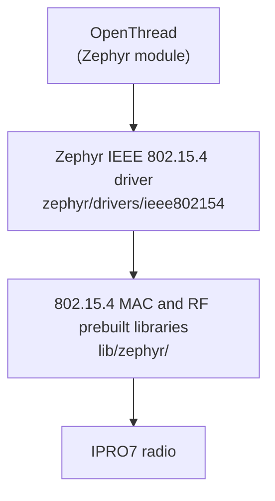

# Thread & Matter

Thread runs on IPRO7's IEEE 802.15.4 radio under Zephyr RTOS, using Zephyr's OpenThread and the SDK's 802.15.4 driver. FreeRTOS applications have no 802.15.4 or Thread support, and the release has no Matter stack.

!!! abstract "At a glance"
    - **Thread**: Zephyr RTOS only, sample board `ipro7_evb`. Configuration fragments for Zephyr's OpenThread shell sample ship in `zephyr/samples/ieee802154_shell/`.
    - **IPRO7AI Reef EVK**: no Thread path in V2.3.0. The Reef has no Zephyr board definition, and the FreeRTOS applications it runs do not include 802.15.4.
    - **Matter**: not included in V2.3.0 — no Matter stack, applications or build commands. Contact INTELPRO.
    - Nothing on this page implies that the release is Thread or Matter certified.

## Delivery status { #overview }

| Item | In this release |
|---|---|
| Matter stack and applications | Not included |
| Thread (OpenThread) | Zephyr RTOS, sample board `ipro7_evb`; not in FreeRTOS |
| Thread Border Router | Not included |
| IEEE 802.15.4 radio | Zephyr driver with prebuilt MAC and RF libraries |
| BLE (usable for commissioning) | Available under FreeRTOS and Zephyr, not integrated with Matter |

## OpenThread (Zephyr RTOS) { #openthread }



The RF driver and the 802.15.4 MAC link as prebuilt libraries (`components/wireless/rf/ipro7_rf/lib/zephyr/`, `components/wireless/ieee802154/lib/zephyr/`). OpenThread is a Zephyr module on the `west.yml` allow-list.

The SDK adds configuration fragments to Zephyr's own `samples/net/openthread/shell`:

| File (`zephyr/samples/ieee802154_shell/`) | Contents |
|---|---|
| `ot.conf` | Thread 1.4, the OpenThread CLI ping sender, the radio timestamps and timed transmit that CSL needs, stack sizes, and the RF crystal trim |
| `csl.conf` | Layered on `ot.conf`: a CSL receiver (sleepy end device), the CSL period and timeout, and the driver's frame trace |
| `app.overlay` | Enables the `ieee802154` node and makes it the default 802.15.4 device |

```ini title="zephyr/samples/ieee802154_shell/ot.conf (excerpt)"
CONFIG_OPENTHREAD_THREAD_VERSION_1_4=y
CONFIG_OPENTHREAD_PING_SENDER=y
CONFIG_NET_PKT_TIMESTAMP=y
CONFIG_NET_PKT_TXTIME=y
CONFIG_SOC_IPRO7_XTAL_CAPCODE=165
```

```ini title="zephyr/samples/ieee802154_shell/csl.conf (excerpt)"
CONFIG_OPENTHREAD_CSL_RECEIVER=y
CONFIG_IEEE802154_IPRO_OT_CSL_PERIOD_US=500000
CONFIG_IEEE802154_IPRO_OT_CSL_TIMEOUT_S=20
```

!!! warning "The RF crystal trim depends on the board"
    `CONFIG_SOC_IPRO7_XTAL_CAPCODE=165` in `ot.conf` was measured on IPRO7 EVBs. On another board, measure with `ipro154 xtal` and `ipro154 cfo` and set your own value: a large frequency error hurts links with other Thread devices.

## Try it on the IPRO7 EVB { #reference-apps }

There is no Reef walk-through for Thread in this release. On an IPRO7 EVB:

<div class="ipro-steps" markdown>

1. **Create the workspace**: run `tools/zephyr/bootstrap.sh` and `source zephyr-workspace/env.sh`, as in [Zephyr RTOS](zephyr.md#workspace).

2. **Build the OpenThread shell** (in `zephyr-workspace/`; `<SDK>` is the absolute path of the SDK root)

    ```bash
    west build -b ipro7_evb zephyr/samples/net/openthread/shell -d build/ot -- \
        -DEXTRA_CONF_FILE=<SDK>/zephyr/samples/ieee802154_shell/ot.conf \
        -DEXTRA_DTC_OVERLAY_FILE=<SDK>/zephyr/samples/ieee802154_shell/app.overlay
    ```

    To try a CSL receiver, add `csl.conf` to `EXTRA_CONF_FILE` as well.

3. **Flash**: `west flash -d build/ot`; without a probe add `-- --boot shell` or `-- --boot manual` (see [Zephyr RTOS](zephyr.md)).

4. **Use it**: open the console with `../tools/zephyr/monitor.sh --port /dev/cu.usbserial-XXXX` (2,000,000 baud) and drive the OpenThread CLI with the `ot` command. Forming or joining a network needs another Thread device or a Border Router.

</div>

To test raw 802.15.4 traffic only, build the SDK's `ieee802154_shell` sample (Zephyr's IEEE 802.15.4 and network shells):

```bash
west build -b ipro7_evb ../zephyr/samples/ieee802154_shell -d build/154
```

The driver adds `ipro154` debug commands:

| Command | Purpose |
|---|---|
| `ipro154 stats` | Driver and HAL counters |
| `ipro154 clk` | Radio clock rate against the kernel clock |
| `ipro154 cfo` | Per-sender frequency offset, SFD correlation and RSSI |
| `ipro154 xtal` | RF crystal trim |
| `ipro154 crc` | Count CRC-failed frames in the HAL counters |
| `ipro154 trace` | HAL frame trace (`on` / `off` / `clear` / `dump`) |

`tools/zephyr/csl_pcap.py` analyzes CSL timing in an 802.15.4 sniffer capture.

## Before you integrate { #configuration }

- **RTOS**: Thread exists only under Zephyr; no configuration key adds it to a FreeRTOS application. If the product also needs low power, a camera, USB or the NPU, check their status under Zephyr first ([Zephyr RTOS](zephyr.md)).
- **Board**: Zephyr boards in this release are the IPRO7 EVB and the IPRO7AI EVK; a product board needs its own board definition.
- **Low power**: Zephyr does not put the SoC into PDS or HBN in this release. `csl.conf` shows CSL timing behavior; it does not mean the device reaches sleep-level current.
- **RF crystal**: set and verify `CONFIG_SOC_IPRO7_XTAL_CAPCODE` for each board design.
- **Border Router and commissioning**: no Border Router is included. Plan for an external one, for how network credentials are provisioned, and for how they are stored securely.
- **Resources**: check the flash and RAM budget, persistent storage, the entropy source (`CONFIG_ENTROPY_GENERATOR`) and the update path (MCUboot; see [OTA Updates](ota.md)).
- **Validation order**: board drivers, the radio link, IP transport and secure storage first; then protocol integration, commissioning, recovery after reboot and interoperability.

## Matter outlook { #matter-architecture }

Matter is an IP application protocol that runs over Wi-Fi, Ethernet or Thread and uses BLE for commissioning. This release has components for each transport — Wi-Fi through an IPRO6S and Ethernet under FreeRTOS ([Networking](networking.md)), Thread under Zephyr, BLE under both — but no Matter stack, commissioning flow, device attestation certificates or Matter OTA. Having the transports is not Matter integration. For Matter plans and timing, contact INTELPRO.

## Related documents { #related }

- [Zephyr RTOS](zephyr.md): workspace, flashing, features and limitations.
- [Networking](networking.md): lwIP, Wi-Fi through the IPRO6S FIN card on the Reef, Ethernet.
- [BLE Development](ble.md): the BLE host and controller.
