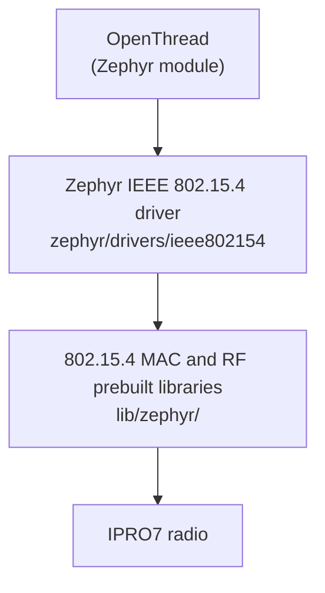

# Thread & Matter

!!! info "Delivery status"
    - **Matter**: not included in V2.1.0 — no Matter stack, applications or build commands. Contact INTELPRO.
    - **Thread**: available under Zephyr RTOS only, using Zephyr's OpenThread and the IPRO7 IEEE 802.15.4 driver. FreeRTOS applications do not include Thread.

Nothing here implies that this release is Thread or Matter certified.

## Delivery status { #overview }

| Item | V2.1.0 |
|---|---|
| Matter stack and applications | Not included |
| Thread (OpenThread) | Zephyr RTOS, sample board `ipro7_evb`; not in FreeRTOS |
| Thread Border Router | Not included |
| IEEE 802.15.4 radio | Zephyr driver with prebuilt MAC and RF libraries |
| BLE (usable for commissioning) | Available on FreeRTOS and Zephyr, but not integrated with Matter |

## OpenThread (Zephyr RTOS) { #openthread }



The RF driver and the 802.15.4 MAC link as prebuilt libraries (`components/wireless/rf/ipro7_rf/lib/zephyr/`, `components/wireless/ieee802154/lib/zephyr/`). OpenThread itself is a Zephyr module on the `west.yml` allow-list.

The SDK adds configuration fragments to Zephyr's own `samples/net/openthread/shell`:

| File (`zephyr/samples/ieee802154_shell/`) | Contents |
|---|---|
| `ot.conf` | Thread 1.4, OpenThread CLI ping, the radio timestamps and timed transmit that CSL needs, stack sizes, and the RF crystal trim |
| `csl.conf` | Layered on top of `ot.conf`: a sleepy end device (SSED) with a CSL receiver, the CSL period and timeout restored after reset, and frame tracing |
| `app.overlay` | Enables the `ieee802154` node and makes it the default 802.15.4 device |

```ini title="ot.conf (excerpt)"
CONFIG_OPENTHREAD_THREAD_VERSION_1_4=y
CONFIG_OPENTHREAD_PING_SENDER=y
CONFIG_NET_PKT_TIMESTAMP=y
CONFIG_NET_PKT_TXTIME=y
CONFIG_SOC_IPRO7_XTAL_CAPCODE=165
```

```ini title="csl.conf (excerpt)"
CONFIG_OPENTHREAD_CSL_RECEIVER=y
CONFIG_IEEE802154_IPRO_OT_CSL_PERIOD_US=500000
CONFIG_IEEE802154_IPRO_OT_CSL_TIMEOUT_S=20
```

!!! warning "The RF crystal trim depends on the board"
    `CONFIG_SOC_IPRO7_XTAL_CAPCODE=165` in `ot.conf` was measured on IPRO7 EVBs; the IPRO7AI Reef EVK uses 95. On other boards, measure with `ipro154 xtal` and `ipro154 cfo` and adjust: a large frequency error hurts links with other Thread devices.

## Try it { #reference-apps }

<div class="ipro-steps" markdown>

1. **Create the workspace**: run `tools/zephyr/bootstrap.sh` and `source zephyr-workspace/env.sh` as described in [First Zephyr Application](../get-started/first-app-zephyr.md).

2. **Build the OpenThread shell** (in `zephyr-workspace/`; `<SDK>` is the absolute path of the SDK root)

    ```bash
    west build -b ipro7_evb zephyr/samples/net/openthread/shell -d build/ot -- \
        -DEXTRA_CONF_FILE=<SDK>/zephyr/samples/ieee802154_shell/ot.conf \
        -DEXTRA_DTC_OVERLAY_FILE=<SDK>/zephyr/samples/ieee802154_shell/app.overlay
    ```

    To try SSED/CSL, add `csl.conf` to `EXTRA_CONF_FILE` as well.

3. **Flash**: `west flash -d build/ot` (without a probe add `-- --boot shell` or `--boot manual`; see [Zephyr RTOS](zephyr.md)).

4. **Use it**: open the console with `tools/zephyr/monitor.sh --port /dev/cu.usbserial-XXXX` (2000000 baud) and drive the OpenThread CLI with the `ot` command. Forming or joining a network needs another Thread device or a Border Router; V2.1.0 does not include a Border Router.

</div>

To test raw 802.15.4 traffic only, build the SDK's `ieee802154_shell` sample (Zephyr's IEEE 802.15.4 and network shells):

```bash
west build -b ipro7_evb ../zephyr/samples/ieee802154_shell -d build/154
```

The driver also provides `ipro154` debug commands:

| Command | Purpose |
|---|---|
| `ipro154 stats` | Driver and HAL counters |
| `ipro154 clk` | Radio clock rate against the kernel clock |
| `ipro154 cfo` | Per-sender frequency offset, SFD correlation and RSSI |
| `ipro154 xtal` | RF crystal trim |
| `ipro154 crc` | Count CRC-failed frames in the HAL counters |
| `ipro154 trace` | HAL frame trace (`on` / `off` / `clear` / `dump`) |

`tools/zephyr/csl_pcap.py` analyzes CSL timing in an 802.15.4 sniffer capture.

## Before you integrate { #configuration }

- **RTOS**: Thread is available only under Zephyr; no configuration key turns it on in a FreeRTOS application. If the product also needs low power, the camera, USB or the NPU, check their status under Zephyr first (see [Zephyr RTOS](zephyr.md)).
- **Low power**: in this release Zephyr does not put the SoC into PDS or HBN. `csl.conf` shows CSL communication behavior; it does not mean the device reaches sleep-level current.
- **RF crystal**: set and verify `CONFIG_SOC_IPRO7_XTAL_CAPCODE` for each board design.
- **Border Router and commissioning**: V2.1.0 has no Border Router. Plan for an external Border Router, how network credentials are provisioned, and how they are stored securely.
- **Resources**: check the flash and RAM budget, persistent storage, the entropy source (`CONFIG_ENTROPY_GENERATOR`) and the update path (MCUboot; see [OTA Updates](ota.md)).
- **Validation order**: verify the board drivers, the radio link, IP transport and secure storage first, then protocol integration, commissioning, recovery after reboot and interoperability.

## Matter outlook { #matter-architecture }

Matter is an IP-based application protocol that runs over Wi-Fi, Ethernet or Thread and uses BLE for commissioning. V2.1.0 has components for each of these transports — Ethernet and Wi-Fi through an IPRO6S under FreeRTOS (see [Networking](networking.md)), Thread under Zephyr, and BLE on both — but no Matter stack, commissioning flow, device attestation certificates or Matter OTA. Having these components is not the same as Matter integration. For Matter plans and timing, contact INTELPRO.

## Related documents { #related }

- [Zephyr RTOS](zephyr.md): workspace, flashing, features and limitations.
- [Networking](networking.md): lwIP, Ethernet and IPRO6S Wi-Fi under FreeRTOS.
- [BLE Development](ble.md): the BLE host and controller.
