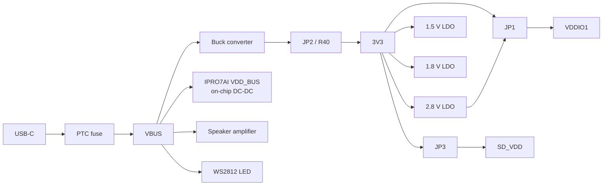
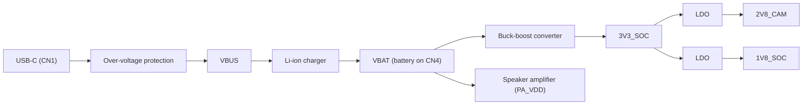
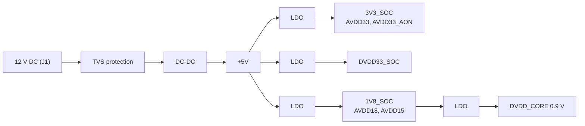

# Power & Current Measurement

Before you measure current, find where the board's power comes from and where to break a rail, then put the chip to sleep with the SDK's low-power test application. The SDK gives no current figures that hold for every board; use the measurement conditions in the chip datasheet and measure on your own board.

## Board power trees { #power }

### IPRO7AI Reef EVK { #reef-power }

The Reef is powered from USB-C only. VBUS feeds the on-board buck converter, the IPRO7AI's own DC-DC (VDD_BUS), the speaker amplifier and the WS2812 LED; everything else runs from 3V3.



| Supply | Source | Feeds |
|---|---|---|
| VBUS | USB-C through a PTC fuse | Buck converter, the IPRO7AI's VDD_BUS, speaker amplifier, WS2812 LED |
| Inside the SoC | VDD_BUS through the on-chip DC-DC | VDDIO_PSRAM, AVDD_RF |
| 3V3 | Buck converter through JP2 (or R40) | AVDD33, VDDIO3, VDDIO1 (JP1 1-2), the LDOs, PDM microphone, headset microphone bias, headphone buffer, power LED, SD_VDD |
| VDD_2V8 | 3V3 through a 2.8 V LDO | Camera DOVDD and AVDD (through a ferrite), SCCB pull-ups, VDDIO1 (JP1 2-3) |
| VDD_1V5 | 3V3 through a 1.5 V LDO, enabled together with 2.8 V | Camera DVDD |
| 1V8 | 3V3 through a 1.8 V LDO | J_IO pin 7 only |
| SD_VDD | 3V3 through JP3 | SD slot and FIN card; with JP3 on 2-3 switched by GPIO14 through a P-MOSFET (low = on) |

The camera rails have no GPIO control and come up with 3V3; a pull-down holds the sensor in reset until GPIO34 releases it.

### IPRO7AI EVK { #evk-power }



| Supply | Source | Feeds |
|---|---|---|
| VBUS | USB-C through over-voltage protection | Li-ion charger |
| VBAT | Charger output and battery (CN4) | Buck-boost converter, speaker amplifier |
| 3V3_SOC | VBAT through the buck-boost converter | SoC and the LDOs |
| 2V8_CAM | 3V3_SOC through an LDO | Camera AVDD; VDDIO1 through the J6 wire |
| 1V8_SOC | 3V3_SOC through an LDO | Camera and digital microphone |

For the J6 wiring, see [IPRO7AI EVK](boards/ipro7ai-evk.md#features).

### IPRO7 EVB { #evb-power }

The EVB takes 12 V DC on J1, steps it down to 5 V and generates the other rails with LDOs; the input has TVS protection.



| Rail | Voltage | Use | Notes |
|---|---|---|---|
| +12V | 12 V | External DC input | J1, TVS protection |
| +5V | 5 V | Main system supply | Stepped down from 12 V |
| 3V3_SOC | 3.3 V | SoC IO supply | GPIOs, peripherals |
| AVDD33 | 3.3 V | Analog supply | ADC / DAC, RF front end |
| DVDD33_SOC | 3.3 V | Digital supply | Digital logic |
| 1V8_SOC | 1.8 V | Low-voltage IO supply | 1.8 V IO interfaces |
| AVDD18 | 1.8 V | Low-voltage analog supply | RF circuits |
| AVDD15 | 1.5 V | Analog core supply | Internal analog circuits |
| DVDD_CORE | 0.9 V | Digital core supply | CPU and memory core |

## Power design recommendations { #design-recommendations }

| Item | Recommendation |
|---|---|
| Input protection | A TVS on the DC input against ESD and surges |
| Decoupling | 100 nF on every supply pin, as close to the chip as possible |
| Bulk capacitance | 10 µF–47 µF on +5 V and +3.3 V |
| Power sequencing | Follow the power-sequencing requirements of the chip datasheet and your board |
| Grounding | A solid ground plane, with analog and digital areas kept apart |
| LDO choice | Low-noise LDOs for the analog supplies (AVDD) |

For the antenna and matching network, see [Pinout & Peripheral Mapping](pinmux.md#antenna).

## Measuring current { #current-measurement }

Record the conditions of every measurement so that results compare: measurement point, CPU clock, RF transmit power, enabled peripherals, memory retention and sleep mode. Subtract or disconnect what the USB-to-UART bridge, LEDs, sensors and the regulators themselves draw.

### Measurement points { #measurement-points }

| Board | Measurement point | What it includes |
|---|---|---|
| IPRO7AI Reef EVK | A USB power meter between USB-C and the computer | The whole board |
| IPRO7AI Reef EVK | Remove JP2 (and check that R40 is not fitted), then feed 3V3 from a bench supply through an ammeter; keep USB-C connected | The circuits on 3V3: IO supplies, camera LDOs, microphones, SD_VDD and so on. It excludes the SoC's VDD_BUS, the speaker amplifier and the LED, which run from VBUS |
| IPRO7AI EVK | A USB power meter between USB-C and the computer, with the battery removed | The whole board; with a battery connected, the reading includes the charging current |
| IPRO7 EVB | The 12 V input on J1 | The whole board, including all regulators |

### Measure sleep current with ipro_lp_test { #lp-test }

`apps/test/ipro_lp_test` puts the chip into PDS (Level 31) sleep through the `hal_lp` low-power framework and wakes it with the RTC. Its `.config` targets the IPRO7 EVB (`CONFIG_EVB=y`) without PSRAM and BLE, and the console runs at 115200 baud.

<div class="ipro-steps" markdown>

1. **Build and flash** (IPRO7 EVB)

    ```bash
    ./build_freertos.sh build flash -p /dev/cu.usbserial-XXXX ipro_lp_test
    ```

2. **Open the console**: type the commands below in any serial terminal (115200 8N1), or send them one at a time with `tools/serial_monitor.py`:

    ```bash
    python3 tools/serial_monitor.py /dev/cu.usbserial-XXXX --send "lp rtc" --timeout 3
    ```

3. **Check that the RTC counts**: run `lp rtc` twice; the value should increase.

4. **Sleep once**: `lp sleep 5000` sleeps for 5 seconds and wakes on the RTC; read the meter during that time.

5. **Sleep repeatedly and average**: `lp auto on` makes the idle task enter 1-second PDS sleeps over and over, which suits an average-current reading. `lp status` shows sleep statistics, `lp reset` clears them, and `lp auto off` stops.

</div>

The UART is off while the chip is in PDS, so characters typed during a sleep are lost; if `lp auto off` gets no answer after `lp auto on`, type it again. Typing `lp` on its own lists every subcommand.

### Automatic low power in applications { #ipro-pm }

Applications normally do not call sleep themselves. `components/sys/ipro_pm` takes over FreeRTOS tickless idle and picks, for every idle window, the deepest mode allowed: `IPRO_PM_MODE_WFI` (CPU clock gated), `IPRO_PM_MODE_NATIVE` or `IPRO_PM_MODE_PDS`. With `CONFIG_IPRO_PM=y`, the shell command `pm stats` lists the residency in each mode and an energy estimate; the estimate does not replace a measurement. For configuration and PDS during BLE connections, see the [low-power guide](../guides/low-power.md).

## Related documents { #documents }

- [IPRO7AI Reef EVK](boards/reef-evk.md#jumpers): jumpers JP1–JP3.
- [IPRO7AI EVK](boards/ipro7ai-evk.md), [IPRO7 EVB](boards/ipro7-evb.md).
- [Low-power guide](../guides/low-power.md): PDS, `ipro_pm` and BLE low-power settings.
- IPRO7 datasheet and hardware design guide (electrical characteristics, power sequencing): see [Documents](../documents/index.md).
