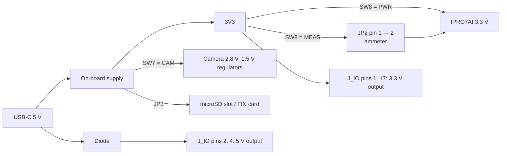

# Power & Current Measurement

Before you measure current, know where the Reef's power comes from and where to break the path you want to measure, then put the board into the state you want to measure. The SDK publishes no current figures that hold for every board; use the measurement conditions in the chip datasheet and measure on your own board.

## Board power { #power }

### IPRO7AI Reef EVK { #reef-power }

The Reef V4.0 is powered from USB-C only; the on-board supply makes 3.3 V (3V3) and the camera voltages. SW8 picks the source of the IPRO7AI's 3.3 V: on PWR it comes straight from the on-board 3.3 V, on MEAS it goes through JP2 so an ammeter or an external supply can sit in the path.



| Switch / jumper | Position | Effect on power |
|---|---|---|
| SW8 | PWR | Normal use: the IPRO7AI's 3.3 V comes straight from the on-board supply |
| | MEAS | The IPRO7AI's 3.3 V goes through JP2; JP2 must carry an ammeter or an external 3.3 V supply |
| JP2 | — | 3 pins: 1 = 3V3 (on-board 3.3 V), 2 = SOC (the IPRO7AI's 3.3 V), 3 = GND; used only with SW8 on MEAS |
| SW7 | CAM | The camera's 2.8 V and 1.5 V regulators are on |
| | GPIO | The camera regulators are off and 16 camera pins go to J_IO |
| JP3 | ON | The microSD slot is always powered |
| | GPIO | GPIO14 switches the slot: powered while low or undriven, off while high; `fin cycle` for the FIN card needs this position |

- The U6 debug connector does not power the board; with the IPRO Debug Probe or a USB-to-UART cable connected, you still need USB-C.
- Pins 2 and 4 of J_IO output USB 5 V through a diode and pins 1 and 17 output 3.3 V; none of them can power the board.

!!! warning "Before power-on"
    - Power the board from USB-C only.
    - Keep SW8 on PWR normally. With SW8 on MEAS, do not plug in USB-C unless JP2 carries an ammeter or an external 3.3 V supply: the IPRO7AI would be unpowered while the peripherals' 3.3 V back-feeds it through the IO pins.
    - Unplug USB-C before you connect or disconnect the camera cable.

For the power trees of the other boards (IPRO7 EVB, IPRO7AI EVK), see their hardware documents; contact INTELPRO.

## Power design recommendations { #design-recommendations }

| Item | Recommendation |
|---|---|
| Input protection | A TVS at the power input against ESD and surges |
| Decoupling | 100 nF on every supply pin, as close to the chip as possible |
| Bulk capacitance | 10 µF–47 µF on the 5 V and 3.3 V supplies |
| Power-up sequence | Follow the chip datasheet and the board's power sequencing |
| Ground | A solid ground plane, with analog and digital areas kept apart |
| LDOs | Low-noise LDOs for the analog supplies (AVDD) |
| Current measurement | Keep a point in the SoC's supply path that can be opened, like the Reef's SW8 and JP2 |

For the antenna and its matching network see [Pinout & Peripheral Mapping](pinmux.md#antenna).

## Measuring current { #current-measurement }

Record the conditions of every measurement so results can be compared: measurement point, CPU clock, RF transmit power, enabled peripherals, memory retention settings and sleep mode.

### Measurement points { #measurement-points }

| Point | How to connect | What it includes |
|---|---|---|
| Whole board | A USB current meter between the computer and USB-C | Everything on the board, including the LED, speaker amplifier, camera and microSD card |
| IPRO7AI 3.3 V | SW8 on MEAS, ammeter between pins 1 and 2 of JP2 | The IPRO7AI's 3.3 V pins with their decoupling capacitors and the boot-pin pull-up; no peripherals |

### Measure the IPRO7AI's current { #reef-soc-current }

<div class="ipro-steps" markdown>

1. **Flash the firmware you want to measure**: for example the out-of-box firmware `ipro7ai_reef_demo`, as in the [IPRO7AI Reef EVK quick start](boards/reef-evk.md#quick-start). Check that it boots with SW8 on PWR.

2. **Connect the ammeter**: unplug USB-C, connect the ammeter between pin 1 (3V3) and pin 2 (SOC) of JP2, then set SW8 to MEAS. To power the chip from an external supply instead, connect the external 3.3 V between pin 2 (SOC) and pin 3 (GND) of JP2.

3. **Power up and check that it boots**: plug in USB-C, open the console at 115200 baud and enter `reef status`.

    ```bash
    python3 tools/serial_monitor.py /dev/cu.usbserial-XXXX --send "reef status" --timeout 5
    ```

    When the console prints the board status, the IPRO7AI runs through JP2 and the ammeter shows its 3.3 V current. If nothing comes back, check the ammeter's range and the JP2 wiring.

4. **Read the current in each state**: run the actions you want to measure at the console, wait for the reading to settle, and record it with the conditions.

5. **Return to normal power**: unplug USB-C first, set SW8 back to PWR, then remove the ammeter.

</div>

### Sleep current { #lp-test }

`apps/test/ipro_lp_test` (PDS31 entry and exit with RTC wake-up, `lp` commands) ships with an IPRO7 EVB configuration only (`CONFIG_EVB=y`); this release has no Reef configuration for measuring sleep current.

In PDS31 sleep only the first 64 KB of OCRAM is retained; the rest only while the MISC power domain stays powered (`pm_pds_set_misc_keep()` in `bsp/hal/inc/hal_pm.h`). The 4 KB of HBN RAM is retained in hibernate. The UART is off while the chip is in PDS, so characters typed during sleep are lost.

### Automatic low power in applications { #ipro-pm }

Applications normally do not call sleep themselves. `components/sys/ipro_pm` takes over FreeRTOS tickless idle and, for each idle period, picks the deepest mode allowed: `IPRO_PM_MODE_WFI` (CPU clock gated), `IPRO_PM_MODE_NATIVE` (WFI while the BLE core sleeps on its own 32 kHz timer) or `IPRO_PM_MODE_PDS` (PDS31). With `CONFIG_IPRO_PM=y`, the shell command `pm stats` lists the time spent in each mode and an estimate of the average current; the estimate does not replace a measurement. For configuration see the [Low Power guide](../guides/low-power.md).

## Related documents { #documents }

- [IPRO7AI Reef EVK](boards/reef-evk.md#jumpers): positions and settings of SW7, SW8, JP2 and JP3.
- [Low Power guide](../guides/low-power.md): PDS, `ipro_pm` and BLE low-power settings.
- IPRO7 datasheet and hardware design guide (electrical characteristics, power sequencing): see [Documents](../documents/index.md).
