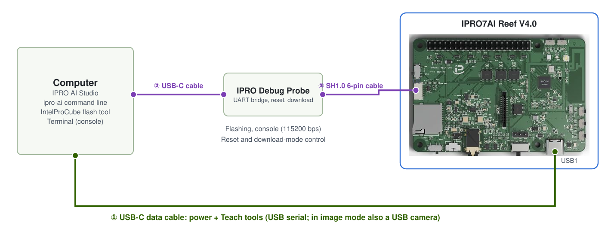

# Flash the Edge AI Firmware

All three Teach tools live in the Edge AI firmware, `ipro_reef_teach`. At the end of this page the Reef boots with its own partition table, start-up mode and voiceprint model, the computer enumerates the USB device of the current mode, and IPRO AI Studio can find the board. You flash the firmware once; image and sensor models are deployed from Studio over USB-C afterwards, without flashing.

## Prerequisites { #prerequisites }

- An IPRO7AI Reef EVK V4.0 and a data cable on the Reef's USB-C (USB1); it also powers the board while flashing.
- An IPRO Debug Probe, connected to the computer with a USB-C cable and to the Reef's U6 with a pin-reversed SH1.0 6-pin cable; see [Debug connector U6](../hardware/boards/reef-evk.md#debug-connector). The probe does not power the Reef.
- The IntelProCube 0.7.0.1 command-line flash tool (`ipro_iot_tool_macos`, `ipro_iot_tool_linux`, `ipro_iot_tool.exe`), run from its own directory. [Set Up Your Host](../get-started/environment.md#intelprocube) shows how to install it.
- The firmware files: the `firmware/` folder of the IPRO Edge AI package, or a build from SDK V2.3.0 (needs the [toolchain](../get-started/environment.md) and Python 3).



Day-to-day Teach use needs only the Reef's USB-C (①). For flashing or reading the console, add the probe (② and ③). The console is on the probe's "IPRO7 UART" serial port at 115200 baud, 8N1; flashing runs at 921600 baud.

## Files for flashing { #files }

| File | What it is | Where it comes from |
|---|---|---|
| `ipro_reef_teach_IPRO7.bin` | Edge AI firmware | Package `firmware/`; or the SDK build output `apps/ai/ipro_reef_teach/build/build_out/` |
| `partition_reef_teach.toml` | The Edge AI firmware's partition table | Package `firmware/`; or SDK `apps/ai/ipro_reef_teach/` |
| `model_b.spkb` | Voiceprint model (437,200 B, CRC `db073b9e`) | Package `firmware/`; or SDK `apps/ai/ipro_reef_teach/model/` |
| `reef_teach_mfg.bin` | mfg payload: start-up mode plus voiceprint model | Package `firmware/` (starts in `image` mode); or made with `mfg_payload.py` |

The image and sensor models are not in the mfg payload; IPRO AI Studio deploys them later.

## Build from the SDK (optional) { #build }

Skip this section if you use the files from the package's `firmware/`. From the SDK root:

<div class="ipro-steps" markdown>

1. **Build the firmware**

    ```bash
    make -C apps/ai/ipro_reef_teach
    ```

    Output: `apps/ai/ipro_reef_teach/build/build_out/ipro_reef_teach_IPRO7.bin`. The app's `.config` already selects the Reef (`CONFIG_IPRO7AI_REEF=y`), 2 MB flash, AI support and the watchdog; no other configuration to choose.

2. **Make the mfg payload**: `--mode` is the mode to boot into: `image`, `voice` or `sensor` (default `image`).

    ```bash
    python3 apps/ai/ipro_reef_teach/mfg_payload.py \
        --voice apps/ai/ipro_reef_teach/model/model_b.spkb \
        --mode image -o reef_teach_mfg.bin
    ```

    The payload holds the mode sector, the voiceprint model and its commit record, so the board finds a CRC-checked voiceprint model at boot.

</div>

## Flashing steps { #flashing }

<div class="ipro-steps" markdown>

1. **Connect**: the Reef's USB-C to the computer for power; the IPRO Debug Probe to the computer and the Reef's U6. For image recognition, plug the OV5640 camera cable into FPC1 first, with the board unpowered, and set SW7 to CAM.

2. **Identify the serial port**: list the serial ports (`ls /dev/cu.*` on macOS; **Ports (COM & LPT)** in Device Manager on Windows). Open the probe's "IPRO7 UART" port at 115200 baud in a terminal program, press SW2 (RESET), and check from the boot log that this is the board you mean to flash. On macOS always use `/dev/cu.*`.

3. **Enter download mode**, one of:

    - **`reboot_dl` on the console (recommended)**: the Edge AI firmware has a shell in every mode. Type it, then close the terminal program; the console is silent in download mode.
    - **Through the probe**: on Windows and Linux, IntelProCube puts the Reef into download mode through the probe by itself. On macOS use `utils/ipro_flash.sh` in the IntelProCube directory instead: it finds the probe, puts the Reef into download mode, and passes its arguments unchanged to `ipro_iot_tool_macos` (you can leave out `--port`).
    - **Buttons**: hold SW1 (BOOT), press and release SW2 (RESET), then release SW1.

    If the firmware has hung and the console prints nothing, `reboot_dl` cannot work; use the probe or the buttons. You can still reflash from download mode.

4. **Flash the firmware, partition table and mfg payload**, from the IntelProCube directory. `--chip-variant IPRO7AI` is the Reef's flash pin setting and is required; `--skip-ota` and `--pt` give the Edge AI firmware's own partition table.

    === "macOS"

        ```bash
        ./ipro_iot_tool_macos --chipname ipro7 --chip-variant IPRO7AI \
            --port /dev/cu.usbserial-XXXX --baudrate 921600 --skip-ota \
            --pt <SDK>/apps/ai/ipro_reef_teach/partition_reef_teach.toml \
            --firmware ipro_reef_teach_IPRO7.bin \
            --mfg reef_teach_mfg.bin
        ```

    === "Linux"

        ```bash
        ./ipro_iot_tool_linux --chipname ipro7 --chip-variant IPRO7AI \
            --port /dev/ttyUSB0 --baudrate 921600 --skip-ota \
            --pt <SDK>/apps/ai/ipro_reef_teach/partition_reef_teach.toml \
            --firmware ipro_reef_teach_IPRO7.bin \
            --mfg reef_teach_mfg.bin
        ```

    === "Windows"

        ```powershell
        .\ipro_iot_tool.exe --chipname ipro7 --chip-variant IPRO7AI --port COM5 --baudrate 921600 --skip-ota --pt <SDK>\apps\ai\ipro_reef_teach\partition_reef_teach.toml --firmware ipro_reef_teach_IPRO7.bin --mfg reef_teach_mfg.bin
        ```

    Give the real paths of the files for `--firmware`, `--mfg` and `--pt`. With the package's files, point `--pt` at `partition_reef_teach.toml` in the package's `firmware/`.

5. **Look for `[All Success]`**: the flash tool exits with 0 even when it fails, so only `[All Success]` in the output means success. The tool then resets the board, which boots from flash.

6. **Check the USB device**: with the Reef's USB-C on the computer, the computer enumerates the current mode's USB device. The package's mfg payload starts in `image` mode, so a camera and serial port named **IPRO7 UVC Cam** appear.

</div>

!!! warning "Do not flash the Edge AI firmware from Studio's Board page"
    IPRO AI Studio's **Board** page has a **Flash** button, but it writes a single firmware image with the standard 2 MB partition table and no mfg payload. The Edge AI firmware needs its own partition table and mfg payload; use the IntelProCube command on this page.

## Update the firmware only { #firmware-only }

To update only the firmware later, run the same command without `--mfg`. The board keeps its mode, the three tools' models and the enrolled voiceprints:

```bash
./ipro_iot_tool_macos --chipname ipro7 --chip-variant IPRO7AI \
    --port /dev/cu.usbserial-XXXX --baudrate 921600 --skip-ota \
    --pt <SDK>/apps/ai/ipro_reef_teach/partition_reef_teach.toml \
    --firmware ipro_reef_teach_IPRO7.bin
```

To change the start-up mode or restore the shipped voiceprint model, make a payload with `mfg_payload.py` and flash it with `--mfg`. If the board ran other firmware with the standard partition table before, deploy the image and sensor models again after you flash the Edge AI firmware.

## Partition table and mfg partition { #mfg-slots }

`partition_reef_teach.toml` shrinks the firmware partition and grows the mfg partition so the three tools' models fit at once; the other partitions are where IntelProCube's standard 2 MB table has them.

| Partition | Standard 2 MB table | Edge AI firmware's table | Holds |
|---|---|---|---|
| FW | 0x003000, 1180 KB | 0x003000, 640 KB | Firmware |
| mfg | 0x12A000, 824 KB | 0x0A3000, 1364 KB | Start-up mode and the three model slots |
| media | 0x1FB000, 16 KB | 0x1FB000, 16 KB | Voiceprint recognition: enrolled voiceprints and thresholds |

Layout of the mfg partition (offsets from the start of mfg):

| Offset | Size | Holds | Model room |
|---|---|---|---|
| 0x000000 | 4 KB | Partition header | |
| 0x001000 | 4 KB | Start-up mode (`RTMD`); blank means `image` | |
| 0x002000 | 448 KB | Voiceprint model (`model_b.spkb`, 437 KB) | 444 KB |
| 0x072000 | 512 KB | Image model (`.inm` + class names; MobileNetV2 0.35 is 461 KB) | 508 KB |
| 0x0F2000 | 256 KB | Sensor model (`.inm` + pre-processing parameters; Large is 191 KB) | 252 KB |
| 0x132000 | 140 KB | Free | |

The last 4 KB of each slot is a commit record. On a deploy, the board first checks the model's size, CRC-32 and format in RAM, then erases the commit record, writes an "installing" record, writes and reads back the model, and finally writes the commit word. A power cut, reset or unplugged cable therefore leaves the old model, the new model or no model - never half a model.

When the board reports no model, the reason appears in the boot log, in `ipro-ai model list` and on the image tool's camera view:

| Reason | Meaning | Fix |
|---|---|---|
| `empty` | The slot has no model | Deploy one |
| `install_interrupted` | The last deploy did not finish | Deploy again |
| `crc` | The committed model does not match its CRC | Deploy again |
| `too_big` | The slot holds more than this firmware's slot size | Deploy again |
| `no_xip` | The partition cannot be read | Reflash the firmware with the right partition table |

## Switching modes { #modes }

The Edge AI firmware runs one tool at a time, called the mode. The mode is stored in flash and survives a restart; switching restarts the board (about 2 s) and erases none of the three models.

| Mode | Tool | USB device | VID:PID | Studio page | Console command |
|---|---|---|---|---|---|
| `image` | Image recognition | IPRO7 UVC Cam: USB camera + serial | 3896:0705 | **Teach** | `teach` |
| `voice` | Voiceprint recognition | IPRO Reef Voice: serial | 3896:0720 | **Audio** | `spk` |
| `sensor` | Sensor recognition | IPRO Reef Sensor: serial | 3896:0721 | **Sensor** | `sens` |

Ways to switch:

- **IPRO AI Studio**: open the page of the tool you want. When the board is in another mode, the page offers **Switch to Teach**, **Switch to Audio** or **Switch to Sensor**; the page finds the board again by itself.
- **Console**: `mode` shows the current mode; `mode image`, `mode voice` or `mode sensor` switches and restarts.

    ```text
    mode
    mode: image (of image voice sensor); `mode <image|voice|sensor>` restarts into another
    ```

- **Command line**: `ipro-ai deploy <package.ipkg> --switch` switches to the package's mode before deploying; `ipro-ai model list --all` switches through the three modes, lists each model and switches back.
- **USB command**: `APP` and `APP <mode>` on the voice and sensor serial protocols; a 16-byte `TAPP` header on the image tool. The format is in the IPRO7AI Edge AI Programming Guide.

## Boot log { #boot-log }

Press SW2 (RESET) or type `reboot` on the console. The boot log first shows the current mode, and its last line says the tool is ready, for example in `voice` mode:

```text
RTCH:   mode: voice (`mode <image|voice|sensor>` to switch)
SPKM: model 'b3-e12': 437200 B, trunk 16/16 layers on the NPU, ...
RTCH: voice ready - shell `spk`, IPRO AI Studio Audio page over USB-C
```

The last line in each mode:

| Mode | Ready line |
|---|---|
| `image` | ``image Teach ready - shell `teach`, IPRO AI Studio Teach page over USB-C`` |
| `voice` | `voice ready - …`; without a valid voiceprint model, `voice NO MODEL: flash the voice model to its mfg slot - …` |
| `sensor` | ``sensor Teach ready - shell `sens`, IPRO AI Studio Sensor page over USB-C; model: deployed``; with no model deployed, the reason follows `model:` |

In `sensor` mode the boot log also has a `SENM: model …` line with the model size, NPU layers, class count, data source and window. Every mode prints `[WDT] AON watchdog armed: …` when the watchdog is on.

## Watchdog { #watchdog }

The Edge AI firmware arms the AON watchdog (`CONFIG_APP_WATCHDOG=y`, 8 s nominal). If the system stalls - for example when the NPU runs a corrupted model - the watchdog restarts the board in the mode it was in, with its models. The Reef's watchdog clock runs fast, so it fires after about 5.6 to 8 s. The watchdog is turned off before download mode, so flashing is not affected.

| Console command | What it does |
|---|---|
| `watchdog` | Watchdog status: timeout, feed interval and count |
| `watchdog test` | Stops feeding, to check that the watchdog restarts the board |

If the board restarts on its own (the boot log appears again on the console), see [Troubleshooting](troubleshooting.md#runtime).

## Verify { #verify }

1. IntelProCube's output has `[All Success]`.
2. The console boot log shows `mode:` and that mode's ready line.
3. The computer enumerates that mode's USB device (for example **IPRO7 UVC Cam**).
4. In `ipro-ai device info --json`, `version` shows `"fw": "ipro_reef_teach"` and `"platform": "2.0"`, and `caps.modes` is `["image", "voice", "sensor"]`.

## Troubleshooting { #troubleshooting }

| Symptom | Cause | Fix |
|---|---|---|
| The tool finished but the output has no `[All Success]` | Flashing failed; the tool exits with 0 on failure too | Check that the board is in download mode and the port is right, then flash again |
| Handshake succeeds but the flash ID is `00000000`, ErrorCode `003D` | `--chip-variant IPRO7AI` is missing | Add `--chip-variant IPRO7AI` and flash again |
| Handshake fails or the port cannot be opened | A terminal program still holds the port, or the board is not in download mode | Close the terminal program; enter download mode again |
| On macOS, `utils/ipro_flash.sh` reports `[Errno 83] Device error`, ErrorCode `0003` | The probe's port briefly disappears after it puts the Reef into download mode | Wait a second or two and run the same command again |
| Nothing at all on the console | The cable is not pin-reversed, or the wrong probe port is open | Use a pin-reversed cable; open the "IPRO7 UART" port at 115200 baud |
| A different board got flashed | Several boards are attached and `--port` named another one | Check the board by its boot log before flashing; when in doubt, attach one board |
| After boot the camera view shows `NO MODEL: NO MFG PARTITION` | The firmware was flashed with a table other than `partition_reef_teach.toml` | Reflash with the right partition table |

## Next steps { #next-steps }

- [Image Recognition](image.md): the package's mfg payload starts in `image` mode.
- [Voiceprint Recognition](voice.md), [Sensor Recognition](sensor.md): switch with Studio's **Switch to …** or the console's `mode`.
