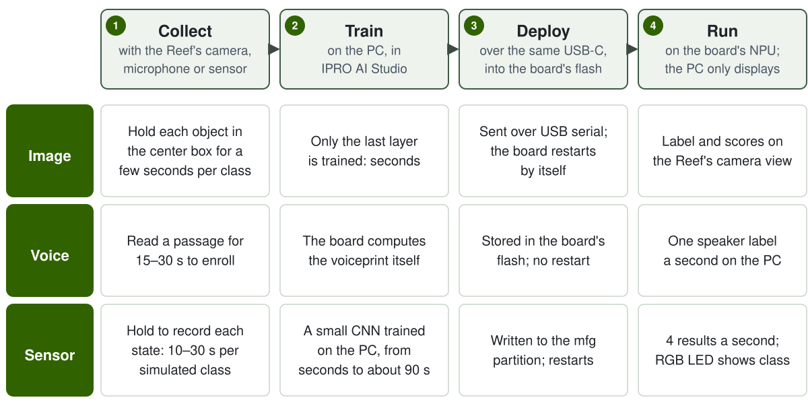

# IPRO AI Teach

IPRO AI Teach teaches the IPRO7AI Reef EVK to recognize things without writing code. You collect data with the board's own camera, microphone or sensor signal, train on your computer in IPRO AI Studio, and deploy over the same USB-C cable; the IPRO7AI's NPU runs the model. The three recognition tools - image, voiceprint and sensor - live in one Edge AI firmware, `ipro_reef_teach`. It runs one tool at a time, and all three models stay on the board when you switch.

!!! info "Availability"
    IPRO AI Studio (macOS and Windows) and the ready-to-flash Edge AI firmware files come in the IPRO Edge AI package; contact INTELPRO. The SDK contains the Edge AI firmware source, `apps/ai/ipro_reef_teach`, and the browser version of image Teach, `tools/teach_web`.

!!! abstract "At a glance"
    - One firmware, three modes: `image` (image recognition), `voice` (voiceprint recognition) and `sensor` (sensor recognition). The mode is stored in flash; switching restarts the board in about 2 s.
    - On the computer, IPRO AI Studio's **Teach**, **Audio** and **Sensor** pages. Training runs on the computer's CPU; no GPU is needed.
    - Inference runs entirely on the board's NPU. Images, sound and sensor data are not uploaded anywhere, and voiceprint audio never leaves the board.
    - Hardware: IPRO7AI Reef EVK V4.0. You flash the firmware once; new models go over USB-C after that.

## Introduction video { #video }

<video controls preload="metadata" playsinline width="100%" poster="/ipro-sdk-docs/assets/videos/ipro-ai-teach-2-intro.jpg">
  <source src="/ipro-sdk-docs/assets/videos/ipro-ai-teach-2-intro.mp4" type="video/mp4">
</video>

A board tour, flashing, and each tool from collecting data to recognition on the board (about 3 minutes, narrated in Mandarin with Chinese captions).

## The three tools { #tools }

| | Image recognition | Voiceprint recognition | Sensor recognition |
|---|---|---|---|
| What it does | Classifies the object in the box at the center of the camera view | Labels who is speaking once a second: enrolled people by name, others as Speaker 1, Speaker 2, ... | Tells the state of a machine or environment from a sensor signal; answers `UNKNOWN` for a state it was not taught, or learns only the normal state for anomaly detection |
| Data source | OV5640 camera module | The board's PDM microphone | Five simulated sensors built into the firmware, the board's microphone, or a sensor you add |
| Firmware mode | `image` | `voice` | `sensor` |
| USB device (VID:PID) | IPRO7 UVC Cam (3896:0705), USB camera + serial | IPRO Reef Voice (3896:0720), serial | IPRO Reef Sensor (3896:0721), serial |
| IPRO AI Studio page | **Teach** | **Audio** | **Sensor** |
| Classes or people | 2 to 8 classes (BACKGROUND included) | Up to 19 people stored in the board's flash | Up to 8 classes (7 taught when UNKNOWN is on) |
| Results | Every camera frame | Once a second | Four times a second |
| Where results show | Drawn on the Reef's camera stream | The Audio page's timeline; the RGB LED is red while the board listens | The Sensor page; the RGB LED shows the class by color |

Voiceprint recognition does not train on the computer: when you enroll someone, the board computes the voiceprint itself and keeps it in flash. The computer only sends commands and shows the results.

## What you need { #requirements }

| Item | Notes | Image | Voice | Sensor |
|---|---|---|---|---|
| IPRO7AI Reef EVK V4.0 | See [IPRO7AI Reef EVK](../hardware/boards/reef-evk.md) | ● | ● | ● |
| OV5640 camera module | FLEX-24 cable into FPC1; SW7 set to CAM | ● | | |
| USB-C data cable | From the Reef's USB-C to the computer: power, tool connection and model transfer. A charge-only cable does not work | ● | ● | ● |
| Computer | macOS 11 or later, or 64-bit Windows (x64) | ● | ● | ● |
| IPRO AI Studio | 0.4.2; see [Install IPRO AI Studio](install.md) | ● | ● | ● |
| IPRO Debug Probe | On the Reef's debug connector U6; needed only to flash firmware and read the console | ● | ● | ● |
| IntelProCube v0.6.3 | Command-line flash tool; needed only to flash firmware | ● | ● | ● |
| Edge AI firmware files | `firmware/` in the IPRO Edge AI package, or built from the SDK; see [Flash the Edge AI Firmware](firmware.md) | ● | ● | ● |

Sensor recognition needs no external sensor: the firmware has five simulated sensors, so one Reef and one USB-C cable take you through the whole flow. To use your own sensor, add a data source to the firmware; see [Sensor Recognition](sensor.md#own-sensor).

## Workflow { #workflow }

1. **Install IPRO AI Studio.** Install and open Studio on macOS or Windows and let it use the camera. See [Install IPRO AI Studio](install.md).

2. **Flash the Edge AI firmware (once).** Through the IPRO Debug Probe, flash `ipro_reef_teach`, its partition table and the mfg payload (start-up mode plus the voiceprint model) with IntelProCube. Only `[All Success]` in the output means it worked. See [Flash the Edge AI Firmware](firmware.md).

3. **Connect USB-C and check the board.** The computer enumerates the USB device of the current mode, for example **IPRO7 UVC Cam**; Studio's pages find the board by it. When the board is in another mode, the page shows a **Switch to …** button.

4. **Collect data.** Image: put the object in the box and hold **Hold to record**. Voiceprint: type a name under **TEACH A VOICE**, press **Record** and read aloud. Sensor: choose a data source and hold **Hold to record** for each state.

5. **Train.** For image and sensor, press **Train**; it finishes in seconds to about 90 s on the computer. A voiceprint is ready as soon as it is enrolled; there is nothing to train.

6. **Deploy.** Press **Deploy**. Studio runs **Compile the model**, **Send and write** and **Restart the board**; the board restarts and loads the new model.

7. **Run it on the board and check.** Image results are drawn on the camera stream; for voiceprints, press **Start listening** and watch the timeline; for sensors, watch the **On the board** area update four times a second.

## Pages in this section { #pages }

-   **[Install IPRO AI Studio](install.md)**

    ---

    Install Studio on macOS and Windows, first launch, camera permission, how Studio finds the board, and the `ipro-ai` command line.

-   **[Flash the Edge AI Firmware](firmware.md)**

    ---

    Get or build the firmware, make the mfg payload, flash with IntelProCube, update the firmware only, the mfg partition, switching modes, the boot log and the watchdog.

-   **[Image Recognition](image.md)**

    ---

    Switch to `image` mode, check the camera, create classes, record, train, deploy, watch the result on the board, then add samples and retrain.

-   **[Voiceprint Recognition](voice.md)**

    ---

    Switch to `voice` mode, enroll speakers, identify them live, name anonymous speakers, remove voiceprints, thresholds and stranger mode.

-   **[Sensor Recognition](sensor.md)**

    ---

    Simulated sensors and the microphone, recording, training options, UNKNOWN and anomaly detection, deploying, live results, and adding your own sensor.

-   **[Image Teach in the Browser](browser.md)**

    ---

    Image Teach in Chrome or Edge with the SDK's `tools/teach_web`, without installing Studio.

-   **[Troubleshooting](troubleshooting.md)**

    ---

    Causes and fixes for a board that is not found, the wrong mode, a black camera view, failed flashing, refused deploys, watchdog restarts and more.

## Limitations in this release { #limitations }

- One tool runs at a time; switching modes restarts the board (about 2 s).
- Each tool has one model slot. A deploy cut before it is committed leaves that tool without a model; deploy again. There is no previous model to roll back to.
- Models are integrity-checked (size, CRC-32) but not signature-checked: any computer that reaches the board's USB can deploy a model with a correct CRC, so do not treat this as a security feature.
- Image recognition needs the OV5640 camera module, and it has no "I don't know" answer: an object it was not taught goes to the most similar class.
- The console accepts ASCII only; enter speaker names with Chinese characters on Studio's Audio page.
- The Edge AI firmware in this release supports the IPRO7AI Reef EVK. On other IPRO7AI boards, check the partitions and the camera and microphone pins yourself.
