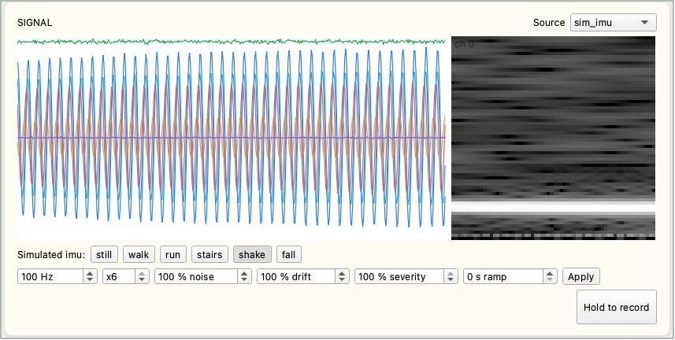
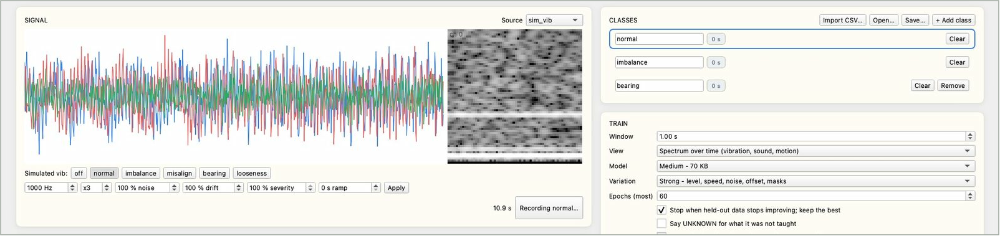
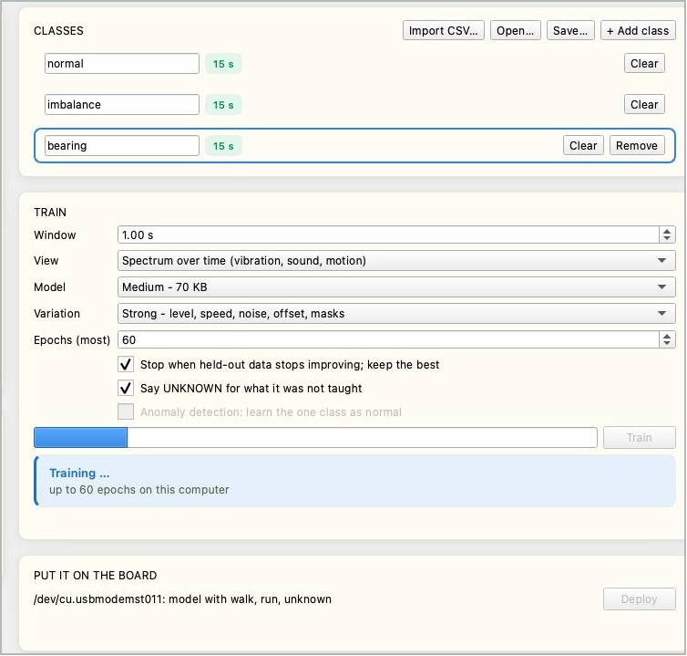
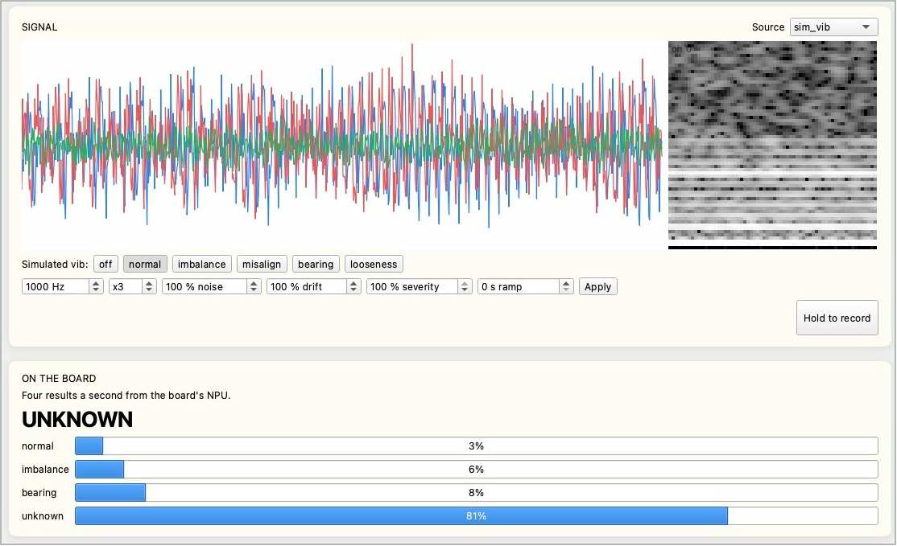

# Sensor Recognition

The Reef learns to tell the state of a machine or environment from a sensor signal - whether a motor is unbalanced, or whether a person is walking or has fallen. Record each state, train on the computer and deploy to the board; the board's NPU then decides four times a second. It all happens on IPRO AI Studio's **Sensor** page. The firmware has five simulated sensors, so before your own sensor is wired in, one Reef and one USB-C cable take you through the whole flow.

## Prerequisites { #prerequisites }

- An IPRO7AI Reef EVK flashed with the Edge AI firmware; see [Flash the Edge AI Firmware](firmware.md). Studio deploys the sensor model; nothing more to flash.
- A USB-C data cable from the Reef's USB-C to the computer.
- IPRO AI Studio installed; see [Install IPRO AI Studio](install.md).
- No other hardware for the simulated sensors or the board's microphone. Your own sensor needs a data source added to the firmware first; see [Add your own sensor](#own-sensor).

## How it works { #how-it-works }

- Samples from the data source (a simulated sensor, the microphone or your sensor) go into a 1 MB ring buffer on the board and stream unchanged to Studio over USB-C.
- Studio turns each piece of signal (a "window") into a 64×64×8 feature map, trains a whole small CNN on the computer, and compiles it into an NPU model.
- On a deploy, the model goes into the sensor model slot together with its pre-processing parameters, class names and data source, and the board restarts by itself.
- The board pre-processes exactly as Studio does, runs the NPU, sends four results a second to Studio, and shows the current class as the RGB LED's color.

## Connect the board { #connect }

<div class="ipro-steps" markdown>

1. **Switch to `sensor` mode**: open the Sensor page and press **Switch to Sensor** at the top, or type `mode sensor` on the console. The boot log shows the current model, for example:

    ```text
    SENM: model 63672 B, 5/5 layers on the NPU, 6 classes, sim_vib 1000 Hz x3, window 1000, spectrogram
    ```

    With no model deployed, this line gives the reason.

2. **Plug in USB-C**: a serial port named **IPRO Reef Sensor** appears on the computer.

3. **Open the Sensor page**: click **Sensor** in Studio's rail (Command+6 on macOS, Ctrl+6 on Windows).

4. **Check the status row**: **Board** shows `ready`, and **Source** shows the current data source, sample rate and channel count, for example `sim_vib 1000 Hz x3`. If no board is found, the **Put it on the board** area says `Connect a Reef running the Edge AI firmware to its own USB-C port.`

</div>

## The Sensor page { #page-layout }

| Area | What it holds |
|---|---|
| Status row | **Board**, **Source**, **Held-out accuracy** (score on held-out data; green at 90% or more), **Last deploy** (time of the last deploy) |
| **Signal** | Live waveform (left) and spectrum (right); **Source** at the top right chooses the data source |
| Simulated states and parameters | Shown for a simulated sensor: the top row of buttons switches the simulated state; the bottom row sets sample rate, channels, noise, drift, severity and ramp, applied with **Apply** |
| **Hold to record** | Hold to record the selected class; release to stop |
| **Classes** | The class list; each row has the name, seconds recorded, **Clear** and **Remove**. Above the list: **Import CSV…**, **Open…**, **Save…**, **+ Add class** |
| **Train** | Training options, progress bar, **Train** button, result and confusion matrix |
| **Put it on the board** | The board's serial port and current model, the **Deploy** button; deploy progress appears below |
| **On the board** | The board's results, four a second: the current decision in large type, each class's probability below |

## Choose a data source { #source }

Choose the data source with **Source** at the top right of the **Signal** area. When you change the source, Studio fills in the suggested window length and view.

| Source | Channels (unit) | Sample rate | States it can simulate | Suggested window and view |
|---|---|---|---|---|
| `sim_vib` | 3-axis acceleration x, y, z (g) | 1 kHz | `off`, `normal`, `imbalance`, `misalign`, `bearing` (bearing fault), `looseness` | 1 s, spectrum |
| `sim_imu` | Acceleration ax, ay, az (g), angular rate gx, gy, gz (500 dps) | 100 Hz | `still`, `walk`, `run`, `stairs`, `shake`, `fall` | 2.56 s, spectrum |
| `sim_env` | Temperature, pressure, humidity | 10 Hz | `normal`, `heating`, `cooling_fail`, `leak`, `door_open`, `sensor_fault` | 60 s, waveform |
| `sim_motor` | Three phase currents A, B, C (A) | 2 kHz | `off`, `normal`, `overload`, `phase_loss`, `broken_bar` (broken rotor bar), `bearing`, `unbalanced` (unbalanced phases) | 2 s, spectrum |
| `sim_sound` | Sound pressure (one channel) | 8 kHz | `quiet`, `hum`, `alarm`, `knock`, `hiss` (air leak), `voice` | 0.5 s, spectrum |
| `mic` | The Reef's PDM microphone (100 Hz high-pass) | 16 kHz | (real sound) | 1 s, spectrum |

A simulated sensor draws a new speed, level and noise for every recording, and its level also drifts slowly every 10 seconds, so two recordings of one state differ the way two runs of the same machine do.

For a simulated sensor, two rows of controls sit under the waveform:

- **State buttons**: for example `Simulated vib: off normal imbalance misalign bearing looseness`; click one to switch the simulated state. Key SW4 on the Reef also steps through the states.
- **Parameters**: set them and press **Apply**.

| Parameter | Range | Meaning |
|---|---|---|
| Sample rate (Hz) | 1 to 16000 | Simulated sampling frequency |
| Channels (x) | 1 to 6 | Number of simulated channels |
| noise (%) | 0 to 1000 | Noise strength |
| drift (%) | 0 to 1000 | Drift strength |
| severity (%) | 0 to 100 | How strong the state's signature is; 30% is a fault just starting |
| ramp (s) | 0 to 3600 | How long a new state takes to grow from nothing to its severity, to simulate a fault that develops |



## Record { #record }

<div class="ipro-steps" markdown>

1. **Name the classes**: the list starts with `normal` and `fault`. Click a name to rename it; press **+ Add class** for more, up to 8 classes. Names use letters, digits and `_ - .`, up to 15 characters, with no spaces (a space becomes an underscore).

2. **Select a class and set the state**: click the class to record (its frame turns blue) and put the machine in that state; with a simulated sensor, press the matching state button.

3. **Hold Hold to record**: while recording the button reads `Recording <class>…`; release to stop. The seconds next to the class add up and turn green at 10 seconds or more.

4. **Record every class in turn**: **Clear** drops a class's recordings if you got it wrong; **Remove** deletes the class.

</div>



Tips for recording:

- With a simulated sensor, 10 to 30 seconds per class is enough.
- **Hold each time for more than twice the window length.** The last quarter of each recording is held out for scoring; a class recorded too briefly cannot be scored. Shorter than one window shows `too short: hold for at least one window`.
- If the data stream skips, the page says `the stream skipped: kept as <N> takes` and keeps the recording as N pieces.
- Record slow signals (such as temperature) longer, at least 15 windows.

**Import CSV**: add data recorded elsewhere to the selected class with **Import CSV…**.

- One column per channel, one row per sample, comma-separated; a header row is skipped.
- The sample rate must match the board's current data source, and the number of columns its channel count; otherwise the page shows an `<N> columns` error.
- Use the raw counts the board streams, not volts or g: the spectrum's floor is one count, so data converted to units looks different from the live signal.

## Train { #train }

| Option | Choices | Notes |
|---|---|---|
| **Window** | 0.05 to 60 s (default 1.00 s) | How much signal each decision looks at; filled in when you change the source |
| **View** | Spectrum over time (vibration, sound, motion) | How the spectrum changes over time; for vibration, sound and motion |
| | Waveform (slow signals: temperature, pressure) | The raw waveform; for slow signals such as temperature and pressure |
| **Model** | Small - fastest, 21 KB | Smallest and fastest |
| | Medium - 70 KB (default) | The starting point for most cases |
| | Large - most capacity, 200 KB | Most capacity, for many classes or subtle differences |
| **Variation** | Strong - level, speed, noise, offset, masks (default) | Adds level, speed, noise, offset and masking changes in training; suits most signals |
| | Light - level and a little noise | Level changes and a little noise only; for very subtle, slow features that strong variation can hide |
| **Epochs (most)** | 5 to 300 (default 60) | Upper limit of training epochs |
| Stop when held-out data stops improving; keep the best | Ticked (default) | Stops after 8 epochs without improvement on the held-out data and keeps the best epoch |
| Say UNKNOWN for what it was not taught | Ticked or not | Learns an extra UNKNOWN class; see below |
| Anomaly detection: learn the one class as normal | Only with exactly one recorded class | Anomaly detection; see below |

<div class="ipro-steps" markdown>

1. **Set the options and press Train**: the progress bar runs and the page says `Training… up to <n> epochs on this computer`. At least 2 classes need recordings (exactly 1 for anomaly detection); otherwise the page says `Not ready to train`.

    

2. **Read the result**: `Trained in <seconds> s`, with the number of training windows and the windows held out from the end of each recording. The held-out score is computed with the int8 model the board will run.

3. **Read the confusion matrix** (`true \ said`): each row is the real class, each column the model's decision; any number off the diagonal is a mistake.

</div>

If the page says `<k> of <n> classes have no held-out data`, some classes were recorded too briefly each time; record them again for more than twice the window length. Training time depends on the number of classes, recording length, model size and whether UNKNOWN is on. INTELPRO measured from about 4 s (2 classes of 15 s each) to about 90 s (3 classes of 15 s each, Medium, UNKNOWN on).

**Teach the model to say UNKNOWN**: with **Say UNKNOWN for what it was not taught** ticked, Studio makes many variations of your recordings, learns them as an extra UNKNOWN class, and sets a score floor for each class. For a state nobody recorded, the board answers `UNKNOWN` instead of forcing it into a known class. With UNKNOWN on you can teach up to 7 classes (UNKNOWN takes the eighth).

**Record only the normal state: anomaly detection**: when exactly one class has recordings (usually "normal"), you can tick **Anomaly detection: learn the one class as normal**. Studio adds man-made anomalies to the normal data - new tones, knocks, noise bursts, level jumps or drift, stuck readings, large speed changes, a dead channel, clipping, stronger peaks or harmonics, a channel gain change and slow beating - so the model learns "normal" against "everything else", and faults never recorded come out as `ANOMALY`. Studio sets the decision threshold so that about 1% of the varied normal data is called anomalous. For faults you can record, classification (one class per fault) is usually more reliable than anomaly detection.

## Deploy { #deploy }

<div class="ipro-steps" markdown>

1. **Check the board**: the **Put it on the board** area shows the board's serial port and current model, for example `/dev/cu.usbmodemXXXX: no model yet`.

2. **Press Deploy**: Studio runs and ticks **Compile the model** (compiles and shows the model size and NPU layers), **Send and write** (the board answers `TDEP OK`) and **Restart the board** (the board restarts and loads the new model).

3. **Check that it finished**: the page shows **On the board** with `<class names> - results below, four a second.`, and **Last deploy** in the status row shows the time.

</div>

A deploy usually takes a few seconds; larger models take longer to send and write. The sensor model has a single slot: if writing is cut off, there is no model; deploy again.

## Live results { #run }

After the deploy, the **On the board** area updates four times a second:

- **Large type**: the current decision - a class name, `UNKNOWN` (a state it was not taught) or `ANOMALY` (an anomaly in anomaly-detection mode).
- **Bars**: each class's probability.
- The Reef's RGB LED shows the current class as a color too, so you can read the result without the computer.



With a simulated sensor, switch to a state you did not teach to check that UNKNOWN works; set ramp to tens of seconds to watch when the decision changes as a fault grows. Right at a state change one window can hold both states, so an occasional UNKNOWN is normal; judge from several results in a row.

Console commands in sensor mode:

| Command | What it does |
|---|---|
| `sens status` | Current data source, model and state |
| `sens src <source>` | Switch the data source: `sim_vib`, `sim_imu`, `sim_env`, `sim_motor`, `sim_sound`, `mic` |
| `sens sim <state>` | Switch the simulated sensor's state (`sens status` lists them) |
| `sens print on` / `sens print off` | Print every result on the console |

## Verify { #verify }

1. After the deploy, **On the board** updates four times a second, and the large type follows the simulated state buttons or the machine's real state.
2. For every state you taught, the large type shows that class's name with the highest probability.
3. With UNKNOWN on, switching to a state you did not teach shows `UNKNOWN`.
4. The RGB LED color changes with the class; after a restart the model is still there (the boot log shows `SENM: model …`).

## Save and retrain { #iterate }

- **Save…**: writes all recordings to a folder: one `.npz` file per class plus `sensor_teach.json` with the sample rate and class order.
- **Open…**: opens a folder saved with **Save…** to record more or retrain.
- The same folder can be trained from the command line, without the window, into a model package and deployed (`--source` must be the source you recorded from):

    ```bash
    ipro-ai train sensor rec/ --source sim_vib --out vib.ipkg
    ipro-ai deploy vib.ipkg --switch
    ```

    The defaults are the Sensor page's (Medium, Strong, at most 60 epochs, stop after 8 without improvement); `--size`, `--window`, `--mode spectrogram|wave`, `--unknown`, `--anomaly` and other options match the page's settings.

## Add your own sensor { #own-sensor }

The Edge AI firmware as shipped has only the five simulated sensors and the board's microphone as data sources; it has no driver for any external sensor. There are two ways to use your own:

**Option 1: add a data source to the firmware (recommended)**

A firmware engineer adds an entry to the source table in the SDK's `apps/ai/ipro_reef_teach/sensor/sensor_src.c`: an I2C or SPI part registers with `ipro_ai_source_sampled_register()` (the platform calls your read function on a timer), a stream with `ipro_ai_source_ring_register()` (data can be pushed from an interrupt). Both are declared in `components/ai/source/include/ipro_ai_source.h`. The rules:

- Samples are int16, channels interleaved, one sample rate for all channels.
- Up to 8 channels; any sample rate, as long as one window fits in the 1 MB ring buffer. A polled source called on the platform's timer reaches at most 1 kHz (the system tick).
- The source reports its name, sample rate, channel count and unit.

Pins 3 and 5 of the Reef's 40-pin header J_IO are I2C (SDA GPIO19, SCL GPIO18, 4.7 kΩ pull-ups on the board), at 3.3 V; see [40-pin header J_IO](../hardware/boards/reef-evk.md#j-io). Build and flash as in [Flash the Edge AI Firmware](firmware.md), leaving out `--mfg` to update the firmware only.

Studio needs no change: it reads the source's name, sample rate and channel count from the board, and the new source appears in the **Source** menu. The model records the data source it was trained on, and the board runs it only on that source.

**Option 2: import CSV**

Data recorded elsewhere with the same sensor, sample rate and channel count can be added to a class with **Import CSV…**. The deployed model still needs a matching data source on the board to run, so this only adds training data; it does not replace option 1.

## Specifications { #specs }

| Item | Specification |
|---|---|
| Classes | Up to 8; up to 7 taught with UNKNOWN on |
| Channels | Up to 8 (1 to 6 for simulated sensors) |
| Sample rate | 1 Hz to 16 kHz |
| Window length | 0.05 to 60 s, also limited by the 1 MB ring buffer: for example 32 s at 16 kHz on one channel, 170 s at 1 kHz on three |
| Pre-processing | Spectrum: 64 time slices per channel, a 128-point FFT each, frequency resolution of sample rate / 128, at least 128 samples per window. Waveform: each channel resampled to 4096 points |
| Model input | 64×64×8, int8 |
| Network | Four 3×3 stride-2 convolutions and a 1×1 classification layer, every layer on the NPU |
| Model size on the board | Small about 17 KB, Medium about 64 KB, Large about 191 KB |
| Time on the board | Large model: NPU about 4.6 ms; pre-processing about 56 ms (1 s window, three channels, spectrum) |
| Results | Four a second, over USB-C to Studio and on the RGB LED |
| Model slot | Sensor model slot, 252 KB of room |

## Tips { #tips }

- **Simulated sensors are for learning the flow.** With a real sensor, collect new data, train again and validate on site.
- **Anomaly detection only knows the "normal" you recorded.** Record normal data at every normal load and speed of the machine; otherwise a heavier normal load may read as an anomaly while a real overload may pass as normal.
- Faults with a clear frequency signature (bearing faults, looseness, a lost phase) are the easiest to catch; faults that only raise the amplitude (overload, unbalanced phases) are harder for anomaly detection - use classification for them.
- Use the waveform view for slow signals (temperature, pressure), at least 15 windows per recording; record plenty of normal data for anomaly detection.
- The spectrum view needs at least 128 samples per window; at very low sample rates use the waveform view or a longer window.
- A fault whose frequencies differ by less than sample rate / 128 shows only as slow beating over time; it needs a window of 2 s or more and remains the hardest case.
- A model runs only on the data source (name, sample rate, channels) it was trained on; change the source or its parameters and you train and deploy again.

## Troubleshooting { #troubleshooting }

| Symptom | Cause | Fix |
|---|---|---|
| **Put it on the board** says `Connect a Reef running the Edge AI firmware to its own USB-C port.` | No board in `sensor` mode found | Check the firmware and the cable; USB-C must be on the Reef's own port; press **Switch to Sensor** |
| `Not ready to train` | The board is not connected, or fewer than 2 classes have recordings (exactly 1 for anomaly detection) | Connect the board and record the classes |
| `too short: hold for at least one window` | Held for less than one window | Hold longer |
| `<k> of <n> classes have no held-out data` | Some classes were recorded too briefly each time | Hold for more than twice the window length each time |
| **Import CSV…** shows `<N> columns` | The CSV's columns do not match the source's channel count | One column per channel, one row per sample |
| **Open…** shows `Not a Sensor Teach folder` | The folder has no `sensor_teach.json` | Open a folder saved with **Save…** |
| Deploy fails: `the board did not come back with the model within 30 s` | The board did not come back with the new model within 30 s | Unplug and replug USB-C, check the console boot log, deploy again |
| Deploy fails: `the board refused it: …` with `size` in the message | The model is larger than the slot | Choose a smaller **Model** (Medium or Small) |
| A trained model no longer works after changing the source | A model works only with the source it was trained on | Record and train again on the new source |
| Live results show `UNKNOWN` at state changes | The window holds both states | Normal; judge from several results in a row |
| Anomaly detection alarms at a heavy but normal load | The normal data did not cover that load | Record normal data at every normal load and speed, and train again |

For anything else, see [Troubleshooting](troubleshooting.md).

## Next steps { #next-steps }

- [Flash the Edge AI Firmware](firmware.md): update only the firmware after adding your data source.
- IPRO7AI Edge AI Programming Guide: the full interfaces of data sources, pre-processing and the application framework, available from INTELPRO; see [Documents](../documents/index.md).
