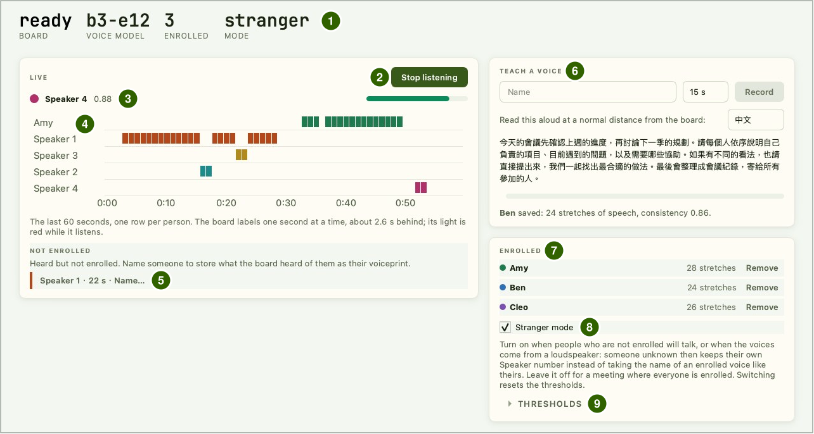
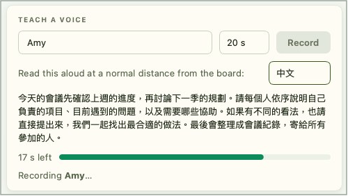
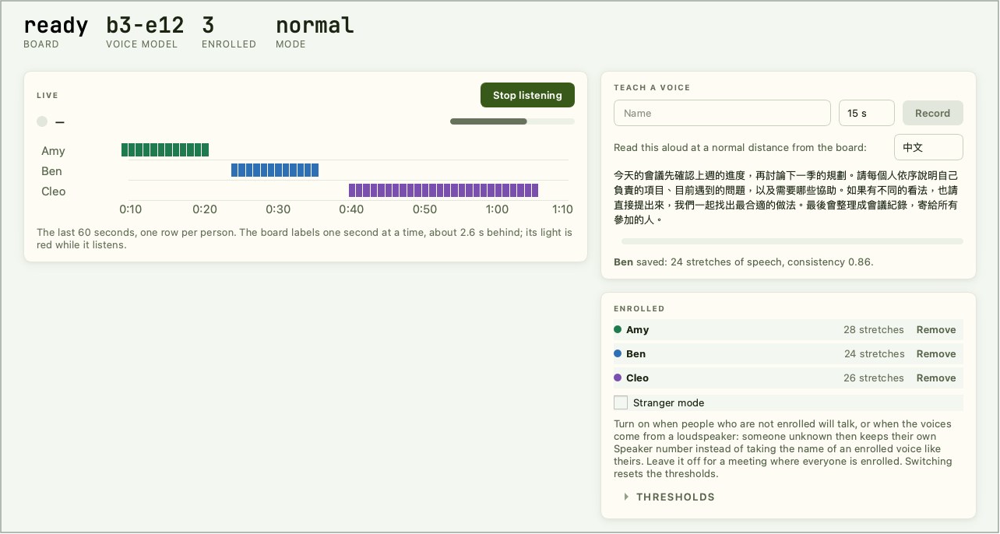

# Voiceprint Recognition

Each person reads a passage for about 20 seconds to enroll. After that the Reef labels who is speaking once a second: enrolled people by name, everyone else as Speaker 1, Speaker 2, and so on - you can name them afterwards. Everything is computed on the board, the voiceprints are kept in the board's flash, and no audio leaves the board. On the computer you use IPRO AI Studio's **Audio** page. The names in the pictures on this page (Amy, Ben, Cleo) are examples.

!!! note "Ask before you record"
    Ask everyone present for their consent before you enroll or listen to them.

## Prerequisites { #prerequisites }

- An IPRO7AI Reef EVK flashed with the Edge AI firmware, with the voiceprint model `model_b.spkb` in the mfg payload; see [Flash the Edge AI Firmware](firmware.md).
- A USB-C data cable from the Reef's USB-C to the computer. Voiceprint recognition uses the board's PDM microphone; no camera is needed.
- IPRO AI Studio installed; see [Install IPRO AI Studio](install.md).
- A quiet room. Enroll and listen with the Reef's own microphone.

## How it works { #how-it-works }

- The board's PDM microphone is resampled to 16 kHz into a ring buffer that keeps the last 32 seconds.
- Once a second the board takes the last 2.6 seconds, computes a log-mel spectrogram, and runs it through the voiceprint network on the NPU and the pooling and fully connected layers on the CPU, giving a 192-value voiceprint.
- To **enroll**, the board turns every 2.6-second stretch with speech during the reading into a voiceprint, averages them, and stores the result in the media partition of flash.
- While **listening**, the board compares each second's voiceprint with the enrolled people (cosine similarity). If the best score reaches the name threshold, it shows that name; if nobody does, it compares with the current anonymous speakers, and below the new-speaker threshold it starts a new anonymous speaker.
- The computer only sends commands and shows the labels the board sends back. The Reef's RGB LED is red while it records or listens.

## Connect the board { #connect }

<div class="ipro-steps" markdown>

1. **Switch to `voice` mode**: open the Audio page and press **Switch to Audio** at the top, or type `mode voice` on the console. After the restart the console shows:

    ```text
    SPKM: model 'b3-e12': 437200 B, trunk 16/16 layers on the NPU, ...
    RTCH: voice ready - shell `spk`, IPRO AI Studio Audio page over USB-C
    ```

    `NO MODEL` means the board has no valid voiceprint model; see [Change the voiceprint model](#voice-model).

2. **Plug in USB-C**: a serial port named **IPRO Reef Voice** appears on the computer.

3. **Open the Audio page**: click **Audio** in Studio's rail (Command+7 on macOS, Ctrl+7 on Windows). The page finds the board itself; you do not pick a serial port.

4. **Check the status row**: **BOARD** shows `ready`, **VOICE MODEL** shows `b3-e12`, **ENROLLED** is the number of enrolled people and **MODE** is `normal` or `stranger`.

</div>

Only one program at a time can open the board's USB serial port; close any other program that has it open while you use the Audio page. Leaving the Audio page stops listening.

## The Audio page { #page-layout }



| No. | Area | What it does |
|---|---|---|
| 1 | Status row | **BOARD** (board state), **VOICE MODEL** (voiceprint model), **ENROLLED** (people enrolled), **MODE** (`normal` or `stranger`) |
| 2 | **Start listening** | Starts listening; while listening it reads **Stop listening** - press again to stop |
| 3 | Current speaker | Name and similarity score |
| 4 | Timeline (**LIVE**) | The last 60 seconds, one row per person, one block per second |
| 5 | **NOT ENROLLED** | People heard but not enrolled, one tag each, for example `Speaker 1 · 22 s · Name…`; click a tag to name that person |
| 6 | **TEACH A VOICE** | Type a name, choose the reading length (15 s, 20 s, 30 s) and press **Record** to enroll; pick the passage language (中文 or English) on the right; the result appears below |
| 7 | **ENROLLED** | Enrolled people, one row each, with the number of speech stretches in the voiceprint and a **Remove** button |
| 8 | **Stranger mode** | Stranger mode on or off; see [Thresholds and stranger mode](#thresholds) |
| 9 | **THRESHOLDS** | Expands to set the name and new-speaker thresholds |

## Enroll a speaker { #enroll }

<div class="ipro-steps" markdown>

1. **Type a name and choose a length**: under **TEACH A VOICE**, type the name (spaces and Chinese characters are fine) and choose the reading length, 20 s by default. You cannot enroll while listening; press **Stop listening** first.

2. **Take position**: the person sits where they will speak later, at their usual distance from the board.

3. **Press Record and read**: they read the passage shown, all the way until time is up. The remaining seconds show beside the progress bar, and `Recording <name>…` below it.

    

4. **Read the result**: when time is up the page shows `<name> saved: <n> stretches of speech, consistency <value>.` and the name appears in the **ENROLLED** list. Stretches of speech is how many speech segments went into the voiceprint; consistency is how alike they are.

</div>

**If consistency is below 0.8, enroll again**: closer to the board, in the place and voice the person will be heard in. Studio tells you when this happens. Enrolling the same name again replaces the voiceprint; the page asks first in a **Record again** dialog.

If enrolling fails, the page shows `Could not save <name>:` and the reason:

| Message | What to do |
|---|---|
| `Too little speech was heard. …` | Speak louder or closer, and keep reading until time is up |
| `The board's voice list is full. Remove someone first.` | The list is full; remove someone first |
| `The board has no voice model.` | The board has no voiceprint model; see [Change the voiceprint model](#voice-model) |
| `The board's microphone did not start.` | The microphone did not start; unplug and replug USB-C, then try again |
| `Recording was cancelled.` | Enrolling was cancelled; press **Record** again |
| `The board refused: check the name, or wait for what it is doing to finish.` | Check the name, or wait until the board finishes its current job (for example listening) |

## Identify speakers live { #listen }

<div class="ipro-steps" markdown>

1. **Keep quiet and press Start listening**: each time listening starts, the board begins tracking the background noise from that moment, so keep the room as quiet as you can when you press it. The RGB LED turns red.

2. **Start talking**: the board sends one label a second for the last 2.6 seconds, so labels trail speech by about 2.6 s. Silent stretches are not labeled. Timeline colors match the dots in the **ENROLLED** list.

3. **Press Stop listening** to stop.

</div>

## Name an anonymous speaker { #name-speaker }

Someone not enrolled appears on the timeline as Speaker 1, Speaker 2, ... once the board has heard them for 3 seconds, and in the **NOT ENROLLED** area as a tag such as `Speaker 2 · 26 s · Name…` (26 s is how long the board has heard them).

1. Click **Name…** on that tag.
2. Type the name in the **Name a speaker** dialog and confirm.

The board keeps what it just heard of this speaker as their voiceprint and shows their name from then on, with no reading needed.



## Remove a voiceprint { #remove }

Press **Remove** next to a person in the **ENROLLED** list and confirm to delete their voiceprint. With everyone removed, **ENROLLED** in the status row is 0 and the list reads `Nobody enrolled yet.`; what the timeline already shows is not changed.

## Thresholds and stranger mode { #thresholds }

Expand **THRESHOLDS** to set the two thresholds (cosine similarity, 0.1 to 0.95) and press **Set**. The thresholds and mode are stored on the board with the voiceprints and survive a restart.

| Threshold | Normal-mode default | Stranger-mode default | Effect |
|---|---|---|---|
| **Name match** | 0.60 | 0.50 | A stretch of voice must reach this similarity to an enrolled person to show their name. Higher: fewer people labeled by name, more labeled anonymous; lower: the reverse |
| **New speaker** | 0.50 | 0.50 | A voice that was not recognized becomes a new anonymous speaker when its similarity to every current anonymous speaker is below this. Lower it when one person is split into several; raise it when different people are merged into one |

Tick or untick **Stranger mode** to switch; **MODE** in the status row shows `stranger` or `normal`. Switching resets both thresholds to that mode's defaults. On the console, `spk mode stranger` and `spk mode normal` do the same.

Stranger mode makes it harder for someone who is not enrolled to get another person's name: before comparing, the board removes what all voices in the room have in common (the effect of the microphone, room and loudspeaker), and unenrolled people the board has heard keep their own Speaker number.

| Situation | Recommendation |
|---|---|
| People who are not enrolled will talk, or the voices come from a loudspeaker or a recording | Turn stranger mode on |
| Everyone present is enrolled | Leave it off. With distant speakers, stranger mode labels enrolled people as anonymous more often |

Stranger mode needs good enrollments: a person with a low consistency is labeled anonymous more often, and two unenrolled people may be merged into one number. Enroll again whenever consistency is below 0.8.

## Console commands { #console }

The console in voice mode (U6, 115200 baud) offers the same operations as the Audio page, for debugging:

| Command | What it does |
|---|---|
| `spk status` | Model, state, enrolled list, USB connection |
| `spk enroll 20 <name>` | Enroll with 20 seconds of reading (8 to 30 s) |
| `spk live on` / `spk live off` / `spk stop` | Start listening / stop listening / stop the current job |
| `spk del <name>` | Delete a person's voiceprint |
| `spk name <k> <name>` | Name anonymous speaker k |
| `spk thresh <name> <new>` | Set both thresholds, for example `spk thresh 0.60 0.50` |
| `spk mode normal` / `spk mode stranger` | Switch to normal or stranger mode; both thresholds reset to that mode's defaults |
| `spk echo on` | Print every event line, and each second's score against every enrolled person |

The console accepts ASCII only; enter names with Chinese characters on the Audio page.

## Verify { #verify }

1. After enrolling, the name is in the **ENROLLED** list with a consistency of 0.8 or more.
2. After **Start listening** the RGB LED is red; about 2.6 s after an enrolled person starts talking, blocks appear in their row and the current speaker shows their name and similarity.
3. When someone not enrolled talks, Speaker k appears on the timeline and their tag appears under **NOT ENROLLED**.
4. After a restart, back on the Audio page, the **ENROLLED** count is unchanged.

## Change the voiceprint model { #voice-model }

The voiceprint model `model_b.spkb` (model name `b3-e12`) is flashed with the mfg payload. To deploy it over USB instead, make a model package and deploy it to the voiceprint tool from the command line:

```bash
ipro-ai model pack model_b.spkb -o voice.ipkg
ipro-ai deploy voice.ipkg --switch
```

Enrolled voiceprints are tied to the model's CRC: after changing to another voiceprint model the enrolled list is cleared and everyone enrolls again. Updating only the firmware keeps both the model and the enrolled people. The Audio page in IPRO AI Studio 0.4.2 has no button for deploying a model.

## Specifications and limits { #specs }

| Item | Specification |
|---|---|
| Audio input | The Reef's PDM microphone, resampled to 16 kHz, 100 Hz high-pass |
| Labels | One a second, from the last 2.6 seconds of sound |
| Voiceprint | 192 values; about 140 ms per voiceprint on the board, of which about 118 ms pre-processing and about 9 ms NPU |
| Voiceprint model | `model_b.spkb` (b3-e12), 437,200 B; all 16 trunk layers on the NPU |
| Enrollment length | 15, 20 or 30 s on the Audio page; 8 to 30 s on the console |
| People stored | 19 in the media partition of flash (16 KB); more are held in RAM and lost at restart |
| Speech detection | By energy: 3 dB above the tracked background noise counts as speech |
| Model slot | Voiceprint model slot, 444 KB of room |

- A voiceprint recorded with another microphone matches the same person heard by the Reef much less well. Enroll and listen with the Reef's own microphone.
- Played through a loudspeaker, different people's voiceprints become more alike; turn stranger mode on when testing with a loudspeaker or a recording.
- Stretches shorter than 2.6 s per speaker, and two people talking at once, cannot be labeled separately.
- Speech detection goes by loudness, so music or a TV also counts as speech. Use it in a quiet room, away from continuous background sound.
- Anonymous speakers are clustered while listening and are not merged afterwards. If one person is split in two, name one of them, or adjust the new-speaker threshold.
- Accents, reverberation and speaking distance vary by site. Try it on site before real use, and adjust the thresholds or mode if needed.

## Troubleshooting { #troubleshooting }

| Symptom | Cause | Fix |
|---|---|---|
| The Audio page says `The board has no voice model.`, or the console shows `NO MODEL` | No valid voiceprint model on the board | Reflash with `--mfg`, or deploy the voiceprint model with `ipro-ai deploy` |
| The Audio page says `The board did not answer.` or does not find the board | Another program holds the board's serial port, or the board is not in `voice` mode | Close other programs using that port; press **Switch to Audio** |
| Someone not enrolled keeps getting an enrolled person's name | The name threshold is low for normal mode, especially with loudspeaker playback | Turn stranger mode on, or raise **Name match** |
| An enrolled person is often labeled Speaker k | Enrolled at a different place, microphone or loudness than in use, or the name threshold is too high | Enroll again at the real position with the Reef's microphone, or lower **Name match** slightly |
| One person is split into several speakers | The new-speaker threshold is too high | Lower **New speaker**, or name one of them |
| Labels appear when nobody speaks | Music, a TV or other continuous sound counts as speech | Remove the background sound; use a quiet room |
| Everyone enrolled is gone after changing the voiceprint model | Voiceprints are tied to the model | Enroll again with the new model |

For anything else, see [Troubleshooting](troubleshooting.md).

## Next steps { #next-steps }

- [Sensor Recognition](sensor.md): tell the state of a machine or environment with the same Reef.
- [Flash the Edge AI Firmware](firmware.md#modes): mode switching and USB devices at a glance.
