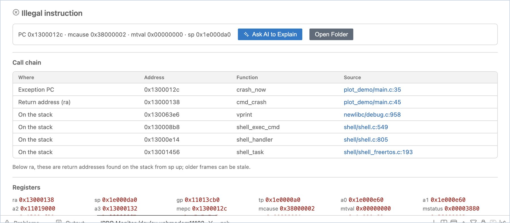
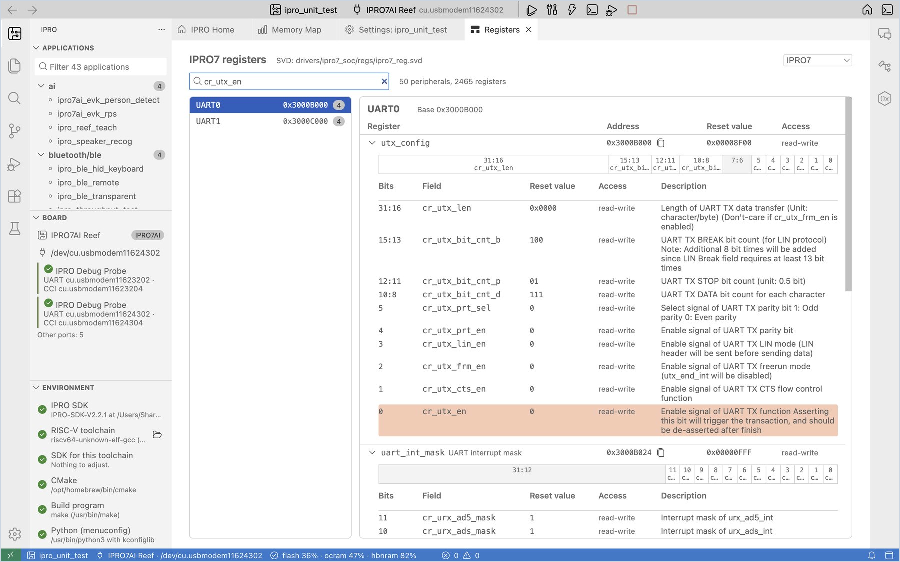

# Debugging and Analysis

When the board crashes or misbehaves, these tools help you find which line of code is responsible, the state of the registers and memory at that moment, and what a register field means. Debugging over JTAG is not available in this release.

## Automatic crash address decoding { #crash-decode }

When IPRO7 firmware crashes, it prints the program address of the exception (MEPC), the return address (ra) and a stack backtrace over the serial port. IPRO Monitor prints an extra gray line with the decoded result under each address (on screen it starts with an arrow; the example below shows it as `->`), for example:

```text
MEPC   : 0x1300012c
    -> 0x1300012c crash_now  …/apps/user/plot_demo/main.c:35
Return Address (ra): 0x130001b6
    -> 0x130001b6 cmd_crash  …/apps/user/plot_demo/main.c:55
```

The decoded result is the function name and the file and line number in the source code.

!!! warning "Important"
    Decoding uses the ELF file of the current application's last build, so the firmware on the board must match the current build. When the **Board** view in the side bar shows "Runs other firmware", the decoded results cannot be trusted; flash again first.

## Crash dump { #crash-dump }

When the addresses alone are not enough, you can have the board send its registers and the whole RAM back to the computer after a crash; the IDE then finds the full call chain from the stack.

<div class="ipro-steps" markdown>

1. **Turn on crash dumps.** Add `CONFIG_EXCEPTION_DUMP=y` to the application's `.config` (you can search for `EXCEPTION_DUMP` in [Settings (Kconfig)](develop.md#kconfig)), then build and flash.

2. **Let the board crash** with the serial monitor open.

    **You should see**: a notification says "The board crashed and offers a crash dump of its RAM and registers. Collect it? It takes about a minute; the board waits for 2 minutes."

3. **Collect it.** Click **Collect Crash Dump**.

    **You should see**: the progress shows "Receiving the crash dump from &lt;port&gt;…". When the transfer is done (256 KB OCRAM plus 8 MB PSRAM, about 64 seconds as measured), **Crash Dump** opens in the editor area.

4. **Read the crash dump.** Look at the contents of **Crash Dump**.

    **You should see**:

    - At the top is the kind of exception (for example `Illegal instruction`); the next line is a summary: PC, mcause, mtval and sp.
    - The **Call chain** table lists, in order, the exception PC, the return address (ra), and the return addresses found on the stack. Each row has the address, the function and the source location; click the source location to open that line.
    - **Registers** lists every register at the time of the crash.

5. **Ask for an explanation (optional).** When needed, click **Ask AI to Explain**: the AI assistant reads the code along the call chain and explains the cause. Click **Open Folder** to see the raw files that were sent back.

</div>



!!! note
    - The entries below ra in the call chain are return addresses found on the stack going up from sp; the further down the list, the more likely they are stale data left from earlier.
    - Crash dumps are saved in the application's `build/crash/<date>` folder. To view one again later, choose **Crash Dumps…** from the IPRO menu.
    - When a block fails its check during the transfer, the page says "The dump is incomplete" and lists the parts that arrived.

## Register reference { #registers }

**Register Reference** lists every peripheral, register and field from the chip's SVD file, so you can look them up directly while you write a driver or read a register dump.

<div class="ipro-steps" markdown>

1. **Open it.** On IPRO Home, click **Register reference (SVD)**.

    **You should see**: "IPRO7 registers", with the location of the SVD file and the total numbers of peripherals and registers next to it (IPRO7 has 50 peripherals and 2465 registers). You can switch chips at the top right.

2. **Search.** In the search box, type the name of a peripheral, register or field (for example `cr_utx_en`), or type an address directly (for example `0x3000B000` for UART0).

    **You should see**: the left side shows the peripherals and their base addresses; the right side shows the registers with their address, reset value and access. Expand a register to see its 32-bit field map and the description of each field.

3. **Copy an address.** Click **Copy the address** next to a register to copy its address to the clipboard.

</div>


