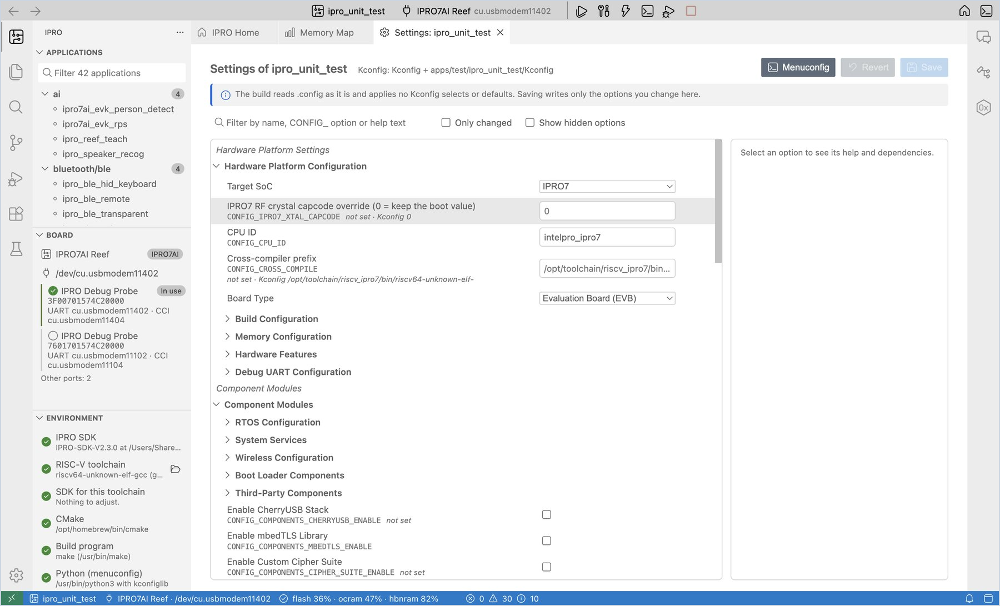
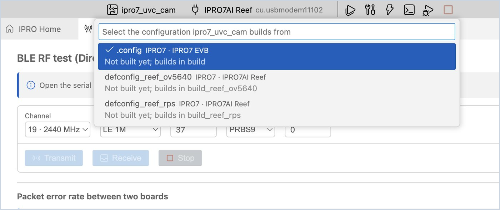
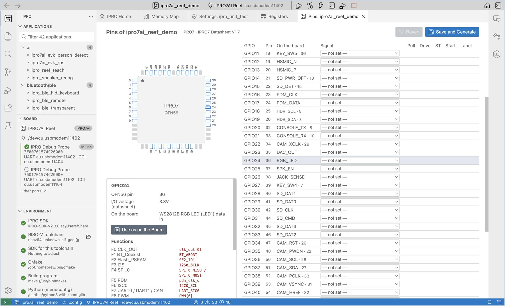
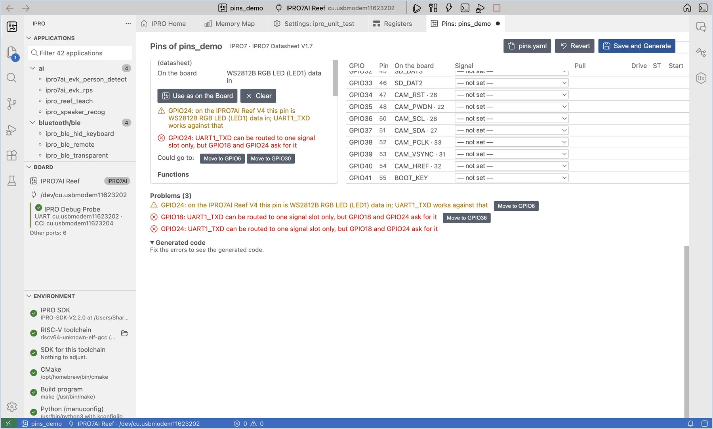
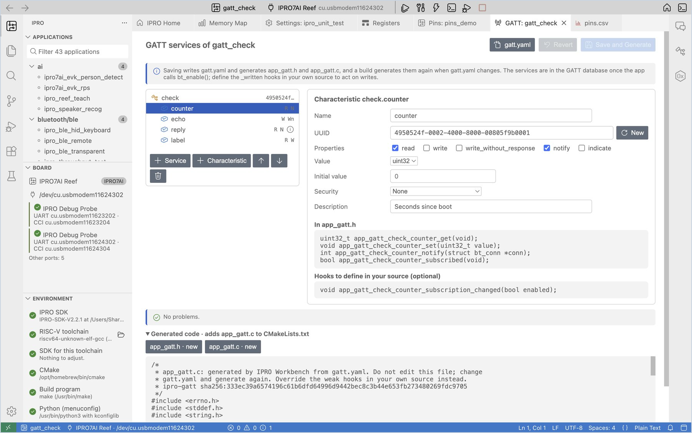
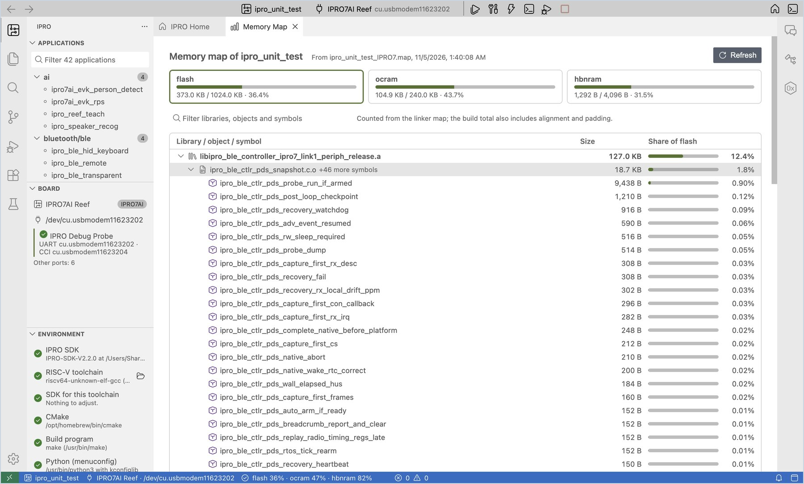

# Develop an Application

The views you use most while writing code: changing settings (Kconfig), configuring pins, configuring GATT services, handling build errors, and seeing where the memory goes. The examples use the IPRO7AI Reef EVK V4.0.

## Change settings (Kconfig) { #kconfig }

The features and parameters of each application are recorded in its `.config`. The **Settings** view edits it in a form, so you do not need to open a terminal.

<div class="ipro-steps" markdown>

1. **Open Settings.** Right-click the application and choose **Settings (Kconfig)…** (or **Settings (Kconfig)** on IPRO Home).

    **You should see**: a **Settings: &lt;application&gt;** tab, with all options listed by Kconfig menu on the left and the help for the selected option on the right.

2. **Change an option.** Type the option you want to change in the search box, for example `LOG_BUFFER_SIZE`, and change its value to `512`.

    **You should see**: a green mark appears on the left of that row, an unsaved dot appears in the tab title, and the button in the top-right corner changes to **Save 1**. The right panel shows the option's type, range, dependencies, its original value in `.config` and the Kconfig default.

3. **Save.** Click **Save** (`Cmd+S` on macOS, `Ctrl+S` on Windows).

    **You should see**: the notification "Saved 1 settings to .config of … (the previous file is .config.old). The next build configures again."

</div>



!!! warning "Important"
    The SDK build reads `.config` directly and does not apply Kconfig selects or defaults. **Settings** writes only the lines you changed; if menuconfig would also change other options, they are listed on screen, and you decide whether to **Take Them Too**.

Other uses:

- Check **Only changed** to see only the changes that are not saved yet; click **Revert** to discard all changes.
- Check **Show hidden options** to see the options whose dependencies are not met: menuconfig hides them, but the build still reads them.
- If you prefer a text interface, right-click and choose **Menuconfig** to edit the same settings in a terminal; choose **Open .config** to edit the file directly.

## Configurations { #configurations }

Some applications come with configuration files for other boards or uses besides `.config`: `defconfig_<name>` or `config_<name>`. The IDE lists them, and the one you choose is what it builds from. The build goes into `build_<name>` in the application folder (`build_config_<name>` for a `config_<name>` file), the same folder `make DEFCONFIG=<file>` uses on the command line, and the application's own `.config` is not touched. Settings (Kconfig), pin configuration and GATT configuration also read and write the chosen file.

The steps use `ipro7_uvc_cam`, whose `.config` is for the IPRO7 EVB and which has two more configurations for the IPRO7AI Reef EVK V4.0.

<div class="ipro-steps" markdown>

1. **Select the application.** Under **Applications** in the side bar, click **ipro7_uvc_cam** (in the `multimedia` category).

    **You should see**: a gear and `.config` next to the application name in the status bar: the application builds from `.config`. An application with no other configuration files has no such item.

2. **Open the list of configurations.** Click `.config` in the status bar (or **Select Configuration…** in the IPRO menu, `IPRO: Select Configuration…` in the command palette).

    **You should see**: a list headed "Select the configuration ipro7_uvc_cam builds from" with `.config`, `defconfig_reef_ov5640` and `defconfig_reef_rps`. Each row gives the chip and board (for example `IPRO7 · IPRO7AI Reef`) and a line saying "Built in build" or "Not built yet; builds in build_reef_rps". The configuration in use has a check mark.

3. **Choose one.** Choose `defconfig_reef_rps`.

    **You should see**: a notification "ipro7_uvc_cam now builds for IPRO7AI Reef (defconfig_reef_rps).", `defconfig_reef_rps` in the status bar, and IPRO7AI Reef as the board on the toolbar (the board follows the application's configuration; see `ipro.board.id` in [Settings](reference.md#settings)). When the chosen file is for the same board as before, there is no notification.

4. **Build.** Click **Build**.

    **You should see**: **IPRO Build** starts with `Configuration: defconfig_reef_rps -> …/build_reef_rps/.config`, and the firmware is in `build_reef_rps/build_out/`. The IDE copies the chosen file into the build folder as `.config`; the `.config` in the application folder stays as it was.

5. **Switch back.** Click the status bar item again and choose `.config`.

    **You should see**: `.config` in the status bar; builds and flashes use the `build` folder again.

</div>



!!! note
    - Applications that have only `defconfig_*` files and no `.config` (for example `ipro6_fmac`) now appear under **Applications**. They start on the file named after the application, or else the first one.
    - For an application with a single configuration, **Select Configuration…** only says "&lt;application&gt; has one configuration: .config."
    - With a configuration chosen, **Clean** deletes that configuration's build folder.
    - The IDE remembers the configuration chosen for each application, also after a restart.

## Configure pins { #pins }

**Pin Configuration** assigns the function of each GPIO on a package drawing and in a table, checks for conflicts and against the board's wiring, and generates the initialization code `app_pins.h` and `app_pins.c`.

<div class="ipro-steps" markdown>

1. **Open Pin Configuration.** Right-click the application and choose **Pin Configuration…** (or **Pins** on IPRO Home).

    **You should see**: the QFN56 package drawing on the left and the GPIO table on the right. **Board** is set to IPRO7AI Reef V4 automatically, the **On the board** column lists what each pin is connected to on the board, and pins that go to the 40-pin header also show the header pin number.

2. **Assign a pin.** Click the GPIO24 row, choose **GPIO_OUT (as on the board)** under **Signal**, and enter `RGB_LED` under **Label**.

    **You should see**: pin 24 turns blue on the package drawing; the right panel lists the pin's available functions, I/O voltage and board wiring; `app_pins.c` under **Generated code** at the bottom gets a GPIO24 line, and "No problems." is shown.

3. **Try a conflict.** Change the signal of GPIO24 to `UART1_TXD`.

    **You should see**: pin 24 turns amber, and **Problems** lists a warning saying that this pin is wired to the RGB LED on Reef V4, together with the free pins this signal **Could go to**; click **Move to GPIO…** to move the setting there. When you have seen this, change GPIO24 back to **GPIO_OUT (as on the board)**.

4. **Search by signal.** Type `SDH_0` in the search box.

    **You should see**: the table shows only the pins that can carry SDH_0, and those pins are outlined on the package drawing. Clear the search text and the full table comes back.

5. **Save and generate.** Click **Save and Generate** (`Cmd+S` / `Ctrl+S`).

    **You should see**: the notification "Saved pins.yaml and generated app_pins.h and app_pins.c." The application folder now has `pins.yaml`, `app_pins.h` and `app_pins.c`, and `CMakeLists.txt` has a new `app_pins.c` line.

6. **Call the generated code.** In `main.c`, add `#include "app_pins.h"` and call `app_pins_init();` once on the line after `ipro_platform_init();`, and then click **Build, Flash and Monitor**.

    **You should see**: the application runs as usual. From now on, whenever `pins.yaml` changes, **IPRO Build** first shows `pins: wrote app_pins.c from pins.yaml` during the build and then starts compiling.

</div>





| Function | Description |
|---|---|
| **Only pins in use** | Lists only the pins that are set, for easy checking |
| **Export CSV** | Writes a pin list for hardware engineers, `pins.csv` |
| **Export Zephyr pinctrl** | Writes the same pin configuration as a Zephyr pinctrl fragment, `app_pins_pinctrl.dtsi` |
| **Use as on the Board** | Sets the selected pin to its use on the board |

!!! note
    - `app_pins.h` and `app_pins.c` are generated by the IDE; do not edit them by hand. The IDE does not simply overwrite a file that was edited by hand; it first asks whether to **Overwrite** it.
    - When `pins.yaml` has errors, the build stops, and the errors are listed in the **Problems** panel.
    - The pin data comes from the IPRO7 datasheet.

## Configuring GATT Services { #gatt }

**GATT Configuration** defines the GATT services and characteristics of a BLE application in a tree and a form, keeps them in `gatt.yaml`, and generates `app_gatt.h` and `app_gatt.c`: one `BT_GATT_SERVICE_DEFINE` per service, and for each characteristic functions that read and change its value and send notifications. The application does not write the GATT attribute table itself.

The application's `.config` needs `CONFIG_BLUETOOTH_LE_ENABLE=y` and `CONFIG_BT_PERIPHERAL=y`, as `ipro_ble_remote` has.

<div class="ipro-steps" markdown>

1. **Open GATT Configuration.** Right-click the application and choose **GATT Configuration…** (or **GATT services** on IPRO Home).

    **You should see**: a **GATT: &lt;application&gt;** tab opens. While there is no `gatt.yaml` yet, a note at the top says to add a service first.

2. **Add a service.** Click **+ Service** and change the name to `sensor`.

    **You should see**: `sensor` appears in the list on the left; its UUID is already a random 128-bit UUID, and **New** gives another one.

3. **Add a characteristic.** Click **+ Characteristic**, change the name to `counter`, check the properties **read** and **notify**, choose the value type `uint32`, and enter `Seconds since boot` as the description.

    **You should see**: **In app_gatt.h** on the right lists `app_gatt_sensor_counter_get`, `_set`, `_notify` and `_subscribed`, and below it the hook you may define, `app_gatt_sensor_counter_subscription_changed`; "No problems." is shown.

4. **Try an invalid UUID.** Change the UUID to `2a1`.

    **You should see**: the problems list says `sensor.counter: "2a1" is not a 16-bit UUID such as 2a19 or a 128-bit UUID`, and the generated code is replaced by "Fix the errors to see the generated code." Click **New** to get a valid UUID back.

5. **Save and generate.** Click **Save and Generate** (`Cmd+S` / `Ctrl+S`).

    **You should see**: the notification "Saved gatt.yaml and generated app_gatt.h and app_gatt.c." appears. The application folder now has `gatt.yaml`, `app_gatt.h` and `app_gatt.c`, and `CMakeLists.txt` has a new line for `app_gatt.c`.

6. **Use the generated functions in your code.** Add `#include "app_gatt.h"`, update the value in your own task and notify the peers that subscribe; put the service UUID in the advertising data so that a peer scanning for it can find the board:

    ```c
    #include "app_gatt.h"

    static const struct bt_data ad[] = {
        BT_DATA_BYTES(BT_DATA_FLAGS, (BT_LE_AD_GENERAL | BT_LE_AD_NO_BREDR)),
        BT_DATA_BYTES(BT_DATA_UUID128_ALL, APP_GATT_SENSOR_UUID_VAL),
    };

    /* Once a second, in your own task (not in an interrupt) */
    app_gatt_sensor_counter_set(seconds);
    if (app_gatt_sensor_counter_subscribed()) {
        app_gatt_sensor_counter_notify(NULL);   /* NULL: every subscribed peer */
    }
    ```

    Click **Build, Flash and Monitor**.

    **You should see**: **IPRO Build** first shows `gatt: wrote app_gatt.c from gatt.yaml` and then compiles. Connected with a BLE tool on a phone or computer (for example nRF Connect), you see the `sensor` service and `counter`; once you subscribe to notifications, a new value arrives every second.

</div>



| Setting | Meaning |
|---|---|
| Properties | read, write, write_without_response, notify, indicate; with notify or indicate a CCC is added so that peers can subscribe |
| Value type | `uint8` to `int32` (fixed size, sent little-endian), `bytes`, `string` (longest value 1–512 bytes) |
| Initial value | A number for the integers (`0x1f` works too); text for `string`; hex for `bytes`, for example `01 02 ff` |
| Security | For an encrypted link or an authenticated (MITM-protected) pairing, `.config` needs `CONFIG_BT_SMP=y` |
| Description | Goes into the Characteristic User Description, which BLE tools show |

The functions generated for each characteristic (service `sensor`, characteristic `counter`):

| Function | Use |
|---|---|
| `app_gatt_sensor_counter_get` / `_set` | Read and change the value peers read |
| `app_gatt_sensor_counter_notify` / `_indicate` | Send the current value to subscribed peers (with notify / indicate) |
| `app_gatt_sensor_counter_subscribed` | Whether a peer has subscribed |
| `app_gatt_sensor_counter_written` (hook) | Called after a peer writes, with the value already stored; define a function of that name in your own source |
| `app_gatt_sensor_counter_subscription_changed` (hook) | Called when a peer turns notifications on or off |

!!! note
    - `app_gatt.h` and `app_gatt.c` are generated by the IDE; do not edit them by hand. The hooks are weak functions: a function of the same name in your own source replaces them. The IDE does not simply overwrite a file that was edited by hand; it first asks whether to **Overwrite** it.
    - When `gatt.yaml` has errors, the build stops, and the errors are listed in the **Problems** panel.
    - Notifications longer than 20 bytes arrive whole only after the peer raises the ATT MTU; one notification carries at most 244 bytes.
    - A peer that paired before the services changed may keep the old service list; forget the device in the peer's Bluetooth settings and pair again.

## Build and errors { #build }

<div class="ipro-steps" markdown>

1. **Build.** Click **Build** (`Cmd+Alt+B` / `Ctrl+Alt+B`).

    **You should see**: on success, the notification "Built &lt;application&gt; in N s", followed by the memory usage.

2. **Go to the error.** When the code has errors, the notification says "&lt;application&gt; did not compile. First error at &lt;file&gt;:&lt;line&gt;: &lt;message&gt;". Click **Go to Error**, and the editor jumps to that line; the **Problems** panel lists all errors and warnings.

3. **Fix and build again.** Fix the code and build again. If needed, you can click **Ask AI to Fix** on the notification (see [AI Assistant](ai.md#fix-build)).

</div>

| Command | When to use it |
|---|---|
| **Build** | The usual case. Recompiles only the files that changed. |
| **Reconfigure and Build** | After you change `CMakeLists.txt` or the build profile; runs the CMake configuration again. |
| **Clean** | Deletes the application's `build` folder (with a [configuration](#configurations) chosen, that configuration's build folder), so the next build starts from scratch. |

The build profile (Debug / Release / MinSizeRel) is selected with the `ipro.build.profile` setting; see [Settings](reference.md#settings).

## See where the memory goes { #memory }

<div class="ipro-steps" markdown>

1. **Open the memory map.** After a successful build, click the memory usage in the status bar, or **What uses the memory** on IPRO Home.

    **You should see**: "Memory map of &lt;application&gt;", with one tab each for flash, ocram and hbnram. Below them, the libraries, object files and symbols are listed by size, with each one's share of that region. Double-click a symbol to search for it in the workspace.

2. **Filter.** Type the name of a library, object file or symbol in the filter box to see only the matching items.

</div>



- **(the application itself)** is the object files in the application folder.
- **(merged strings and constants)** is the string pool shared by all objects; it gets large when there are many log strings.
- The numbers are counted from the linker map file; the totals in the build output also include alignment and padding, so the two may differ slightly.

### Size changes and the memory budget { #memory-budget }

<div class="ipro-steps" markdown>

1. **See the size change.** Change the code, build again, and look at the last few lines of the **IPRO Build** output.

    **You should see**: for example `Memory since the last build: flash +3,072 B, ocram 0 B, …`, followed by the symbols that changed most, for example `+3,072 B  my_table  (flash, (application) main.c.o)`. The build-finished notification also adds the change after the usage, for example `flash 8.2% (+3,072 B)`. After the first build, or after a clean, there is no previous build to compare with, so these lines do not appear.

2. **Set a memory budget.** Open Settings (`Cmd+,` on macOS, `Ctrl+,` on Windows), search for `ipro.build`, and in **Memory Budget** enter the maximum percentage for each region, for example `{ "flash": 90, "ocram": 95 }`.

    **You should see**: when a limit is exceeded, the notification reads "… is over its memory budget: flash 92.1% > 90%." Click **Memory Map** to see what used it up.

3. **Fail the build over budget (optional).** Also check **Fail Over Budget** to make a build over the budget fail; **Build, Flash and Monitor** then stops before flashing.

</div>
