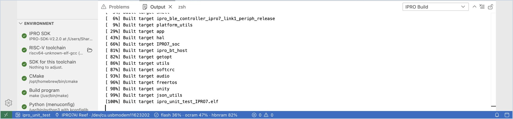
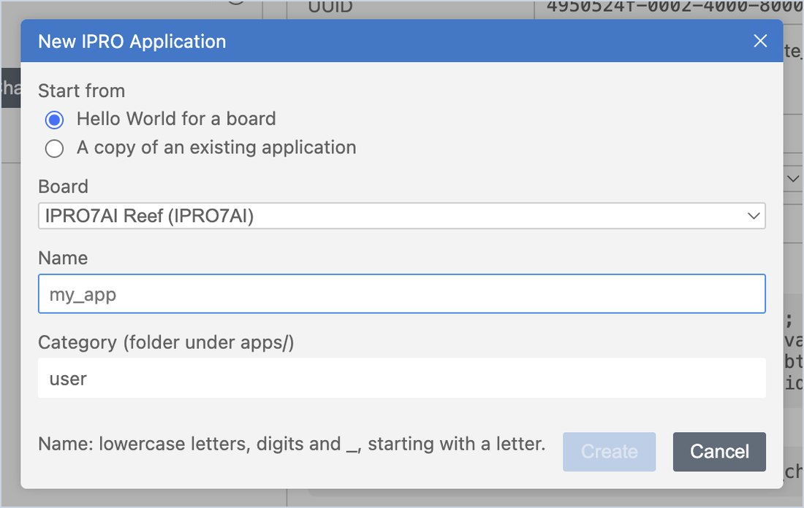
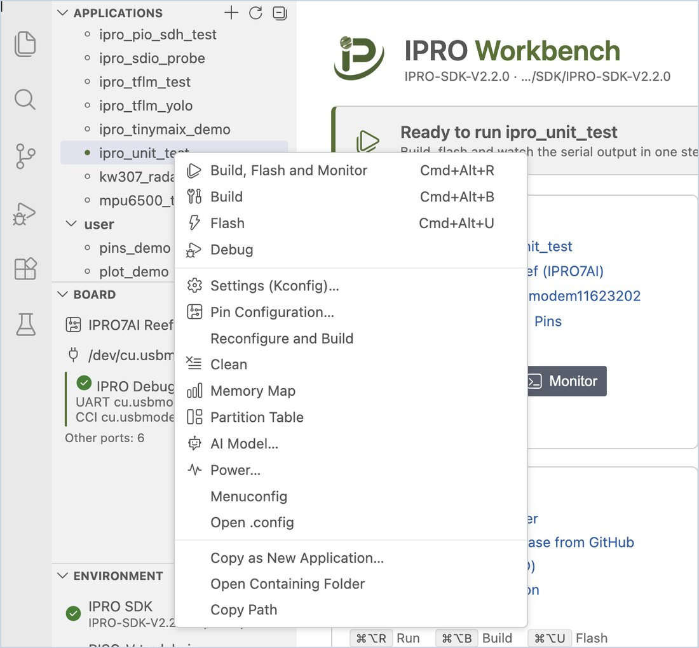

# First Run

Use the unit test that comes with the SDK, `ipro_unit_test`, to go through one full "build → flash → watch the board's output" cycle and confirm that the computer, probe and board all work; then create your own first application. At the end, `ALL TESTS PASSED` and then `Hello from my_app` appear in IPRO Monitor on the IPRO7AI Reef EVK V4.0.

## Prerequisites { #prerequisites }

- IPRO Workbench installed, every row under **Environment** checked, and the IPRO SDK open: see [Install IPRO Workbench](install.md).
- An IPRO7AI Reef EVK V4.0 connected through the IPRO Debug Probe, with the probe and its ports shown under **Board** in the side bar: see [Connect the board](install.md#connect-board).

## Run ipro_unit_test { #unit-test }

1. **Select the application.** Under **Applications** in the side bar, click **ipro_unit_test** (it is in the `test` category; you can type `unit` in the search box).

    **You should see**: both the toolbar and the status bar show `ipro_unit_test`, and the IPRO Home banner reads "Ready to run ipro_unit_test".

2. **Build, flash and monitor.** Click **Build, Flash and Monitor** on IPRO Home (`Cmd+Alt+R` on macOS, `Ctrl+Alt+R` on Windows). You can also double-click the application in the application list.

    **You should see**, in this order:

    1. **IPRO Build** in **Output** shows the compilation and, at the end, lists the usage of flash, ocram and hbnram.
    2. **IPRO Flash** shows the flashing progress; the last line is `[All Success]`.
    3. The **IPRO Monitor** terminal opens below, the board restarts, and when the tests finish `ALL TESTS PASSED` appears.

3. **Check the status bar and IPRO Home.**

    **You should see**: the status bar shows the memory usage, for example `flash 36% · ocram 47% · hbnram 82%`; the **Application** card on IPRO Home also has usage bars. **Board** in the side bar gets an extra line, "Runs ipro_unit_test (built …)", which means the board is running the firmware you just built.

| Output | Contents |
|---|---|
| **IPRO Build** | CMake configuration and compilation, memory usage, and the size change since the previous build |
| **IPRO Flash** | The IntelProCube flashing process; on success the last line is `[All Success]` |
| **IPRO Monitor** | The board's serial output (a terminal); you can type commands to the board directly |

If any step fails, the IDE stops at that step and shows an explanation with buttons to handle it, such as **Go to Error**, **Retry** and **Select Port**. For common messages, see [Troubleshooting](troubleshooting.md#messages).

!!! tip
    To only build, only flash or only open the monitor, use the separate buttons on the toolbar, or the shortcuts: build `Cmd+Alt+B`, flash `Cmd+Alt+U`, monitor `Cmd+Alt+M` (on Windows, replace `Cmd` with `Ctrl`).

## Create your own application { #own-app }

1. **Start a new application.** Click **+** (**New Application…**) above the **Applications** list, or **New application from a template or an example** on IPRO Home.

2. **Fill in the form.** Under **Start from**, choose **Hello World for a board**; under **Board**, choose **IPRO7AI Reef** (with the IPRO6S EVK, choose **IPRO6S EVK**; see [Creating an Application for the IPRO6S EVK](flash.md#ipro6s-new-app)); enter `my_app` as the name, leave the category as `user`, and click **Create**.

    The name can only contain lowercase letters, digits and underscores, and must start with a letter.

    **You should see**: `user/my_app` appears in the list and becomes the current application, and the editor opens its `main.c`.

3. **Run it.** Click **Build, Flash and Monitor**.

    **You should see**: `Hello from my_app` appears in IPRO Monitor.

To start from an existing example, right-click the application in the list and choose **Copy as New Application…**, or choose **A copy of an existing application** under **Start from**. The new application goes into `apps/<category>/<name>` in the SDK.

## The application context menu { #app-menu }

Right-click an application in the **Applications** list to do these things directly:

| Item | Purpose |
|---|---|
| **Build, Flash and Monitor** / **Build** / **Flash** / **Debug** | Same as on the toolbar |
| **Settings (Kconfig)…** / **Menuconfig** / **Open .config** | Change the application's settings; see [Develop an Application](develop.md#kconfig) |
| **Pin Configuration…** | Assign GPIO functions and generate code |
| **GATT Configuration…** | Define BLE services and characteristics and generate code; see [Configuring GATT Services](develop.md#gatt) |
| **Reconfigure and Build** / **Clean** | Run the CMake configuration again and build; delete the build results |
| **Memory Map** | See where the memory goes |
| **Partition Table** / **AI Model…** / **Power…** | See [Flashing and the Board](flash.md) and [Testing and Measurement](measure.md#power) |
| **Copy as New Application…** | Create a new application with this one as the starting point |
| **Open Containing Folder** / **Copy Path** | Open the folder in File Explorer (Finder), or copy the folder path |

## Next steps { #next-steps }

- [Develop an Application](develop.md): settings (Kconfig), pins, GATT services, build errors and where the memory goes.
- [Flashing and the Board](flash.md): what the IDE checks when it flashes, the partition table, AI models and the IPRO6S EVK.
- [Serial Monitor](monitor.md): filter, timestamps, logs, the serial plotter and a second port.
