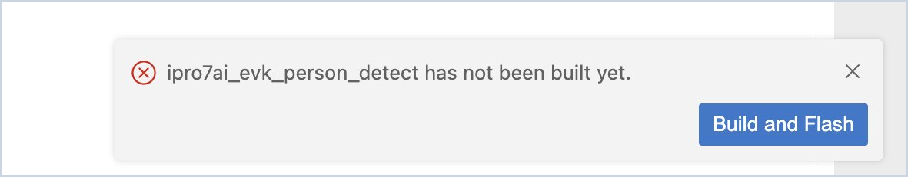
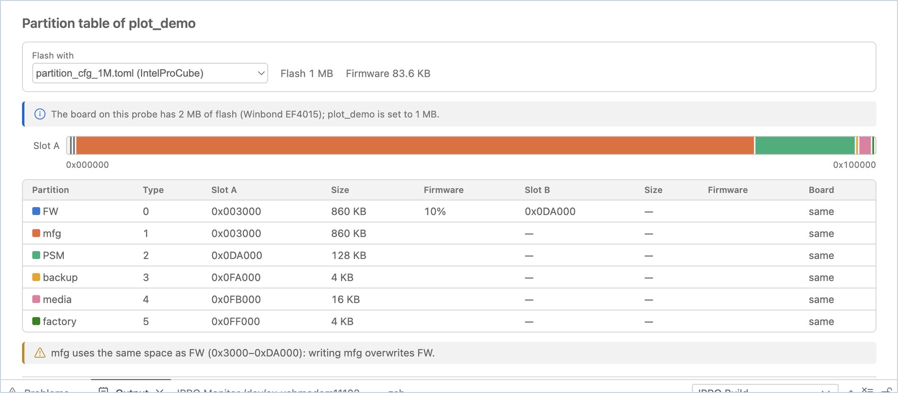
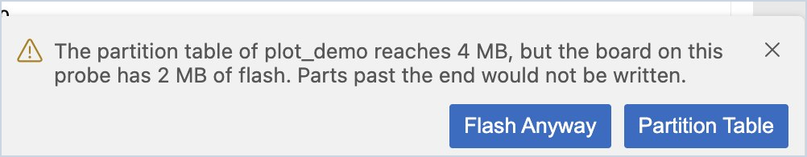
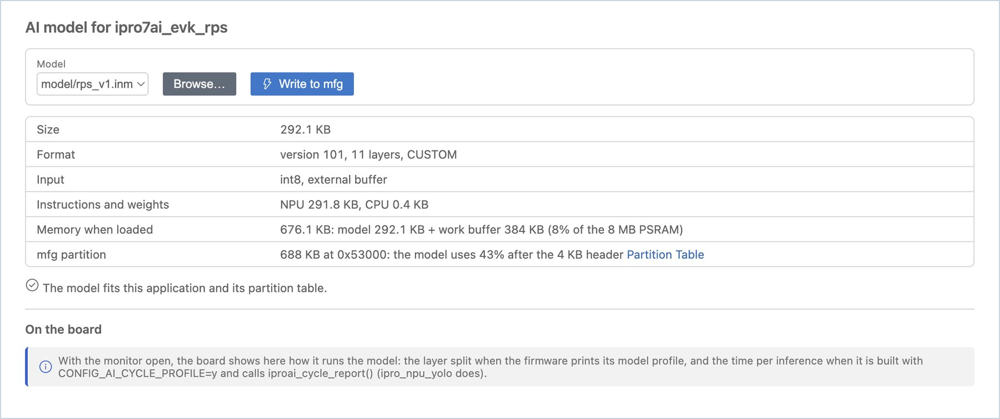
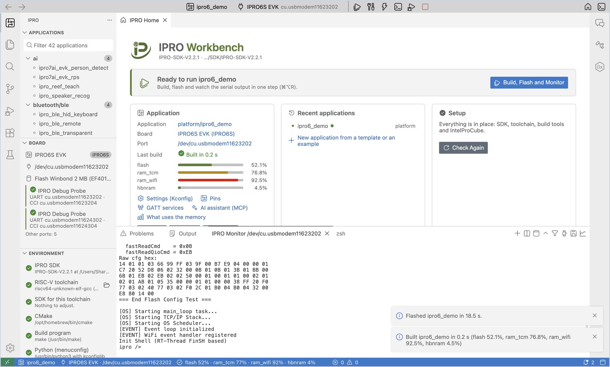
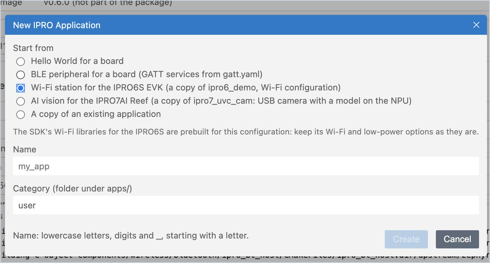

# Flashing and the Board

The checks the IDE makes for you when flashing, the partition table, the board's flash, the firmware check, writing AI models, [OTA packages](#ota) and [flashing over the board's own USB](#usb-flash); the last section covers the [IPRO6S EVK](#ipro6s) and where it differs from the IPRO7 series. The board in the other sections is the IPRO7AI Reef EVK V4.0 on the IPRO Debug Probe; flashing uses IntelProCube.

## Flash { #flash }

<div class="ipro-steps" markdown>

1. **Flash.** After you select the application and build it, click **Flash** (`Cmd+Alt+U` / `Ctrl+Alt+U`).

    **You should see**: the **Output** panel switches to **IPRO Flash** and shows the IntelProCube flashing progress; the last line is `[All Success]`. A notification says "Flashed &lt;application&gt; in N s."

2. **The monitor closes and reopens.** Before flashing, the IDE automatically closes every serial monitor (one port cannot be used by two programs at the same time). With **Build, Flash and Monitor**, the monitor opens again after a successful flash.

</div>

!!! warning "Important"
    When IntelProCube fails to flash, it sometimes reports no error. The IDE counts a flash as successful only when `[All Success]` appears in the output; after the board reboots, the IDE also checks the build time the board prints (see [Board flash and firmware check](#board-flash)).

When flashing fails, the IDE offers buttons that match the cause:



| Situation | What the IDE does |
|---|---|
| The application has not been built | Says it "has not been built yet" and offers **Build and Flash** |
| IntelProCube is not found | Offers **Install IntelProCube**, or **Browse…** to point to one you already have |
| The board does not answer | Asks you to check the probe cable and the power, adds how to put this board into download mode by hand (IPRO7AI Reef EVK V4.0: "To enter download mode by hand: hold SW1 (BOOT), tap SW2 (RESET), then release SW1."), and offers **Select Port** and **Retry** |
| The board answers but its flash does not (it was flashed with another board's flash pins) | Says "The board on … answered, but its flash did not: it was flashed as …, and the flash pins of that board are not this one's. Select the board that is connected, then retry." and offers **Select Board**, **Retry** and **Show Output** |
| The port is in use by another program | Asks you to close that program, then **Retry** |
| The partition table is larger than the board's flash | Asks before flashing; you can **Flash Anyway** or open the **Partition Table** instead |
| IntelProCube lacks the partition table this board needs | Does not flash (without the table the board would not boot); offers **Partition Table** and **Install IntelProCube** |
| The partition table is laid out for boot2, and IntelProCube has no boot2 image for the chip | Does not flash (a board flashed without boot2 would not start); offers **Partition Table** and **Install IntelProCube** |
| IntelProCube is too old (the IPRO6S EVK needs 0.7.0.1 or later) | Does not flash (a board flashed with it does not start); offers **Install IntelProCube** and **Browse…** |

When the partition table leaves room for boot2 (a boot2 layout, such as an A/B table for OTA), the IDE writes the boot2 that comes with IntelProCube along with the firmware, on IPRO7 and IPRO6S alike. **IPRO Flash** then has a line `boot2: … (the partition table is laid out for boot2)` after the partition table line, and the board starts through boot2.

## Partition table { #partitions }

The partition table decides where in flash the firmware, OTA slot B, the AI model (mfg) and other data are placed.

<div class="ipro-steps" markdown>

1. **Open the partition table.** Right-click the application and choose **Partition Table** (or click **Partition table** under **Tools** on IPRO Home).

    **You should see**: "Partition table of &lt;application&gt;". **Flash with** shows the partition table this flash uses (by default, the one IntelProCube picks from the flash size in `.config`); next to it are the flash size set in `.config` and the firmware size. When the IDE knows the board's flash, it adds a comparison line, for example "The board on this probe has 2 MB of flash (Winbond EF4015); ipro_unit_test is set to 1 MB." Below that are the flash map (one row each for slot A and slot B), the address and size of every partition, and the share of the FW partition that the firmware takes.

2. **Read the check results** below the table.

    **You should see**: when there is no problem, nothing is listed. When there is a problem, it is explained, for example: mfg and FW of the 1M partition table share the same space (writing an AI model overwrites the firmware), FW slot B of the 2M partition table overlaps mfg (an OTA update overwrites the AI model), or the firmware is larger than slot A.

3. **Use another table.** When the application ships its own partition table, the page says "This application ships …". Besides the application's own tables, **Flash with** lists every table IntelProCube has for the chip (marked `(IntelProCube)`, for example the boot2 and OTA layouts), so a table does not have to be copied into the application first. Once you select one, every later flash of this application uses it.

4. **Compare with the board.** With the serial monitor open, click **Reset Board**.

    **You should see**: **On the board** compares against the partition table the board prints at boot and marks each partition "same", "differs" or "not on the board". When they all match, it shows "The board printed the same table at its last boot."

</div>



!!! warning
    Flashing writes the partition table selected in **Flash with**. When it differs from the partition table on the board, partitions whose location changes (for example the AI model in mfg) lose their data.

## Board flash and firmware check { #board-flash }

At boot, the board prints the ID of its flash and the build time of its firmware. With the serial monitor open, the IDE reads these messages and shows them in the **Board** view of the side bar:

| Shown | Meaning |
|---|---|
| Flash Winbond 2 MB (EF4015) | The flash and its size on the board on this probe |
| Chip ID … | The chip ID that IntelProCube read while flashing |
| Runs ipro_unit_test (built …) | The build time the board printed at boot matches the firmware of this application's last build |
| Runs other firmware (built …) | The board is not running the last build; that build runs only after you flash it |

If "other firmware" appears right after a flash, the flash may not really have reached the board. The IDE warns you and offers **Flash Again**.

**Board** lists every probe that is plugged in, which helps when two boards are on one computer: the probe in use is marked **In use**, and under each probe is "Last flashed: &lt;application&gt; · &lt;board&gt; · &lt;time&gt;", so you can tell which board got what. Click another probe to use its UART.

When the partition table uses more space than the board's flash (for example a 4 MB partition table selected for a 2 MB board), the IDE asks you before flashing, so that the part past the end is not left unwritten. Click **Partition Table** to pick another one, or click **Flash Anyway** once you have confirmed it is correct.



## AI model { #ai-model }

The IPRO7AI NPU model (`.inm`) usually lives in the mfg partition of the flash and is not linked with the firmware. To update the model, you only write mfg; the firmware does not need to be flashed again. Some applications link the model into the firmware; see the note at the end of this section.

<div class="ipro-steps" markdown>

1. **Choose the model.** Right-click the application and choose **AI Model…** (or click **AI model** under **Tools** on IPRO Home). In **Model**, choose an `.inm` in the application folder, or click **Browse…** to choose another file.

    **You should see**: the model's size, format version and number of layers, input, NPU and CPU instructions and weight sizes, the memory it takes once loaded (model plus work buffer, against the 8 MB PSRAM), and the mfg partition it goes into. The last line says "The model fits this application and its partition table." or why it does not fit.

2. **Write it.** If it fits, click **Write to mfg**.

    **You should see**: a notification says "Wrote … to the mfg partition in N s." Only the model is written; the firmware is untouched.

3. **Watch it on the board.** While the board runs the model (with the serial monitor open), **On the board** shows whether each layer runs on the NPU or the CPU. When the firmware is built with `CONFIG_AI_CYCLE_PROFILE=y` and calls `iproai_cycle_report()`, it also shows the time per inference and how busy the NPU and the CPU are.

</div>



!!! note
    - The IntelProCube 1M partition table has no separate space for the model (mfg overlaps FW), so the IDE refuses to write it. In **Partition Table**, select the partition table that comes with the application (for example the one with a separate mfg), then write the model.
    - When the application links the model into its firmware, the page says "This application links the model into its firmware (…): it runs the copy it was built with, and a model written to mfg does not change that. Rebuild and flash the application to change the model.", and **Write to mfg** turns into a secondary button.

## OTA package { #ota }

**OTA Package** makes the boot2 OTA package (`.xz.ota`) of the application's last build: IntelProCube builds the image for the partition table and the SDK's `tools/create_ota.py` compresses it; making it writes nothing to a board. With IPRO SDK V2.3.0 the page also sends the package over the console UART to the board's `ota_uart` command, to install it or only to have the board check it. How OTA works, the package format and sending over BLE are in [OTA Updates](../guides/ota.md).

| Needs | Details |
|---|---|
| Chip | IPRO7, IPRO7AI (boot2 OTA packages are for IPRO7 applications) |
| Partition table | An A/B table that leaves room for boot2 and has a second FW slot, for example `partition_cfg_2M_remote_ab.toml` that comes with `ipro_ble_remote`. IntelProCube's usual tables have no room for boot2 and cannot make a package |
| Sending to the board (SDK V2.3.0) | The application has `CONFIG_IPRO_OTA=y` and `CONFIG_IPRO_OTA_UART=y`, and the board has been flashed with boot2 and the A/B table |

The steps use `ipro_ble_remote` of IPRO SDK V2.3.0 on the IPRO7AI Reef EVK V4.0; its `defconfig_reef` has the settings above.

<div class="ipro-steps" markdown>

1. **Select the application and its configuration.** Under **Applications**, click **ipro_ble_remote**, then click `.config` in the status bar and choose `defconfig_reef` (see [Configurations](develop.md#configurations)).

    **You should see**: a notification "ipro_ble_remote now builds for IPRO7AI Reef (defconfig_reef).", and `defconfig_reef` in the status bar.

2. **Select the A/B table.** Right-click the application, choose **Partition Table**, and select `partition_cfg_2M_remote_ab.toml` in **Flash with**.

    **You should see**: the flash map has two rows for FW, A and B.

3. **Build, flash and monitor.** Click **Build, Flash and Monitor**.

    **You should see**: a line `boot2: … (the partition table is laid out for boot2)` in **IPRO Flash**, which ends with `[All Success]`; IPRO Monitor first shows a few lines starting with `[BOOT2]`, then the application's boot messages.

4. **Open OTA Package.** Click **OTA package** under **Tools** on IPRO Home (or `IPRO: OTA Package…` in the command palette).

    **You should see**: "OTA package of ipro_ble_remote", a line saying this is a boot2 OTA package of the last build, and a table with **Firmware**, **Partition table**, **FW slots** (for example "A …, B …") and **boot2 image** ("v… (not part of the package)"). When something is missing it is explained in red under the table, for example "Build the application first: the package is made from its firmware.", and **Make Package** cannot be clicked.

5. **Make the package.** **Version** starts as the current time (for example `202611131542`); you can change it to up to 15 characters without spaces. Click **Make Package**.

    **You should see**: the button reads "Making…" while **IPRO Flash** shows the output of IntelProCube and `create_ota.py`. Then "Package made" lists **File** (`apps/bluetooth/ble/ipro_ble_remote/build_reef/build_out/ipro_ble_remote.xz.ota`), **Size** ("… (… bytes): a 512-byte header and … of XZ data"), **Image inside**, **Version**, **SHA-256**, **Signature** and **Made**, and ends with "The package is whole and fits the FW slots of this table."

6. **Have the board check it.** With the monitor open, click **Check on Board** under "Send to the board".

    **You should see**: the monitor closes and the progress reads "Sending the OTA package of ipro_ble_remote to &lt;port&gt; for the board to check"; then "Sent in N s. The board found the package whole and installed nothing: it is in FW slot B, and the firmware that runs is the one that ran before.", and the monitor opens again.

7. **Send and install it.** Click **Send to Board**.

    **You should see**: the progress reads "Sending the OTA package of ipro_ble_remote to &lt;port&gt;", which takes about 40 s at 115200 baud; then "Sent in N s. The board checked the package and is rebooting: boot2 installs it, and the monitor shows the new firmware start." The monitor that opens again shows boot2 installing the package, then the new firmware's boot messages.

</div>


!!! note
    - **Signature** tells whether the package header carries a signature block: "Signed: the header carries a signature block" or "Not signed". The packages this page makes are not signed; for signed packages, see [OTA Updates](../guides/ota.md).
    - Clicking **Stop** while a package is being sent shows "Stopped. The board asks for the rest for about 20 seconds, then gives up and returns to its shell; nothing was installed."
    - When the package is larger than FW slot B, or the image inside is larger than FW slot A, a warning or an error under "Package made" says so.
    - A BLE peripheral made with [New Application](first-run.md#own-app-ble) with **With OTA** checked already has the settings and the A/B table above; start at step 3.

## Flash over the board's own USB { #usb-flash }

Some boards have their console on their own USB port (USB CDC), for example the IPRO7AI Sensor Tag, and need no IPRO Debug Probe. When the selected port is such a USB port, **Flash** goes through boot2's USB downloader with the SDK's `tools/ipro_dl.py` (SDK V2.3.0): it writes the firmware, checks it and starts it. This is only in the macOS version.

The IDE takes this route in these cases, and flashes through the probe with IntelProCube otherwise:

- The selected port is boot2's USB downloader itself (a board with no firmware, or one already in the downloader).
- The selected port is not a probe's, and the application's configuration has `CONFIG_CHERRYUSB_DEVICE_CDC=y` and `CONFIG_SHELL=y` (console and shell on USB). The IDE first types `reboot_usb` on the console, so the running board restarts into the downloader.

The steps use [`ipro7ai_sensor_tag_demo`](https://github.com/INTELPRO-INC/IPRO-SDK/tree/IPRO-SDK-V2.3.0/apps/platform/ipro7ai_sensor_tag_demo) of IPRO SDK V2.3.0 on the IPRO7AI Sensor Tag.

<div class="ipro-steps" markdown>

1. **Connect the board.** Connect the USB port of the IPRO7AI Sensor Tag to the Mac with a USB cable.

2. **Select the application and build it.** Under **Applications**, click **ipro7ai_sensor_tag_demo** (in the `platform` category) and click **Build**.

    **You should see**: the build notification, and the firmware in `build/build_out/ipro7ai_sensor_tag_demo_IPRO7.bin`.

3. **Select the board's port.** Click the board name on the toolbar and choose **Select Port…**.

    **You should see**: the list grouped under headings such as "IPRO Debug Probes" and "Other USB serial ports"; the board's port is under "Other USB serial ports", for example `/dev/cu.usbmodemXXXX`. Select it.

4. **Flash.** Click **Flash** (`Cmd+Alt+U`).

    **You should see**: **IPRO Flash** shows

    ```text
    Flashing over the board's own USB (boot2's USB downloader) with tools/ipro_dl.py
    Typing reboot_usb on /dev/cu.usbmodemXXXX: the board restarts into the downloader
    boot2's USB downloader is on /dev/cu.usbmodemYYYY
    ```

    then the write progress of `ipro_dl.py` and `verify OK`. A notification says "Flashed ipro7ai_sensor_tag_demo in N s.", the board restarts with the new firmware, and the IDE selects the board's port again (when its name changed, the last line of **IPRO Flash** is `The board is back on …`).

5. **Watch the output.** Click **Serial Monitor**.

    **You should see**: 20 lines of `name:value` a second, for example `ax:0.012 ay:-0.004 az:1.003 …`. The [Sensor dashboard](monitor.md#dashboard) shows these values.

</div>

!!! note
    - This route writes only the firmware: the partition table, boot2 and mfg stay as they are, and the table selected in **Partition Table** is not used.
    - When the board does not enter the downloader (for example a firmware without a USB console), the IDE says "The board did not start boot2's USB downloader. Flash again, and while it waits (20 s), unplug the board's USB cable and plug it in: boot2 listens for the downloader at power-on." Do that.
    - In the Windows version, selecting a board's own USB port gives "… is the board's own USB port. Flashing over it is not available on Windows yet: flash from macOS, or connect the IPRO Debug Probe and select its port."
    - With an SDK that has no `tools/ipro_dl.py` (before V2.3.0) the IDE says "… is the board's own USB port, and this SDK has no tools/ipro_dl.py to flash over it. IPRO SDK V2.3.0 and later have it."

## IPRO6S EVK { #ipro6s }

IPRO Workbench builds, flashes and monitors the IPRO6 applications of the IPRO SDK (`CONFIG_CHIP="IPRO6"` in `.config`); the board is the IPRO6S EVK. This section uses `platform/ipro6_demo` of IPRO SDK V2.3.0. The chip, its applications and flashing from the command line are described on [IPRO6S](../hardware/chips/ipro6s.md).

| Item | Version |
|---|---|
| IPRO Workbench | 0.2.0 |
| IPRO SDK | V2.3.0 (2.2.1 and later build, flash and monitor too, but **Board** does not show the firmware the board runs) |
| IntelProCube | 0.7.0.1 or later (it has the partition table for the IPRO6S, `partition_cfg_fw_direct.toml`) |

### Building, Flashing and Monitoring ipro6_demo { #ipro6s-run }

<div class="ipro-steps" markdown>

1. **Connect the probe and the board.** Connect the IPRO Debug Probe to the computer with the USB cable, and then connect the probe to the IPRO6S EVK.

    **You should see**: **IPRO Debug Probe** and its two ports, UART and CCI, appear under **Board** in the side bar.

2. **Select the application.** Under **Applications** in the side bar, click **ipro6_demo** (in the `platform` category; you can type `ipro6` in the search box).

    **You should see**: the toolbar shows `ipro6_demo` and the board changes to **IPRO6S EVK** by itself; the chip label under **Board** in the side bar is `IPRO6S`. The board follows the application's chip, so you do not choose it yourself.

3. **Select the port when two boards are connected.** With two boards connected at the same time (for example a Reef and an IPRO6S EVK, each on its own probe), click the board name on the toolbar, choose **Select Port…** and pick the UART of the probe on the IPRO6S EVK. With one board you can skip this step.

4. **Build, flash and monitor.** Click **Build, Flash and Monitor** (`Cmd+Alt+R` / `Ctrl+Alt+R`).

    **You should see**, in this order:

    1. **IPRO Build** compiles up to `[100%] Built target ipro6_demo_IPRO6.elf`.
    2. The first line of **IPRO Flash** is "Partition table: …/chips/ipro6/partition/partition_cfg_fw_direct.toml"; the command after it has `--chipname ipro6 --chip-variant IPRO6S` and `--pt …/partition_cfg_fw_direct.toml`; the last line is `[All Success]`.
    3. **IPRO Monitor** opens, the board restarts, and the output ends with `Init Shell (RT-Thread FinSH based)` and the prompt `ipro />`.
    4. **Board** in the side bar gets a line "Runs ipro6_demo (built …)": the IPRO6 firmware of IPRO SDK V2.3.0 prints `Build:<time>,<date>` at boot, and the IDE checks the firmware on the board against it.

5. **List the board's commands.** Type `help` in the monitor and press Enter.

    **You should see**: the board lists its commands, among them the Wi-Fi commands (`stack_wifi`, `wifi_sta_connect`, `wifi_ap_start`) and `iperf`. [Wi-Fi Throughput (iperf)](measure.md#iperf) in [Testing and Measurement](measure.md) uses these commands.

</div>



!!! warning "Important"
    The IPRO6S EVK must be flashed with `partition_cfg_fw_direct.toml`; the IDE selects it by itself. When the IntelProCube version is too old to have this table, the IDE does not flash and shows "IntelProCube has no partition_cfg_fw_direct.toml, the partition table ipro6_demo flashes with. Without one the board would not boot. Update IntelProCube, or choose a partition table for ipro6_demo." Click **Install IntelProCube** to install the new version, and flash again.

### Creating an Application for the IPRO6S EVK { #ipro6s-new-app }

<div class="ipro-steps" markdown>

1. **Start a new application.** Click **+** (**New Application…**) above the **Applications** list.

2. **Fill in the form.** Under **Start from**, choose **Hello World for a board**; under **Board**, choose **IPRO6S EVK**; enter `my_wifi_app` as the name and click **Create**.

    **You should see**: the list has a new `user/my_wifi_app`, the board on the toolbar is **IPRO6S EVK**, and the editor opens its `main.c`.

3. **Run it.** Click **Build, Flash and Monitor**.

    **You should see**: `Hello from my_wifi_app` appears in IPRO Monitor.

</div>



For a Wi-Fi application, choose **Wi-Fi station for the IPRO6S EVK (a copy of ipro6_demo, Wi-Fi configuration)** under **Start from** instead, enter a name and click **Create**.

**You should see**: the dialog notes "The SDK's Wi-Fi libraries for the IPRO6S are prebuilt for this configuration: keep its Wi-Fi and low-power options as they are."; the new application is a copy of `ipro6_demo` whose `.config` is its Wi-Fi configuration, copied with the Wi-Fi libraries it needs. After flashing, `help` in the monitor lists the same Wi-Fi commands and `iperf` as `ipro6_demo`, ready for [Wi-Fi throughput (iperf)](measure.md#iperf).

### Differences from the IPRO7 Series { #ipro6s-differences }

IPRO6 series boards print no partition table or flash ID at boot; the firmware build time (the `Build:` line) is printed from IPRO SDK V2.3.0 on. These functions differ on the IPRO6S EVK:

| Function | On the IPRO6S EVK |
|---|---|
| Checking the firmware on the board (the "Runs …" line under **Board**) | IPRO SDK V2.3.0: as on the IPRO7 series. 2.2.1 and earlier: not shown; confirm the flash by `[All Success]` in **IPRO Flash** and the boot messages in the monitor. |
| Comparing the partition table with the board's (**On the board**) | Not compared. **Partition Table** still shows the table a flash writes. |
| Detecting the board's flash at boot | Not detected at boot. After one flash, **Board** shows the flash that IntelProCube read while flashing (for example "Flash Winbond 2 MB"). |
| Crash address decoding | As on the IPRO7 series: IPRO6S firmware prints the same crash report, and IPRO Monitor decodes it; see [Automatic crash address decoding](debug.md#crash-decode). |
| AI model | Does not apply (the NPU is an IPRO7AI feature). |
| OTA package | Does not apply (boot2 OTA packages are for IPRO7 applications). |

Building, flashing, the serial monitor, Settings (Kconfig), [configurations](develop.md#configurations), pin configuration, the memory map and [Wi-Fi throughput (iperf)](measure.md#iperf) work as described on the other pages; the IPRO6S Wi-Fi memory profile is set on the Wi-Fi throughput page as well, see [Wi-Fi memory profile](measure.md#wifi-profile).
