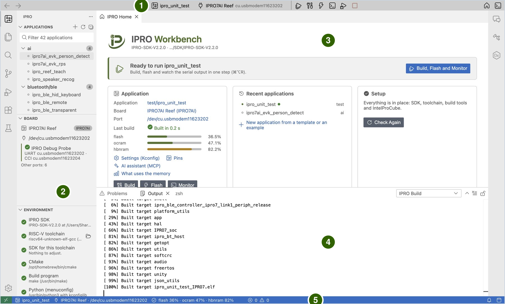

# IPRO Workbench

IPRO Workbench is the integrated development environment (IDE) that INTELPRO provides for the IPRO series of chips. In a single window you build IPRO SDK applications, flash them to the board and watch the board's serial output. It also provides C/C++ code navigation, pin configuration, memory analysis, crash analysis, on-board tests, RF and power measurement, and an AI assistant that can build and flash by itself.

The pages in this section use the [IPRO7AI Reef EVK V4.0](../hardware/boards/reef-evk.md) with the IPRO Debug Probe for their examples. Every step says what to do and what you should see; when the screen does not match, see [Troubleshooting](troubleshooting.md). If you work in VS Code instead, see [VS Code Extension](../guides/vscode.md).

!!! info "Availability"
    IPRO Workbench 0.1.0 (preview) for macOS and Windows is on the [IPRO Workbench releases page on GitHub](https://github.com/INTELPRO-INC/ipro-workbench/releases/tag/v0.1.0); no GitHub account is needed. There is no Linux version yet. See [Install IPRO Workbench](install.md).

## What it does { #features }

| Feature | Description |
|---|---|
| Complete the environment | Checks the SDK, the RISC-V toolchain, CMake, Python, IntelProCube and the board automatically, and installs anything missing from GitHub with one click. |
| Build, flash and monitor | One button builds, flashes and opens the serial monitor. The output of each step is shown separately; if any step fails, it stops and explains why. |
| Application management | Lists the applications in the SDK by category; creates a new application from a board's Hello World or from an existing example. |
| Settings (Kconfig) | Edits the application's `.config` in a form, writes only the options you change, and shows the help text and dependencies of each option. |
| Pin configuration | Assigns the function of each GPIO on a package drawing and in a table, checks for conflicts and against the board's wiring, and generates initialization code. |
| Memory analysis | Shows which libraries, object files and symbols use flash, ocram and hbnram; compares the size change from build to build, and lets you set a memory budget. |
| Flashing and the board | Partition table view and check, detection of the board's flash, checking the firmware running on the board, and writing AI models to the mfg partition. |
| Serial monitor | Filtering, timestamps, saving and full logging, a serial plotter, and monitoring a second port at the same time. |
| Debugging and analysis | Decodes crash addresses into source lines automatically, collects and analyzes crash dumps, and looks up registers and their fields. |
| Testing and measurement | On-board test results in the **Testing** view, RF tests (BLE DTM), power curves and battery life estimates. |
| AI assistant | The built-in IPRO AI assistant builds, reads the output, and changes settings and pins by itself; AI assistants outside the IDE (for example Claude Code) can use the same set of tools through MCP. |

## Window areas { #window }

| No. | Area | Purpose |
|---|---|---|
| 1 | Toolbar | The current application, board and port, and buttons such as build, flash and monitor. Click the application or board name to change it. |
| 2 | IPRO side bar | **Applications** lists the applications in the SDK; **Board** shows the probe, its ports and the firmware running on the board; **Environment** lists the check results item by item. |
| 3 | Editor area | IPRO Home, source code, and views such as settings, pins, memory map and partition table all open here. |
| 4 | Bottom panel | In **Output**, **IPRO Build**, **IPRO Flash** and **IPRO Setup** show the build, flash and installation processes respectively; **IPRO Monitor** in **Terminal** is the serial monitor. |
| 5 | Status bar | The current application, board and memory usage; it also reminds you here when something is missing from the environment. |

The banner at the top of IPRO Home always shows the next step: before an SDK is open it asks you to open the SDK, when something is missing from the environment it asks you to complete the environment, and when everything is ready it tells you that you can run.

## Supported environment { #requirements }

| Item | Details |
|---|---|
| Computer | macOS 12 or later (Apple silicon); Windows 11 (x64) |
| IPRO SDK | IPRO SDK 2.2.0 |
| Chips | IPRO7, IPRO7AI |
| Boards | [IPRO7AI Reef EVK V4.0](../hardware/boards/reef-evk.md) |
| Flashing and connection | IPRO Debug Probe (USB); flashing uses IntelProCube |
| Interface languages | Traditional Chinese, English |

## Workflow { #workflow }

1. **Install and complete the environment.** Install IPRO Workbench, let **Fix Environment** install the SDK and the tools, open the SDK and connect the board through the IPRO Debug Probe; see [Install IPRO Workbench](install.md).

2. **Run a first application.** Select `ipro_unit_test`, click **Build, Flash and Monitor** and wait for `ALL TESTS PASSED`, then create an application of your own; see [First Run](first-run.md).

3. **Develop.** Change settings (Kconfig) in a form, assign pins and generate their code, fix build errors and see where the memory goes; see [Develop an Application](develop.md).

4. **Flash.** Flash with the IDE's checks, compare the partition table with the board, and write AI models to the mfg partition; see [Flashing and the Board](flash.md).

5. **Monitor.** Watch, filter, timestamp and save the board's serial output, and plot the numbers it prints; see [Serial Monitor](monitor.md).

6. **Debug and measure.** Decode crash addresses, collect crash dumps and look up registers, then run board tests, RF tests and power analysis; see [Debugging and Analysis](debug.md) and [Testing and Measurement](measure.md).

## Full manual { #manual }

The IPRO Workbench Operation Manual V1.1 covers IPRO Workbench 0.1.0 as a PDF: [English](https://github.com/INTELPRO-INC/ipro-workbench/releases/download/v0.1.0/IPRO-Workbench-Operation-Manual-V1.1-en.pdf) (53 pages) or [Traditional Chinese](https://github.com/INTELPRO-INC/ipro-workbench/releases/download/v0.1.0/IPRO-Workbench-Operation-Manual-V1.1-zh-TW.pdf) (52 pages). It is also listed under [Documents](../documents/index.md).

## Pages in this section { #pages }

-   **[Install IPRO Workbench](install.md)**

    ---

    Download and verify the installer, install on macOS and Windows, the interface language, completing the development environment, opening the SDK and connecting the board.

-   **[First Run](first-run.md)**

    ---

    Build, flash and monitor `ipro_unit_test`, create your own application, and the application context menu.

-   **[Develop an Application](develop.md)**

    ---

    Settings (Kconfig), pin configuration and generated code, builds and errors, the memory map, size changes and the memory budget.

-   **[Flashing and the Board](flash.md)**

    ---

    Flashing and its checks, the partition table, the board's flash and firmware check, and writing AI models to mfg.

-   **[Serial Monitor](monitor.md)**

    ---

    Opening the monitor and typing commands, filter, timestamps, saving and full logs, the serial plotter and a second port.

-   **[Debugging and Analysis](debug.md)**

    ---

    Automatic crash address decoding, crash dumps with the full call chain, and the register reference.

-   **[Testing and Measurement](measure.md)**

    ---

    Board tests in the Testing view, RF tests in BLE Direct Test Mode, and power curves with battery life estimates.

-   **[AI Assistant](ai.md)**

    ---

    Turning on AI features, asking AI to fix a build error or analyze a crash, and letting AI assistants outside the IDE use it through MCP.

-   **[Troubleshooting](troubleshooting.md)**

    ---

    Messages on screen, toolbar and side bar status, macOS and Windows issues, and what to send when you report a problem.

-   **[Shortcuts, Commands and Settings](reference.md)**

    ---

    Keyboard shortcuts, IPRO commands, `ipro.*` settings, MCP tools and the files and folders the IDE uses.

## Scope of this release { #limitations }

These pages cover the IPRO Workbench 0.1.0 preview. This release has the following limitations:

- The installers are not signed by Apple or Microsoft, so the operating system shows a prompt the first time you open or install IPRO Workbench (see [Install](install.md#install) for what to do).
- Debugging over JTAG is not available yet. If the board crashes, use the crash decoding and crash dumps described in [Debugging and Analysis](debug.md) instead.
- Automatic updates are off by default. To get a new version, download it from the releases page and install it again.
- The serial monitor filter also hides the content that the IDE reads by itself (build stamp, partition table, test results). Clear the filter before doing those steps.
- There is no Linux version yet.
