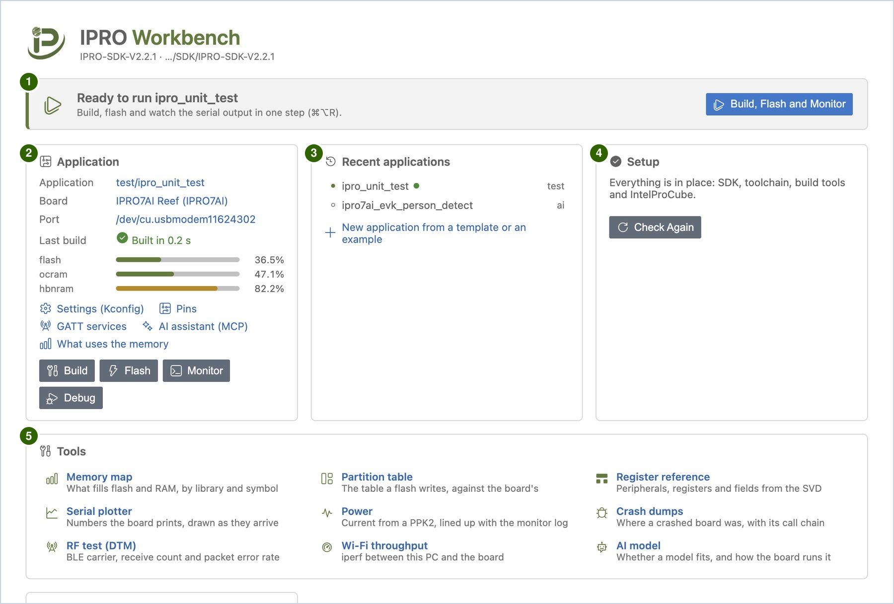

# IPRO Workbench

IPRO Workbench is the integrated development environment (IDE) that INTELPRO provides for the IPRO series of chips. In a single window you build IPRO SDK applications, flash them to the board and watch the board's serial output. It also provides C/C++ code navigation, switching between configurations, pin configuration, GATT configuration, memory analysis, OTA packages, a sensor dashboard, crash analysis, on-board tests, RF, Wi-Fi throughput and power measurement, and an AI assistant that can build and flash by itself.

The pages in this section use the [IPRO7AI Reef EVK V4.0](../hardware/boards/reef-evk.md) with the IPRO Debug Probe for their examples. Every step says what to do and what you should see; when the screen does not match, see [Troubleshooting](troubleshooting.md). With the IPRO6S EVK the steps for building, flashing and monitoring are the same; what differs is collected in the [IPRO6S EVK](flash.md#ipro6s) section of [Flashing and the Board](flash.md). If you work in VS Code instead, see [VS Code Extension](../guides/vscode.md).

!!! info "Availability"
    IPRO Workbench 0.2.1 (preview) for macOS and Windows is on the [IPRO Workbench releases page on GitHub](https://github.com/INTELPRO-INC/ipro-workbench/releases/tag/v0.2.1); no GitHub account is needed. There is no Linux version yet. See [Install IPRO Workbench](install.md).

    Use it with IPRO SDK V2.3.0. Older SDKs work too, without the features marked "SDK V2.3.0" on these pages.

## What it does { #features }

| Feature | Description |
|---|---|
| Complete the environment | Checks the SDK, the RISC-V toolchain, CMake, Python, IntelProCube and the board automatically, and installs anything missing from GitHub with one click. |
| Build, flash and monitor | One button builds, flashes and opens the serial monitor. The output of each step is shown separately; if any step fails, it stops and explains why. |
| Application management | Lists the applications in the SDK by category; creates a new application from a board's Hello World, a BLE peripheral, a Wi-Fi station for the IPRO6S EVK, AI vision for the IPRO7AI Reef EVK V4.0, or an existing example; see [Create your own application](first-run.md#own-app). |
| Settings (Kconfig) | Edits the application's `.config` in a form, writes only the options you change, and shows the help text and dependencies of each option. |
| Configurations | Lists an application's `defconfig_*` and `config_*` files; the one you choose builds in the same `build_<name>` folder as `make DEFCONFIG=<file>`, and `.config` is left alone; see [Configurations](develop.md#configurations). |
| Pin configuration | Assigns the function of each GPIO on a package drawing and in a table, checks for conflicts and against the board's wiring, and generates initialization code. |
| GATT configuration | Defines BLE services and characteristics in a form, checks UUIDs, lengths and the application's settings, and generates the GATT service code; see [Configuring GATT Services](develop.md#gatt). |
| Memory analysis | Shows which libraries, object files and symbols use flash, ocram and hbnram; compares the size change from build to build, and lets you set a memory budget. |
| Flashing and the board | Partition table view and check, writing boot2 along when the partition table is laid out for it, detection of the board's flash, checking the firmware running on the board, and writing AI models to the mfg partition; the IPRO6S EVK is flashed with its own partition table. |
| OTA package | Makes the boot2 OTA package of the application and shows whether it is signed; sends it to the board over the console UART to install, or only for the board to check (SDK V2.3.0); see [OTA package](flash.md#ota). |
| Flash over the board's own USB | When the selected port is the board's own USB port, flashes through boot2's USB downloader, with no probe (macOS, Windows 11); see [Flash over the board's own USB](flash.md#usb-flash). |
| Serial monitor | Filtering, timestamps, saving and full logging, a serial plotter, and monitoring a second port at the same time. |
| Sensor dashboard | Shows the `name:value` lines a board prints as tiles, meters, lamps, a tilt view and charts, with buttons that type commands on the board; `dashboard.yaml` in the application lays it out; see [Sensor dashboard](monitor.md#dashboard). |
| Debugging and analysis | Decodes crash addresses into source lines automatically (IPRO7 series and IPRO6S), collects and analyzes crash dumps, and looks up registers and their fields. |
| Testing and measurement | On-board test results in the **Testing** view, RF tests (BLE DTM), Wi-Fi throughput (iperf, with a scan, the board's MAC and signal, and the Wi-Fi memory profile), power curves and battery life estimates. |
| AI assistant | The built-in IPRO AI assistant builds, reads the output, and changes settings, pins and GATT services by itself; AI assistants outside the IDE (for example Claude Code) can use the same set of tools through MCP, and can also open an SDK, choose the board, port and configuration, and type on the board's console. |

## Window areas { #window }

| No. | Area | Purpose |
|---|---|---|
| 1 | Toolbar | The current application, board and port, and buttons such as build, flash and monitor. Click the application or board name to change it. |
| 2 | IPRO side bar | **Applications** lists the applications in the SDK; **Board** shows the probe, its ports and the firmware running on the board; **Environment** lists the check results item by item. |
| 3 | Editor area | IPRO Home, source code, and views such as settings, pins, memory map and partition table all open here. |
| 4 | Bottom panel | In **Output**, **IPRO Build**, **IPRO Flash** and **IPRO Setup** show the build, flash and installation processes respectively; **IPRO Monitor** in **Terminal** is the serial monitor. |
| 5 | Status bar | The current application, board and memory usage; it also reminds you here when something is missing from the environment. |

## IPRO Home { #home }

IPRO Home is the first tab in the editor area after you open an SDK. If you close it, click the house icon at the right of the toolbar (**IPRO Home**) to open it again.

| No. | Area | Purpose |
|---|---|---|
| 1 | Banner | Always shows the "next step": before an SDK is open it asks you to open the SDK, when something is missing from the environment it asks you to complete the environment, and when everything is ready it shows "&lt;application&gt; is ready to run" with the **Build, Flash and Monitor** button. |
| 2 | Application | The current application, board and port (click one to change it); when the board needs something set before use, the note is under the board (for example on the IPRO7AI Reef EVK V4.0, "The camera needs SW7 on CAM. …"); links to Settings (Kconfig), Pins, GATT services and AI assistant (MCP); the Build, Flash, Monitor and Debug buttons. After a build it also shows the memory usage. |
| 3 | Recent applications | The applications you used most recently; click one to switch to it. You can also create a new application from here. |
| 4 | Setup | A summary of the environment check with **Check Again**; when something is missing it shows **Fix Environment**. |
| 5 | Tools | The way into the ten tool pages: Memory map, Partition table, Register reference, Serial plotter, Power, Crash dumps, RF test (DTM), Wi-Fi throughput, AI model and OTA package. Each has a line saying what it is for; click the name to open the page. |

The tool pages all open in the editor area and share one layout: the title and the application the page is about at the top, then the options and buttons, then the results. The same commands are in the IPRO menu and in the command palette (type `IPRO`); the [Sensor Dashboard](monitor.md#dashboard) is not on the **Tools** card, and opens from the IPRO menu or the command palette.

## Supported environment { #requirements }

| Item | Details |
|---|---|
| Computer | macOS 12 or later (Apple silicon); Windows 11 (x64) |
| IPRO SDK | IPRO SDK V2.3.0. The features marked "SDK V2.3.0" need it; the rest also work on 2.2.x (the IPRO6S EVK needs 2.2.1 or later) |
| Chips | IPRO7, IPRO7AI, IPRO6S (builds the SDK's IPRO6 applications) |
| Boards | [IPRO7AI Reef EVK V4.0](../hardware/boards/reef-evk.md), [IPRO6S EVK](flash.md#ipro6s); IPRO7AI Sensor Tag (the example for the [Sensor dashboard](monitor.md#dashboard) and for [flashing over the board's own USB](flash.md#usb-flash)) |
| Flashing and connection | IPRO Debug Probe (USB); flashing uses IntelProCube (the IPRO6S EVK needs 0.7.0.1 or later); also over the board's own USB (macOS, Windows 11) |
| Interface languages | Traditional Chinese, English, Simplified Chinese, Japanese |

## Workflow { #workflow }

1. **Install and complete the environment.** Install IPRO Workbench, let **Fix Environment** install the SDK and the tools, open the SDK and connect the board through the IPRO Debug Probe; see [Install IPRO Workbench](install.md).

2. **Run a first application.** Select `ipro_unit_test`, click **Build, Flash and Monitor** and wait for `ALL TESTS PASSED`, then create an application of your own; see [First Run](first-run.md).

3. **Develop.** Change settings (Kconfig) in a form, choose the configuration to build, assign pins and generate their code, define GATT services and generate their code, fix build errors and see where the memory goes; see [Develop an Application](develop.md).

4. **Flash and update.** Flash with the IDE's checks, compare the partition table with the board, write AI models to the mfg partition, make an OTA package and send it to the board over the console UART, flash over the board's own USB, and build, flash and monitor the IPRO6S EVK; see [Flashing and the Board](flash.md).

5. **Monitor.** Watch, filter, timestamp and save the board's serial output, plot the numbers it prints or show them on the sensor dashboard; see [Serial Monitor](monitor.md).

6. **Debug and measure.** Decode crash addresses, collect crash dumps and look up registers, then run board tests, RF tests, Wi-Fi throughput tests and power analysis; see [Debugging and Analysis](debug.md) and [Testing and Measurement](measure.md).

## Full manual { #manual }

The IPRO Workbench Operation Manual V1.2 is attached as a PDF to the 0.2.1 release: [English](https://github.com/INTELPRO-INC/ipro-workbench/releases/download/v0.2.1/IPRO-Workbench-Operation-Manual-V1.2-en.pdf) (73 pages) or [Traditional Chinese](https://github.com/INTELPRO-INC/ipro-workbench/releases/download/v0.2.1/IPRO-Workbench-Operation-Manual-V1.2-zh-TW.pdf) (67 pages). V1.2 is written for 0.1.1; a manual for 0.2.1 follows, and until then these pages describe what is new or changed in 0.2.1. It is also listed under [Documents](../documents/index.md).

## Pages in this section { #pages }

-   **[Install IPRO Workbench](install.md)**

    ---

    Download and verify the installer, install on macOS and Windows, the interface language, completing the development environment, opening the SDK and connecting the board.

-   **[First Run](first-run.md)**

    ---

    Build, flash and monitor `ipro_unit_test`, create your own application, and the application context menu.

-   **[Develop an Application](develop.md)**

    ---

    Settings (Kconfig), configurations, pin configuration and generated code, GATT services and generated code, builds and errors, the memory map, size changes and the memory budget.

-   **[Flashing and the Board](flash.md)**

    ---

    Flashing and its checks, the partition table, the board's flash and firmware check, writing AI models to mfg, OTA packages, flashing over the board's own USB, and the IPRO6S EVK.

-   **[Serial Monitor](monitor.md)**

    ---

    Opening the monitor and typing commands, filter, timestamps, saving and full logs, the serial plotter, a second port and the sensor dashboard.

-   **[Debugging and Analysis](debug.md)**

    ---

    Automatic crash address decoding, crash dumps with the full call chain, and the register reference.

-   **[Testing and Measurement](measure.md)**

    ---

    Board tests in the Testing view, RF tests in BLE Direct Test Mode, Wi-Fi throughput with iperf and the Wi-Fi memory profile, and power curves with battery life estimates.

-   **[AI Assistant](ai.md)**

    ---

    Turning on AI features, asking AI to fix a build error or analyze a crash, and letting AI assistants outside the IDE use it through MCP.

-   **[Troubleshooting](troubleshooting.md)**

    ---

    Messages on screen, toolbar and side bar status, macOS and Windows issues, and what to send when you report a problem.

-   **[Shortcuts, Commands and Settings](reference.md)**

    ---

    Keyboard shortcuts, IPRO commands, `ipro.*` settings, MCP tools and the files and folders the IDE uses.

## Scope of this release { #limitations }

These pages cover the IPRO Workbench 0.2.1 preview. This release has the following limitations:

- The installers are not signed by Apple (not notarized) or Microsoft, so the operating system shows a prompt the first time you open or install IPRO Workbench (see [Install](install.md#install) for what to do).
- Debugging over JTAG is not available yet. If the board crashes, use the crash decoding and crash dumps described in [Debugging and Analysis](debug.md) instead.
- Automatic updates are off. To get a new version, download it from the releases page and install it again.
- [Wi-Fi throughput (iperf)](measure.md#iperf): the board's network name and password cannot contain spaces, and the board echoes the password in the serial monitor. When the board sends to a Windows PC, the firewall must allow incoming TCP port 5001.
- On Windows, build the IPRO SDK with the RISC-V toolchain 14.2.1 (the environment check installs it); 13.1.1 cannot link the SDK's prebuilt libraries.
- IPRO6 series boards print no partition table or flash ID at boot, so the partition table is not compared with the board's and the board's flash is not detected at boot; with IPRO SDK 2.2.1 or earlier, **Board** also does not show which firmware the board runs (see [Differences from the IPRO7 Series](flash.md#ipro6s-differences)).
- There is no Linux version yet.
