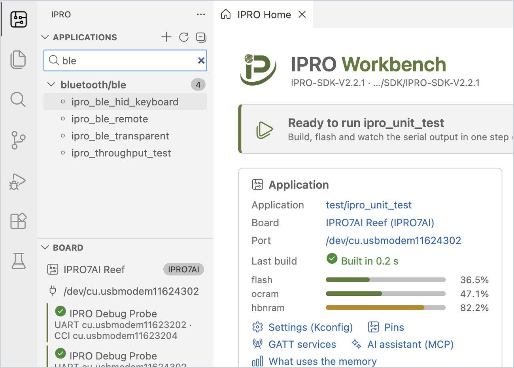

# Install IPRO Workbench

This page takes you from installing IPRO Workbench to the point where the IDE finds your board. When you are done, the IPRO Home banner shows "Ready to run". It covers IPRO Workbench 0.2.0; buttons and other interface labels are shown in bold as they appear in the English interface.

## Prerequisites { #prerequisites }

| Item | Details |
|---|---|
| Computer | macOS 12 or later (Apple silicon) or Windows 11 (x64), with access to GitHub. The IDE, tools and SDK need about 4 GB of disk space in total. |
| Installer | macOS: `IPRO-Workbench-0.2.0-mac-arm64.dmg`; Windows: `IPRO-Workbench-0.2.0-win-x64.exe`. Download it from the IPRO Workbench releases page on GitHub (see [Download and verify](#download)); no GitHub account is needed. |
| IPRO SDK | IPRO SDK V2.3.0 (you can install it from GitHub when you [open the SDK](#open-sdk)). Older SDKs work too, without the features marked "SDK V2.3.0" |
| Board | [IPRO7AI Reef EVK V4.0](../hardware/boards/reef-evk.md), or IPRO6S EVK |
| Probe and cable | IPRO Debug Probe, and a USB cable to connect it to the computer |
| Also needed on macOS | Xcode Command Line Tools, and CMake and Ninja from Homebrew (see [Complete the development environment](#environment)) |

## Download and verify { #download }

| File | System | Size |
|---|---|---|
| [`IPRO-Workbench-0.2.0-mac-arm64.dmg`](https://github.com/INTELPRO-INC/ipro-workbench/releases/download/v0.2.0/IPRO-Workbench-0.2.0-mac-arm64.dmg) | macOS 12 or later, Apple silicon | 201 MB |
| [`IPRO-Workbench-0.2.0-win-x64.exe`](https://github.com/INTELPRO-INC/ipro-workbench/releases/download/v0.2.0/IPRO-Workbench-0.2.0-win-x64.exe) | Windows 11, x64 | 161 MB |

<div class="ipro-steps" markdown>

1. **Download the installer.** Open the IPRO Workbench 0.2.0 release page <https://github.com/INTELPRO-INC/ipro-workbench/releases/tag/v0.2.0> and, under **Assets**, download the installer for your system.

2. **Verify the downloaded file** to make sure it is not damaged or replaced:

    === "macOS"

        ```bash
        shasum -a 256 IPRO-Workbench-0.2.0-mac-arm64.dmg
        ```

    === "Windows"

        ```powershell
        (Get-FileHash .\IPRO-Workbench-0.2.0-win-x64.exe -Algorithm SHA256).Hash
        ```

    **You should see**: the same value as the one listed below for the same file (Windows shows it in uppercase). `SHA256SUMS.txt` on the releases page also lists these values.

    ```text title="SHA-256 of the IPRO Workbench 0.2.0 installers"
    # IPRO-Workbench-0.2.0-mac-arm64.dmg
    0c2e4391d3cefbd8906c07ab65554a8f5a4812baa44ee67356ed51e4262c0cb7
    # IPRO-Workbench-0.2.0-win-x64.exe
    5d3643d1d346ae68b0b53ac608b758f3bff2bca7136b18cf00a4e351aaa9fb2a
    ```

</div>

The ZIP, `latest-mac.yml`, `latest.yml` and blockmap files on the releases page are for the built-in update function; you do not need to download them. For the two operation manual PDFs, see [Full manual](index.md#manual).

## Install { #install }

<div class="ipro-steps" markdown>

1. **Install the program**

    === "macOS"

        Open `IPRO-Workbench-0.2.0-mac-arm64.dmg` and drag **IPRO Workbench** into the Applications folder.

    === "Windows"

        1. Double-click `IPRO-Workbench-0.2.0-win-x64.exe`.
        2. Windows may show "Windows protected your PC". Click **More info**, check the app name, and then click **Run anyway**.
        3. When the installer wizard asks who to install for, choose to install for the current user only (no administrator rights needed). You can then change the installation folder; click **Install**, and when it is done, click **Finish**.

        **You should see**: IPRO Workbench appears in the Start menu and on the desktop.

2. **Open IPRO Workbench**

    === "macOS"

        Open IPRO Workbench from Applications.

        If macOS says it cannot verify the developer the first time you open it, go to System Settings → Privacy & Security, scroll down to the IPRO Workbench entry, click **Open Anyway** (the wording differs in some macOS versions), and open IPRO Workbench again.

    === "Windows"

        Open IPRO Workbench from the Start menu.

    **You should see**: the IPRO Workbench window, with IPRO Home in the middle and the IPRO side bar on the left (**Applications**, **Board**, **Environment**). It looks the same on macOS and Windows.

</div>

!!! tip
    For mass deployment by IT staff, use a silent install: `IPRO-Workbench-0.2.0-win-x64.exe /S`, or set the installation location with `/D=<folder>` (`/D` must be the last parameter).

## Interface language { #language }

IPRO Workbench comes in Traditional Chinese, English, Simplified Chinese and Japanese. The first start follows the system language: a Traditional Chinese (Taiwan, Hong Kong, Macau), Simplified Chinese or Japanese system gets that language, any other system gets English. To change the language later, press `Cmd+Shift+P` (`Ctrl+Shift+P` on Windows) to open the command palette, type `Configure Display Language`, choose a language, and restart when prompted.

## Complete the development environment { #environment }

IPRO Workbench checks every tool needed for development by itself and lists the results under **Environment** in the side bar.

| Item | Purpose | Can **Fix Environment** install it? |
|---|---|---|
| IPRO SDK | Source of the applications, drivers and examples | Yes, the latest release from GitHub |
| RISC-V toolchain | Compiles the firmware | Yes (on Windows it installs 14.2.1; 13.1.1 cannot link the SDK's prebuilt libraries) |
| CMake, Build program | Generates and runs the build | Yes on Windows (in one package with Ninja and Python); on macOS, install them with Homebrew |
| Python (menuconfig) | Settings (Kconfig) and Menuconfig | The kconfiglib package must be installed separately (see below) |
| IntelProCube | Flashing | Yes (it installs 0.7.0.1 or later, which the IPRO6S EVK needs) |
| clangd (code navigation) | Go to definition, errors as you type | Yes, downloaded by the clangd extension (after Fix, the extension asks once more whether to install it) |
| OpenOCD (debugging) | JTAG debugging (not available yet in this release) | Yes on Windows; building and flashing work without it |
| Board | Finds the IPRO Debug Probe | Just plug in the probe |
| SDK for this toolchain | Windows only: lets IPRO SDK 2.2.1 and earlier build on Windows | Yes |
| macOS quarantine | macOS only: tools downloaded with a browser are blocked by the system | Yes, the flag is removed after you confirm |

<div class="ipro-steps" markdown>

1. **Look at the banner at the top of IPRO Home.** When something is missing, it says "Finish the setup" and tells you how many items are still missing.

2. **On macOS, install the Xcode Command Line Tools and the build tools first** in Terminal (skip this if they are already installed):

    ```bash
    xcode-select --install
    brew install cmake ninja
    ```

3. **Click Fix Environment.**

    **You should see**: the **Output** panel at the bottom switches to **IPRO Setup** and shows each item being downloaded from GitHub and installed. The tools go into `IPRO/tools/<tool>/<version>` in your home folder (`%USERPROFILE%\IPRO\tools` on Windows). When it finishes, every row under **Environment** has a green check mark, and the IPRO Home banner moves on to the next step. On a typical network this takes about two minutes.

4. **Install kconfiglib if it is missing.** When the **Python (menuconfig)** row reports that kconfiglib is missing, run the command shown in that row in a terminal, and then click **Check Again** at the top of **Environment**:

    === "macOS"

        ```bash
        python3 -m pip install kconfiglib
        ```

    === "Windows"

        ```powershell
        python -m pip install kconfiglib windows-curses
        ```

5. **Use tools you already have (optional).** If the toolchain or IntelProCube is already on your computer, you do not need to install it again: in that row of **Environment**, click the folder icon (**Use one already on this computer…**) and choose the folder the tool is in. To flash the IPRO6S EVK, IntelProCube must be 0.7.0.1 or later; `RELEASE_INFO.txt` in the IntelProCube folder gives its version.

6. **(macOS) Clear the quarantine flag.** A **macOS quarantine** row means that a tool was downloaded with a browser or a chat app and the system will block it when it runs. Click the lock icon on that row; after you confirm, the IDE removes the flag.

</div>

## Open the SDK { #open-sdk }

IPRO Workbench uses the IPRO SDK folder as its workspace.

<div class="ipro-steps" markdown>

1. **Open the SDK folder.** On IPRO Home, click **Open SDK…** and choose the IPRO SDK folder (for example `IPRO/SDK/IPRO-SDK-V2.3.0` in your home folder). If you do not have the SDK yet, click **Install SDK from GitHub…**; the list shows the SDK releases and marks them "latest" or "preview".

    **You should see**: **Applications** in the side bar lists the applications in the SDK by category, and the search box reads "Filter N applications".

2. **Filter the list.** Type a keyword in the search box (for example `ble`), and only the matching applications stay in the list. Clear the text to show them all again.

</div>



The SDK itself, and how to get it without the IDE, is described in [Get Started](../get-started/index.md).

## Connect the board { #connect-board }

<div class="ipro-steps" markdown>

1. **Connect the probe and the board.** Connect the IPRO Debug Probe to the computer with the USB cable, and then connect the probe to the Reef V4 (the probe goes on the board's [debug connector U6](../hardware/boards/reef-evk.md#debug-connector); the IPRO6S EVK connects the same way).

    **You should see**: **IPRO Debug Probe** and its two ports appear under **Board** in the side bar, for example `UART cu.usbmodemXXXX · CCI cu.usbmodemYYYY` on macOS or `UART COM5 · CCI COM6` on Windows. The same UART port is shown next to the board on the toolbar.

2. **If the toolbar shows "no probe" in amber**, the IDE cannot find the probe: check the USB cable, and connect it directly to the computer rather than through a hub whenever possible.

</div>

!!! note
    The probe has two ports: UART is the board's console (both the serial monitor and flashing use it), and CCI is a separate interface. The IDE picks UART automatically; to change it by hand, click the board name on the toolbar and choose **Select Port…**.

## Troubleshooting { #troubleshooting }

| Symptom | Fix |
|---|---|
| macOS says the developer cannot be verified on the first launch | Go to System Settings → Privacy & Security and click **Open Anyway** (see [Install](#install)). |
| Installation shows "Windows protected your PC" | Click **More info**, check that the app name is IPRO-Workbench, then click **Run anyway**. |
| CMake or the build program is reported missing (macOS) | On macOS the IDE does not install the build tools. Run `xcode-select --install` and `brew install cmake ninja` in a terminal, then press **Check Again**. |
| The Python row says kconfiglib is missing | Run the `pip install` command shown in that row (see [step 4](#environment) above), then press **Check Again**. |
| The toolbar shows "no probe" in amber | The IDE cannot find the IPRO Debug Probe. Check the USB cable and connect the probe directly to the computer if you can; once it is plugged in, it appears automatically within a few seconds. |

For anything else, see [Troubleshooting](troubleshooting.md).

## Next steps { #next-steps }

- [First Run](first-run.md): build, flash and monitor `ipro_unit_test`, then create your own application.
- [Shortcuts, Commands and Settings](reference.md): every shortcut, IPRO command and `ipro.*` setting in one place.
