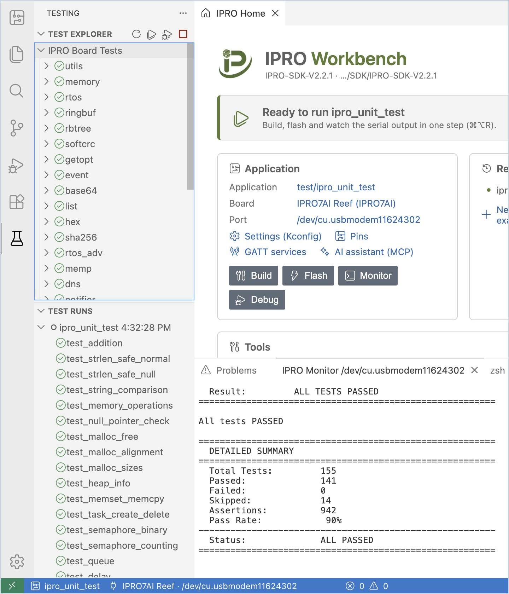
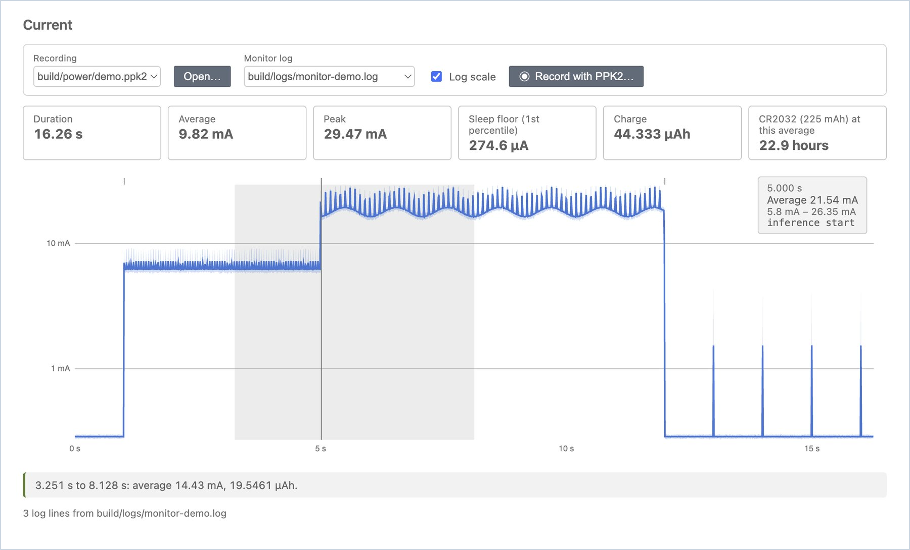

# Testing and Measurement

Running tests on the board, measuring BLE RF, and looking at power curves.

## Board tests { #board-tests }

When an application uses the SDK's Unity test framework (for example `ipro_unit_test`), the test results the board prints are collected into the IDE's **Testing** view.

1. **Run the tests.** After you select the application and flash it once, click the beaker icon (**Run Tests on Board**) at the top of the **Board** view in the side bar.

    **You should see**: a notification says "Resetting the board with the monitor open…", and the board reboots through the probe. The left side switches to the **Testing** view: **Test Runs** lists this run (for example "ipro_unit_test 2:10:16 PM"), with a passed, failed or skipped symbol in front of each test; in **Test Explorer**, **IPRO Board Tests** lists every test group (utils, memory, rtos…).

2. **Open a failure.** Double-click a failed test to open the test's source code at the line that failed.

3. **Results after every run.** When you run **Build, Flash and Monitor**, the results also go to the **Testing** view automatically.

!!! note
    - The **Testing** view reads the test lines the board prints after it boots, so the monitor must be on the UART (console) port of the probe, and no filter may be on.
    - When the board does not reboot, the IDE says "The board did not restart. Is the monitor on the console port of an IPRO Debug Probe?"

## RF test (BLE DTM) { #rf-test }

**RF Test** uses the MFG firmware from INTELPRO to make the board transmit or receive in BLE Direct Test Mode, for measurements with a spectrum analyzer or a radio communication tester, or to measure the packet error rate (PER) between two boards.

1. **Check the firmware.** Flash the MFG firmware to the board and open the serial monitor. Choose **RF Test (DTM)…** from the IPRO menu and click **Check Firmware**. The MFG firmware is not included in the IPRO SDK; ask your INTELPRO sales representative for it.

    **You should see**: "MFG firmware 1.01". When the board does not answer, it shows "The board did not answer. Is it running the MFG firmware?"

2. **Transmit or receive.** Select the channel, PHY, length, payload and TX power, click **Transmit** or **Receive**, and click **Stop** to end.

    **You should see**: while transmitting, a message such as "Transmitting on 2402 MHz (1M, 37 bytes, every 625 µs)." After receiving stops, "Received M packets in N s; against a DTM transmitter at the standard rate that is a PER of X%."

    When you only click **Receive**, the PER is estimated from the receive time, which also counts a short time before the board starts receiving, so it comes out slightly higher than the real value (about 1–3% higher over 10 seconds). For an accurate PER, measure with two boards as in the next step.

3. **PER with two boards.** Connect both boards to the same computer, flash the MFG firmware to the second board too, and click **Open Monitor on Another Port…** to open its monitor. In **Packet error rate between two boards**, select the receiver and the number of seconds, then click **Measure PER**.

    **You should see**: the result table gains a row: time, channel, PHY, sent (expected), received and PER.

    When the two boards are on different computers, open IPRO Workbench on each computer: first select a channel on one and click **Transmit**, then select the same channel on the other and click **Receive**, and click **Stop** after a few seconds. The receiving side shows the number of packets received and the estimated PER.

!!! tip
    With Wi-Fi nearby, BLE channels that overlap a Wi-Fi channel lose many packets (for example around 2440 MHz). When you measure PER, choose a channel clear of the nearby Wi-Fi, for example 2478 MHz.

!!! note
    Each time a test starts, the MFG firmware first has to start the BLE controller (about 2.5 seconds); the IDE waits for its reply before it starts.

## Power { #power }

**Power** reads current recordings from a Nordic Power Profiler Kit II (PPK2), works out the average, peak, sleep current and charge, and estimates how long the board would run on a CR2032.

1. **Open a recording.** Right-click the application, choose **Power…**, click **Open…** and choose a `.ppk2` or CSV file saved by the Power Profiler.

    **You should see**: the duration, average, peak, sleep floor (1st percentile) and charge, and how long it lasts under "CR2032 (225 mAh) at this average"; below them is the current curve, which you can switch to **Log scale**.

2. **Hover over the curve.**

    **You should see**: the time, average current and range at that moment, for example "8.128 s, Average 282.3 µA, 271.4 µA – 292.5 µA".

3. **Measure a stretch.** Press and drag across a stretch of the curve.

    **You should see**: the average current and charge of that stretch appear below, for example "3.251 s to 8.128 s: average 11.91 mA, 16.1279 µAh."

4. **Line up the monitor log.** If the serial monitor had **Log To File** and timestamps on during the recording, select that log in **Monitor log**.

    **You should see**: each log line is marked with a short tick above the curve; hovering over a tick shows the current at that moment and the log text, so you can see "which part of the code used how much power".

