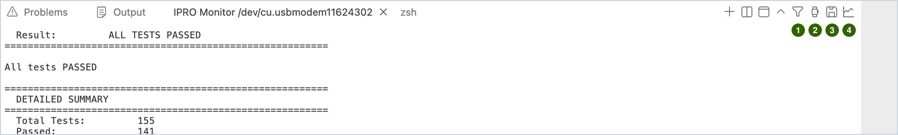
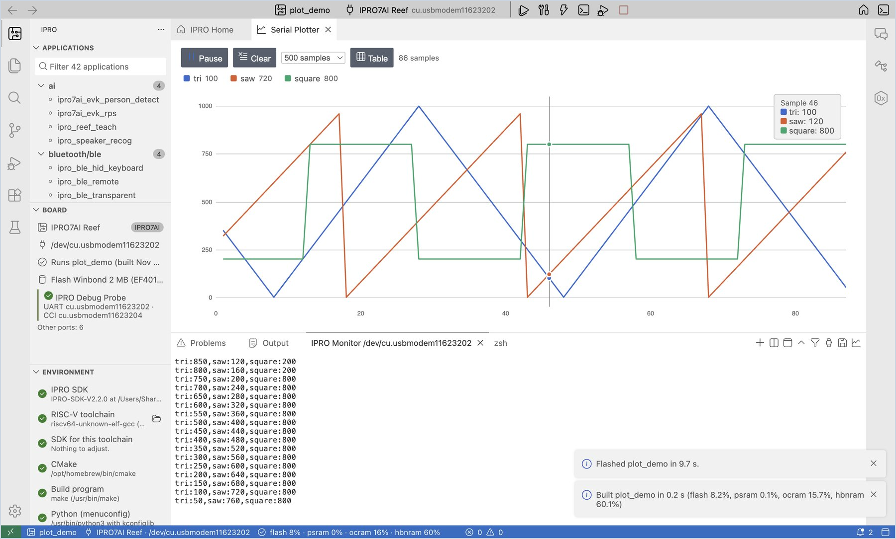

# Serial Monitor

**IPRO Monitor** is the serial monitor in the **Terminal** of the bottom panel. It shows what the board prints over UART, and you can type commands straight to the board.

## Open the monitor and type commands { #open }

<div class="ipro-steps" markdown>

1. **Open the monitor.** Click **Serial Monitor** (`Cmd+Alt+M` / `Ctrl+Alt+M`). With **Build, Flash and Monitor**, it opens automatically after flashing.

    **You should see**: an **IPRO Monitor &lt;port&gt;** terminal opens at the bottom, at 115200 baud by default.

2. **Type a command.** Type in the monitor and press Enter to send, for example `help`.

    **You should see**: the board's shell replies with the commands it supports.

3. **Reboot the board.** Click **Reset Board**: the IDE resets the board through the probe, and the monitor stays open and shows everything from the first boot line.

</div>

!!! note
    - Before flashing or resetting, the IDE closes every monitor and opens them again when it is done.
    - Change the baud rate in the `ipro.monitor.baudRate` setting; after the change, the monitor reopens automatically.
    - The monitor automatically decodes the addresses the board prints into source locations; see [Debugging and Analysis](debug.md#crash-decode).

## Tools on the monitor tab { #tools }

The panel that holds the **IPRO Monitor** tab has a few buttons at its top right; the command palette and the IPRO menu have the same commands.



| No. | Icon | Command | Purpose |
|---|---|---|---|
| 1 | Funnel | **Filter Monitor Output…** | Shows only the matching lines |
| 2 | Stopwatch | **Show Monitor Timestamps** | Adds the time each line was received in front of it |
| 3 | Disk | **Save Monitor Output…** | Saves the current content as a text file |
| 4 | Line chart | **Serial Plotter** | Plots the numbers the board prints as curves |

### Filter { #filter }

<div class="ipro-steps" markdown>

1. **Set a filter.** Click the funnel icon (**Filter Monitor Output…**), type what to keep, for example `ERROR|WARN` or `PASS|FAIL` (a regular expression, not case-sensitive), and press Enter.

    **You should see**: the monitor reopens, the tab title gains `/ERROR|WARN/` at the end, and only matching lines are shown. Crash messages (MEPC, ra, stack backtrace) always show.

2. **Clear the filter.** Click the funnel icon again, empty the input box and press Enter.

</div>

The filter judges a line only once the whole line has arrived, so the shell prompt shows only after you press Enter.

The filter only changes what is shown: the firmware check, the partition table comparison and the board tests still read every line the board prints, so they work with a filter on.

### Timestamps { #timestamps }

Click the stopwatch icon (**Show Monitor Timestamps**).

**You should see**: each line starts with the time it was received, for example `[23:33:13.227]` (by this computer's clock). Click again to turn it off.

### Saving and full logs { #save-log }

<div class="ipro-steps" markdown>

1. **Save what is on screen.** Click the disk icon (**Save Monitor Output…**), choose a location and click **Save**.

    **You should see**: a notification says "Saved the monitor output to monitor-….txt." What is saved is the content the terminal currently keeps (by default the last 1000 lines).

2. **Keep a full log of every session.** Open Settings, search for `ipro.monitor` and check **Log To File**.

    **You should see**: the first line of the monitor says `logging to …/build/logs/monitor-<date>-<time>.log`. The file holds everything the board printed, unfiltered and without colors. When you measure power, this log can be lined up with the current curve (see [Testing and Measurement](measure.md#power)).

</div>

## Serial plotter { #plotter }

<div class="ipro-steps" markdown>

1. **Print numbers.** Have the firmware print numbers on each line, for example `temp:23.5,hum:40` (name:value) or `1.2 3.4` (separated by spaces or commas). The same `name:value` lines can also be shown on the [Sensor dashboard](#dashboard).

2. **Open the plotter.** With the monitor open, click the line-chart icon on the monitor tab (**Serial Plotter**).

    **You should see**: **Serial Plotter** opens in the editor area, with one line per name (up to 8), and the legend at the top shows the latest values. Hover over the chart to list all the values of that sample.

3. **Control the display.** Click **Pause** / **Resume** to freeze or resume the display, and **Clear** to start over; click a name in the legend to hide or show that line; click **Table** to see the numbers instead.

</div>



## Monitor another port at the same time { #second-port }

To watch two boards at once, or the CCI port of the probe:

<div class="ipro-steps" markdown>

1. **Open a second monitor.** Choose **Open Monitor on Another Port…** from the IPRO menu and select the port.

    **You should see**: the ports of the probe (UART, CCI) are at the top of the list; ports that already have a monitor open are not listed. Once you choose one, another **IPRO Monitor** tab appears.

2. **Use both.** You can type in both monitors. When you flash or reset, every monitor is closed first.

</div>

!!! note
    On Windows, a COM port can be used by only one program at a time. To use another serial tool, close IPRO Monitor first.

## Sensor dashboard { #dashboard }

The **Sensor Dashboard** reads the `name:value` lines a board prints on its serial port (the same format as the [Serial plotter](#plotter)) and gives each value a tile with its unit; it also has meters, lamps, a tilt view, a chart per group, and buttons that type a command on the board's console. `dashboard.yaml` in the application's folder lays it out; without that file every value gets a tile and a chart.

The steps use [`ipro7ai_sensor_tag_demo`](https://github.com/INTELPRO-INC/IPRO-SDK/tree/IPRO-SDK-V2.3.0/apps/platform/ipro7ai_sensor_tag_demo) of IPRO SDK V2.3.0 on the IPRO7AI Sensor Tag, whose console is on the board's own USB port.

<div class="ipro-steps" markdown>

1. **Flash and open the monitor.** Flash `ipro7ai_sensor_tag_demo` to the IPRO7AI Sensor Tag as in [Flash over the board's own USB](flash.md#usb-flash), with the board's USB port selected, and click **Serial Monitor**.

    **You should see**: 20 lines a second in IPRO Monitor, such as:

    ```text
    ax:0.012 ay:-0.004 az:1.003 gx:0.3 gy:-0.1 gz:0.0 temp:27.4 batt:87 vbat:4.012 btn:0
    ```

2. **Open the Sensor Dashboard.** Choose **Sensor Dashboard** from the IPRO menu (or `IPRO: Sensor Dashboard` in the command palette). If the monitor is not open yet, the IDE opens it on the port in use.

    **You should see**: **Sensor Dashboard** opens in the editor area with the title `IPRO7AI Sensor Tag` from `dashboard.yaml`, a line "… lines a second from /dev/cu.usbmodemXXXX" and "Laid out by dashboard.yaml of this application". Below are the groups Acceleration and Rotation (three values and a chart each; Acceleration also has the **Tilt** view, "pitch …° · roll …°") and Board (Temperature, Battery as a meter, Battery voltage, and the Button lamp).

3. **Move the board.** Tilt the board, then press the button on it.

    **You should see**: the tilt view follows the board and the acceleration chart changes; while the button is held, the Button lamp shows "On", and "Off" once released. Hovering over a tile shows "&lt;name&gt;: lowest …, highest … since the page was cleared".

4. **Click a command button.** Click **Beep** at the top.

    **You should see**: the board's buzzer sounds. Each button types one line on the console; **Beep** types `beep 200`, and hovering over a button shows its command.

5. **Pause, clear and read the file again.** Click **Pause** to freeze the page (the button turns into **Resume**), and **Clear** to start the statistics over. After you change `dashboard.yaml`, click **Read dashboard.yaml Again**.

</div>

How `dashboard.yaml` is written (shortened from `ipro7ai_sensor_tag_demo`):

```yaml title="dashboard.yaml"
title: IPRO7AI Sensor Tag
groups:
  - title: Acceleration
    unit: g
    range: [-2, 2]
    decimals: 3
    chart: true
    tilt: { x: ax, y: ay, z: az }
    values:
      - { name: ax, label: X }
      - { name: ay, label: Y }
      - { name: az, label: Z }
  - title: Board
    values:
      - { name: temp, label: Temperature, unit: "°C", decimals: 1 }
      - { name: batt, label: Battery, unit: "%", range: [0, 100], show: bar }
      - { name: btn, label: Button, show: lamp }
controls:
  - { label: Beep, send: beep 200 }
```

| Key | Meaning |
|---|---|
| `title` | The dashboard's title; without it, "Sensors of &lt;application&gt;" |
| `groups` | The groups. Each has a `title` and `values`, and may give `unit`, `range` and `decimals` for the whole group |
| `chart: true` | Draws a chart of the group's values over time |
| `tilt` | Pitch and roll from three accelerations (`x`, `y`, `z` name the values) |
| `values` | One entry per value: `name` (as the board prints it), `label`, `unit`, `decimals`, `range`, `show` |
| `show` | `value`: the number (the default); `bar`: the number and where it is in its `range`; `lamp`: on when not zero |
| `controls` | Buttons: `label` is the text on the button, `send` the command typed on the console |

!!! note
    - For an application without `dashboard.yaml` the page says "This application has no dashboard.yaml: every value the board prints is shown. The file names groups, units, ranges and buttons."
    - Mistakes in `dashboard.yaml` are listed as "dashboard.yaml line N: …"; the wrong parts are left out and the rest is shown.
    - Without an open monitor the page says "The serial monitor is not open" and offers **Open Monitor**; when the board has printed nothing for a while it says "Nothing from … for a while".
