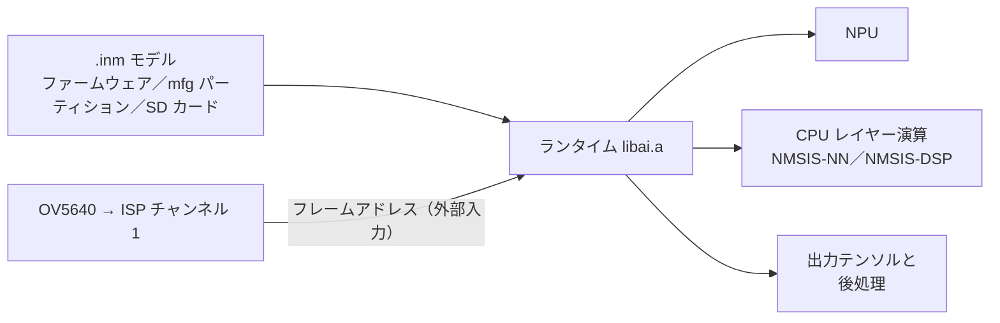

# AI と NPU

IPRO7AI の NPU は、ビルド済みランタイム `components/ai/lib/libai.a` と公開ヘッダーを通じて `.inm` モデルを実行します（IPRO7 との違いは [IPRO7AI](../hardware/chips/ipro7ai.md) のページを参照してください）。IPRO7AI Reef EVK では 3 つのアプリケーションが NPU を使用します。`defconfig_reef_rps` でビルドした `ipro7_uvc_cam`（NPU と対戦するウェブカメラのゲーム）、`ipro_ai_link`（SD カード上の任意のモデルをコマンドで実行）、`ipro_reef_teach`（[IPRO AI Teach](../teach/index.md) を支える Edge AI ファームウェア）です。独自のモデルを持ち込む前に、まずこれらのいずれかを付属のモデルで動かしてください。

!!! abstract "要点"
    - 同梱：ビルド済みランタイムとそのヘッダー（単一モデル用の `iproai_core.h`、複数モデル用の `ipro_ai.h` とその他の Edge AI レイヤー）、`.inm` モデルのサンプル、上記の Reef アプリケーション。
    - `CONFIG_AI_SUPPORT=y` で有効にし、`CONFIG_USE_PSRAM=y` は自分で `.config` に書き込みます。モデルとテンソルは PSRAM に配置されます。
    - モデルはファームウェアにリンクするか、`mfg` Flash パーティションに格納するか、SD カードから読み込みます。
    - SDK パッケージに含まれないもの：ランタイムのソースコードとモデル変換ツール（INTELPRO にお問い合わせください）。IPRO AI Studio は別途配布です（[IPRO AI Studio のインストール](../teach/install.md)を参照）。

## アーキテクチャ { #architecture }



モデルの各レイヤーは、モデル自体の指定に従って NPU と CPU のどちらかで実行されます。`iproai_getNetInfo()` は全レイヤー数と NPU レイヤー数を返します。どのモデルでもすべてが NPU で実行されるとは考えないでください。

| パス | モデル形式 | 実行方法 | Reef のサンプル |
|---|---|---|---|
| NPU | `.inm` | `libai.a` がモデルを読み込み、各レイヤーを NPU または CPU に振り分けます | `ipro7_uvc_cam`（`defconfig_reef_rps`）、`ipro_ai_link`、`ipro_reef_teach` |
| CPU | `.tflite` | NMSIS-NN カーネルを使う TensorFlow Lite Micro（`components/3rdparty`） | —（IPRO7 EVB のサンプル `ipro_tflm_test`、`ipro_tflm_yolo`） |

2 つの形式に互換性はありません。ファイル名を変えても変換はされません。

## ランタイムと API { #iproai-framework }

```text title="components/ai/"
components/ai/
├── CMakeLists.txt        # lib/libai.a をリンクし、以下のインクルードパスを追加
├── iproai_def.h
├── lib/libai.a           # ビルド済みランタイム
├── src/core/include/     # iproai_core.h：単一モデル、直接呼び出し
├── src/inst/include/     # NPU、CPU 演算、後処理（detect/、audio/）
├── runtime/include/      # ipro_ai.h：複数モデル、NPU を共有
├── store/include/        # ipro_ai_store.h：Flash 内のモデルスロット
├── source/include/       # ipro_ai_source.h：データソース
├── preproc/include/      # ipro_ai_preproc.h、sensor_front.h
└── app/include/          # ipro_ai_app.h：ソース → モデル → 結果
```

パッケージにはランタイムのソースが含まれないため、`.config` で `libai.a` のコンパイル方法を変えることはできません。

**ダイレクト API（`iproai_core.h`）**：`ipro_ai_link` とじゃんけんのビルドが使用します。

| 関数 | 用途 |
|---|---|
| `iproai_create()` | モデルインスタンスを作成 |
| `iproai_load_model_from_buffer(hdl, buf)` | メモリから読み込み：ファームウェアにリンクしたモデル、または XIP で読み出す `mfg` パーティション |
| `iproai_load_model_from_file(hdl, "sd:/…")` | FatFS で `.inm` 全体を PSRAM に読み込んでからロード |
| `iproai_getNetInfo(hdl)` | 入力サイズ、レイヤー数、NPU レイヤー数 |
| `iproai_getInputBuffer(hdl)`、`iproai_getOutputBuffer(hdl, &size)` | 入力バッファーと出力バッファー |
| `iproai_startCompute(hdl)` | 推論を実行（同期） |
| `iproai_setResultCB()`、`iproai_setCustom_Postproc_CB()` | 結果コールバック、カスタム後処理 |
| `iproai_free(hdl)` | モデルを解放 |

各関数は成功時に `IPROAI_STATUS_NO_ERROR` を返します。最初のロードの前に、`ipro_ai_link` と同じく、マルチメディアクロックのゲートを解除し（`GLB_PER_Clock_UnGate(GLB_AHB_CLOCK_MM)`）、`iproai_npu_init()`（`iproai_inst_npu.h`）を呼び出してください。

- **入力**：カメラフレームを受け取るモデルは外部入力を読み込みます。ランタイムは `imgBuffer + 4` から読み込みます（先頭 4 バイトはサイズヘッダー）。各実行の前に `NPU_Img_Ext_Addr_Cfg()`（`hal_npu.h`）でフレームアドレスを設定します。Reef のカメラパスは 1 ピクセルあたり 4 バイト（ARGB）を出力します。
- **出力**：`iproai_getOutputBuffer()` が返すサイズはパッチサイズであり、テンソル全体のサイズではありません。NPU はチャンネル数を 4 の倍数にパディングする（`BALI_CHN_ALIGN`、`iproai_inst_util.h`）ため、パディング後のストライドで出力を読んでください。
- NPU のベースアドレスと外部入力のレジスターは、モデルのロード時にのみ書き込まれます。1 つのイメージに 1 つのモデルなら問題になりませんが、複数のモデルを使う場合は次のランタイムを使用してください。

**Edge AI レイヤー**：`ipro_reef_teach` が使用します（すべて `libai.a` に含まれます）。

| ヘッダー | 用途 |
|---|---|
| `ipro_ai.h` | `ipro_ai_init()`、`ipro_ai_model_open()`、`ipro_ai_invoke()`、`ipro_ai_model_close()`：任意の数のモデルを同時に開けます。NPU ロックは 1 つで、実行のたびに NPU を実行対象のモデルに向け直します。同じイメージ内で `iproai_*` を直接呼び出すコードは、その呼び出しを `ipro_ai_npu_lock()` で囲みます |
| `ipro_ai_store.h` | Flash パーティション内のモデルスロット：レコードセクターとコミットワードを使ってインストールするため、電源が切れても残るのは以前のモデル、新しいモデル、空のスロットのいずれかで、書きかけのモデルが残ることはありません |
| `ipro_ai_source.h` | 共通のライフサイクルを持つデータソース（PDM マイクやセンサーなどのサンプルストリーム、またはカメラフレーム） |
| `ipro_ai_preproc.h`、`sensor_front.h` | 共通の前処理：量子化、音声の log-mel 特徴量、センサーウィンドウから 64×64×8 入力への変換、画像の切り出しとリサイズ |
| `ipro_ai_app.h` | ソース → 前処理 → モデル → タスクアダプター（分類、埋め込み、異常スコア）→ コールバック |

## 設定 { #configuration }

```ini title=".config（Reef での AI）"
CONFIG_IPRO7AI_REEF=y
CONFIG_BOARD="IPRO7AI_REEF"
CONFIG_USE_PSRAM=y           # 必須：モデルとテンソルは PSRAM に配置
CONFIG_AI_SUPPORT=y          # components/ai を追加し、libai.a をリンク
CONFIG_MM_SUPPORT=y          # カメラ映像を NPU に渡すアプリケーション向け
```

| キー | 説明 |
|---|---|
| `CONFIG_AI_SUPPORT` | AI コンポーネントを追加します。`CONFIG_MM_SUPPORT` と併用すると OCRAM 領域も縮小されます。[メモリ計画](#dev-guide)を参照してください |
| `CONFIG_USE_PSRAM` | すべての AI アプリケーションが設定しています。ビルドは Kconfig の `select` を適用しないため、`.config` に書く必要があります |
| `CONFIG_AI_MODEL_FROM_FILE` | SD カードからモデルを読み込む `ipro_ai_link` が設定しています（FatFS とあわせて `CONFIG_EVFS=y`、`CONFIG_EVFS_USE_FATFS=y`、`CONFIG_COMPONENTS_FATFS_ENABLE=y`） |
| `CONFIG_AI_CPU_NN_OPS` | CPU レイヤーを含むモデル向けに `ipro_ai_link` と `ipro_reef_teach` が設定しています。`ipro_ai_link` は `CONFIG_COMPONENTS_NMSIS_NN_ENABLE` も設定します |
| `CONFIG_AI_CYCLE_PROFILE` | `ipro_ai_link` が設定しています：`ai_prof` 用のレイヤーごとのサイクル数 |
| `CONFIG_UVC_RPS`、`CONFIG_RPS_EMBED_MODEL` | `ipro7_uvc_cam` の `defconfig_reef_rps` のアプリケーションキー：ゲームをビルドし、`rps_v3.inm` をファームウェアにリンクします |

## Reef でのハンズオン { #hands-on }

じゃんけんで対戦できるウェブカメラをビルドします。ISP チャンネル 1 が OV5640 の映像の中央を 128×128 に切り出して NPU 上の 4 クラス CNN に渡し、その結果を USB ビデオに描画します。

<div class="ipro-steps" markdown>

1. **設定**

    `defconfig_reef_rps` は、Reef の標準のウェブカメラ設定（`defconfig_reef_ov5640`）に 3 行を加えたものです。

    ```ini title="apps/multimedia/ipro7_uvc_cam/defconfig_reef_rps（抜粋）"
    #
    # Rock-paper-scissors on the stream (uvc_rps.c): the EVK app's classifier and
    # game, model linked into the image.
    #
    CONFIG_AI_SUPPORT=y
    CONFIG_UVC_RPS=y
    CONFIG_RPS_EMBED_MODEL=y
    ```

    ウェブカメラの設定ですでに `CONFIG_USE_PSRAM=y`、`CONFIG_MM_SUPPORT=y`、`CONFIG_SENSOR_OV5640=y` が設定されています。

2. **コード**

    モデルはアセンブリファイルによってイメージに取り込まれます。

    ```text title="apps/ai/ipro7ai_evk_rps/src/model_blob.S（抜粋）"
        .section .rodata.rps_model, "a", @progbits
        .balign 16

        .global g_rps_model
        .type   g_rps_model, @object
    g_rps_model:
        .incbin "rps_v3.inm"
        .global g_rps_model_end
    g_rps_model_end:
        .size   g_rps_model, g_rps_model_end - g_rps_model
    ```

    起動時にはこのバッファーからロードされます。Reef ビルドは、IPRO7AI EVK アプリケーションの分類器のソースをそのままコンパイルします。

    ```c title="apps/ai/ipro7ai_evk_rps/src/rps_model.c（load_model から抜粋）"
    s_hdl = iproai_create();
    if (!s_hdl) {
        s_fail = "NPU CREATE FAILED";
        return -1;
    }
    t0 = xTaskGetTickCount();
    st = iproai_load_model_from_buffer(s_hdl, xip);
    s_stats.load_ms = (uint32_t)((xTaskGetTickCount() - t0) * portTICK_PERIOD_MS);
    if (st != IPROAI_STATUS_NO_ERROR) {
        IPRO_LOGE(LOG_TAG, "NPU load failed (status %d)", (int)st);
        s_fail = "NPU LOAD FAILED";
        return -1;
    }
    s_net = iproai_getNetInfo(s_hdl);
    ```

    その後、各フレームはモデルタスクで NPU に渡されます。

    ```c title="apps/ai/ipro7ai_evk_rps/src/rps_model.c（モデルタスクから抜粋）"
    feed(addr);
    IPROAI_Status_e st = iproai_startCompute(s_hdl);
    TickType_t t1 = xTaskGetTickCount();

    if (st != IPROAI_STATUS_NO_ERROR) {
        s_stats.errors++;
        IPRO_LOGE(LOG_TAG, "NPU compute failed (status %d)", (int)st);
    } else {
        uint32_t osz = 0;
        const uint8_t *out = iproai_getOutputBuffer(s_hdl, &osz);
        /* ... */
    }
    ```

    このモデルでは、`feed()` は `NPU_Img_Ext_Addr_Cfg(addr)` を呼び出すだけです。NPU は ISP チャンネル 1 が書き込んだ 128×128 の ARGB フレームを読み込みます。4 つの出力は CPU 上で確率に変換されます。

    `apps/multimedia/ipro7_uvc_cam/CMakeLists.txt` は、`CONFIG_UVC_RPS` が設定されていると `rps_model.c`、`rps_game.c`、`model_blob.S` を追加します。独自のアプリケーションで独自のモデルを使う場合も同じ方法が使えます。[最初の独自アプリケーションを作る](../tutorials/first-own-app.md)を参照してください。

3. **ビルド**

    ```bash
    make -C apps/multimedia/ipro7_uvc_cam DEFCONFIG=defconfig_reef_rps
    ```

    出力：`apps/multimedia/ipro7_uvc_cam/build_reef_rps/build_out/ipro7_uvc_cam_IPRO7.bin`

4. **書き込み**

    SW7 を **CAM** にしてダウンロードモードに入れ（SW1 を押したまま SW2 を押して離し、SW1 を離す）、IntelProCube のディレクトリで次を実行します。

    ```bash
    cd <ICUBE>
    ./ipro_iot_tool_macos --chipname ipro7 --chip-variant IPRO7AI \
        --port /dev/cu.usbserial-XXXX --baudrate 921600 \
        --pt chips/ipro7/partition/partition_cfg_2M.toml \
        --firmware <SDK>/apps/multimedia/ipro7_uvc_cam/build_reef_rps/build_out/ipro7_uvc_cam_IPRO7.bin
    ```

    モデルはファームウェアに含まれているため、ほかに書き込むものはありません。`[All Success]` を確認して SW2 を押します。その他のホストについては[書き込みとシリアルコンソール](../get-started/flash-and-monitor.md)を参照してください。

5. **実行と確認**

    U6 のコンソール（115200 baud）のブートログに次の行が含まれます。

    ```text
    [UVC] Bringing up USB UVC webcam (720p MJPEG)...
    I (…) RPS_MODEL: model: … B linked into the firmware at 0x…
    I (…) RPS_MODEL: loaded in … ms: input 128x128x…, 1 outputs, ext_input …, unsigned …, … layers (… NPU), out scale … zp …
    I (…) RPS_MODEL: PSRAM heap left after the model: … KB
    [UVC] Streaming pipeline started
    ```

    Reef の USB-C をコンピューターに接続し、任意のカメラアプリケーションで開きます。映像中央の枠に手をかざすと、カウントダウンの後に各ラウンドがログに記録されます。`rps` でモデルと NPU の状態を表示できます。

    ```text
    [GAME] round 1: you ROCK, me PAPER -> I WIN  (you 0 me 1 draw 0)
    ipro /> rps
    model   : ready, … B from firmware, loaded in … ms, … KB heap left
    npu     : … frames, 0 errors, … fps, last … ms
    now     : … …%  (r … p … s … n …)
    game    : round 1, you 0 me 1 draw 0, conf >= …%, mirror on
    ```

    モデルを読み込めなかった場合は、コンソールに `[RPS] model not loaded: … - streaming without the game` と表示され、ストリーム上にもその理由が表示されます。

</div>

このような確認を繰り返し実行できるテストにする方法は、[アプリケーションのテスト](../tutorials/testing.md)で説明しています。

## 同梱モデル { #supported-models }

| ファイル | 用途 |
|---|---|
| `apps/ai/ipro7ai_evk_rps/model/rps_v3.inm`（デフォルト）、`rps_v1.inm` | 4 クラスの int8 じゃんけん分類器、入力 128×128。`ipro7_uvc_cam` の `defconfig_reef_rps` にリンク |
| `apps/ai/ipro_reef_teach/model/model_b.spkb` | `ipro_reef_teach` の `voice` モードの声紋モデル。`mfg_payload.py` で `mfg` パーティションに書き込み |
| `tools/teach_web/assets/mnv1_025.inm`、`mnv2_035.inm` | ブラウザー版の画像 Teach（`tools/teach_web/`）が使用する画像特徴モデル |
| `apps/platform/ipro7_demo/demo/ai/ai_model/*.inm`、`apps/test/ipro_npu_yolo/src/person_pet_detect.inm` | IPRO7 EVB と IPRO7AI EVK のサンプルで使う人物検出器と人物／ペット検出器 |
| `apps/test/ipro_tflm_test/src/*.tflite`、`apps/test/ipro_tflm_yolo/src/*.tflite` | IPRO7 EVB 向けの TensorFlow Lite Micro（CPU）サンプル |

## モデルのデプロイ { #model-pipeline }

| モデルの配置場所 | 方法 | Reef のサンプル |
|---|---|---|
| ファームウェアにリンク | アセンブリファイルが `.incbin` で `.inm` をイメージに取り込み、`iproai_load_model_from_buffer()` で読み込みます。モデルを変えるには再ビルドが必要です | `ipro7_uvc_cam` の `defconfig_reef_rps` |
| `mfg` Flash パーティション | IntelProCube の `--mfg` オプションで書き込み、XIP で読み出します。標準の `partition_cfg_2M.toml` では、1,180 KB のファームウェアパーティションの後ろの 0x12A000 に `mfg`（824 KB）があります | `ipro_reef_teach`：独自の `partition_reef_teach.toml`（ファームウェア 640 KB、`mfg` 1,364 KB）にモードごとに 1 つのスロットを持ち、`ipro_ai_store.h` で管理します |
| SD カード | `iproai_load_model_from_file()` が FatFS で読み込みます。パスは `/sdcard/` ではなく `sd:/` を使います | `ipro_ai_link` |

`ipro_reef_teach` は最初の `mfg` ペイロードを `mfg_payload.py` で書き込みます。その後に Teach したモデルは、再書き込みなしで IPRO AI Studio から各スロットにデプロイされます。書き込みコマンドの全体とスロットの割り当ては、[Edge AI ファームウェアの書き込み](../teach/firmware.md)とアプリケーションの README に記載しています。

**独自のモデル**：モデル変換ツールは SDK パッケージに含まれていません。INTELPRO にお問い合わせください。デプロイの前に、演算子のサポート、テンソルの形状、量子化パラメーター、必要なメモリを確認してください。`ipro_ai_link`（後述）を使うと、任意の `.inm` のレイヤー分割と入出力の形状を確認できます。

## サンプルアプリケーション { #reference-apps }

| アプリケーション | Reef の設定 | 内容 |
|---|---|---|
| `apps/multimedia/ipro7_uvc_cam` | `defconfig_reef_rps` | NPU のじゃんけんゲームをストリームに描画する USB ウェブカメラ |
| `apps/test/ipro_ai_link` | `defconfig_reef` | IPRO AI Studio の「Run on board」用のボードファームウェア：モデルと入力は SD カードから読み込み |
| `apps/ai/ipro_reef_teach` | `.config` | Edge AI ファームウェア：`image`、`voice`、`sensor` の Teach を 1 つずつ実行。[IPRO AI Teach](../teach/index.md) を参照 |
| `apps/multimedia/ipro_agora_sentino` | `.config` | クラウド音声アシスタント。[クラウド AI](#cloud-llm) を参照 |

IPRO7AI EVK 向け（`ipro7ai_evk_person_detect`、`ipro7ai_evk_rps`、`ipro7ai_evk_launcher`）と IPRO7 EVB 向け（`ipro_npu_yolo`、`ipro_ai_bench`、`ipro_tflm_*`、`ipro_nmsis_nn_test`、`ipro_tinymaix_demo`）の NPU サンプルは、[サンプル](../examples/index.md)に掲載しています。

### IPRO AI Studio のボードファームウェア（ipro_ai_link） { #ai-link }

`ipro_ai_link` を一度書き込めば、その後はホストがコマンドでモデルと入力を入れ替え、推論を実行して結果を収集できます。再書き込みは不要です。モデルと入力は SD カードから読み込まれ、出力行には機械可読なプレフィックス（`AIINFO`、`AIRUN`、`AIOUT`、`AIERR`）が付きます。Reef ビルドは、高速なファイル転送のために USB-C 上に USB CDC デバイス（VID 0x3896、PID 0x0704）も列挙します。

```bash
make -C apps/test/ipro_ai_link DEFCONFIG=defconfig_reef   # 出力先は build_reef/build_out/
```

手動でも操作できます。FAT でフォーマットした microSD カードにモデル（例：`apps/ai/ipro7ai_evk_rps/model/` の `rps_v3.inm`）をコピーしてカードを挿入し、`--chip-variant IPRO7AI` でビルドを書き込んだうえで、U6 のコンソール（115200 baud）で次を入力します。

```text
ipro /> ai_mount
AIMOUNT ok
ipro /> ai_load sd:/rps_v3.inm
AILOAD ok sd:/rps_v3.inm
ipro /> ai_info
AIINFO path=sd:/rps_v3.inm layers=… npu=… in=…x…x… out=…x…x… patch_size=… patch_count=… app_type=… feed=0
```

| コマンド | 用途 |
|---|---|
| `ai_mount` / `ai_unmount` | SD カードをマウント／解放 |
| `ai_ls [dir]` | ファイルを一覧表示 |
| `ai_load sd:/model.inm` | モデルを読み込み |
| `ai_input sd:/input.bin` | モデルの入力レイアウトに沿った生の入力バイト列を読み込み |
| `ai_run [reps]` | 推論を実行（1～100 回）。`AIRUN rep=… total=… npu=… dispatches=…` のサイクル数を表示 |
| `ai_out [max_bytes]` | 出力をダンプ |
| `ai_info` | モデル情報（レイヤー数、NPU レイヤー数、入出力の形状） |
| `ai_prof` | 直前の実行のレイヤーごとのサイクル数 |

## 統合とメモリ計画 { #dev-guide }

**OCRAM**：`CONFIG_AI_SUPPORT` と `CONFIG_MM_SUPPORT` の両方を有効にすると、リンカーは OCRAM 領域を、BLE なし（`CONFIG_EM_SIZE` が 0 または未設定）では 64 KB、BLE ありでは 48 KB に縮小します。すべての組み合わせは[ビルドシステムと設定](build-system.md#memory-layout)に記載しています。ビルドの最後にリンカーが出力するメモリ使用量を確認してください。

**PSRAM**：モデル、中間テンソル、カメラフレームは PSRAM から割り当てられます。ロードの前後と連続推論中に空きヒープ（`xPortGetFreeHeapSize()`）を測定してください。じゃんけんのビルドはロード後に空きヒープをログに出力します。

**カメラから NPU へ**：推論中のバッファーを ISP が上書きしないよう、NPU には一度に 1 フレームずつ渡し、キャッシュのコヒーレンシーを保ってください（NPU はバスマスターであり、CPU の D キャッシュを参照しません）。

**複数のモデル**：2 つのハンドルに対して `iproai_startCompute()` を呼び出すのではなく、`ipro_ai.h` を通じてモデルを開いてください。そうしないと、2 つ目のロードによって NPU が最後にロードしたモデルを指したままになります。

**エラー処理**：`iproai_create()`、ロード関数、`iproai_startCompute()` の戻り値を確認し、失敗時は `iproai_free()` でモデルを解放して、自分で確保したバッファーも解放してください。`ipro_reef_teach` は、SoC が停止したときに再起動するよう AON ウォッチドッグも有効にしています。

**浮動小数点**：IPRO7 の FreeRTOS ポートはタスク切り替えと割り込みの際に浮動小数点レジスターを保存するため、NPU タスクと並行して動くタスクでも浮動小数点を使用できます。

## ベンチマーク { #performance }

| ツール | コマンド | 測定内容 |
|---|---|---|
| `ipro_ai_link` | `ai_run [reps]`、`ai_prof` | 実行ごとの総サイクル数と NPU サイクル数、NPU ディスパッチ数。独自モデルのレイヤーごとのサイクル数 |
| `ipro7_uvc_cam` の `defconfig_reef_rps` | `rps` | 実行中のゲームの NPU フレーム数、エラー数、フレームレート、直近の推論時間 |

モデルファイル、入力サイズ、ビルド設定、ヒープ使用量、繰り返し実行した推論時間を記録し、前処理、推論、後処理は個別に測定してください。初回の実行には PSRAM とキャッシュのコールドスタートのコストが含まれるため、2 回目以降の結果を使用します。参考として、`ipro7ai_evk_rps` の README には、IPRO7AI EVK 上の同じ IPRO7AI チップで測定した `rps_v3.inm`（11 レイヤー、すべて NPU で実行）の推論時間として 1 回あたり 7 ms が記載されています。

## クラウド AI { #cloud-llm }

汎用のクラウド AI クライアントコンポーネントはありません。`apps/multimedia/ipro_agora_sentino` は Reef 向けのクラウド音声アシスタントです。BLE でプロビジョニングされ、IPRO6S FIN カード経由で Wi-Fi に接続し（[ネットワーク](networking.md)）、Sentino プラットフォームと Agora RTC を通じて会話します。`make` を実行するだけで Reef 向けにビルドされます（`BOARD=reef` がデフォルトです）。

- SDK に含まれない AOSL コアが必要です。Agora RTC ライブラリのビルドに使われたコミットで一度だけ取得してください。ディレクトリが空のままだと、ビルドは次の手順を表示して停止します。

    ```bash
    git clone https://github.com/AgoraIO-Community/aosl components/3rdparty/agora/aosl
    git -C components/3rdparty/agora/aosl checkout d825607
    ```

- Sentino のデバイストリプルも必要ですが、V2.2.0 には含まれていません。INTELPRO にお問い合わせください。

## 本リリースの制限事項 { #limitations }

- ランタイムはビルド済みの `libai.a` としてのみ提供され、その内部オプションは `.config` から変更できません。
- モデル変換ツールは SDK パッケージに含まれていません。INTELPRO にお問い合わせください。
- Zephyr 用の NPU ドライバーはありません。AI アプリケーションはすべて FreeRTOS アプリケーションです。
- AI、カメラ、BLE を同時に有効にすると、OCRAM 領域は 48 KB になります。[メモリ計画](#dev-guide)を参照してください。

## 関連ドキュメント { #related }

- [IPRO AI Teach](../teach/index.md)：IPRO AI Studio から Reef 上で画像、音声、センサーのモデルを Teach します
- [カメラと画像処理](camera.md)：ISP とカメラパイプライン
- [ビルドシステムと設定](build-system.md)：`.config`、`DEFCONFIG=`、メモリレイアウト
- [AI API](../reference/api/ai.md)
- [IPRO7AI Reef EVK](../hardware/boards/reef-evk.md)
