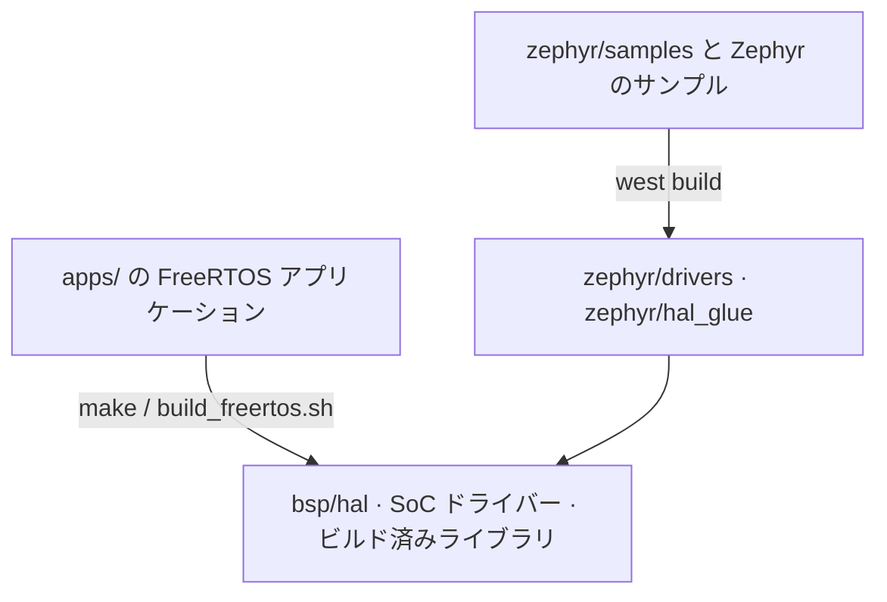

# システムアーキテクチャ

1 つのソースツリーで 2 種類のチップと 2 種類の RTOS に対応します。`apps/` 以下の 40 個の FreeRTOS アプリケーション（IPRO7 と IPRO7AI 用が 37 個、IPRO6S 用が 3 個）と、IPRO7 用の Zephyr v4.4.0 モジュールです。どちらの経路も HAL、SoC ドライバー、ビルド済みライブラリを共有します。ビルドの流れとメモリレイアウトは[ビルドシステムと設定](build-system.md)を参照してください。

!!! abstract "要点"
    - レイヤー：アプリケーション（`apps/`）→ コンポーネント（`components/`）→ RTOS（FreeRTOS V11.1.0 または Zephyr v4.4.0）→ BSP（`bsp/`）→ チップ。
    - IPRO7 と IPRO7AI：DSP 拡張付きの RISC-V RV32IMAFC、LE Audio 対応の BLE 5.4、IEEE 802.15.4。IPRO7AI はさらに NPU と ISP を備えます。ネットワーク接続はイーサネット（RMII）、または SDIO 接続の IPRO6S による Wi-Fi です。IPRO7AI Reef EVK では、この IPRO6S が microSD スロットに挿す FIN カードです。
    - IPRO6S：同じコアにオンチップの Wi-Fi 6 を備え、FreeRTOS のみに対応します。
    - BLE コントローラー、RF ドライバー、Wi-Fi 6 MAC、低消費電力フレームワーク、AI 推論ランタイム、ISP アルゴリズム、LC3 コーデックはビルド済みライブラリとして提供し、それ以外はソースコードで提供します。
    - このサイトのサンプルはすべて IPRO7AI Reef EVK で動作します。他の INTELPRO ボードが必要なアプリケーションには、そのボード名を記載しています。

## システム概要 { #overview }

<div class="ipro-stack">
  <div class="l-app"><strong>アプリケーション apps/</strong><span>ai · bluetooth · multimedia · platform · test</span></div>
  <div class="l-host"><strong>コンポーネント components/</strong><span>BLE ホスト · lwIP · mbedTLS · CherryUSB · audio · ai · fs · shell</span></div>
  <div class="l-hci"><strong>RTOS</strong><span>FreeRTOS V11.1.0 · Zephyr v4.4.0（モジュール、IPRO7）</span></div>
  <div class="l-ctlr"><strong>BSP bsp/</strong><span>HAL · SoC ドライバー · ボード設定 · リンカースクリプト</span></div>
  <div style="--layer: #64748b"><strong>チップ</strong><span>IPRO7／IPRO7AI：BLE 5.4 · 802.15.4 · ISP · NPU — IPRO6S：Wi-Fi 6</span></div>
</div>

| レイヤー | 場所 | 役割 |
|---|---|---|
| アプリケーション | `apps/<category>/<app>/` | 各アプリケーションが独自の `.config`、`CMakeLists.txt`、`Makefile` を持ち、単独でビルドできます |
| コンポーネント | `components/` | ミドルウェアとライブラリ。アプリケーションの `.config` にある `CONFIG_*` キーに応じてビルドに組み込まれます |
| RTOS | `components/os/`、`zephyr/` | FreeRTOS のスケジューリング、キュー、タイマーと共通の `freertos_app_hooks`、または Zephyr カーネル |
| BSP | `bsp/` | HAL API、レジスターと SoC ドライバー、ボードヘッダー、リンカースクリプトジェネレーター |

ビルド済みライブラリは公開ヘッダーとともに提供され、自動的にリンクされます。使用するための設定は不要です。デバッグ情報は削除されていますがシンボル名は残っているため、マップファイルや `nm` は引き続き使えます。

## FreeRTOS と Zephyr { #rtos-paths }



| | FreeRTOS | Zephyr |
|---|---|---|
| アプリケーションとサンプル | `apps/` 以下の 40 個のアプリケーション | `zephyr/samples/` の SDK サンプルと Zephyr アップストリームのサンプル。ドライバーテストは `zephyr/tests/` |
| ビルド | `make -C apps/<category>/<app>` または `./build_freertos.sh` | `tools/zephyr/bootstrap.sh` でワークスペースを作成し、`west build` を実行 |
| チップ | IPRO7、IPRO7AI、IPRO6S | IPRO7、IPRO7AI |
| ボード | IPRO7AI Reef EVK（9 個のアプリケーションで 11 構成）と他の INTELPRO ボード | `ipro7_evb`、`ipro7ai_evk`。本リリースには Reef のボード定義はありません |
| BLE | Zephyr v4.4 ホストを移植レイヤー経由で FreeRTOS 上で動かし、IPRO BLE コントローラー（ビルド済みライブラリ）と組み合わせます | Zephyr のホストと同じコントローラーアーカイブ |
| IEEE 802.15.4／Thread | 提供なし | Zephyr の IEEE 802.15.4 ドライバーと OpenThread |
| 低消費電力、カメラ、オーディオコーデック、USB、SD ホスト、イーサネット、NPU | 提供 | 未対応 |
| コンソール | アプリケーションごとの `CONFIG_PLATFORM_UART_BAUDRATE`。未設定時は 115200 | UART0、2,000,000 baud |

Reef、および低消費電力、カメラ、オーディオ、NPU を必要とする製品では FreeRTOS の経路を使用してください。Zephyr のボード、サンプル、書き込みについては [Zephyr RTOS](zephyr.md) を参照してください。

## コンポーネント { #components }

以下のパスはすべて `components/` 以下です。

| 分野 | パス | 内容 |
|---|---|---|
| Bluetooth | `wireless/bluetooth/ipro_bt_host/` | BLE ホスト。Zephyr v4.4.0 の移植（ソースコード） |
| | `wireless/bluetooth/ipro_ble_controller/` | IPRO7 BLE コントローラー（ビルド済みライブラリ） |
| 無線 | `wireless/rf/ipro7_rf/`、`wireless/rf/ipro6_rf/` | IPRO7 と IPRO6S の RF ドライバー（ビルド済みライブラリ） |
| | `wireless/ieee802154/` | Zephyr 用の IEEE 802.15.4 MAC（ビルド済みライブラリ） |
| Wi-Fi 6（IPRO6S） | `wireless/macsw/`、`wireless/wifi6/` | MAC、fhost API、wpa_supplicant、lwIP アダプター（ビルド済みライブラリ） |
| ネットワーク | `network/lwip/` | lwIP 2.1.2 |
| | `network/ipronet_host/` | SDIO 接続の IPRO6S を介した Wi-Fi の IPRO7 側（netif `iproeth0`）。Reef の FIN カードで使用します |
| | `network/rtsp_server/` | RTSP MJPEG 映像ストリーミング |
| セキュリティ | `crypto/mbedtls/` | mbedTLS 2.28.2 |
| OS | `os/freertos/` | FreeRTOS V11.1.0 カーネルと共通フック（`freertos_app_hooks`） |
| | `os/freertos_posix/`、`os/ipro_osal/` | POSIX レイヤー、OS 抽象化レイヤー |
| システムサービス | `sys/shell/`、`sys/ipro_event/`、`sys/ipro_pm/`、`sys/usb_console/` | シェル、イベントフレームワーク、電源管理、USB コンソール |
| | `utils/` | ログ（`ipro_log.h`）と共通ユーティリティ |
| オーディオ | `audio/` | オーディオの入力と出力（DAC、I2S、UAC）、リサンプリング、スピーカー EQ、MP3 デコード |
| AI | `ai/` | NPU 推論ランタイム（`lib/libai.a` とヘッダー） |
| 画像処理 | `isp_firmware/`、`isp_algorithm/`、`isp_iq_param/`、`isp_iq_cmd/` | ISP 制御、ISP アルゴリズム（ビルド済み）、IQ パラメーター |
| | `sensor/` | カメラセンサードライバー |
| ボードライブラリ | `board/ipro7ai_evk/` | IPRO7AI EVK（別の INTELPRO ボード）用のライブラリ。Reef では使用しません |
| USB | `cherryusb/` | USB デバイスクラス：CDC、CDC-ECM、HID、MSC、UAC、UVC |
| ファイルシステム | `fs/` | FatFS、LittleFS、EasyFlash4、EVFS、ROMFS |
| サードパーティ | `3rdparty/` | LC3（ビルド済み）、SBC、Opus、minimp3、TensorFlow Lite Micro、NMSIS-NN、TinyMaix、cJSON、xz、zmodem、Agora RTC SDK（ビルド済み）など |

IPRO7 がネットワークに接続する方法と、SDIO リンクの反対側で動く IPRO6S のアプリケーションについては[ネットワーク](networking.md)を参照してください。

## ディレクトリ構成 { #directory }

```text
IPRO-SDK-V2.2.0/
├── apps/                    FreeRTOS アプリケーション（40 個）
│   ├── ai/                  NPU と Edge AI のアプリケーション
│   ├── bluetooth/ble/       BLE のサンプル
│   ├── bluetooth/le_audio/  LE Audio ヘッドセット
│   ├── multimedia/          USB ウェブカメラ、JPEG デコード、PDM 録音、クラウド音声
│   ├── platform/            チップとボードのリファレンス、IPRO6S Wi-Fi。common/ には共通の OTA コード
│   ├── test/                ドライバーテスト、ハードウェアの立ち上げ確認、ベンチマーク（19 個）
│   └── turnkey/common/      共通の USB コンソールコード
├── bsp/                     HAL、SoC ドライバー（ipro7_soc、ipro6_soc）、ボード設定、リンカースクリプト
├── components/              ミドルウェアとライブラリ
├── cmake/                   ツールチェーンの検出、ビルドマクロ、autoconf.h ジェネレーター
├── tools/                   serial_monitor.py、create_ota.py、teach_web/、zephyr/ スクリプト、同梱の CMake、Android サンプルアプリのソース
├── zephyr/                  Zephyr モジュール：boards、soc、dts、drivers、samples、tests
├── build_freertos.sh        FreeRTOS のビルド、書き込み、モニターのフロントエンド
├── project.build            各アプリケーションの Makefile から呼ばれるビルドドライバー
├── west.yml                 Zephyr west マニフェスト
├── CMakeLists.txt
├── Kconfig
└── VERSION.txt
```

アプリケーションの全一覧は `./build_freertos.sh -l` を実行するか、[サンプル](../examples/index.md)を参照してください。

## BLE スタック { #ble-stack }

<div class="ipro-stack">
  <div class="l-app"><strong>アプリケーション</strong><span>Zephyr bt_* API</span></div>
  <div class="l-host"><strong>BLE ホスト（Zephyr v4.4.0）</strong><span>ipro_bt_host：GAP · GATT · L2CAP · SMP · ISO · LE Audio</span></div>
  <div class="l-hci"><strong>オンチップ HCI</strong><span>メモリ上のバイトストリーム（ipro_ble_ctlr_hcitl）</span></div>
  <div class="l-ctlr"><strong>IPRO BLE コントローラー（ビルド済みライブラリ）</strong><span>ipro_ble_controller/lib/ · RF ドライバー ipro7_rf</span></div>
</div>

ホストはソースコードで提供され、`ipro_bt_host/port/` レイヤーを介して FreeRTOS 上で動作します。ホストとコントローラーの間に UART HCI はありません。`.config` の 3 つのキーで、16 個ある IPRO7 コントローラーアーカイブのうちリンクする 1 つを選びます。IPRO6S の Bluetooth コントローラーは本リリースに含まれず、IPRO6S のアプリケーションは Wi-Fi のみです。アーカイブの選択、初期化の順序、API の使い方は [BLE 開発](ble.md)を参照してください。

## BSP とドライバー { #bsp }

| パス | 内容 |
|---|---|
| `bsp/hal/` | HAL API（`inc/hal_*.h`、`src/hal_*.c`） |
| `bsp/hal/lp_framework/` | 低消費電力フレームワーク：IPRO7 PDS（ビルド済み `liblp_framework.a`）、IPRO6S 低消費電力ファームウェアイメージ |
| `bsp/drivers/ipro7_soc/` | レジスター定義、スタートアップコード（`startup/`）、標準ドライバー（`std_drv/`）、ビルド済み NMSIS-DSP ライブラリ（`DSP/`） |
| `bsp/drivers/ipro6_soc/` | IPRO6S SoC ドライバー |
| `bsp/drivers/soc_common/` | チップ間で共通のドライバー |
| `bsp/board/ipro7/` | ボードヘッダーと `board.c`。`board_config.h` がボードキーに応じてヘッダーを選び、`CONFIG_IPRO7AI_REEF` には `ipro7ai_reef_board_config.h` を使います（[ボードキー](build-system.md#board-keys)を参照） |
| `bsp/board/ipro6/` | IPRO6S のボードファイル |
| `bsp/board/linker/` | リンカースクリプトジェネレーター（テンプレートと `configs/ipro7_flash.cmake`） |
| `bsp/common/platform_utils/` | プラットフォームの初期化、コンソール UART のボーレート |

HAL が対応する周辺機能：

| 分野 | HAL |
|---|---|
| 通信 | UART、SPI、I2C、I2S、SDIO |
| ストレージ | SPI Flash、PSRAM、SD ホスト（SDH）、PIO によるソフトウェア SD ホスト |
| アナログとタイミング | ADC、DAC、AUADC（オーディオ ADC）、アナログコンパレーター、PWM、タイマー、RTC、ウォッチドッグ |
| 入力 | GPIO、QDEC、キースキャン |
| 画像処理と AI | DVP カメラ、ISP、MJPEG エンコード、NPU |
| ネットワーク | EMAC イーサネット、lwIP netif、イーサネット PHY |
| セキュリティ | AES、SHA、ECDSA、P-256、GMAC、TRNG |
| システム | DMA、クロック、電源管理、boot2 パーティションテーブル |

Reef のピン割り当てやスピーカーのイネーブルなどの定義は、`bsp/board/ipro7/ipro7ai_reef_board_config.h` に `BOARD_*` マクロとして書かれています。ボードのピン配置は [IPRO7AI Reef EVK](../hardware/boards/reef-evk.md#pinout) ページに、チップのピン機能は[ピン配置と周辺機能の対応](../hardware/pinmux.md)にあります。

## Reef でのハンズオン { #hands-on }

出荷時ファームウェア `ipro7ai_reef_demo` で各レイヤーがつながる様子を確認します。その `.config` が RTOS とコンポーネントを選び、`main.c` が共通のプラットフォーム初期化とボードヘッダーを呼び出し、FreeRTOS のシェルが実行時の結果を表示します。

<div class="ipro-steps" markdown>

1. **構成ファイルでレイヤーを選びます。** 出荷時の `.config` のうち、次の行がチップ、ボードヘッダー、FreeRTOS、シェルを選択します。

    ```ini title="apps/platform/ipro7ai_reef_demo/.config（抜粋）"
    CONFIG_IPRO7=y
    CONFIG_CHIP="IPRO7"
    CONFIG_IPRO7AI_REEF=y
    CONFIG_BOARD="IPRO7AI_REEF"
    CONFIG_USE_PSRAM=y
    CONFIG_PLATFORM_UART_BAUDRATE=115200
    CONFIG_FREERTOS_SUPPORT=y
    CONFIG_COMPONENTS_FREERTOS_ENABLE=y
    CONFIG_SHELL=y
    CONFIG_IPRO_LOG_ENABLE=y
    ```

2. **`main()` は各レイヤーに一度ずつ触れます。** `ipro_platform_init()` は `components/os/freertos/freertos_app_hooks` から、`BOARD_*` のピンは `bsp/board/ipro7/` の Reef ボードヘッダーから、タスクは FreeRTOS から来ています。

    ```c title="apps/platform/ipro7ai_reef_demo/main.c（抜粋）"
    int main(void)
    {
        static StackType_t  s_app_stack[2048];
        static StaticTask_t s_app_tcb;

        ipro_platform_init();   /* heap + boot2 + log + shell */
        ...
        IPRO_LOGI(LOG_TAG, "  IPRO7AI Reef carrier demo");
        IPRO_LOGI(LOG_TAG, "  UART0 TX=%d RX=%d  RGB=G%d  SPK_EN=G%d(hi)",
                  BOARD_UART_TX_PIN, BOARD_UART_RX_PIN, BOARD_RGB_LED_PIN, BOARD_SPK_EN_PIN);
        ...
        xTaskCreateStatic(app_task, "evk_app",
                          sizeof(s_app_stack) / sizeof(StackType_t), NULL,
                          configMAX_PRIORITIES - 2,
                          s_app_stack, &s_app_tcb);
        vTaskStartScheduler();
        ...
    }
    ```

3. **ビルドします。**

    ```bash
    make -C apps/platform/ipro7ai_reef_demo
    ```

    リンカーマップ `apps/platform/ipro7ai_reef_demo/build/build_out/ipro7ai_reef_demo_IPRO7.map` に、イメージに組み込まれたすべてのコンポーネントアーカイブが列挙されます。

4. **書き込みます。** [書き込みとシリアルコンソール](../get-started/flash-and-monitor.md)の手順どおりに書き込み、115200 baud でコンソールを開きます。

5. **動作中のシステムを確認します。** 起動時のバナーにボードヘッダーのピンが表示されます（ログのプレフィックスは省略しています）。

    ```text
      IPRO7AI Reef carrier demo
      UART0 TX=20 RX=21  RGB=G24  SPK_EN=G25(hi)
    ```

    続いて、`components/sys/shell` のシェルにある FreeRTOS コマンド `free` と `ps` を入力します。

    ```text
    Heap: total <bytes>, free <bytes>, min free <bytes>

    Task             State  Prio  Stack   #   CPU%
    ---------------------------------------------------
    ```

    タスク一覧には、`main()` で作成したアプリケーションタスク `evk_app` が含まれます。`help` を入力すると、イメージに登録されたすべてのコマンドが表示されます。

</div>

次のステップ：[最初の独自アプリケーションを作る](../tutorials/first-own-app.md)で同じ構造を自分で作り、[アプリケーションのテスト](../tutorials/testing.md)で確認します。

## 関連ドキュメント { #related }

- [ビルドシステムと設定](build-system.md)：ビルドの流れ、`.config`、メモリレイアウト、新しいアプリケーション
- [BLE 開発](ble.md)：アーカイブの選択、初期化の順序、GATT のサンプル
- [ネットワーク](networking.md)：イーサネット、lwIP、SDIO 接続の IPRO6S による Wi-Fi
- [Zephyr RTOS](zephyr.md)：Zephyr のボード、サンプル、書き込み
- [IPRO7AI Reef EVK](../hardware/boards/reef-evk.md)：すべてのサンプルで使用するボード
- [IPRO7](../hardware/chips/ipro7.md)、[IPRO7AI](../hardware/chips/ipro7ai.md)、[IPRO6S](../hardware/chips/ipro6s.md)：チップの仕様
