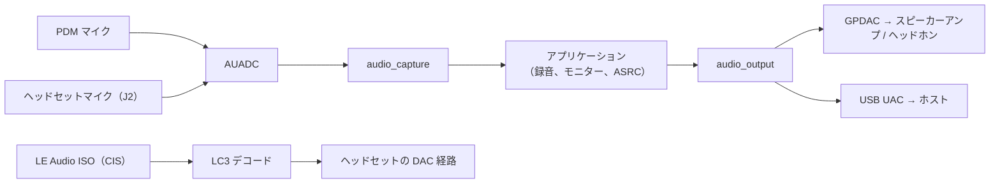
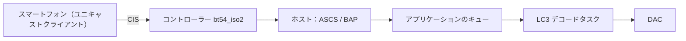

# オーディオと LE Audio

IPRO7 は、アナログマイクと PDM マイク用のオーディオ ADC（AUADC）、10 ビット DAC（GPDAC）、I2S を備えています。SDK はその上に `components/audio` の入力フレームワークと出力フレームワークを置き、LC3 などのコーデック、CherryUSB による USB オーディオ、BLE ホストの LE Audio プロファイルを加えています。IPRO7AI Reef EVK では、出荷時ファームウェア `ipro7ai_reef_demo` がシェルからすべてのオーディオブロックを操作でき、その `src/audio.c` がこのページのリファレンスコードです。

!!! abstract "要点"
    - Reef のオーディオ：PDM マイク、ジャック J2 のヘッドセットマイク、GPDAC から出力するスピーカーアンプとヘッドホン出力。`ipro7ai_reef_demo` で録音、再生、モニター、SD カードへの WAV ファイルの録音（`mic sdrec`）ができ、ボードを USB マイクにすること（`mic usb`）もできます。
    - 構成：`CONFIG_AUDIO_CAPTURE=y`、`CONFIG_AUDIO_OUTPUT=y`、`CONFIG_DMA_CHANNEL_ALLOCATOR=y`。USB オーディオには `CONFIG_CHERRYUSB_DEVICE_AUDIO=y` を追加します。
    - LE Audio：ユニキャストヘッドセット `ipro_le_audio_headset`（`defconfig_reef`）、`CONFIG_EM_SIZE=32` の `bt54_iso2` コントローラー、ビルド済みライブラリの LC3。その README では、スマートフォンからのオーディオ再生は未検証とされています。
    - V2.2.0 に含まれないもの：FreeRTOS の LE Audio ブロードキャストのサンプル、USB から BLE へのオーディオブリッジ。

## アーキテクチャ { #overview }



| 部分 | 場所 | 説明 |
|---|---|---|
| オーディオ HAL | `bsp/hal/inc/hal_auadc.h`、`hal_dac.h`、`hal_i2s.h` | オーディオ ADC、DAC、I2S |
| 入力 | `components/audio/include/audio_capture.h` | アナログマイク（`AUDIO_SRC_AMIC`）、PDM マイク（`AUDIO_SRC_DMIC`）、I2S（`AUDIO_SRC_I2S`）から 16 ビットモノラルの PCM フレームへ。複数のコンシューマーがそれぞれ自分のコピーを読み出します |
| 出力 | `components/audio/include/audio_output.h` | `AUDIO_OUTPUT_DAC`、`AUDIO_OUTPUT_UAC`、`AUDIO_OUTPUT_I2S`、`AUDIO_OUTPUT_DUMP` に共通の API |
| 処理 | `audio_resampler.h`、`audio_asrc.h`、`audio_speaker_eq.h`、`audio_bass_boost.h`、`mp3_decoder.h` | リサンプリング、レベルコントローラー付きのクロックドリフト補正リサンプラー、スピーカー EQ、低音強調、MP3 デコード |
| コーデック | `components/3rdparty/liblc3`（ビルド済み）、`libsbc`、`opus`、`minimp3` | LC3 は LE Audio で使用 |
| LE Audio | `components/wireless/bluetooth/ipro_bt_host/upstream/zephyr/subsys/bluetooth/audio/` | Zephyr v4.4.0 の LE Audio プロファイルのソース |
| USB オーディオ | `components/cherryusb/class/audio/` | USB Audio Class デバイス |

## オーディオハードウェア { #audio-hardware }

IPRO7AI Reef EVK V4.0 のオーディオブロックと、コードで使うボードヘッダーの名前（`bsp/board/ipro7/ipro7ai_reef_board_config.h`）：

| ブロック | ピン | ボードヘッダー |
|---|---|---|
| PDM マイク MK1 | CLK GPIO16、DATA GPIO17、左スロット | `BOARD_MIC_CLK_PIN`、`BOARD_MIC_DAT_PIN`、`BOARD_MIC_PDM_CHANNEL` |
| ヘッドセットマイク（ジャック J2） | AIN7（GPIO13）+、AIN6（GPIO12）−、差動 | `BOARD_HSMIC_POS_CH`、`BOARD_HSMIC_NEG_CH` |
| GPDAC 出力 | DAC チャネル A、GPIO23。ヘッドホン段（J2）とスピーカーアンプに同時に出力 | `BOARD_SPK_DAC_PIN` |
| スピーカーアンプ PAM8302A（J_SPK） | イネーブル GPIO25、High = オン | `BOARD_SPK_EN_PIN`、`BOARD_SPK_EN_ACTIVE`（1） |
| ヘッドセットプラグの検出 | GPIO26、Low = プラグ挿入 | `BOARD_HP_DET_PIN`、`BOARD_HP_DET_ACTIVE`（0） |

- ヘッドホンジャックには常に DAC の信号が出力されます。「ヘッドホンのみ」とはスピーカーアンプをオフにしておくことで、それ以外に経路を切り替えるスイッチはありません。
- PDM の経路は 16,000 Hz ちょうどではなく、約 15,872 Hz で動作します。`mic sdrec` は測定したレートを WAV ヘッダーに書き込み、`mic usb` は `audio_asrc` でホストの 16,000 Hz に変換します。
- `audio_output` の DAC バックエンドは 32 kHz 固定で動作します（`audio_capture.h` の `DAC_RATE`）。それ以外のサンプリングレートはリサンプリングされます。
- アンプのゲインは高く（デモの README では 30 V/V）、デモはデフォルトで振幅 20 % でトーンを再生します。
- `CONFIG_DMA_CHANNEL_ALLOCATOR=y` を設定してください。入力、再生、USB のアイソクロナスエンドポイントが、衝突することなく実行時に DMA チャネルを取得できます。

ジャックの種類、コネクター、ピン配置の全体は [IPRO7AI Reef EVK](../hardware/boards/reef-evk.md) ページにあります。IPRO7 EVB と IPRO7AI EVK には独自のオーディオサンプル（`ipro_pdm_mic_demo`、`ipro7ai_evk_demo`）があります。それぞれのボードのページを参照してください。

## オーディオフレームワーク { #audio-framework }

```ini title=".config（オーディオ、apps/platform/ipro7ai_reef_demo/.config から）"
CONFIG_AUDIO_OUTPUT=y
CONFIG_AUDIO_CAPTURE=y
CONFIG_DMA_CHANNEL_ALLOCATOR=y
# audio_output の UAC バックエンドによる USB マイク
CONFIG_COMPONENTS_CHERRYUSB_ENABLE=y
CONFIG_CHERRYUSB_DEVICE=y
CONFIG_CHERRYUSB_DEVICE_AUDIO=y
```

| キー | 効果 |
|---|---|
| `CONFIG_AUDIO_CAPTURE` | `audio_capture.c` と PDM マイクのチェーン `audio_pdm_mic.c` をビルド |
| `CONFIG_AUDIO_OUTPUT` | DAC とダンプのバックエンドを含む `audio_output.c` をビルド |
| `CONFIG_CHERRYUSB_DEVICE_AUDIO` | `CONFIG_AUDIO_OUTPUT` と組み合わせると、UAC バックエンド `audio_output_uac.c` もビルド |
| `CONFIG_AUDIO_OUTPUT_UAC_EXCLUDE` | 独自の USB オーディオデバイスを実装するアプリケーション向けに、UAC バックエンドを除外（両方が `usbd_audio_*` コールバックを定義してしまうため） |
| `CONFIG_BSP_USING_I2S0` | `CONFIG_AUDIO_OUTPUT` と組み合わせると、I2S バックエンドをビルド |

リサンプラー、クロックドリフト補正リサンプラー（`audio_asrc`）、スピーカー EQ、低音強調は常にビルドされます。

各部分の使い方：

- `audio_capture_init()` は `audio_capture_cfg_t`（ソースの種類、サンプリングレート、フレームサイズ、PDM またはアナログの設定）を受け取ります。`audio_capture_add_consumer()` は専用のバッファーを持つコンシューマー ID を返し、`audio_capture_start()` が DMA を開始し、`audio_capture_read(id, buf, bytes, timeout_ms)` が PCM を返します。
- `audio_output_create()` は `audio_output_cfg_t` を受け取ります。`AUDIO_OUTPUT_MODE_STREAMING` では循環 DMA リングから連続して再生し、`audio_output_write(out, pcm, samples)` はリングがいっぱいのときに短時間だけブロックします。`AUDIO_OUTPUT_MODE_ONESHOT` ではバッファー全体の再生が終わるまでブロックします。`audio_output_write()` の 3 番目の引数はバイト数ではなく、チャネルあたりのサンプル数です。
- DAC バックエンドでは、アンプのイネーブルピンとそのアクティブレベル（`dac_spk_gpio`、`dac_spk_en_active`）を渡します。`audio_output_start()` がアンプをオンにします。

## Reef でのハンズオン { #hands-on }

PDM マイクから 3 秒間録音してヘッドホンで再生し、続いて SD カードに WAV ファイルを録音し、ボードを USB マイクとして使います。すべて `ipro7ai_reef_demo` で動作します。抜粋は、独自のアプリケーションで再利用するコードです。

<div class="ipro-steps" markdown>

1. **構成**

    デモの `.config` のオーディオ関連の行（[オーディオフレームワーク](#audio-framework)に掲載）と Reef ボードの行があれば、アプリケーションに必要なものはそろいます。

    ```ini title="apps/platform/ipro7ai_reef_demo/.config（抜粋）"
    CONFIG_IPRO7AI_REEF=y
    CONFIG_BOARD="IPRO7AI_REEF"
    CONFIG_USE_PSRAM=y
    CONFIG_AUDIO_OUTPUT=y
    CONFIG_AUDIO_CAPTURE=y
    CONFIG_DMA_CHANNEL_ALLOCATOR=y
    ```

2. **コード**

    PDM マイクと DAC 出力を開く部分です。ピンとレベルのマクロは Reef のボードヘッダーから来ています。

    ```c title="apps/platform/ipro7ai_reef_demo/src/audio.c（抜粋）"
    static audio_output_t *sink_open(uint32_t rate, audio_route_t route)
    {
        audio_output_cfg_t cfg = {
            .type             = AUDIO_OUTPUT_DAC,
            .mode             = AUDIO_OUTPUT_MODE_STREAMING,
            .sample_rate      = rate,
            .channels         = 1,
            .dac_spk_gpio     = BOARD_SPK_EN_PIN,
            .dac_spk_en_active = BOARD_SPK_EN_ACTIVE ? 1 : -1,
        };
        audio_output_t *out = audio_output_create(&cfg);

        if (!out) {
            IPRO_LOGE(LOG_TAG, "audio_output_create failed");
            return NULL;
        }
        if (audio_output_start(out) != 0) {
            IPRO_LOGE(LOG_TAG, "audio_output_start failed");
            audio_output_destroy(out);
            return NULL;
        }
        /* start() switched the amplifier on; the route decides whether it stays. */
        route_apply(route);
        return out;
    }

    static int capture_open(audio_in_t src, uint32_t consumer_bytes, int *consumer)
    {
        audio_capture_cfg_t cfg = {
            .sample_rate   = AUDIO_RATE_HZ,          /* 16000 */
            .frame_samples = AUDIO_FRAME_SAMPLES,    /* 320 = 20 ms */
        };

        switch (src) {
        case AUDIO_IN_PDM:
            cfg.type = AUDIO_SRC_DMIC;
            cfg.dmic.clk_pin         = BOARD_MIC_CLK_PIN;
            cfg.dmic.data_pin        = BOARD_MIC_DAT_PIN;
            cfg.dmic.channel         = (uint8_t)s_pdm_ch;
            cfg.dmic.digital_gain_db = MIC_DIGITAL_GAIN_DB;   /* 18.0f */
            break;
        case AUDIO_IN_HSMIC:
            cfg.type = AUDIO_SRC_AMIC;
            cfg.amic.single_ended = 0;
            cfg.amic.pos_ch       = BOARD_HSMIC_POS_CH;
            cfg.amic.neg_ch       = BOARD_HSMIC_NEG_CH;
            cfg.amic.gain_db      = HSMIC_ANALOG_GAIN_DB; /* 24 */
            break;
        /* ... */
        }

        if (audio_capture_init(&cfg) != 0) {
            return -1;
        }
        *consumer = audio_capture_add_consumer(consumer_bytes);
        if (*consumer < 0) {
            audio_capture_deinit();
            return -1;
        }
        if (audio_capture_start() != 0) {
            audio_capture_deinit();
            return -1;
        }
        return 0;
    }
    ```

    ライブモニター（`mic loop`）は、フレームを入力から出力へ移します。

    ```c title="apps/platform/ipro7ai_reef_demo/src/audio.c（do_loop からの抜粋）"
    while (!s_stop_req && (frames == 0 || done < frames)) {
        size_t got = audio_capture_read(consumer, chunk, sizeof(chunk), 200);
        if (got == 0) {
            IPRO_LOGW(LOG_TAG, "capture stalled");
            break;
        }
        gain_apply(chunk, got / sizeof(int16_t));
        audio_output_write(out, chunk, got / sizeof(int16_t));
        done++;
    }
    ```

    同じコードを独自のアプリケーションで使うには、`ipro_ble_remote` が Reef 用ビルドで行っているように、デモの `src/audio.c` を `CMakeLists.txt` に追加します（`audio.c` が呼び出す `rgb_led.c`、`keys.c`、`sdcard.c` も列挙されています）。アプリケーションの作成については[最初の独自アプリケーションを作る](../tutorials/first-own-app.md)を参照してください。

3. **ビルド**

    ```bash
    make -C apps/platform/ipro7ai_reef_demo
    ```

    出力：`apps/platform/ipro7ai_reef_demo/build/build_out/ipro7ai_reef_demo_IPRO7.bin`

4. **書き込み**

    Reef をダウンロードモードにし（SW1 を押したまま SW2 を短く押し、SW1 を離します）、IntelProCube のディレクトリから書き込みツールを実行します。

    ```bash
    cd <ICUBE>
    ./ipro_iot_tool_macos --chipname ipro7 --chip-variant IPRO7AI \
        --port /dev/cu.usbserial-XXXX --baudrate 921600 \
        --pt chips/ipro7/partition/partition_cfg_2M.toml \
        --firmware <SDK>/apps/platform/ipro7ai_reef_demo/build/build_out/ipro7ai_reef_demo_IPRO7.bin
    ```

    `[All Success]` を確認し、SW2 を押します。他のホストや `build_freertos.sh` については[書き込みとシリアルコンソール](../get-started/flash-and-monitor.md)を参照してください。

5. **実行と確認**

    ヘッドホンを J2 に挿し、U6 のコンソールを 115200 baud で開きます。起動時のバナーは、コマンドグループを列挙する `REEF: shell ready` の行で終わります。続いて次のように入力します。

    ```text
    ipro /> spk tone 1000 500
    1000 Hz for 500 ms at 20% -> speaker+headphone
    ipro /> mic rec pdm 3
    recording 3 s from pdm...
    I (…) AUDIO: recorded 48000 samples from pdm: peak … dBFS, rms … dBFS, dc …, voice band (300-3400 Hz) rms … dBFS; first 100 ms left out (peak there … dBFS)
    ipro /> mic play hp
    playing 48000 samples, +20 dB
    ```

    トーンがスピーカーとヘッドホンから聞こえ、続いて録音した音声がヘッドホンからのみ聞こえます（`hp` はアンプをオフのままにします）。FAT でフォーマットした microSD カードをスロットに挿している場合：

    ```text
    ipro /> mic sdrec pdm take1 10
    recording 10 s from pdm to sd:/rec/take1.wav (LED red; `mic stop` ends it)
    I (…) AUDIO: sdrec: sd:/rec/take1.wav … samples (10 s) at … Hz, measured … Hz, peak … dBFS, stalls 0
    ipro /> mic usb pdm
    USB microphone from pdm: 16 kHz mono UAC on the board's USB-C (LED red; `mic stop` ends it)
    ```

    `mic usb` の実行中は、Reef の USB-C に接続したコンピューターから USB マイク（VID 0x3896、PID 0x0003）として認識され、録音できます。`mic status` で USB キューのレベルを確認でき、`mic stop` で終了します。

</div>

これらの確認を繰り返し実行できるテストにするには、[アプリケーションのテスト](../tutorials/testing.md)を参照してください。

## LE Audio { #le-audio-pipeline }

LE Audio は ISO チャネルで LC3 オーディオを伝送します。ユニキャストには CIS、ブロードキャストには BIS を使います。受信側のデータ経路は次のとおりです。



`.config` に必要な設定（`ipro_le_audio_headset/defconfig_reef` からの抜粋）：

```ini title="apps/bluetooth/le_audio/ipro_le_audio_headset/defconfig_reef（抜粋）"
CONFIG_BT_CTLR_IPRO=y
CONFIG_IPRO_BLE_CTLR_LIB="link1_periph"
CONFIG_IPRO_BLE_CTLR_FEATURE="bt54_iso2"
CONFIG_IPRO_BLE_CTLR_CFG_DBG=y
CONFIG_EM_SIZE=32
CONFIG_BT_CONN=1
CONFIG_BT_SETTINGS=y
CONFIG_BT_AUDIO=y
CONFIG_BT_AUDIO_RX=y
CONFIG_COMPONENTS_LC3_ENABLE=y
```

ビルドは Kconfig の依存関係を解決しないため、この抜粋ではなく `defconfig_reef` 全体から始めてください。このファイルは BAP、PACS、ASCS、ISO、CAP、CSIP、VCP も有効にしています。コントローラーアーカイブのルールは [BLE 開発](ble.md#controller-variants)を参照してください。

### ユニキャストヘッドセット { #unicast-audio }

`apps/bluetooth/le_audio/ipro_le_audio_headset` は `IPRO-LE-Audio` としてアドバタイズします。LE Audio のユニキャストクライアントが接続し、ボードへの CIS を確立します。

!!! info "本リリースでの状況"
    アプリケーションの README では、これは完成したヘッドセットではなく、LE Audio プロファイルと ISO 受信経路の立ち上げとして説明されています。CIS の確立と ISO 受信経路は 2 台のボードによるテストで検証済みですが、スマートフォンからのオーディオ再生は未検証とされています。

| 項目 | 詳細 |
|---|---|
| ロール | BAP ユニキャストサーバー、PACS、ASCS（シンク ASE のみ）、CSIP セットメンバーを兼ねる CAP アクセプター、VCP ボリュームレンダラー |
| PACS の機能 | LC3、16/32/48 kHz、7.5/10 ms フレーム、モノラル、1 フレームあたり 26～155 オクテット |
| セキュリティ | SMP ペアリング。`CONFIG_BT_SETTINGS` でボンディング情報を Flash に保存 |
| コントローラー | `link1_periph` / `bt54_iso2`、32 KB の EM、デバッグ版アーカイブ（`CONFIG_IPRO_BLE_CTLR_CFG_DBG=y`） |

```bash
make -C apps/bluetooth/le_audio/ipro_le_audio_headset DEFCONFIG=defconfig_reef   # 出力は build_reef/build_out/
```

Reef では、`defconfig_reef` は DAC 版です。出力は GPDAC へ送られ（J2 のヘッドホン、J2 にプラグが挿さっていないときはスピーカーアンプ）、VCP ボリュームレンダラーを通じて SW3 と SW4 で音量を下げ／上げ、SW5 でミュートします。このアプリケーションの他の構成（`.config`、`DAC.config`、`UAC.config`）は IPRO7 EVB 向けにビルドされます。ビルド、ペアリング、確認事項は [LE Audio 入門](../tutorials/le-audio.md)を参照してください。

`src/bap_server.c` が PACS と ASCS を登録する部分（抜粋。ログと条件付きコンパイルを省略して簡略化しています。`unicast_server_cb` は同じファイルで定義されています）：

```c title="apps/bluetooth/le_audio/ipro_le_audio_headset/src/bap_server.c（抜粋）"
static const struct bt_audio_codec_cap lc3_sink_codec_cap =
	BT_AUDIO_CODEC_CAP_LC3(BT_AUDIO_CODEC_CAP_FREQ_16KHZ |
				       BT_AUDIO_CODEC_CAP_FREQ_32KHZ |
				       BT_AUDIO_CODEC_CAP_FREQ_48KHZ,
			       BT_AUDIO_CODEC_CAP_DURATION_7_5 |
				       BT_AUDIO_CODEC_CAP_DURATION_10 |
				       BT_AUDIO_CODEC_CAP_DURATION_PREFER_10,
			       BT_AUDIO_CODEC_CAP_CHAN_COUNT_SUPPORT(1),
			       26, 155, 1,
			       BT_AUDIO_CONTEXT_TYPE_MEDIA |
				       BT_AUDIO_CONTEXT_TYPE_CONVERSATIONAL);

static struct bt_pacs_cap lc3_sink_cap = {
	.codec_cap = &lc3_sink_codec_cap,
};

int bap_server_init(void)
{
	struct bt_pacs_register_param pacs_param = {
		.snk_pac = true,
		.snk_loc = true,
	};
	struct bt_bap_unicast_server_register_param server_param = {
		.snk_cnt = CONFIG_BT_ASCS_MAX_ASE_SNK_COUNT,
		.src_cnt = CONFIG_BT_ASCS_MAX_ASE_SRC_COUNT,
	};
	int err;

	err = bt_pacs_register(&pacs_param);                     /* 1. PACS service */
	if (err != 0 && err != -EALREADY) {
		return err;
	}
	err = bt_pacs_cap_register(BT_AUDIO_DIR_SINK, &lc3_sink_cap);  /* 2. LC3 capability */
	if (err != 0) {
		return err;
	}
	err = bt_pacs_set_location(BT_AUDIO_DIR_SINK, BT_AUDIO_LOCATION_FRONT_LEFT);
	if (err != 0) {
		return err;
	}
	bt_pacs_set_supported_contexts(BT_AUDIO_DIR_SINK,
				       BT_AUDIO_CONTEXT_TYPE_MEDIA |
				       BT_AUDIO_CONTEXT_TYPE_CONVERSATIONAL |
				       BT_AUDIO_CONTEXT_TYPE_UNSPECIFIED);
	bt_pacs_set_available_contexts(BT_AUDIO_DIR_SINK,
				       BT_AUDIO_CONTEXT_TYPE_MEDIA |
				       BT_AUDIO_CONTEXT_TYPE_CONVERSATIONAL |
				       BT_AUDIO_CONTEXT_TYPE_UNSPECIFIED);

	err = bt_bap_unicast_server_register(&server_param);      /* 3. ASCS endpoints */
	if (err != 0 && err != -EALREADY) {
		return err;
	}
	return bt_bap_unicast_server_register_cb(&unicast_server_cb);  /* 4. BAP callbacks */
}
```

### ブロードキャスト { #broadcast-audio }

本リリースには BIS ブロードキャストを行う FreeRTOS アプリケーションはありません。ホストには `bt_bap_broadcast_source_*` と `bt_bap_broadcast_sink_*` の API が含まれており、`zephyr/samples/bap_broadcast_source` と `bap_broadcast_sink` が IPRO7 EVB と IPRO7AI EVK 上の Zephyr でそれらを示しています。Reef 用の Zephyr ボードはありません（[Zephyr RTOS](zephyr.md) を参照）。

### プロファイル { #audio-profiles }

ホストの `subsys/bluetooth/audio/` には、Zephyr v4.4.0 の LE Audio プロファイル（BAP、CAP、PACS、ASCS、VCP、CSIP、MICP、MCP、TMAP など）のソースがあります。ヘッドセットが有効にしているもの：

| プロファイル | `.config` | ロール |
|---|---|---|
| BAP | `CONFIG_BT_BAP_UNICAST_SERVER=y` | ユニキャストサーバー |
| PACS | `CONFIG_BT_PACS=y`、`CONFIG_BT_PAC_SNK=y` | シンクの機能を公開 |
| ASCS | `CONFIG_BT_ASCS=y` | オーディオストリームのエンドポイント |
| CAP | `CONFIG_BT_CAP_ACCEPTOR=y` | アクセプター |
| CSIP | `CONFIG_BT_CSIP_SET_MEMBER=y` | セットメンバー |
| VCP | `CONFIG_BT_VCP_VOL_REND=y` | ボリュームレンダラー |

### LC3 { #lc3 }

- ビルド済みライブラリ `components/3rdparty/liblc3/lib/libliblc3.a` とヘッダー `lc3.h`。`CONFIG_COMPONENTS_LC3_ENABLE=y` で追加します。
- ビットレートは 16～320 kbps（`LC3_MIN_BITRATE`、`LC3_MAX_BITRATE`）。
- `components/3rdparty` にある他のコーデック：SBC（`libsbc`）、Opus（`opus`、`ipro_agora_sentino` が使用）、minimp3。

## USB オーディオ { #usb-audio }

USB オーディオは、Reef の USB-C（Full Speed）で CherryUSB の UAC デバイスクラスを使います。

```ini
CONFIG_COMPONENTS_CHERRYUSB_ENABLE=y
CONFIG_CHERRYUSB_DEVICE=y
CONFIG_CHERRYUSB_DEVICE_AUDIO=y
```

`CONFIG_AUDIO_OUTPUT=y` も設定すると、`audio_output` に UAC バックエンドが加わります。`.type = AUDIO_OUTPUT_UAC` で出力を作成し、DAC と同じように PCM を書き込みます。`ipro7ai_reef_demo` は 2 つのコマンドでこれを使っています。

| コマンド | USB デバイス | 動作 |
|---|---|---|
| `mic usb <pdm\|headset>` | 16 kHz モノラルのマイク | 選択したマイクの音声をホストへストリーミングします。入力は、UAC キューを約 1,800 サンプルに保つレベルコントローラー付きの `audio_asrc` を通るため、遅い PDM クロックでもホスト側でアンダーランが起きません |
| `mic usb host` | 16 kHz モノラルのスピーカーとマイク | デジタル注入用のループバック。ホストがボードに再生した音声が、weak フック `audio_usbhost_process()` を通ってマイクとして戻ります |

どちらも VID 0x3896、PID 0x0003 として認識されます。独自の USB オーディオデバイスを実装するアプリケーションは `CONFIG_AUDIO_OUTPUT_UAC_EXCLUDE=y` を設定します。IPRO7 EVB のサンプル `ipro_pdm_mic_demo` と、`ipro_le_audio_headset` の `UAC.config` は、それぞれ独自の UAC デバイスを持っています。

## PDM 録音 { #pdm-recording }

`ipro7ai_reef_demo` は PDM マイク（`pdm`）またはヘッドセットマイク（`headset`）から録音します。

| コマンド | 録音先 | 上限 |
|---|---|---|
| `mic rec <src> <s>` | PSRAM、16 kHz モノラル。`mic play [hp]` でメイクアップゲインをかけて再生 | 10 秒 |
| `mic sdrec <src> <name> <s>` | `sd:/rec/<name>.wav`、16 ビットモノラル。ヘッダーには測定したレートが入ります | 2 時間 |
| `mic loop <src> [s] [hp]` | 出力へのライブモニター。時間を省略すると `mic stop` まで実行 | — |

- `mic gain <dB>` で再生時のメイクアップゲイン（0～40 dB、デフォルト 20 dB）を設定し、`mic ch <0|1>` で PDM のスロットを選択します。
- `mic status` は、直前の録音のピーク、RMS、音声帯域（300～3,400 Hz）のレベルを dBFS で表示します。デシメーターはステップ状に立ち上がるため、開始後最初の 100 ms はこれらの値から除外されます。
- `mic sdrec` は 30 秒ごとにファイルをフラッシュするため、電源を切っても失われるのは最大で最後の 30 秒です。測定したレートが 15,875 Hz から大きく外れている場合は、サンプルの欠落として報告されます。
- マイクの音をスピーカーでモニターするとハウリングが起きます。ヘッドホンと `hp` を使ってください。

IPRO7 EVB と IPRO7AI EVK 用の PDM 録音のサンプルは `ipro_pdm_mic_demo` です（LC3 による BLE 転送、Android コンパニオンアプリのソースは `tools/android/IproMicDemo/`）。

## 本リリースの制限事項 { #limitations }

- `ipro_le_audio_headset`：スマートフォンからのオーディオ再生は未検証です（README を参照）。ヘッドセットにはソース ASE がなく、マイクの音声は送り返しません。
- FreeRTOS の LE Audio ブロードキャストのサンプルはありません。ブロードキャストは IPRO7 EVB と IPRO7AI EVK 用の Zephyr サンプルとしてのみ存在します。
- `bt54_iso2` には 32 KB 以上の EM が必要ですが、コントローラーの PDS スリープは 16 KB の EM プロファイルにしか対応していないため、LE Audio の構成ではコントローラーは PDS に入りません。
- Reef V4.0 にはライン入力がありません。デモの README にある `aux` ソースと AUX-IN の記述は、以前のボードについてのものです。
- USB から BLE へのオーディオブリッジのサンプルは含まれていません。

## 関連するサンプルとドキュメント { #reference-apps }

| サンプル | Reef の構成 | 内容 |
|---|---|---|
| `ipro7ai_reef_demo` | `.config` | スピーカー、ヘッドホン、PDM マイクとヘッドセットマイク、SD カードへの録音、USB マイク。[ipro7ai_reef_demo](../examples/ipro7ai_reef_demo.md) を参照 |
| `ipro_le_audio_headset` | `defconfig_reef` | LE Audio ユニキャストヘッドセット、DAC 版。[ipro_le_audio_headset](../examples/ipro_le_audio_headset.md) を参照 |
| `ipro_ble_remote` | `defconfig_reef` | Reef のハードウェアサービスでデモの `audio.c` を再利用 |
| `ipro_reef_teach` | `.config` | `voice` モード：PDM マイクによる話者認識。[声紋認識](../teach/voice.md)を参照 |

- [LE Audio 入門](../tutorials/le-audio.md)
- [BLE 開発](ble.md)：コントローラーの選択、初期化の順序、GATT
- [オーディオ API](../reference/api/audio.md)
- [IPRO7AI Reef EVK](../hardware/boards/reef-evk.md)：ジャック、スピーカーコネクター、ピン
