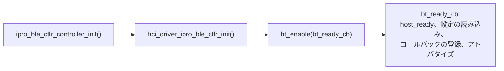

# BLE 開発

FreeRTOS アプリケーションの BLE は 2 つの部分で構成されます。Zephyr v4.4.0 の BLE ホスト（ソースコード）と IPRO BLE コントローラー（ビルド済みライブラリ）です。アプリケーションは Zephyr のコールバック方式の `bt_*` API で書き、`.config` の 3 つのキーで 16 個のコントローラーアーカイブのうちどれをリンクするかを選びます。このページのコード例は、IPRO7AI Reef EVK 向けに `defconfig_reef` でビルドした `apps/bluetooth/ble/ipro_ble_remote` から取っています。

!!! abstract "要点"
    - ホスト：Zephyr v4.4.0。GAP、GATT、L2CAP、SMP、ISO、LE Audio を含みます。ホストとコントローラーはオンチップの HCI で通信し、間に UART はありません。
    - コントローラー：16 個の IPRO7 アーカイブ（`link1_periph` / `link1` / `link2` / `link4` × `bt52` / `bt54_iso2` × debug / release）。`CONFIG_IPRO_BLE_CTLR_LIB`、`CONFIG_IPRO_BLE_CTLR_FEATURE`、`CONFIG_IPRO_BLE_CTLR_CFG_DBG` で選択します。
    - 初期化の順序：`ipro_ble_ctlr_controller_init()` → `hci_driver_ipro_ble_ctlr_init()` → `bt_enable()`。
    - Reef の BLE 構成：`DEFCONFIG=defconfig_reef` を指定した `ipro_ble_remote`、`ipro_throughput_test`、`ipro_le_audio_headset`、および `ipro_agora_sentino`（BLE プロビジョニング）。
    - V2.2.0 に含まれないもの：コントローラーのソースコード、PAwR/ESL アプリケーション、IPRO6S の BLE コントローラー。

## スタックのアーキテクチャ { #stack-architecture }

<div class="ipro-stack">
  <div class="l-app"><strong>アプリケーション</strong><span>Zephyr bt_* API：GAP · GATT · SMP · LE Audio</span></div>
  <div class="l-host"><strong>BLE ホスト（Zephyr v4.4.0）</strong><span>ipro_bt_host：GAP · GATT · L2CAP · SMP · ISO</span></div>
  <div class="l-hci"><strong>オンチップ HCI</strong><span>メモリ上のバイトストリーム（ipro_ble_ctlr_hcitl）</span></div>
  <div class="l-ctlr"><strong>IPRO BLE コントローラー（ビルド済みライブラリ）</strong><span>Link Layer · 1M / 2M / Coded PHY</span></div>
</div>

```text title="components/wireless/bluetooth/"
ipro_bt_host/
├── upstream/zephyr/        Zephyr v4.4.0 ホストのソース（include/、subsys/bluetooth/）
├── port/                   FreeRTOS への移植：HCI ドライバー、カーネルインターフェース、設定の保存、暗号
└── tinycrypt/
ipro_ble_controller/
├── include/                公開ヘッダー ipro_ble_controller.h
├── hcitl/                  オンチップ HCI トランスポート
├── plf/ipro7/              コントローラー API のヘッダー（初期化、低消費電力、NVDS）
├── lib/                    16 個のビルド済み IPRO7 アーカイブ
└── cmake/                  アーカイブの選択ルール（ipro7_build.cmake）
```

すべての BLE アプリケーションの `.config` に次の行が必要です。

```ini
CONFIG_BLUETOOTH_LE_ENABLE=y
CONFIG_BT_CTLR_IPRO=y
CONFIG_BT_HOST_IPRO_V44=y
```

`CONFIG_BT_CTLR_IPRO` または `CONFIG_BT_HOST_IPRO_V44` がないと、CMake の構成段階でビルドが停止します。ホストとコントローラーのコンポーネントは自身のインクルードパスをエクスポートするため、`CMakeLists.txt` に `zephyr/bluetooth/*.h` のパスを追加する必要はありません。

Zephyr RTOS のイメージは、Zephyr 自身のホストと同じコントローラーアーカイブを使います。V2.2.0 の Zephyr には IPRO7 EVB と IPRO7AI EVK のボードしかありません。[Zephyr RTOS](zephyr.md) を参照してください。

## コントローラーの選択 { #controller-variants }

| 設定 | 値 | 未設定時 | 意味 |
|---|---|---|---|
| `CONFIG_IPRO_BLE_CTLR_LIB` | `link1_periph`、`link1`、`link2`、`link4` | `link1_periph` | `link1_periph` はペリフェラルとブロードキャスターのロールのみ。それ以外は数字が接続数です |
| `CONFIG_IPRO_BLE_CTLR_FEATURE` | `bt52`、`bt54_iso2` | `bt52` | `bt54_iso2` は ISO チャネル（LE Audio）を追加します |
| `CONFIG_IPRO_BLE_CTLR_CFG_DBG` | `y` または未設定 | 未設定 | 未設定では `_release` アーカイブを、`y` ではデバッグ版アーカイブをリンクします |

アーカイブ名は `libipro_ble_controller_ipro7_<LIB>[_bt54_iso2][_release].a` の形式です。`bt52` には機能の接尾辞が付きません。`lib/` にある 16 個のアーカイブ：

| LIB | `bt52` | `bt52` release | `bt54_iso2` | `bt54_iso2` release |
|---|---|---|---|---|
| `link1_periph` | `…_link1_periph.a` | `…_link1_periph_release.a` | `…_link1_periph_bt54_iso2.a` | `…_link1_periph_bt54_iso2_release.a` |
| `link1` | `…_link1.a` | `…_link1_release.a` | `…_link1_bt54_iso2.a` | `…_link1_bt54_iso2_release.a` |
| `link2` | `…_link2.a` | `…_link2_release.a` | `…_link2_bt54_iso2.a` | `…_link2_bt54_iso2_release.a` |
| `link4` | `…_link4.a` | `…_link4_release.a` | `…_link4_bt54_iso2.a` | `…_link4_bt54_iso2_release.a` |

構成時のチェック：

- `CONFIG_EM_SIZE`（BLE Exchange Memory、KB 単位）を設定する必要があります。
- `bt54_iso2` には 32 以上の `CONFIG_EM_SIZE` が必要です。
- 不明な `LIB` または `FEATURE` の値はビルドを停止させます。

`CONFIG_BT_CONN`（ホストの接続数）は、アーカイブの接続数を超えてはなりません。Exchange Memory は OCRAM の最上部に予約されます。[メモリレイアウト](build-system.md#memory-layout)を参照してください。

V2.2.0 に同梱されている Reef 用構成は、出発点として適しています。

| アプリケーションと構成 | LIB | FEATURE | デバッグ版アーカイブ | `CONFIG_BT_CONN` | `CONFIG_EM_SIZE` |
|---|---|---|---|---|---|
| `ipro_ble_remote` `defconfig_reef` | `link1_periph` | `bt52` | いいえ | 1 | 16 |
| `ipro_throughput_test` `defconfig_reef` | `link2` | `bt52` | いいえ | 2 | 32 |
| `ipro_le_audio_headset` `defconfig_reef` | `link1_periph` | `bt54_iso2` | はい | 1 | 32 |
| `ipro_agora_sentino` `.config` | `link1_periph` | `bt52` | いいえ | 1 | 16 |

`ipro_ble_transparent`、`ipro_ble_hid_keyboard`、`ipro_pdm_mic_demo` は IPRO7 EVB と IPRO7AI EVK 用の BLE サンプルで、Reef 向けにはビルドできません。

```ini title="apps/bluetooth/ble/ipro_ble_remote/defconfig_reef（抜粋）"
CONFIG_BLUETOOTH_LE_ENABLE=y
CONFIG_BT_CTLR_IPRO=y
CONFIG_IPRO_BLE_CTLR_LIB="link1_periph"
CONFIG_IPRO_BLE_CTLR_FEATURE="bt52"
CONFIG_EM_SIZE=16
CONFIG_BT_CONN=1
CONFIG_BT_PERIPHERAL=y
CONFIG_BT_OBSERVER=y
CONFIG_BT_BROADCASTER=y
CONFIG_PHY_UPDATE=y
CONFIG_BT_DATA_LEN_UPDATE=y
CONFIG_BT_HOST_IPRO_V44=y
CONFIG_BT_SMP=y
CONFIG_BT_GATT_CLIENT=y
CONFIG_ENABLE_NVDS=y
CONFIG_CFG_NVDS=y
```

ビルドは Kconfig の依存関係を解決しないため、最も近い出荷時アプリケーションの構成ファイル全体をコピーして編集してください。[ビルドシステムと設定](build-system.md)を参照してください。

## 初期化の順序 { #bring-up }



```c title="apps/bluetooth/ble/ipro_ble_remote/src/app/remote_app.c（抜粋、エラー処理は省略）"
ipro_ble_ctlr_controller_init(configMAX_PRIORITIES - 1);
vTaskDelay(pdMS_TO_TICKS(50));
hci_driver_ipro_ble_ctlr_init();
vTaskDelay(pdMS_TO_TICKS(50));
bt_enable(bt_ready_cb);
```

- これはスケジューラーの開始後に FreeRTOS タスクから実行してください。`vTaskDelay()` の呼び出しにはそれが必要です。
- `ipro_ble_ctlr_controller_init()` はコントローラーのタスクを作成します。コントローラーには無線の厳しいデッドラインがあるため、アプリケーションのタスクより高い優先度を与えてください。出荷時のアプリケーションは `configMAX_PRIORITIES - 1` を使っています。成功すると 0、コントローラーがすでに動作している場合は -1、タスクを作成できなかった場合は -2 を返します。
- `bt_ready_cb` では、最初に `ipro_ble_ctlr_hcitl_host_ready()` を呼び出します。これは HCI の初期化が完了したことをコントローラーに伝え、イベント間のスリープを可能にします。
- `CONFIG_BT_SETTINGS` を使う場合は、アドバタイズを開始する前に `bt_ready_cb` で `settings_load_subtree("bt")` を呼び出してボンディング情報を読み込みます。
- Reef には 32.768 kHz の水晶発振子がありません。`ipro_throughput_test` の README によると、コントローラーはまず 32 kHz クロックを検証し、その後 RC32K にフォールバックする（ログに `XTAL32K rejected` と表示される）ため、Reef ではリセットから約 7 秒後に BLE の準備完了の行が表示されます。

## API の使い方 { #api-patterns }

以下の 3 つのコード片を順番に 1 つの `.c` ファイルに入れると、コンパイルできます。これらは `ipro_ble_remote` の `src/services/remote_services.c` と `src/app/remote_app.c` から取っています。アプリケーションは Zephyr のコールバック方式の API を使い、コントローラー内部のメッセージングは公開されていません。

### GATT サービス { #gatt-service }

`BT_GATT_SERVICE_DEFINE` はコンパイル時にサービスを定義します。このサービスは、読み出しと通知ができる温度を公開します（UUID は `ipro_ble_remote` の環境サービスのもので 0xFF30/0xFF31。Reef ではオンチップの温度センサーの値を返します）。

```c title="GATT サービス"
#include <FreeRTOS.h>
#include <task.h>

#include <zephyr/bluetooth/bluetooth.h>
#include <zephyr/bluetooth/conn.h>
#include <zephyr/bluetooth/gatt.h>
#include <zephyr/bluetooth/uuid.h>
#include <zephyr/settings/settings.h>
#include <hci_driver_ipro_ble_ctlr.h>
#include <ipro_ble_controller.h>

#define BT_UUID_ENV_SVC   BT_UUID_DECLARE_16(0xFF30)
#define BT_UUID_ENV_TEMP  BT_UUID_DECLARE_16(0xFF31)

static int16_t temperature = 2500;      /* 0.01 °C */
static bool temp_notify_enabled;

static ssize_t temp_read(struct bt_conn *conn, const struct bt_gatt_attr *attr,
                         void *buf, uint16_t len, uint16_t offset)
{
    return bt_gatt_attr_read(conn, attr, buf, len, offset,
                             &temperature, sizeof(temperature));
}

static void temp_ccc_changed(const struct bt_gatt_attr *attr, uint16_t value)
{
    temp_notify_enabled = (value == BT_GATT_CCC_NOTIFY);
}

BT_GATT_SERVICE_DEFINE(env_svc,
    BT_GATT_PRIMARY_SERVICE(BT_UUID_ENV_SVC),
    BT_GATT_CHARACTERISTIC(BT_UUID_ENV_TEMP,
                           BT_GATT_CHRC_READ | BT_GATT_CHRC_NOTIFY,
                           BT_GATT_PERM_READ,
                           temp_read, NULL, NULL),
    BT_GATT_CCC(temp_ccc_changed, BT_GATT_PERM_READ | BT_GATT_PERM_WRITE),
);

/* attr_env_svc[1] は温度キャラクタリスティックの宣言。
 * bt_gatt_notify() はその直後の値の属性を使う */
static int notify_temperature(struct bt_conn *conn)
{
    if (!temp_notify_enabled) {
        return 0;
    }
    return bt_gatt_notify(conn, &attr_env_svc[1], &temperature, sizeof(temperature));
}
```

### アドバタイズと接続 { #gap-connection }

```c title="アドバタイズと接続のコールバック"
#define DEVICE_NAME     "IPRO-Remote"
#define DEVICE_NAME_LEN (sizeof(DEVICE_NAME) - 1)

static struct bt_conn *current_conn;

static const struct bt_data ad[] = {
    BT_DATA_BYTES(BT_DATA_FLAGS, (BT_LE_AD_GENERAL | BT_LE_AD_NO_BREDR)),
    BT_DATA(BT_DATA_NAME_COMPLETE, DEVICE_NAME, DEVICE_NAME_LEN),
};

static int start_advertising(void)
{
    struct bt_le_adv_param adv_param = {
        .id = BT_ID_DEFAULT,
        .options = BT_LE_ADV_OPT_CONN,   /* 接続可能 */
        .interval_min = 160,             /* 100 ms（0.625 ms 単位） */
        .interval_max = 320,             /* 200 ms */
    };

    return bt_le_adv_start(&adv_param, ad, ARRAY_SIZE(ad), NULL, 0);
}

static void connected(struct bt_conn *conn, uint8_t err)
{
    if (err) {
        return;
    }
    current_conn = bt_conn_ref(conn);
    (void)notify_temperature(current_conn);
}

static void disconnected(struct bt_conn *conn, uint8_t reason)
{
    (void)conn;
    (void)reason;
    if (current_conn) {
        bt_conn_unref(current_conn);
        current_conn = NULL;
    }
    /* このコールバックはホストスレッドで実行されるため、ブロックしてはならない。
     * ipro_ble_remote はここではなく、500 ms 後に FreeRTOS タイマーからアドバタイズを再開する。 */
}

static struct bt_conn_cb conn_callbacks = {
    .connected = connected,
    .disconnected = disconnected,
};
```

本リリースのホストには `BT_LE_ADV_CONN_NAME` マクロがありません。上の例のようにデバイス名をアドバタイズデータに入れるか、`BT_LE_ADV_CONN_FAST_1` などホストで定義済みのパラメーターマクロを使ってください。

### 起動 { #ble-init }

```c title="初期化"
static void bt_ready_cb(int err)
{
    if (err) {
        return;
    }
    ipro_ble_ctlr_hcitl_host_ready();

#if defined(CONFIG_BT_SETTINGS)
    (void)settings_load_subtree("bt");
#endif
    bt_conn_cb_register(&conn_callbacks);
    (void)start_advertising();
}

/* アプリケーションのタスクから呼び出す */
int ble_init(void)
{
    int err;

    err = ipro_ble_ctlr_controller_init(configMAX_PRIORITIES - 1);
    if (err) {
        return err;
    }
    vTaskDelay(pdMS_TO_TICKS(50));

    err = hci_driver_ipro_ble_ctlr_init();
    if (err) {
        return err;
    }
    vTaskDelay(pdMS_TO_TICKS(50));

    return bt_enable(bt_ready_cb);
}
```

- ボンディング情報を Flash に保存するには、`CONFIG_BT_SETTINGS=y` と `CONFIG_EASYFLASH4=y` を設定します（ホストの設定の保存には EasyFlash が使われ、パーティションテーブルの `PSM` パーティションに保存されます）。`ipro_le_audio_headset` の `defconfig_reef` はこのように設定しています。`ipro_ble_remote` の `defconfig_reef` はボンディング情報を保存しません。
- 接続後にスループットを上げるため、`ipro_ble_remote` は `connected` で `bt_gatt_exchange_mtu()` により MTU を交換し、`CONFIG_BT_USER_DATA_LEN_UPDATE` が有効な場合は `bt_conn_le_data_len_update()` で 251 バイトの DLE を要求します。

## Reef でのハンズオン { #hands-on }

`ipro_ble_remote` を Reef 向けにビルドし、スマートフォンまたはコンピューターから接続して、GATT 経由で Reef の RGB LED の色を変えます。必要なものは、U6 にコンソールケーブルを接続した Reef、IntelProCube のコマンドラインツール（以下 `<ICUBE>`）、そして汎用の BLE アプリ（nRF Connect、LightBlue）を入れたスマートフォン、または Python と Bluetooth が使える macOS/Linux のコンピューターです。

<div class="ipro-steps" markdown>

1. **構成を確認します**

    `defconfig_reef` は出荷時の状態で完結しています。ここで重要なのは次の行です。2 MB の Flash と boot2 パーティションテーブルを使う Reef ボードの設定、アプリケーションの OTA スイッチ、BLE のブロックです。新しい Reef 用 BLE アプリケーションでは、ボードと BLE の行を残します。`CONFIG_IPRO_BLE_REMOTE_OTA` は `ipro_ble_remote` 専用です。

    ```ini title="apps/bluetooth/ble/ipro_ble_remote/defconfig_reef（抜粋）"
    CONFIG_IPRO7AI_REEF=y
    CONFIG_IPRO7_FLASH_2M=y
    CONFIG_PARTITION=y
    CONFIG_IPRO_BLE_REMOTE_OTA=y

    CONFIG_BLUETOOTH_LE_ENABLE=y
    CONFIG_BT_CTLR_IPRO=y
    CONFIG_IPRO_BLE_CTLR_LIB="link1_periph"
    CONFIG_IPRO_BLE_CTLR_FEATURE="bt52"
    CONFIG_EM_SIZE=16
    CONFIG_BT_CONN=1
    CONFIG_BT_PERIPHERAL=y
    CONFIG_BT_BROADCASTER=y
    CONFIG_BT_HOST_IPRO_V44=y
    CONFIG_BT_SMP=y
    ```

2. **書き込むキャラクタリスティックを確認します**

    Reef 専用のサービス 0xFF80 には、LED Colour キャラクタリスティック 0xFF81 があります。R、G、B の 3 バイトです。その書き込みハンドラーは長さをチェックし、色をログに出力して LED ドライバーに渡します。

    ```c title="apps/bluetooth/ble/ipro_ble_remote/src/services/reef_service.c（抜粋）"
    static ssize_t color_write(struct bt_conn *conn, const struct bt_gatt_attr *attr,
                               const void *buf, uint16_t len, uint16_t offset, uint8_t flags)
    {
        const uint8_t *d = buf;

        (void)conn; (void)attr; (void)flags;
        if (offset != 0u) {
            return BT_GATT_ERR(BT_ATT_ERR_INVALID_OFFSET);
        }
        if (len != sizeof(s_ctx.rgb)) {
            return BT_GATT_ERR(BT_ATT_ERR_INVALID_ATTRIBUTE_LEN);
        }
        memcpy(s_ctx.rgb, d, sizeof(s_ctx.rgb));
        IPRO_LOGI(LOG_TAG, "[LED] Colour %u,%u,%u", d[0], d[1], d[2]);
        if (s_ctx.h.led_color) {
            s_ctx.h.led_color(d[0], d[1], d[2]);
        }
        return len;
    }

    BT_GATT_SERVICE_DEFINE(reef_svc,
        BT_GATT_PRIMARY_SERVICE(BT_UUID_REEF_SVC),
        BT_GATT_CHARACTERISTIC(BT_UUID_REEF_LED_COLOR,
                               BT_GATT_CHRC_READ | BT_GATT_CHRC_WRITE,
                               BT_GATT_PERM_READ | BT_GATT_PERM_WRITE,
                               color_read, color_write, NULL),
        /* ... キーイベント、音量レベル、トーン、ボード情報のキャラクタリスティック ... */
    );
    ```

    このファイルでは `LOG_TAG` は `"REEF_SVC"` です。独自のキャラクタリスティックも同じ方法で追加できます。`BT_GATT_CHARACTERISTIC` のエントリを 1 つと、読み出しまたは書き込みのハンドラーを追加します。

3. **ビルドします**

    ```bash
    make -C apps/bluetooth/ble/ipro_ble_remote DEFCONFIG=defconfig_reef
    ```

    出力：`apps/bluetooth/ble/ipro_ble_remote/build_reef/build_out/ipro_ble_remote_IPRO7.bin`。

4. **boot2 と A/B パーティションテーブルとともに書き込みます**

    Reef をダウンロードモードにします（SW1 BOOT を押したまま SW2 RESET を短く押し、SW1 を離します。または、動作中のコンソールで `reboot_dl` と入力します）。続いて IntelProCube のディレクトリから書き込みます。

    ```bash
    cd <ICUBE>
    ./ipro_iot_tool_macos --chipname ipro7 --chip-variant IPRO7AI \
        --port /dev/cu.usbserial-XXXX --baudrate 921600 \
        --boot2 chips/ipro7/builtin_imgs/boot2_v0.6.0/ipro_boot2_IPRO7_v0.6.0.bin \
        --pt <SDK>/apps/bluetooth/ble/ipro_ble_remote/partition_cfg_2M_remote_ab.toml \
        --firmware <SDK>/apps/bluetooth/ble/ipro_ble_remote/build_reef/build_out/ipro_ble_remote_IPRO7.bin
    ```

    このツールは書き込みに失敗しても終了コード 0 を返します。`[All Success]` が表示されることを確認してください。SW2（RESET）を押します。このパーティションテーブルは [OTA アップデート](ota.md)で使うものと同じです。書き込みの詳細は[書き込みとシリアルコンソール](../get-started/flash-and-monitor.md)を参照してください。

5. **コンソールを確認して接続します**

    115200 baud でコンソールを開きます。boot2 のバナー `[BOOT2] IPRO7 Boot2 v0.6.0` のあと、アプリケーションが他の行に混じって次の行を出力します（ログのプレフィックスは省略しています）。

    ```text
    [BLE] Initialized
    [BLE] Services ready
    [OTA] Service ready
    [BLE] All services initialized
    [BLE] Advertising: IPRO-Remote
    ```

    `IPRO-Remote` に接続し、キャラクタリスティック 0xFF81 に `FF 00 00` を書き込みます。コンソールに `Connected! Peer: …`、続いて `[LED] Colour 255,0,0` が表示されます。0xFF11（LED State）に `01` を書き込むと、LED がその色で点灯します。スマートフォンがない場合は、同梱の bleak テストをコンピューターで実行します。色を書き込み、ボード情報を読み返します。

    ```bash
    python3 -m venv .venv && .venv/bin/pip install bleak
    .venv/bin/python apps/bluetooth/ble/ipro_ble_remote/tools/reef_ble_test.py info led
    ```

    `board info:` と `LED colour [255, 0, 0] …` が表示され、LED が赤く点滅します。コンソールで `reef status` と入力すると、ボード側から同じ状態を確認できます。

</div>

次のステップ：[最初の独自アプリケーションを作る](../tutorials/first-own-app.md)で Reef の構成から独自のアプリケーションを始め、[アプリケーションのテスト](../tutorials/testing.md)のコンソールとホストスクリプトで確認します。Android アプリを使った GATT の詳しい手順は[最初の BLE アプリケーション](../tutorials/first-ble-app.md)にあります。

## 性能とスループット { #throughput }

`ipro_throughput_test` の README に記載の測定値です。条件は、`defconfig_reef`（`link2` コントローラー）を実行する 2 台の Reef EVK、ATT MTU 247、DLE 251 オクテット、244 バイトのペイロード、50 ms の接続間隔、`CONFIG_IPRO7_BLE_HOTCODE=y` です。

| PHY | 片方向スループット |
|---|---|
| 2M | 1.34 Mbps |
| 1M | 747 kbps |

- `CONFIG_IPRO7_BLE_HOTCODE=y` は、コントローラー、ホスト、FreeRTOS カーネルのパケットごとの処理経路を OCRAM から実行します。代わりに OCRAM を約 88 KB 消費します。同じ条件でこれを使わない場合（コードは Flash 上）、2M PHY で約 0.6 Mbps です。
- このオプションは、AI と画像処理を組み合わせた OCRAM レイアウトや低消費電力の設定（`CONFIG_HAL_LP`、`CONFIG_IPRO_PM_*`、`CONFIG_OCRAM_NORET_SPLIT`）とは併用できません。リンカースクリプトジェネレーターが拒否します。
- 大量のデータには、2M PHY、30～50 ms の接続間隔、244 バイトのペイロードを使ってください。

テストはコンソールから `tp slave`、`tp master`、`tp conn`、`tp phy`、`tp start` で操作します。[BLE スループットテスト](../tutorials/ble-throughput.md)を参照してください。

## LE Audio { #le-audio }

LE Audio には `CONFIG_IPRO_BLE_CTLR_FEATURE="bt54_iso2"` と `CONFIG_EM_SIZE=32` に加えて、`CONFIG_BT_AUDIO=y` と BAP、PACS、ASCS などのロール設定が必要です。LC3 は `CONFIG_COMPONENTS_LC3_ENABLE=y` で組み込まれます。ホストの LE Audio ヘッダーは `ipro_bt_host/upstream/zephyr/include/zephyr/bluetooth/audio/` にあります。同梱の FreeRTOS サンプルはユニキャストヘッドセット `ipro_le_audio_headset` で、`DEFCONFIG=defconfig_reef` で Reef 向けにビルドできます。構成、プロファイル、オーディオ経路、現在の状況は[オーディオと LE Audio](audio.md)を参照してください。

## 低消費電力 { #low-power }

- `ipro_ble_remote` の `defconfig_reef` は PDS を使いません。Reef は USB 給電で動作し、カメラとオーディオにはクロックが必要なためです。
- コントローラーの PDS スリープは 16 KB の EM プロファイルでのみ受け付けられます。`bt54_iso2`（32 KB の EM）では、コントローラーは本来のスリープは維持しますが PDS には入りません。
- `CONFIG_IPRO_PM_BLE` と `CONFIG_IPRO_PM_PDS_CONNECTED` はコントローラーのソースビルドを強制しますが、V2.2.0 ではソースビルドはできません。[制限事項](#limitations)を参照してください。
- PDS31 スリープとボンディング済みデバイスへの再接続を伴う BLE は、IPRO7 EVB / IPRO7AI EVK 用のサンプル `ipro_pdm_mic_demo` で示されています。

スリープモード、ウェイクアップ要因、測定については[低消費電力](low-power.md)を参照してください。

## 本リリースの制限事項 { #limitations }

- コントローラーはビルド済みライブラリとしてのみ提供され、ソースコードは V2.2.0 に含まれていません。次の設定はコントローラーのソースビルドを必要とし、ビルドを停止させます：`CONFIG_IPRO_BLE_CTLR_FORCE_SOURCE_BUILD`、`CONFIG_IPRO_BLE_CTLR_SUBRATING`、`CONFIG_IPRO_BLE_CTLR_CSSA`、`CONFIG_IPRO_PM_BLE`、`CONFIG_IPRO_PM_PDS_CONNECTED`。
- PAwR と ESL：ホストのヘッダーには周期的アドバタイズの API が含まれていますが、PAwR/ESL のアプリケーションはありません。V2.2.0 には含まれていません。INTELPRO にお問い合わせください。
- `ipro_ble_remote` の OTA サービスは `defconfig_reef` でのみ有効です。デフォルトの `.config` は OTA なしの IPRO7 EVB 用イメージをビルドします。
- IPRO6S の BLE コントローラーは V2.2.0 に含まれていません。このパッケージの IPRO6S アプリケーションは Wi-Fi のみです。

## リファレンスアプリケーション { #reference-apps }

| アプリケーション（Reef 用ビルド） | 内容 |
|---|---|
| `ipro_ble_remote`（`DEFCONFIG=defconfig_reef`） | Reef 用の GATT サービス：WS2812 LED、キー、オンチップ温度、UART、動き検出付きの OV5640 JPEG キャプチャー、画像のアップロード、PDM マイクのレベル、トーン、BLE OTA。Android アプリ `ipro_remote_demo.apk` とホストスクリプト `tools/reef_ble_test.py`、`tools/reef_ota.py` を同梱 |
| `ipro_throughput_test`（`DEFCONFIG=defconfig_reef`） | 2 台のボードによるスループットテスト：1M / 2M / Coded PHY、DLE、MTU 247 |
| `ipro_le_audio_headset`（`DEFCONFIG=defconfig_reef`） | LE Audio ユニキャストヘッドセット |
| `ipro_agora_sentino`（`.config`） | クラウド音声アプリケーション用の BLE プロビジョニング。Wi-Fi は IPRO6S FIN カード経由 |

`ipro_ble_transparent`（AT 形式のデータパイプ）、`ipro_ble_hid_keyboard`（HID over GATT）、`ipro_pdm_mic_demo` は IPRO7 EVB または IPRO7AI EVK 向けにのみビルドできます。

- [最初の BLE アプリケーション](../tutorials/first-ble-app.md)
- [BLE スループットテスト](../tutorials/ble-throughput.md)
- [OTA アップデート](ota.md)
- [オーディオと LE Audio](audio.md)
- [API リファレンス](../reference/api/index.md)
