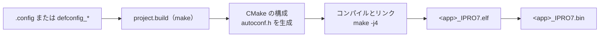

# ビルドシステムと設定

FreeRTOS アプリケーションは、`make` が CMake を駆動してビルドします。アプリケーションの `.config` ファイルにはすべての `CONFIG_*` 設定が並んでおり、ビルド時にこれが C ヘッダー `autoconf.h` に変換され、コンパイルするコンポーネントの選択にも使われます。このページではその流れと Reef 用構成のビルド方法を説明します。Zephyr は `west` でビルドします。[Zephyr RTOS](zephyr.md) を参照してください。

!!! abstract "要点"
    - ビルドは `make -C apps/<category>/<app>` または `./build_freertos.sh build <app>` で行います。イメージは `build/build_out/<app>_<CONFIG_CHIP>.bin` で、IPRO7 と IPRO7AI のアプリケーションは `_IPRO7.bin`、IPRO6S のアプリケーションは `_IPRO6.bin` です。
    - `.config` はそのまま読み込まれます。Kconfig ファイルはオプションの説明にすぎず、`select`、`depends on`、デフォルト値は適用されません。唯一の例外は Reef の水晶発振子トリムで、`.config` に記載がない場合はビルドが 95 を設定します。
    - Reef 向けのビルドの多くは別構成です。`DEFCONFIG=defconfig_reef` を指定すると `build_reef/` にビルドされます。単に `make` を実行して Reef 向けにビルドされるのは `ipro7ai_reef_demo`、`ipro_reef_teach`、`ipro_agora_sentino` だけです。
    - リリースパッケージでは `make menuconfig` と `make defconfig` は動作しません。`.config` または `defconfig_*` ファイルをテキストエディターで編集してください。
    - ツールチェーン（GCC 14、`/opt/toolchain/riscv_ipro7/`）は SDK に含まれていません。INTELPRO から入手してください。

## ビルドの流れ { #build-pipeline }



コマンドはすべて SDK のルートディレクトリで実行します。

```bash
make -C apps/platform/ipro7ai_reef_demo          # 出荷時ファームウェアをビルド
make -C apps/platform/ipro7ai_reef_demo clean    # build/ を削除
./build_freertos.sh -l                           # 全アプリケーションをカテゴリー別に一覧表示
./build_freertos.sh build ipro7ai_reef_demo      # 名前を指定してビルド。ログは build/build.log に出力
```

ビルド中に行われること：

1. アプリケーションの `Makefile` が `make -C <SDK> -f project.build PROJECT_PATH=<app dir>` を実行します。プロジェクト名はアプリケーションのディレクトリ名です。
2. `project.build` が構成ファイルから `CONFIG_CPU_ID` と `CONFIG_CROSS_COMPILE` を読み取り、CMake を探します。まず `PATH` 上の `cmake`、次に同梱の `tools/cmake/`（CMake 3.15、Linux x86-64 専用）です。どちらもない場合は `No cmake found` で停止します。
3. CMake が Unix Makefiles ジェネレーターでビルドディレクトリを構成します。`cmake/generate_autoconf.cmake` が構成ファイルから `include/generated/autoconf.h` を書き出し、続いて `bsp/`、`components/`、アプリケーションディレクトリが追加されます。
4. `make -j4` でコンパイルとリンクを行います。SDK のコンポーネントライブラリの大半は `-Werror` 付きでコンパイルされるため、その中で警告が 1 つでも出るとビルドが停止します。最後にリンカーが各メモリ領域の使用量を表示し、`objcopy` が `.bin` を生成します。
5. エディターのコードインデックス用に、`compile_commands.json` が SDK のルートにコピーされます。

CMake の開始前に `[INFO] Build Path: <dir>` と `CPU: intelpro_ipro7` が表示されるので、どのディレクトリとツールチェーンターゲットが使われるかがわかります。

### ツールチェーンのプレフィックス { #toolchain }

コンパイラーのプレフィックスは、次のうち最初に設定されているものが使われます。

1. 環境変数または make のコマンドラインで指定した `CROSS_COMPILE`：`make -C <app> CROSS_COMPILE=<dir>/bin/riscv64-unknown-elf-`。
2. 構成ファイルの `CONFIG_CROSS_COMPILE`。出荷時の構成の多くは `/opt/toolchain/riscv_ipro7/bin/riscv64-unknown-elf-` を設定しています。
3. `/opt/toolchain/riscv_ipro7/bin/riscv64-unknown-elf-`（Windows を除く）。

`cmake/toolchain.cmake` はこのプレフィックスに `gcc`、`g++`、`ld`、`objcopy` を付け加えるだけで、他のパスは検索しません。次に DSP 拡張命令を試しにコンパイルし、コンパイラーが受け付ければ DSP 用のフラグを追加し、受け付けなければ標準 GCC 用のフラグを使います。

リリースパッケージがビルドホストとして記載しているのは、bash シェルを使う macOS と Linux です。`project.build` には Windows 用の分岐がありますが（構成ファイルを `python` で解析し、`PATH` 上の `cmake` を使います）、そこではデフォルトのプレフィックスを設定しないため、`CROSS_COMPILE` を必ず指定する必要があります。`build_freertos.sh` と `tools/serial_monitor.py` には POSIX シェルが必要です。

### 出力ファイル { #outputs }

`build/build_out/`（別構成の場合は `build_<name>/build_out/`）に出力されます。

| ファイル | 内容 |
|---|---|
| `<app>_<CHIP>.elf` | シンボル付きのイメージ。デバッグと `size` 用 |
| `<app>_<CHIP>.bin` | 書き込むバイナリー |
| `<app>_<CHIP>.map` | リンカーマップ |
| `<app>_<CHIP>.asm` | 逆アセンブル結果。`CONFIG_GENERATE_ASM=y` の場合のみ |

`<CHIP>` は `CONFIG_CHIP` の値です。IPRO7 と IPRO7AI のすべての構成（Reef を含む）では `IPRO7`、`ipro6_demo`、`ipro6_if_wifi`、`ipro6_fmac` では `IPRO6` です。`build_freertos.sh` のその他のアクションとオプションは[ツールのコマンドライン](../reference/tools.md)を参照してください。

## .config ファイル { #configuration }

`.config` は Linux カーネル形式で、1 行に 1 つの設定を書きます。ビルドは次のように変換します。

| `.config` | `autoconf.h` |
|---|---|
| `CONFIG_SHELL=y` | `#define CONFIG_SHELL 1` |
| `CONFIG_EM_SIZE=16` | `#define CONFIG_EM_SIZE 16` |
| `CONFIG_CHIP="IPRO7"` | `#define CONFIG_CHIP "IPRO7"` |
| `# CONFIG_EASYFLASH4 is not set` または `CONFIG_X=n` | `#undef`、定義されない |
| その他のコメント行 | C のコメント |

各設定は `-D` としてコンパイラーにも渡され、同じ名前の CMake 変数にも設定されます。そのため、アプリケーションの `CMakeLists.txt` で `if(CONFIG_SHELL)` を直接判定できます。

オプションの説明はルートの `Kconfig`、`bsp/Kconfig`、`components/**/Kconfig`、および一部のアプリケーションの `Kconfig` にありますが、ビルドが読むのは構成ファイルだけで、Kconfig は評価されません。その結果：

- `select` は効果がありません。たとえば `CONFIG_IPRO7AI_REEF` と `CONFIG_MM_SUPPORT` は Kconfig で `USE_PSRAM` を select しますが、構成ファイルには `CONFIG_USE_PSRAM=y` を明記する必要があります。
- Kconfig のデフォルト値は適用されません。ファイルに記載のないオプションは設定されません。
- ただし、デフォルト値が 1 つだけビルドによって補われます。Reef で構成に `CONFIG_IPRO7_XTAL_CAPCODE` がない場合、`bsp/board/ipro7/CMakeLists.txt` が `-DCONFIG_IPRO7_XTAL_CAPCODE=95` を追加し、`[board] IPRO7AI Reef: CONFIG_IPRO7_XTAL_CAPCODE=95 (board default)` と表示します。構成に明示した値が優先され、`0` はチップの起動時の値をそのまま使います。これはコンパイラーの定義であり、`autoconf.h` の行ではありません。
- 新しい構成は、空のファイルからではなく、最も近い出荷時の構成から始めてください。

### ボードキー { #board-keys }

ボードキーは、`board_config.h` を通じて `bsp/board/ipro7/` のボードヘッダーを選択します。必ず 1 つだけ設定してください。`board_config.h` はキーを決まった順序で判定し、`CONFIG_EVB` / `CONFIG_DVK` と `CONFIG_IPRO7AI_EVK` は `CONFIG_IPRO7AI_REEF` より先に判定されます。`CONFIG_EVB=y` と `CONFIG_IPRO7AI_REEF=y` の両方を設定した構成は、何のメッセージもなく IPRO7 EVB 向けにビルドされます。

| キー | ボードヘッダー |
|---|---|
| `CONFIG_IPRO7AI_REEF=y` | `ipro7ai_reef_board_config.h`（IPRO7AI Reef EVK） |
| `CONFIG_EVB=y`、`CONFIG_IPRO7AI_EVK=y`、`CONFIG_IPRO7_ARDUINO=y` など | 他の INTELPRO ボード |

出荷時の Reef 構成はすべて `CONFIG_IPRO7AI_REEF=y` と `CONFIG_BOARD="IPRO7AI_REEF"` を設定し、他のボードキーは設定していません。

### よく使う設定 { #common-settings }

| 設定 | 意味 |
|---|---|
| `CONFIG_IPRO7=y`、`CONFIG_CHIP="IPRO7"` | チップ。`CONFIG_CHIP` は出力ファイル名の接尾辞にもなります（IPRO6S では `CONFIG_IPRO6=y`、`CONFIG_CHIP="IPRO6"`） |
| `CONFIG_CPU_ID="intelpro_ipro7"` | ツールチェーンのターゲット。両チップ共通 |
| `CONFIG_CROSS_COMPILE="…/riscv64-unknown-elf-"` | ツールチェーンのプレフィックス。[ツールチェーンのプレフィックス](#toolchain)を参照 |
| `CONFIG_IPRO7AI_REEF=y`、`CONFIG_BOARD="IPRO7AI_REEF"` | ボード。[ボードキー](#board-keys)を参照 |
| `CONFIG_FREERTOS_SUPPORT=y` | FreeRTOS を使用 |
| `CONFIG_LINK_FLASH=y` | コードを Flash から直接実行（XIP） |
| `CONFIG_IPRO7_FLASH_2M=y`（または `_4M`、`_8M`） | リンク時の Flash サイズ。未設定時は 1 MB |
| `CONFIG_USE_PSRAM=y` | 8 MB の PSRAM を有効化 |
| `CONFIG_PLATFORM_UART_BAUDRATE=115200` | コンソールのボーレート。未設定時は 115200 |
| `CONFIG_SHELL=y` | コンソールのシェル |
| `CONFIG_MM_SUPPORT=y` | ISP、カメラ、MJPEG。`CONFIG_USE_PSRAM=y` も設定してください |
| `CONFIG_AI_SUPPORT=y` | NPU 推論ランタイム。`CONFIG_USE_PSRAM=y` も設定してください |
| `CONFIG_BLUETOOTH_LE_ENABLE=y` | BLE。コントローラーとホストの設定は [BLE 開発](ble.md)を参照 |

ビルド後、ビルドディレクトリの `include/generated/autoconf.h` で実際に有効になった値を確認できます。`make -C apps/bluetooth/ble/ipro_ble_remote DEFCONFIG=defconfig_reef` の場合：

```c title="apps/bluetooth/ble/ipro_ble_remote/build_reef/include/generated/autoconf.h（抜粋）"
#define CONFIG_IPRO7 1
#define CONFIG_CHIP "IPRO7"
#define CONFIG_IPRO7AI_REEF 1
#define CONFIG_BOARD "IPRO7AI_REEF"
#define CONFIG_IPRO7_FLASH_2M 1
/* CONFIG_EASYFLASH4 is not set */
#undef CONFIG_EASYFLASH4
#define CONFIG_IPRO_BLE_REMOTE_OTA 1
#define CONFIG_IPRO_BLE_CTLR_LIB "link1_periph"
#define CONFIG_EM_SIZE 16
```

### 構成ツール { #config-tools }

| ツール | リリースパッケージでの状況 |
|---|---|
| テキストエディター | `.config` または `defconfig_*` ファイルを直接編集します。これがサポートされている方法です |
| `make menuconfig` | 動作しません。同梱されていない `tools/kconfig/menuconfig.py` が必要なうえ、アプリケーションの Makefile がこのターゲットを転送しません |
| `make defconfig`、`make list-defconfigs` | 一部の Makefile（たとえば `ipro_ble_remote`）にはこれらのターゲットがあります。同梱されていない `configs/` ディレクトリを探したあと、アプリケーションのローカルの `defconfig` を `.config` に上書きコピーします |
| `make savedefconfig`、`make show-config` | それぞれ `.config` を `defconfig` にコピー、`.config` を表示します |
| `tools/script/parse_kconfig_dynamic.py` | Kconfig のツリーを JSON で出力します（`kconfiglib` が必要）。ビルドでは使われません |

## 別構成 { #variants }

複数のボードや機能に対応するアプリケーションは、複数の構成ファイルを同梱しています。`.config` を変更せずに 1 つを選べます。

| 方法 | 例 | ビルドディレクトリ |
|---|---|---|
| `DEFCONFIG=<file>` | `make -C apps/bluetooth/ble/ipro_ble_remote DEFCONFIG=defconfig_reef` | `build_reef/` |
| `build_freertos.sh -d <file>` | `./build_freertos.sh -d defconfig_reef build ipro_ble_remote` | `build_reef/` |
| `BOARD=<board>` | `make -C apps/multimedia/ipro_agora_sentino`（デフォルトは `BOARD=reef`、`.config`） | `build/` |

- `DEFCONFIG=` はファイルを `build_<name>/.config` にコピーし、そこでビルドします。`<name>` はファイル名から `defconfig_` プレフィックスと拡張子を除いたものです。`defconfig_reef_ov5640` は `build_reef_ov5640/` に、`config_evk` は `build_config_evk/` にビルドされます。
- 出力ファイル名は変わりません。`build_<name>/build_out/` 内の `<app>_IPRO7.bin` のままです。
- `BOARD=` を実装しているのは 2 つの Makefile だけです。`ipro_agora_sentino`（デフォルトは `reef` で `.config`、`BOARD=evk` で `config_evk` を選択）と `ipro_pdm_mic_demo`（IPRO7 EVB / IPRO7AI EVK 用アプリケーション）です。それ以外では無視されます。`build_freertos.sh` には `BOARD` オプションがないため、`-d` でファイルを指定してください。
- `make clean` の動作はアプリケーションの Makefile によって異なります。`clean` を `project.build` に渡すもの（`ipro_ble_remote`、`ipro_throughput_test`、`ipro_le_audio_headset`、`ipro7_uvc_cam`、`ipro_agora_sentino`）では、`make clean DEFCONFIG=<file>` で `build_<name>/` が削除されます。`ipro7ai_reef_demo`、`ipro_reef_teach`、`ipro_ai_link` は `build/` のみを削除し、`ipro7_jpeg_decode` は `build/` とすべての `build_*/` を削除します。それ以外のビルドディレクトリは手動で削除してください。
- コマンドラインの `-j N`、または `build_freertos.sh -j N` は外側の make にのみ適用されます。コンパイル段階は常に `-j4` で実行されます。

本リリースの Reef 用構成：

| アプリケーション | ビルドコマンド | リンク時の Flash サイズ | コンソール |
|---|---|---|---|
| `ipro7ai_reef_demo` | `make -C apps/platform/ipro7ai_reef_demo` | 1 MB | 115200 |
| `ipro7ai_reef_demo` + Wi-Fi | `make -C apps/platform/ipro7ai_reef_demo DEFCONFIG=defconfig_wifi_ipro6s` | 1 MB | 115200 |
| `ipro_reef_teach` | `make -C apps/ai/ipro_reef_teach` | 2 MB | 115200 |
| `ipro_ble_remote` | `make -C apps/bluetooth/ble/ipro_ble_remote DEFCONFIG=defconfig_reef` | 2 MB | 115200 |
| `ipro_throughput_test` | `make -C apps/bluetooth/ble/ipro_throughput_test DEFCONFIG=defconfig_reef` | 1 MB | 115200 |
| `ipro_le_audio_headset` | `make -C apps/bluetooth/le_audio/ipro_le_audio_headset DEFCONFIG=defconfig_reef` | 2 MB | 115200 |
| `ipro7_uvc_cam` ウェブカメラ | `make -C apps/multimedia/ipro7_uvc_cam DEFCONFIG=defconfig_reef_ov5640` | 独自の `ipro7_uvc_cam.ld` | 115200 |
| `ipro7_uvc_cam` じゃんけんゲーム | `make -C apps/multimedia/ipro7_uvc_cam DEFCONFIG=defconfig_reef_rps` | 独自の `ipro7_uvc_cam.ld` | 115200 |
| `ipro7_jpeg_decode` | `make -C apps/multimedia/ipro7_jpeg_decode DEFCONFIG=defconfig_reef` | 1 MB | **921600** |
| `ipro_ai_link` | `make -C apps/test/ipro_ai_link DEFCONFIG=defconfig_reef` | 2 MB | 115200 |
| `ipro_agora_sentino` | `make -C apps/multimedia/ipro_agora_sentino` | 2 MB | 115200 |

`ipro_ble_remote`、`ipro_throughput_test`、`ipro_le_audio_headset`、`ipro7_uvc_cam`、`ipro_ai_link`、`ipro7_jpeg_decode` を単に `make` すると、別のボード向けにビルドされます。Reef では必ず Reef 用のファイルを指定してください。`ipro_throughput_test/defconfig_reef` を除くすべての Reef 用構成が `CONFIG_USE_PSRAM=y` を設定しています。パーティションテーブル、boot2、`mfg` ペイロードを含む各構成の書き込み方法は、[サンプル](../examples/index.md)と各アプリケーションの README にあります。

## メモリレイアウト { #memory-layout }

| 領域 | 開始アドレス | サイズ | 用途 |
|---|---|---|---|
| Flash | `0x13000000` | デフォルトでは 1 MB でリンク。`CONFIG_IPRO7_FLASH_2M` / `_4M` / `_8M` で 2 / 4 / 8 MB を選択 | コードと読み出し専用データ。その場で実行（XIP） |
| PSRAM | `0x1e000000` | 8 MB | `CONFIG_USE_PSRAM=y` のとき、`.data`、`.bss`、メインヒープを配置 |
| OCRAM | `0x11010000` | 256 KB から下記の予約分を引いたもの | PSRAM がオフのときのメイン RAM。`.ocram_*` セクション、スタック、高速に実行する必要のあるコード |
| HBNRAM | `0x20090000` | 4 KB | ハイバネーション中も保持されるデータ |

リンカーが使える OCRAM の量は構成によって変わります。

| 構成 | リンカーが使える OCRAM |
|---|---|
| AI オフ（通常） | 256 KB から `CONFIG_EM_SIZE`（BLE Exchange Memory、OCRAM の最上部に予約）を引いたもの |
| `CONFIG_AI_SUPPORT=y` かつ `CONFIG_MM_SUPPORT=y`、BLE なし（`CONFIG_EM_SIZE` が 0 または未設定） | 64 KB |
| `CONFIG_AI_SUPPORT=y` かつ `CONFIG_MM_SUPPORT=y`、BLE あり | 48 KB |

AI と画像処理を両方有効にすると、NPU が OCRAM の上部を占有します。さらに BLE Exchange Memory が加わると OCRAM が逼迫するため、3 つすべてを必要とするアプリケーションでは構成を分ける必要がある場合があります。

- ボードに搭載されている容量を超える Flash サイズでリンクしないでください。1 MB のデフォルトは、イメージが知らないうちにパーツの容量を超えるのを防ぎます。Reef の IPRO7AI はパッケージ内に 2 MB の Flash を内蔵しています（[IPRO7AI Reef EVK](../hardware/boards/reef-evk.md)）。上記の Reef 用構成は、表のとおり 1 MB または 2 MB でリンクします。`ipro7ai_reef_demo` の `.config` には、その 1 MB のレイアウトはどちらのパッケージ内蔵パーツにも収まること、`CONFIG_IPRO7_FLASH_2M=y` を指定するとパーツ全体をリンカーに渡すことが記載されています。
- 2 MB でリンクしても、ファームウェアパーティションは大きくなりません。イメージは依然として、書き込むパーティションテーブルのファームウェアスロットに収まる必要があります（`partition_cfg_2M.toml`：1180 KB）。
- リンカースクリプトは `bsp/board/linker/` から生成されます（テンプレートは `ipro7/ipro7_common.ld.in`、メモリパラメーターは `configs/ipro7_flash.cmake`）。アプリケーションディレクトリに `<app>.ld`（たとえば `ipro7_uvc_cam.ld`）がある場合、または構成で `CONFIG_LINKER_SCRIPT="<file>"` を設定している場合は、そのスクリプトが代わりに使われ、Flash サイズのキーは適用されません。
- イメージが収まるかどうかは、ビルドの最後に表示されるメモリ使用量で判断します。

## アプリケーションの構造 { #app-structure }

```text
apps/<category>/<app>/
├── .config            ビルド構成（必須）
├── Makefile           SDK ルートの project.build を呼び出す
├── CMakeLists.txt     ソース、インクルードパス、setup_project()
├── main.c             エントリポイント
├── Kconfig            （任意）アプリケーションのオプションの説明
├── defconfig_*        （任意）別構成
├── <app>.ld           （任意）アプリケーション独自のリンカースクリプト
├── src/  include/
└── build/             ビルド出力（自動生成）
    ├── include/generated/autoconf.h
    └── build_out/<app>_IPRO7.{elf,bin,map}
```

アプリケーションの `CMakeLists.txt` には `cmake_minimum_required()` や `project()` は不要で、SDK のビルドマクロを直接使います。

| マクロまたはプロパティ | 効果 |
|---|---|
| `__component_add_include_dirs(<dir>)` | インクルードパスを追加 |
| `target_sources(app PRIVATE ...)` | `app` ライブラリにソースを追加。`main.c` はここに書かない |
| `set_property(GLOBAL APPEND PROPERTY SDK_LIBS app)` | `app` ライブラリをリンク |
| `set_property(GLOBAL APPEND PROPERTY SDK_WHOLE_ARCHIVE_LIBS app)` | whole-archive でリンク。アプリケーションがシェルコマンドを登録する場合は必須 |
| `__set_main_file(main.c)` | メインファイルを指定。ELF にのみコンパイルされる |
| `setup_project(<app>)` | `<app>_<CHIP>.elf`、`.bin`、`.map` を生成。名前はディレクトリ名と一致させる |

`CMakeLists.txt` で `if(CONFIG_…)` を使うと、必要な構成のときだけソースを追加できます。出荷時ファームウェアはこの方法で Wi-Fi と RTSP のソースを追加しているため、1 つのディレクトリで `.config` と `defconfig_wifi_ipro6s` の両方をビルドできます。

```cmake title="apps/platform/ipro7ai_reef_demo/CMakeLists.txt（抜粋）"
# Wi-Fi through the IPRO6S_FIN in CARD1 (ipronet_host over SDIO).
if(CONFIG_WIFI_USE_IPRO6S)
    target_sources(app PRIVATE ${CMAKE_CURRENT_SOURCE_DIR}/src/wifi_ipro6s.c)
    ...
endif()

# RTSP MJPEG camera stream over that Wi-Fi; camera ch0 at sensor / 2.
if(CONFIG_WIFI_USE_IPRO6S AND CONFIG_RTSP_SERVER)
    target_sources(app PRIVATE ${CMAKE_CURRENT_SOURCE_DIR}/src/wifi_rtsp.c)
    target_compile_definitions(app PRIVATE CAM_SCALE_DIV=2u)
endif()
```

すべての FreeRTOS アプリケーションは `components/os/freertos/freertos_app_hooks` を共有します。ヒープ、FreeRTOS のフック（idle、tick、スタックオーバーフロー、malloc 失敗）、assert にはいずれも weak のデフォルト実装があります。`main()` は `ipro_platform_init()` を呼び出し、タスクを作成してスケジューラーを開始するだけです。

- `ipro_platform_init()` は、プラットフォームの初期化（ボードのセットアップとコンソール UART）、ヒープ、boot2 パーティションテーブル、ログ、`CONFIG_SHELL=y` の場合はシェルを初期化します。アプリケーション内でシェルを再度初期化しないでください。
- ヒープ、フック、assert の定型コードを `main.c` に追加しないでください。`vApplicationIdleHook` などのフックを置き換えるには、同じ名前の weak でない関数を自分のソースで定義します。リンカーが自動的にそちらを選びます。

## Reef でのハンズオン { #hands-on }

出荷時ファームウェアの別構成を自分で作り、ビルドがそれをどう扱ったかを確認して実行します。この例では、`ipro7ai_reef_demo` の `.config` の記載に従い、パッケージ内蔵の 2 MB の Flash 全体でリンクします。

<div class="ipro-steps" markdown>

1. **構成ファイルを作成します。** `.config` をコピーして 1 行追加します。

    ```bash
    cp apps/platform/ipro7ai_reef_demo/.config apps/platform/ipro7ai_reef_demo/defconfig_2m
    echo 'CONFIG_IPRO7_FLASH_2M=y' >> apps/platform/ipro7ai_reef_demo/defconfig_2m
    ```

    ```ini title="apps/platform/ipro7ai_reef_demo/defconfig_2m（追加した行）"
    CONFIG_IPRO7_FLASH_2M=y
    ```

2. **キーが使われる場所を確認します。** リンカースクリプトジェネレーターがこのキーを `flash` メモリ領域のサイズに変換します。

    ```cmake title="bsp/board/linker/configs/ipro7_flash.cmake（抜粋）"
    elseif(CONFIG_IPRO7_FLASH_2M)
        set(FLASH_SIZE "2M")
        message(STATUS "IPRO7 flash: 2M (CONFIG_IPRO7_FLASH_2M=y, SF3 external flash)")
    ...
    else()
        set(FLASH_SIZE "1M")
        message(STATUS "IPRO7 flash: 1M (default, on-chip)")
    endif()
    ```

3. **ビルドします。**

    ```bash
    make -C apps/platform/ipro7ai_reef_demo DEFCONFIG=defconfig_2m
    ```

    ビルド出力の中に次の行があります（パスは短縮しています）。

    ```text
    [INFO] Using defconfig: defconfig_2m -> <SDK>/apps/platform/ipro7ai_reef_demo/build_2m/.config
    [INFO] Build Path: <SDK>/apps/platform/ipro7ai_reef_demo/build_2m
    -- IPRO7 flash: 2M (CONFIG_IPRO7_FLASH_2M=y, SF3 external flash)
    -- [board] IPRO7AI Reef: CONFIG_IPRO7_XTAL_CAPCODE=95 (board default)
    Memory region         Used Size  Region Size  %age Used
               flash:          …         2 MB       …%
    ```

    イメージは `apps/platform/ipro7ai_reef_demo/build_2m/build_out/ipro7ai_reef_demo_IPRO7.bin` です。`.config` と `build/` は変更されません。

4. **有効になった値を確認します。**

    ```bash
    grep -E '^#define CONFIG_(IPRO7AI_REEF|IPRO7_FLASH_2M) ' \
        apps/platform/ipro7ai_reef_demo/build_2m/include/generated/autoconf.h
    ```

    ```text
    #define CONFIG_IPRO7AI_REEF 1
    #define CONFIG_IPRO7_FLASH_2M 1
    ```

5. **書き込んで実行します。** 出荷時ファームウェアと同じ手順（[書き込みとシリアルコンソール](../get-started/flash-and-monitor.md)）で、`build_2m/` のイメージを書き込みます。または、1 つのコマンドで実行します。

    ```bash
    export IPRO_FLASH_TOOL=<ICUBE>/ipro_iot_tool_macos
    ./build_freertos.sh -d defconfig_2m -p /dev/cu.usbserial-XXXX \
        -P <ICUBE>/chips/ipro7/partition/partition_cfg_2M.toml \
        build flash monitor ipro7ai_reef_demo
    ```

6. **コンソールを確認します**（115200 baud）。最初のほうの行（ログのプレフィックスは省略）のうち、`Build:` の行にはビルドした時刻が、`[XTAL]` の行にはビルドが補ったトリム値が表示されます。

    ```text
    Build:<time>,<date>
    [XTAL] capcode <boot value> -> 95
      IPRO7AI Reef carrier demo
      UART0 TX=20 RX=21  RGB=G24  SPK_EN=G25(hi)
    shell ready - `reef`, `led`, `btn`, `spk`, `mic`, `sd`, `fin`, `cam`, `hp`
    ```

</div>

元に戻すには、`build/` のイメージをもう一度書き込みます。次のステップ：[最初の独自アプリケーションを作る](../tutorials/first-own-app.md)で独自のアプリケーションを書き、[アプリケーションのテスト](../tutorials/testing.md)で確認します。

## 新しいアプリケーションの作成 { #creating-apps }

[最初の独自アプリケーションを作る](../tutorials/first-own-app.md)では、空のディレクトリから Reef 用アプリケーションを順を追って作成します。そこで従うルールは次のとおりです。

- アプリケーションは `apps/<category>/<app>/` に置きます。コピーした Makefile は `IPRO_SDK_BASE ?= $(abspath ../../../)` で SDK のルートを見つけます。`apps/bluetooth/ble/<app>` のように 1 階層深い場合は `../../../../` にする必要があります。Makefile は貼り付けずにコピーしてください。レシピ行はタブで始まる必要があります。
- `.config` は `apps/platform/ipro7ai_reef_demo/.config` から始め、不要なものを削除します。1 行目のコメントが、`./build_freertos.sh -l` で表示される説明になります。
- `CMakeLists.txt` は[アプリケーションの構造](#app-structure)のマクロを使って書きます。`setup_project()` に渡す名前はディレクトリ名と一致させる必要があります。
- `main.c` は最小限にします。

    ```c title="main.c"
    #include <FreeRTOS.h>
    #include <task.h>

    #include "freertos_app_hooks.h"

    static void app_task(void *arg)
    {
        (void)arg;
        for (;;) {
            vTaskDelay(pdMS_TO_TICKS(1000));
        }
    }

    int main(void)
    {
        ipro_platform_init();   /* platform, heap, boot2, log, shell */
        xTaskCreate(app_task, "app", 1024, NULL, 5, NULL);
        vTaskStartScheduler();
        for (;;) {
        }
    }
    ```

## 本リリースの制限事項 { #limitations }

- 対話的な構成ツールはありません。リリースパッケージでは `make menuconfig` と `make defconfig` は動作しません（[構成ツール](#config-tools)を参照）。
- Kconfig は評価されないため、依存するオプションは構成ファイルに書き込む必要があります。ビルドが補うデフォルト値は Reef の水晶発振子トリムだけです。
- `BOARD=` が動作するのは `ipro_agora_sentino` と `ipro_pdm_mic_demo` だけです。
- リリースパッケージに記載されているビルドホストは macOS と Linux だけです。

## 関連ドキュメント { #related }

- [最初の独自アプリケーションを作る](../tutorials/first-own-app.md)：空のディレクトリから作る Reef 用アプリケーション。
- [アプリケーションのテスト](../tutorials/testing.md)：コンソールでの確認、セルフテスト、`build_freertos.sh test`。
- [システムアーキテクチャ](architecture.md)：レイヤー、コンポーネント、ディレクトリ。
- [BLE 開発](ble.md)：`.config` の BLE 設定。
- [ツールのコマンドライン](../reference/tools.md)：`build_freertos.sh` のすべてのアクションとオプション。
- [サンプル](../examples/index.md)：各アプリケーションが同梱する構成。
