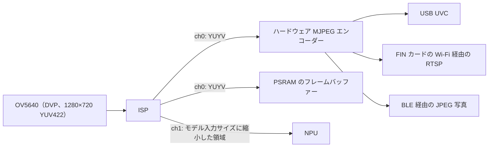

# カメラと画像処理

IPRO7AI は 8 ビットの DVP ポートでカメラセンサーを接続します。オンチップの ISP には 2 つの出力チャネルがあります。チャネル 0 はプレビューまたはハードウェア MJPEG エンコーダー用、チャネル 1 は NPU 用に縮小した画像です。SDK はセンサードライバー、ISP と MJPEG のコンポーネント、CherryUSB の UVC クラスを提供します。IPRO7AI Reef EVK のカメラはコネクター FPC1 に接続する OV5640 モジュールで、`ipro7ai_reef_demo` がシェルからこれを起動し、`ipro7_uvc_cam` がボードを USB ウェブカメラにします。

!!! abstract "要点"
    - Reef のカメラ：FPC1 に接続する OV5640 FLEX-24 モジュール。1280×720 YUV422 で、センサー自身の自動露出とホワイトバランスを使います。ケーブルを接続する前に SW7 を **CAM** にし、USB-C を抜いてください。
    - 構成：`CONFIG_MM_SUPPORT=y`、`CONFIG_USE_PSRAM=y`、`CONFIG_COMPONENTS_SENSOR_ENABLE=y`、`CONFIG_SENSOR_OV5640=y`。ウェブカメラには UVC のキーを追加します。
    - サンプル：`ipro7ai_reef_demo`（`cam` コマンド）、`ipro7_uvc_cam`（`defconfig_reef_ov5640` のウェブカメラ、`defconfig_reef_rps` の NPU ゲーム）、`defconfig_wifi_ipro6s` の Wi-Fi 経由の RTSP、`ipro7_jpeg_decode` の JPEG デコード。
    - MJPEG ブロックはエンコード専用で、JPEG 画像のデコードは CPU で行います。Zephyr にはカメラドライバーがありません。

## 画像パイプライン { #camera-video }



- ISP の各チャネルは独自の出力サイズを持ちます。チャネル 0 はホストや自分のコードが見る画像です。チャネル 1 はセンサー画像の一部の領域を取り出し、モデルの入力サイズに縮小します（たとえば、じゃんけん用ビルドでは中央の 512×512 の正方形を 128×128 に縮小します）。
- OV5640 と OV2640 のドライバーは自動露出、ゲイン、ホワイトバランスをセンサー側で行うため、これらのセンサーでは ISP ファームウェア自身の 3A は起動しません。IQ パラメーターのテーブルは、他の INTELPRO ボードの SC101IOT センサー用しか同梱されていません。
- ISP の DMA はフレームを PSRAM に書き込みます。CPU がフレームを読む前に、D キャッシュの該当範囲を無効化してください（`L1C_DCACHE_INVALID_RANGE`）。
- Reef では OV5640 モジュールの読み出しが上下反転しています。`ipro7ai_reef_demo/src/cam.c` は、センサーではなくキャプチャー DMA で反転しています（`CAM_DVP_VFLIP`）。

## コンポーネントと構成 { #configuration }

| 部分 | 場所 | 説明 |
|---|---|---|
| カメラ HAL | `bsp/hal/inc/hal_cam.h`、`hal_isp.h`、`hal_mjpeg.h` | DVP キャプチャー、ISP、MJPEG エンコーダー |
| センサー | `components/sensor/` | センサードライバーと SCCB。`camera_module_init()` が登録済みのセンサーを順に検出します |
| ISP 制御 | `components/isp_firmware/` | ISP のセットアップと画像パラメーターの処理 |
| ISP アルゴリズム | `components/isp_algorithm/` | ビルド済みの `libisp_algorithm.a` |
| IQ パラメーター | `components/isp_iq_param/`、`components/isp_iq_cmd/` | IQ テーブルとチューニングコマンド（SC101IOT） |
| UVC | `components/cherryusb/class/video/` | USB Video Class デバイス |
| RTSP | `components/network/rtsp_server/` | RTSP MJPEG ストリーミング（`CONFIG_RTSP_SERVER`） |

```ini title=".config（Reef のカメラ、apps/multimedia/ipro7_uvc_cam/defconfig_reef_ov5640 から）"
CONFIG_IPRO7AI_REEF=y
CONFIG_BOARD="IPRO7AI_REEF"
CONFIG_USE_PSRAM=y
CONFIG_MM_SUPPORT=y
CONFIG_COMPONENTS_SENSOR_ENABLE=y
CONFIG_SENSOR_OV5640=y
# USB ウェブカメラ
CONFIG_COMPONENTS_CHERRYUSB_ENABLE=y
CONFIG_CHERRYUSB_DEVICE=y
CONFIG_CHERRYUSB_DEVICE_VIDEO=y
```

Kconfig では `CONFIG_MM_SUPPORT` と `CONFIG_IPRO7AI_REEF` が `USE_PSRAM` を select しますが、ビルドは Kconfig の `select` を適用しないため、`.config` に `CONFIG_USE_PSRAM=y` を書く必要があります。[ビルドシステムと設定](build-system.md#configuration)を参照してください。

### 対応センサー { #sensors }

| センサー | `.config` | 出力 | 備考 |
|---|---|---|---|
| OV5640 | `CONFIG_SENSOR_OV5640=y` | 1280×720 YUV422（2×2 ビニング）、SCCB アドレス 0x3C | Reef の FPC1 は OV5640 FLEX-24 のピン配置です。30 fps、暗い環境では 15 fps に低下します |
| OV2640 | `CONFIG_SENSOR_OV2640=y` | 1280×720 YUV422（UXGA から縮小）、SCCB 0x30 | `ipro7ai_reef_demo` では OV5640 ドライバーと並んで有効になっています |
| SC101IOT | `CONFIG_COMPONENTS_SENSOR_ENABLE=y` でビルドされます | 1280×720 | IPRO7 EVB と IPRO7AI EVK のセンサー |

OV5640 と OV2640 のドライバーはオプトイン方式なので、他のボードで余分なコストはかかりません。`components/sensor/` には GC6133 と GC032A のドライバーもありますが、出荷時のサンプルでは使われていません。

## Reef でのハンズオン { #hands-on }

OV5640 を検出してストリームを開始し、フレームレートとエラーを確認して、1 フレームを ASCII アートで表示します。これは `ipro7ai_reef_demo` で動作し、そのカメラモジュール `src/cam.c` は独自のアプリケーションで再利用できます。

<div class="ipro-steps" markdown>

1. **ハードウェアと構成**

    USB-C を抜き、カメラケーブルを FPC1 に接続して SW7 を **CAM** にし、USB-C を挿し直します。デモの `.config` のカメラ関連の行：

    ```ini title="apps/platform/ipro7ai_reef_demo/.config（抜粋）"
    CONFIG_IPRO7AI_REEF=y
    CONFIG_BOARD="IPRO7AI_REEF"
    CONFIG_USE_PSRAM=y
    CONFIG_MM_SUPPORT=y
    CONFIG_COMPONENTS_SENSOR_ENABLE=y
    CONFIG_SENSOR_OV5640=y
    CONFIG_SENSOR_OV2640=y
    ```

2. **コード**

    `cam.h` は、電源シーケンス、SCCB による検出、PSRAM への ISP チャネル 0 のストリーム（センサーのサイズを `CAM_SCALE_DIV` で割ったもの、デフォルトは 4）をまとめています。`cam` シェルコマンドは次のように呼び出します。

    ```c title="apps/platform/ipro7ai_reef_demo/src/app_cli.c（cmd_cam からの抜粋）"
    if (strcmp(argv[1], "probe") == 0) {
        if (cam_probe() == 0) {
            uint16_t w, h;
            cam_sensor_size(&w, &h);
            printf("sensor %s at SCCB 0x%02X, %ux%u\n", cam_sensor_name(),
                   cam_sensor_addr(), w, h);
        } else {
            printf("no sensor found\n");
        }
    } else if (strcmp(argv[1], "start") == 0) {
        int rc = cam_start();
        printf(rc == CAM_OK ? "streaming - `cam status` in a second\n"
                            : "start failed (%d)\n", rc);
    } else if (strcmp(argv[1], "status") == 0) {
        cam_stats_t st;
        uint16_t w, h, ow, oh;
        /* ... */
        cam_get_stats(&st);
        cam_out_size(&ow, &oh);
        printf("ch0     : YUYV %ux%u, frames %u, %u.%u fps, luma mean %u\n", ow, oh,
               (unsigned)st.frames, (unsigned)(st.fps_x10 / 10), (unsigned)(st.fps_x10 % 10),
               (unsigned)st.luma_mean);
        printf("errors  : fifo %u, vsync %u, hsync %u\n", (unsigned)st.fifo_err,
               (unsigned)st.vsync_err, (unsigned)st.hsync_err);
    }
    ```

    `cam_latest_frame()` は、独自の処理に使う最新の完全な YUYV フレームのアドレスを返します。`ipro_ble_remote` は Reef 用ビルドでこのモジュールを CMake に追加して再利用しており、縮小率は異なります。

    ```cmake title="apps/bluetooth/ble/ipro_ble_remote/CMakeLists.txt（抜粋）"
    if(CONFIG_IPRO7AI_REEF)
        set(REEF_DEMO_SRC ${CMAKE_SOURCE_DIR}/apps/platform/ipro7ai_reef_demo/src)
        __component_add_include_dirs(${REEF_DEMO_SRC})
        target_sources(app PRIVATE
            ${REEF_DEMO_SRC}/cam.c
            # ... the remote's other Reef sources
        )
        target_compile_definitions(app PRIVATE CAM_SCALE_DIV=1u)
    endif()
    ```

    独自のアプリケーションの作成については[最初の独自アプリケーションを作る](../tutorials/first-own-app.md)を参照してください。

3. **ビルド**

    ```bash
    make -C apps/platform/ipro7ai_reef_demo
    ```

4. **書き込み**

    ダウンロードモードにし（SW1 を押したまま SW2 を短く押し、SW1 を離します）、IntelProCube のディレクトリから書き込みます。

    ```bash
    cd <ICUBE>
    ./ipro_iot_tool_macos --chipname ipro7 --chip-variant IPRO7AI \
        --port /dev/cu.usbserial-XXXX --baudrate 921600 \
        --pt chips/ipro7/partition/partition_cfg_2M.toml \
        --firmware <SDK>/apps/platform/ipro7ai_reef_demo/build/build_out/ipro7ai_reef_demo_IPRO7.bin
    ```

    `[All Success]` を確認し、SW2 を押します。他のホストについては[書き込みとシリアルコンソール](../get-started/flash-and-monitor.md)を参照してください。

5. **実行と確認**

    U6 のコンソールで、115200 baud で次のように入力します。

    ```text
    ipro /> cam probe
    sensor __rti_name_ov5640 at SCCB 0x3C, 1280x720
    ipro /> cam start
    streaming - `cam status` in a second
    ipro /> cam status
    sensor  : __rti_name_ov5640 @0x3C 1280x720, streaming
    ch0     : YUYV 320x180, frames …, … fps, luma mean …
    errors  : fifo 0, vsync 0, hsync 0
    dvp     : byte order lower-first, vsync high, hsync high
    ```

    1 秒ほど間隔をあけて `cam status` を 2 回実行します。フレーム数は増え、エラーカウンターは増えません。次に `cam bar on` と `cam snap` を実行すると、縦の帯（センサーのカラーバー）の ASCII サムネイルが表示されます。`cam bar off` と `cam snap` で実際の景色が表示されます。`no sensor found` と表示された場合は、ケーブル、SW7、モジュールのいずれかに問題があります。次に確認すること（`cam pins`、`cam sync`、`cam order`）は、デモの README のカメラの節に記載されています。

</div>

ビルドのたびにカメラを自動で確認するには、[アプリケーションのテスト](../tutorials/testing.md)を参照してください。

## USB ウェブカメラ ipro7_uvc_cam { #uvc-cam }

`apps/multimedia/ipro7_uvc_cam` は、Reef を USB-C ポート上の一般的な UVC ウェブカメラとして認識させます。OV5640 → ISP → ハードウェア MJPEG → USB Full Speed のアイソクロナスエンドポイントという経路です。ホストは標準の UVC ドライバーを使います。

| Reef の構成 | ストリーム（MJPEG） | NPU | 出力 |
|---|---|---|---|
| `defconfig_reef_ov5640` | 1280×720（動きの多いシーンでは約 15 fps、Full-Speed USB による制限）または 640×360（30 fps）、ホストが選択 | 使用しない | `build_reef_ov5640/build_out/ipro7_uvc_cam_IPRO7.bin` |
| `defconfig_reef_rps` | 640×360、じゃんけんゲームを重ねて描画 | 128×128 の分類器、モデルはファームウェアにリンク | `build_reef_rps/build_out/ipro7_uvc_cam_IPRO7.bin` |

```bash
make -C apps/multimedia/ipro7_uvc_cam DEFCONFIG=defconfig_reef_ov5640
```

デモと同じく `--chip-variant IPRO7AI` と `--pt chips/ipro7/partition/partition_cfg_2M.toml` で書き込みます。コンソールは 115200 baud で、次のように表示されます。

```text
[UVC] Bringing up USB UVC webcam (720p MJPEG)...
[UVC] Streaming pipeline started
```

Reef の USB-C をコンピューターに接続し、任意のカメラアプリケーションで開きます（USB VID 0x3896、PID 0x0701）。シェルからのセンサーのチューニング：`cam rd <reg> [n]`、`cam wr <reg> <hexbytes>`、`cam grid [cols rows]`。

- フレームサイズとフォーマットは、共通のカメラパイプラインのディスクリプター（`apps/ai/ipro_reef_teach/image/uvc.c`、`uvc_isp.h`）で固定されています。これらを変える `.config` の設定はありません。
- このアプリケーションには独自のリンカースクリプト `ipro7_uvc_cam.ld` があります。
- 素の `.config` は、SC101IOT センサーを使う IPRO7 EVB 向けにビルドされます。
- じゃんけん用ビルドの手順は [AI と NPU](ai-npu.md#hands-on) にあります。

## JPEG デコード { #jpeg-decode }

IPRO7 の MJPEG ブロックはエンコード専用としてサポートしています。`hal_mjdec.h` は存在しますが、IPRO7 ではハードウェアデコーダーがフレームを最後まで処理できません。`apps/multimedia/ipro7_jpeg_decode` は、TJpgDec R0.03 とラッパー `jdec_rgb` を使って JPEG 画像を CPU でデコードします。このラッパーは真の RGB565（リトルエンディアンまたはビッグエンディアン）または RGB888 を出力し、カメラの MJPEG フレームで省略される標準のハフマンテーブルを補います。

```bash
make -C apps/multimedia/ipro7_jpeg_decode DEFCONFIG=defconfig_reef   # 出力は build_reef/build_out/
```

このビルドのコンソールは **921600** baud で動作します。`jdec run all` は組み込みのテスト画像をデコードし、それぞれを同じデコーダーの PC ビルドと比較して、`14 images, 0 failed -> ALL PASS` で終わります。1280×720 の 4:2:0 画像のデコードには、192 MHz で約 570 ms かかります。これは CMake 3.18 以降でビルドし、デコーダーが `-O2` でコンパイルされた場合の値です（アプリケーションの README）。このデコーダーを独自のアプリケーションで使うには、`jdec_rgb.c`、`jdec_rgb.h`、`tjpgd/` をコピーします。

## IPRO7AI EVK カメラライブラリ { #evk-camera }

`components/board/ipro7ai_evk`（`evk_cam_*`）は、IPRO7AI EVK とその SC101IOT センサー用のカメラライブラリで、Reef では使用しません。そのボードについては INTELPRO にお問い合わせください。

## カメラを使うサンプル { #camera-apps }

| サンプル | Reef の構成 | 内容 |
|---|---|---|
| `ipro7ai_reef_demo` | `.config` | `cam` コマンド：検出、ストリーミング、状態表示、ASCII スナップショット、カラーバー、レジスターアクセス、DVP パッドのアクティビティ |
| `ipro7ai_reef_demo` | `defconfig_wifi_ipro6s` | IPRO6S FIN カードの Wi-Fi を介した、チャネル 0（640×360）の RTSP MJPEG ストリーム（`rtsp://<ip>:8554/av0_0`）。[ネットワーク](networking.md)と [Wi-Fi と RTSP カメラストリーミング](../tutorials/wifi-rtsp.md)を参照 |
| `ipro7_uvc_cam` | `defconfig_reef_ov5640`、`defconfig_reef_rps` | USB ウェブカメラ。NPU によるじゃんけんをストリームに描画 |
| `ipro7_jpeg_decode` | `defconfig_reef` | ソフトウェアによる RGB565 / RGB888 への JPEG デコード |
| `ipro_ble_remote` | `defconfig_reef` | BLE 画像サービスによる、スマートフォンへの 1280×720 の JPEG 写真の送信。画像の動き検出でキャプチャーを開始。カードが挿さっていれば写真を `sd:/REMOTE/` にも保存 |
| `ipro_reef_teach` | `.config` | `image` モード：USB カメラと、IPRO AI Studio から学習させるオンデバイスの分類器。[画像認識](../teach/image.md)を参照 |

IPRO7 EVB と IPRO7AI EVK のカメラのサンプル（`ipro7ai_evk_*`、`ipro7_demo`）は[サンプル](../examples/index.md)に掲載しています。

## 本リリースの制限事項 { #limitations }

- IPRO7 ではハードウェアによる JPEG デコードはできません。`ipro7_jpeg_decode` を使ってください。
- USB は Full Speed で動作するため、動きの多いシーンでは 720p MJPEG が約 15 fps に制限されます。
- ISP の IQ テーブルは SC101IOT 用しか同梱されていません。OV5640 と OV2640 はセンサー自身の 3A を使います。
- Zephyr にはカメラ、ISP、USB のドライバーがありません。

## 関連ドキュメント { #related }

- [AI と NPU](ai-npu.md)：ISP チャネル 1 を NPU に入力する方法
- [ネットワーク](networking.md)：RTSP ストリーミングに使う Wi-Fi
- [IPRO7AI Reef EVK](../hardware/boards/reef-evk.md)：FPC1、SW7、カメラのピン
- [カメラ API](../reference/api/camera.md)
- [ビルドシステムと設定](build-system.md)：`DEFCONFIG=` とメモリレイアウト
