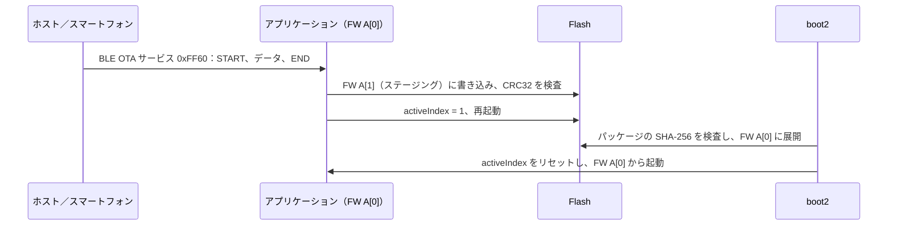

# OTA アップデート

FreeRTOS アプリケーションでは、更新は boot2 が行います。動作中のアプリケーションが OTA パッケージをパーティションテーブルの空いている FW スロットに書き込み、アクティブインデックスを切り替えます。再起動後、boot2 がパッケージを検査して実行スロットに展開し、起動します。SDK には、パッケージ作成ツール `tools/create_ota.py` と、IPRO7AI Reef EVK を BLE で更新する完全なリファレンスが含まれています。リファレンスは、`defconfig_reef` でビルドした `ipro_ble_remote`、その A/B パーティションテーブル、パッケージ作成スクリプト、Python の送信ツール、Android アプリで構成されます。

!!! abstract "要点"
    - リファレンス：`ipro_ble_remote` の `defconfig_reef` + `partition_cfg_2M_remote_ab.toml` + boot2 v0.6.0（IntelProCube に同梱）。デフォルトの `.config` には OTA がありません。
    - パッケージ：`tools/create_ota.py` が IntelProCube で結合した `whole_img.bin` を `.xz.ota`（512 バイトのヘッダー + XZ ペイロード）にまとめます。Reef 向けには `make_reef_ota.sh` が両方の手順を実行します。
    - 送信側：`tools/reef_ota.py`（Python、bleak）または `ipro_remote_demo.apk`（Android）。BLE OTA サービス 0xFF60 を使います。
    - IPRO6S FIN カードは、`defconfig_wifi_ipro6s` でビルドした `ipro7ai_reef_demo` の `ipro6s_ota <http url>` で Wi-Fi 経由で更新します。
    - Reef では標準の `partition_cfg_2M.toml` で OTA を実行しないでください。含まれないもの：署名付きパッケージの製品設定（`tools/ota_products.py`）。

## アーキテクチャ { #architecture }



`ipro_ble_remote` の README によると、boot2 はパッケージが SHA-256 の検査に合格してから実行スロットを消去します。検査に失敗したパッケージでは boot2 が USB レスキューモードのままになり、既存の実行スロットはそのまま残ります。

## パーティションテーブルと A/B レイアウト { #partitions }

`apps/bluetooth/ble/ipro_ble_remote/partition_cfg_2M_remote_ab.toml`（2 MB Flash、boot2 あり）：

| アドレス | パーティション | サイズ | 用途 |
|---|---|---|---|
| 0x000000 | boot2 | 64 KB | IntelProCube に同梱の boot2 v0.6.0 |
| 0x010000 | PT0 / PT1 | 4 KB + 4 KB | パーティションテーブル |
| 0x012000 | FW A[0] | 824 KB | 実行スロット。boot2 がここにパッケージを展開します |
| 0x0E0000 | FW A[1] | 512 KB | OTA のステージング。アプリケーションがここに `.xz.ota` を書き込みます |
| 0x160000 | PSM | 112 KB | 永続的な設定 |
| 0x17C000 | backup | 4 KB | |
| 0x17D000 | media | 16 KB | |
| 0x1FF000 | factory | 4 KB | |

- このレイアウトには 2 MB の Flash が必要です。`defconfig_reef` は `CONFIG_IPRO7_FLASH_2M=y` を設定しています。
- boot2 のイメージは IntelProCube のディレクトリにある `chips/ipro7/builtin_imgs/boot2_v0.6.0/ipro_boot2_IPRO7_v0.6.0.bin` で、SDK パッケージには含まれていません。
- このテーブルには意図的に boot2 のエントリを入れていません。エントリがあると、書き込みツールがブート ROM の読み込まない boot2 ヘッダーを書き込んでしまいます。代わりに `--boot2` で boot2 を渡します。

!!! danger "標準のパーティションテーブルで OTA を実行しないでください"
    IPRO7AI Reef EVK では、標準の `partition_cfg_2M.toml` で OTA を実行しないでください。2 つ目の FW スロット（0x12A000）に書き込んでアクティブにしたイメージは起動せず、コンソールは無出力のままになり、ダウンロードモードでボードを書き直す必要があります。`partition_cfg_2M_remote_ab.toml` を使用してください。

## OTA パッケージの作成（create_ota.py） { #ota-package }

`tools/create_ota.py` の入力は、`IPNP` ブートヘッダーで始まる結合イメージでなければなりません。たとえば、IntelProCube のコマンドラインツールが `--build` で生成する `chips/ipro7/img_create_iot/whole_img.bin` です。SDK のビルドで生成される `.bin` は使えません。入力の形式が正しくない場合、スクリプトは停止します。

```bash
# 1. IntelProCube で whole_img.bin を生成する（IntelProCube のディレクトリで実行。ツールは
#    失敗しても 0 で終了するため、出力に "PT Check: whole_img.bin" があることを確認する）
cd <ICUBE>
./ipro_iot_tool_macos --chipname ipro7 --chip-variant IPRO7AI --build \
    --boot2 chips/ipro7/builtin_imgs/boot2_v0.6.0/ipro_boot2_IPRO7_v0.6.0.bin \
    --pt <SDK>/apps/bluetooth/ble/ipro_ble_remote/partition_cfg_2M_remote_ab.toml \
    --firmware <SDK>/apps/bluetooth/ble/ipro_ble_remote/build_reef/build_out/ipro_ble_remote_IPRO7.bin

# 2. パッケージにする（デフォルトは XZ 圧縮）
python3 <SDK>/tools/create_ota.py chips/ipro7/img_create_iot/whole_img.bin \
    --fw-ver <fw-version> -o firmware.xz.ota
```

| 引数 | 意味 |
|---|---|
| `<input>` | 結合イメージ（`IPNP` ブートヘッダーで始まるもの） |
| `--raw` | 圧縮しません。`-o` を省略すると、出力ファイル名は入力ファイル名の拡張子を `.ota`（`--raw` の場合）または `.xz.ota` に置き換えたものになります |
| `-o FILE` | 出力ファイル |
| `--hw-ver`、`--fw-ver` | ヘッダーに書き込むハードウェアとファームウェアのバージョン文字列（それぞれ最大 15 文字）。boot2 はハードウェアバージョンを検査しません |
| `--sign-key`、`--product`、`--hw-id`、`--fw-version`、`--force-version`、`--key-id` | 署名付きパッケージ用。V2.2.1 に含まれていない `tools/ota_products.py` が必要なため、使用できません |

| ヘッダーのオフセット | 内容 |
|---|---|
| 0–15 | マジック文字列 `IPRO_OTA_Ver1.0` |
| 16–19 | 種類：`XZ  ` または `RAW ` |
| 20–23 | ペイロード長（リトルエンディアン） |
| 32–47、48–63 | ハードウェアとファームウェアのバージョン文字列 |
| 64–95 | ペイロードの SHA-256 |
| 96–511 | 予約（0xFF）。署名付きパッケージでは署名ブロックが入ります |
| 512 以降 | ペイロード（boot2 のデコーダーに合わせた 32 KB 辞書の XZ） |

Reef 向けには、`apps/bluetooth/ble/ipro_ble_remote/tools/make_reef_ota.sh` が両方の手順を 1 つのコマンドで実行し、ビルド時刻をファームウェアバージョンとして書き込みます。[Reef でのハンズオン](#hands-on)を参照してください。スクリプトは IntelProCube フォルダー内の最新の boot2（0.7.0.1 では v0.6.0）を使います。

## BLE OTA（ipro_ble_remote） { #ble-ota }

OTA サービスを有効にするのは `defconfig_reef` だけです。`ipro_ble_remote` のデフォルトの `.config` は、OTA サービスなしの IPRO7 EVB 用イメージをビルドします（`# CONFIG_IPRO_BLE_REMOTE_OTA is not set`）。

```ini title="apps/bluetooth/ble/ipro_ble_remote/defconfig_reef（抜粋）"
CONFIG_IPRO7AI_REEF=y
CONFIG_IPRO7_FLASH_2M=y
CONFIG_LINK_FLASH=y
CONFIG_PARTITION=y
CONFIG_IPRO_BLE_REMOTE_OTA=y
```

サービスとそのキャラクタリスティック（アプリ開発者向けの詳しい説明は `apps/bluetooth/ble/ipro_ble_remote/OTA_IMPLEMENTATION_GUIDE.md` にあります）：

| キャラクタリスティック | UUID | プロパティ | 形式 |
|---|---|---|---|
| OTA Control | `0xFF61` | Write | `01` + サイズ（u32 LE）で START、`02` + CRC32（u32 LE）で END、`03` ABORT、`04` VERIFY、`05` REBOOT |
| OTA Data | `0xFF62` | Write Without Response | シーケンス u16、長さ u16、予約 u16、続いてデータ。1 パケットあたりのデータは最大 MTU − 9 バイト |
| OTA Status | `0xFF63` | Read、Notify | ステータス、エラーコード、進捗 %、予約 u16。ステータスは 0 アイドル、1 受信中、2 検証中、3 準備完了、4 完了（REBOOT を送信）、0xFF エラー |

- `.bin` ではなく `.xz.ota` パッケージを送信します。CRC32 は、送信したファイル全体に対する標準の CRC-32（`zlib.crc32` と同じ）です。
- START の後、デバイスはステージングスロットを消去します。ステータスが 1（受信中）になってからデータを送信してください。
- デバイスは最大 20 パケットをキューに入れ、到着した順に Flash に書き込みます。送信側でペースを調整しないと（`reef_ota.py` は 8 パケットごとに OTA Status を読み出します）、パケットが失われ、END がエラーを返します。
- 先に大きな MTU をネゴシエートしてください。README では、接続後に MTU 513 以上を要求することを推奨しています。

## Reef でのハンズオン { #hands-on }

`ipro_ble_remote` を UART で一度書き込み、コードを変更してから、新しいビルドを BLE でインストールし、ビルド時刻が変わることを確認します。U6 にコンソールケーブルを接続した Reef、IntelProCube のコマンドラインツール（`<ICUBE>`）、Bluetooth と Python 3 を備えた macOS または Linux のコンピューター（または `ipro_remote_demo.apk` をインストールした Android スマートフォン）が必要です。

<div class="ipro-steps" markdown>

1. **設定を確認する**

    `DEFCONFIG=defconfig_reef` を同梱のまま使用します。OTA を機能させるキーは [BLE OTA](#ble-ota) の抜粋にあります。独自の Reef アプリケーションで OTA を使う場合は、`CONFIG_IPRO7_FLASH_2M=y` と `CONFIG_PARTITION=y` を維持し、boot2 と `partition_cfg_2M_remote_ab.toml` のような A/B テーブルで書き込み、以下と同じようにパッケージを非アクティブな FW スロットに書き込みます。

2. **アプリケーションがパッケージをステージングする方法を読む**

    OTA サービスは boot2 のパーティション API に非アクティブな FW スロットを問い合わせ、そこにパッケージを書き込み、CRC32 の検査後にそのスロットをアクティブにします。

    ```c title="apps/bluetooth/ble/ipro_ble_remote/src/services/ota_service.c（抜粋）"
    static int ota_get_backup_partition(uint32_t *addr, uint32_t *size)
    {
        int ret = hal_boot2_partition_addr_inactive("FW", addr, size);
        if (ret != 0) {
            IPRO_LOGE(LOG_TAG, "Failed to get backup partition: %d", ret);
            return -1;
        }
        return 0;
    }

    static int ota_switch_partition(void)
    {
        int ret;
        PtTable_Entry_Config pt_entry;

        ret = hal_boot2_get_active_entries(PT_ENTRY_FW_CPU0, &pt_entry);
        if (ret != 0) {
            IPRO_LOGE(LOG_TAG, "Failed to get partition entry: %d", ret);
            return -1;
        }
        /* pt_entry.maxLen[] とのサイズ比較は省略 */

    #if defined(CONFIG_IPRO7AI_REEF)
        /* The Reef image runs under boot2 (partition_cfg_2M_remote_ab.toml): the
         * slot holds an OTA package that boot2 checks and unpacks by its own
         * header, so the entry length is not used. */
        pt_entry.len = 0;
    #else
        pt_entry.len = g_ota_ctx.firmware_size;
    #endif

        ret = hal_boot2_update_ptable(&pt_entry);
        if (ret != 0) {
            IPRO_LOGE(LOG_TAG, "Failed to update partition table: %d", ret);
            return -1;
        }
        return 0;
    }
    ```

    その後、REBOOT コマンドでチップがリセットされ、起動時に boot2 がパッケージをインストールします。

3. **最初のイメージをビルドして書き込む**

    ```bash
    make -C apps/bluetooth/ble/ipro_ble_remote DEFCONFIG=defconfig_reef
    ```

    Reef をダウンロードモードにし（SW1 BOOT を押したまま SW2 RESET を押して離し、SW1 を離す）、次を実行します。

    ```bash
    cd <ICUBE>
    ./ipro_iot_tool_macos --chipname ipro7 --chip-variant IPRO7AI \
        --port /dev/cu.usbserial-XXXX --baudrate 921600 \
        --boot2 chips/ipro7/builtin_imgs/boot2_v0.6.0/ipro_boot2_IPRO7_v0.6.0.bin \
        --pt <SDK>/apps/bluetooth/ble/ipro_ble_remote/partition_cfg_2M_remote_ab.toml \
        --firmware <SDK>/apps/bluetooth/ble/ipro_ble_remote/build_reef/build_out/ipro_ble_remote_IPRO7.bin
    ```

    `[All Success]` を確認してから（ツールは失敗しても 0 で終了します）、SW2（RESET）を押します。115200 baud のコンソールに `[BOOT2] IPRO7 Boot2 v0.6.0` が表示され、続いてアプリケーションが FW A（0x12000）から起動して `[OTA] Service ready` を出力します。書き込みの詳細は[書き込みとシリアルコンソール](../get-started/flash-and-monitor.md)を参照してください。

4. **コードを変更して OTA パッケージをビルドする**

    コードに任意の変更を加え、同じ `make` コマンドで再ビルドしてから、新しいビルドをパッケージにします。パッケージ化スクリプトは IntelProCube フォルダー内の最新の boot2（0.7.0.1 では v0.6.0）を使い、使用したファイルを表示します。Linux では `ipro_iot_tool_linux` を使います。

    ```bash
    IPRO_FLASH_TOOL=<ICUBE>/ipro_iot_tool_macos \
        sh apps/bluetooth/ble/ipro_ble_remote/tools/make_reef_ota.sh
    ```

    出力：`apps/bluetooth/ble/ipro_ble_remote/build_reef/build_out/ipro_ble_remote_reef.xz.ota`（約 345 KB）

5. **BLE で送信する**

    ```bash
    python3 -m venv .venv && .venv/bin/pip install bleak
    .venv/bin/python apps/bluetooth/ble/ipro_ble_remote/tools/reef_ota.py \
        apps/bluetooth/ble/ipro_ble_remote/build_reef/build_out/ipro_ble_remote_reef.xz.ota
    ```

    スクリプトは `IPRO-Remote` を探し（別の名前の場合は `REMOTE_NAME` を設定）、動作中のイメージのボード情報を表示し、パッケージを送信して、ボードが再接続するのを待ちます。README では、macOS、MTU 247 で 345 KB のパッケージに 13～17 秒かかったと記載されています。

6. **結果を確認する**

    Reef のコンソールには、ほかの行に混じって次の行が表示されます（ログのプレフィックスは省略）。

    ```text
    [OTA] START: … bytes, … packets (… bytes/pkt, MTU=…)
    [OTA] Progress: 5% (…)
    [OTA] Transfer complete: … bytes in … ms (… bytes/s)
    [OTA] END: CRC32=0x…, …/… bytes
    [OTA] CRC32 OK! Switching partition...
    [OTA] Ready to reboot
    [OTA] Rebooting...
    [BOOT2] IPRO7 Boot2 v0.6.0
    ...
    [BOOT2] OTA pending
    [OTA] E0000->12000
    [OTA] no eFuse key, package unverified
    [OTA] XZ …
    [OTA] …
    [OTA] OK
    [BOOT2] OTA ok
    ```

    `[BOOT2] OTA ok` は、boot2 がパッケージの SHA256 を確認して FW A に展開し、新しいイメージを起動することを示します。`no eFuse key, package unverified` は、チップの eFuse に署名鍵がないため署名を検証しないことを示します。コンピューター側では、`reef_ota.py` が `verified, slot switched; rebooting` を出力し、ボードの再接続後に `running: IPRO7AI Reef; camera …; SD …; build <date> <time>` を出力します。このビルド時刻は `src/board/reef_hw.c` から取られ、このファイルが再コンパイルされたときにだけ変わります。更新はコンソールの `[BOOT2] OTA ok` で確認してください。

</div>

次のステップ：[最初の独自アプリケーションを作る](../tutorials/first-own-app.md)では Reef の設定から新しいアプリケーションを作成します。[アプリケーションのテスト](../tutorials/testing.md)では、上記のようなコンソールとホストスクリプトによる確認を扱います。

## その他の更新経路 { #other-paths }

| 経路 | 詳細 |
|---|---|
| IPRO6S FIN カードのファームウェア | `DEFCONFIG=defconfig_wifi_ipro6s` でビルドした `ipro7ai_reef_demo` には、コンソールコマンド `ipro6s_ota <http url>` があります。Wi-Fi でパッケージをダウンロードし、`ipronet_ota_update()`（`components/network/ipronet_host/ipronet_ota.h`）で FIN カードに渡します。所要時間は約 30～60 秒で、最後にコンソールに `[ota] RESULT OK` と表示されます。パッケージは、ハードウェアバージョンが IPRO6 の IntelProCube の `FW_OTA.bin.xz.ota` です。ほかのチップ向けのパッケージは、開始前にホストが拒否します。FIN カードのファームウェアは `defconfig_ipro6_sdio` でビルドした `ipro6_if_wifi` で、その `CONFIG_RNM_OTA=y` がデバイス側の処理を提供します。[ネットワーク](networking.md)を参照してください |
| 共通の OTA コード | `apps/platform/common/ota/`：パッケージを非アクティブな FW スロットに書き込み、SHA-256 を検査してアクティブインデックスを切り替えるコア、UART（zmodem）と USB CDC の受信部、`ota_sig` の署名検査。同梱の設定でこれらのファイルをビルドするものはありません。独自の受信部を作る際のリファレンスとして使用してください |

## Zephyr：MCUboot と MCUmgr { #zephyr-mcuboot }

Zephyr のイメージは、boot2 のパッケージではなく MCUboot で更新します。boot2 が MCUboot を起動し、MCUboot が `slot1_partition` から新しいイメージを入れ替えます（swap-move）。サンプル `zephyr/samples/ble_ota` は、MCUmgr SMP で BLE 経由でイメージをアップロードします。V2.2.1 の Zephyr には IPRO7 EVB と IPRO7AI EVK のボード定義しかなく、Reef のボード定義はありません。ビルドと書き込みについては [Zephyr RTOS](zephyr.md) を参照してください。

## 本リリースの制限事項 { #limitations }

- 署名付き OTA パッケージ（`create_ota.py --sign-key`）に必要な `tools/ota_products.py` は V2.2.1 に含まれていません。
- BLE OTA のリファレンスフローは `ipro_ble_remote` の `defconfig_reef` です。`ipro_ble_remote` のデフォルトのビルドには OTA がありません。
- IPRO7 のファームウェアを Wi-Fi やイーサネットで更新するサンプルはありません。`ipro6s_ota` が更新するのは IPRO6S FIN カードだけです。
- `build_freertos.sh flash` では boot2 のイメージを渡せません。OTA に対応したイメージの最初の書き込みは、上記のとおり IntelProCube のコマンドラインで行ってください。
- boot2 のイメージと標準のパーティションテーブルは、SDK パッケージではなく IntelProCube に同梱されています。

## 関連ドキュメント { #related }

- [IPRO7AI Reef EVK](../hardware/boards/reef-evk.md)：ダウンロードモード、スイッチ、U6 のコンソールコネクター。
- [書き込みとシリアルコンソール](../get-started/flash-and-monitor.md)：IntelProCube のコマンドラインツール。
- [BLE 開発](ble.md)：`ipro_ble_remote` の GATT サービス。
- [ネットワーク](networking.md)：`ipronet_host` と FIN カード。
- [Zephyr RTOS](zephyr.md)：sysbuild、MCUboot、`west flash`。
