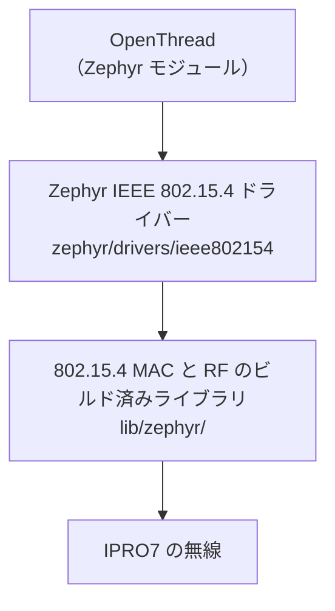

# Thread と Matter

Thread は、Zephyr RTOS 上で Zephyr の OpenThread と SDK の 802.15.4 ドライバーを使い、IPRO7 の IEEE 802.15.4 無線で動作します。FreeRTOS アプリケーションは 802.15.4 にも Thread にも対応しておらず、本リリースには Matter スタックがありません。

!!! abstract "要点"
    - **Thread**：Zephyr RTOS のみ。サンプルのボードは `ipro7_evb`。Zephyr の OpenThread シェルサンプル用の設定フラグメントを `zephyr/samples/ieee802154_shell/` に同梱しています。
    - **IPRO7AI Reef EVK**：V2.3.0 では Thread を使う経路がありません。Reef には Zephyr のボード定義がなく、Reef で動く FreeRTOS アプリケーションには 802.15.4 が含まれていません。
    - **Matter**：V2.3.0 には含まれていません。Matter スタック、アプリケーション、ビルドコマンドはありません。INTELPRO にお問い合わせください。
    - このページのいかなる記述も、本リリースが Thread または Matter の認証を取得していることを意味するものではありません。

## 提供状況 { #overview }

| 項目 | 本リリースでの状況 |
|---|---|
| Matter スタックとアプリケーション | 含まれていません |
| Thread（OpenThread） | Zephyr RTOS、サンプルのボードは `ipro7_evb`。FreeRTOS では非対応 |
| Thread Border Router | 含まれていません |
| IEEE 802.15.4 無線 | ビルド済みの MAC と RF のライブラリを使う Zephyr ドライバー |
| BLE（コミッショニングに使用可能） | FreeRTOS と Zephyr で利用可能。Matter とは統合されていません |

## OpenThread（Zephyr RTOS） { #openthread }



RF ドライバーと 802.15.4 MAC はビルド済みライブラリとしてリンクされます（`components/wireless/rf/ipro7_rf/lib/zephyr/`、`components/wireless/ieee802154/lib/zephyr/`）。OpenThread は `west.yml` の許可リストに含まれる Zephyr モジュールです。

SDK は、Zephyr 自身の `samples/net/openthread/shell` 用の設定フラグメントを追加しています。

| ファイル（`zephyr/samples/ieee802154_shell/`） | 内容 |
|---|---|
| `ot.conf` | Thread 1.4、OpenThread CLI の ping 送信機能、CSL に必要な無線のタイムスタンプと時刻指定送信、スタックサイズ、RF 水晶のトリム値 |
| `csl.conf` | `ot.conf` に重ねて使用：CSL レシーバー（sleepy end device）、CSL の周期とタイムアウト、ドライバーのフレームトレース |
| `app.overlay` | `ieee802154` ノードを有効にし、デフォルトの 802.15.4 デバイスにします |

```ini title="zephyr/samples/ieee802154_shell/ot.conf（抜粋）"
CONFIG_OPENTHREAD_THREAD_VERSION_1_4=y
CONFIG_OPENTHREAD_PING_SENDER=y
CONFIG_NET_PKT_TIMESTAMP=y
CONFIG_NET_PKT_TXTIME=y
CONFIG_SOC_IPRO7_XTAL_CAPCODE=165
```

```ini title="zephyr/samples/ieee802154_shell/csl.conf（抜粋）"
CONFIG_OPENTHREAD_CSL_RECEIVER=y
CONFIG_IEEE802154_IPRO_OT_CSL_PERIOD_US=500000
CONFIG_IEEE802154_IPRO_OT_CSL_TIMEOUT_S=20
```

!!! warning "RF 水晶のトリム値はボードによって異なります"
    `ot.conf` の `CONFIG_SOC_IPRO7_XTAL_CAPCODE=165` は IPRO7 EVB で測定した値です。ほかのボードでは `ipro154 xtal` と `ipro154 cfo` で測定し、独自の値を設定してください。周波数誤差が大きいと、ほかの Thread デバイスとのリンクに悪影響が出ます。

## IPRO7 EVB で試す { #reference-apps }

本リリースには、Reef で Thread を試す手順はありません。IPRO7 EVB では次のようにします。

<div class="ipro-steps" markdown>

1. **ワークスペースを作成する**：[Zephyr RTOS](zephyr.md#workspace) のとおりに `tools/zephyr/bootstrap.sh` と `source zephyr-workspace/env.sh` を実行します。

2. **OpenThread シェルをビルドする**（`zephyr-workspace/` で実行します。`<SDK>` は SDK ルートの絶対パスです）

    ```bash
    west build -b ipro7_evb zephyr/samples/net/openthread/shell -d build/ot -- \
        -DEXTRA_CONF_FILE=<SDK>/zephyr/samples/ieee802154_shell/ot.conf \
        -DEXTRA_DTC_OVERLAY_FILE=<SDK>/zephyr/samples/ieee802154_shell/app.overlay
    ```

    CSL レシーバーを試す場合は、`EXTRA_CONF_FILE` に `csl.conf` も追加します。

3. **書き込む**：`west flash -d build/ot` を実行します。プローブがない場合は `-- --boot shell` または `-- --boot manual` を追加します（[Zephyr RTOS](zephyr.md) を参照）。

4. **使用する**：`../tools/zephyr/monitor.sh --port /dev/cu.usbserial-XXXX`（2,000,000 baud）でコンソールを開き、`ot` コマンドで OpenThread CLI を操作します。ネットワークの形成や参加には、別の Thread デバイスまたは Border Router が必要です。

</div>

802.15.4 の生のトラフィックだけをテストする場合は、SDK の `ieee802154_shell` サンプル（Zephyr の IEEE 802.15.4 シェルとネットワークシェル）をビルドします。

```bash
west build -b ipro7_evb ../zephyr/samples/ieee802154_shell -d build/154
```

ドライバーは `ipro154` デバッグコマンドを追加します。

| コマンド | 用途 |
|---|---|
| `ipro154 stats` | ドライバーと HAL のカウンター |
| `ipro154 clk` | カーネルクロックと比較した無線クロックの速度 |
| `ipro154 cfo` | 送信元ごとの周波数オフセット、SFD 相関、RSSI |
| `ipro154 xtal` | RF 水晶のトリム値 |
| `ipro154 crc` | CRC エラーのフレームを HAL のカウンターで数える |
| `ipro154 trace` | HAL のフレームトレース（`on` / `off` / `clear` / `dump`） |

`tools/zephyr/csl_pcap.py` は、802.15.4 スニファーのキャプチャから CSL のタイミングを解析します。

## 統合前の確認事項 { #configuration }

- **RTOS**：Thread は Zephyr でのみ使用でき、FreeRTOS アプリケーションに Thread を追加する設定キーはありません。製品で低消費電力、カメラ、USB、NPU も必要な場合は、まず Zephyr でのそれらの対応状況を確認してください（[Zephyr RTOS](zephyr.md)）。
- **ボード**：本リリースの Zephyr ボードは IPRO7 EVB と IPRO7AI EVK です。製品のボードには独自のボード定義が必要です。
- **低消費電力**：本リリースの Zephyr は SoC を PDS や HBN に移行させません。`csl.conf` は CSL のタイミング動作を示すもので、デバイスがスリープレベルの電流に達することを意味するものではありません。
- **RF 水晶**：ボード設計ごとに `CONFIG_SOC_IPRO7_XTAL_CAPCODE` を設定して検証してください。
- **Border Router とコミッショニング**：Border Router は含まれていません。外部の Border Router、ネットワーク資格情報のプロビジョニング方法、その安全な保存方法を計画してください。
- **リソース**：Flash と RAM の予算、永続ストレージ、エントロピーソース（`CONFIG_ENTROPY_GENERATOR`）、更新経路（MCUboot。[OTA アップデート](ota.md)を参照）を確認してください。
- **検証の順序**：まずボードのドライバー、無線リンク、IP トランスポート、セキュアストレージを検証し、次にプロトコルの統合、コミッショニング、再起動後の復旧、相互運用性を検証します。

## Matter の見通し { #matter-architecture }

Matter は、Wi-Fi、イーサネット、Thread の上で動作し、コミッショニングに BLE を使う IP アプリケーションプロトコルです。本リリースには、それぞれのトランスポートのコンポーネントがあります。FreeRTOS での IPRO6S 経由の Wi-Fi とイーサネット（[ネットワーク](networking.md)）、Zephyr での Thread、両方での BLE です。しかし、Matter スタック、コミッショニングフロー、デバイス認証証明書、Matter OTA はありません。トランスポートがそろっていても、Matter が統合されているわけではありません。Matter の計画と時期については、INTELPRO にお問い合わせください。

## 関連ドキュメント { #related }

- [Zephyr RTOS](zephyr.md)：ワークスペース、書き込み、機能と制限事項。
- [ネットワーク](networking.md)：lwIP、Reef での IPRO6S FIN カード経由の Wi-Fi、イーサネット。
- [BLE 開発](ble.md)：BLE ホストとコントローラー。
