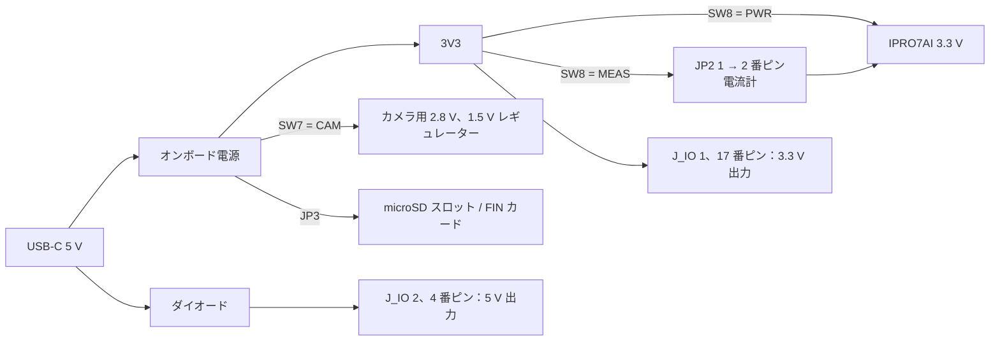

# 電源と電流測定

電流を測定する前に、Reef の電源がどこから来ているか、測定したい経路をどこで切り離すかを把握したうえで、測定したい状態にボードを置きます。SDK はすべてのボードに当てはまる電流値を公開していません。チップのデータシートにある測定条件に従い、お使いのボードで測定してください。

## ボードの電源 { #power }

### IPRO7AI Reef EVK { #reef-power }

Reef V4.0 の電源は USB-C からのみ供給されます。オンボード電源が 3.3 V（3V3）とカメラ用の電圧を生成します。SW8 は IPRO7AI の 3.3 V の供給元を選択します。PWR ではオンボードの 3.3 V から直接供給され、MEAS では JP2 を経由するため、電流計や外部電源を経路に入れることができます。



| スイッチ / ジャンパー | 位置 | 電源への影響 |
|---|---|---|
| SW8 | PWR | 通常使用：IPRO7AI の 3.3 V はオンボード電源から直接供給されます |
| | MEAS | IPRO7AI の 3.3 V は JP2 を経由します。JP2 には電流計または外部 3.3 V 電源を接続する必要があります |
| JP2 | — | 3 ピン：1 = 3V3（オンボード 3.3 V）、2 = SOC（IPRO7AI の 3.3 V）、3 = GND。SW8 が MEAS のときのみ使用します |
| SW7 | CAM | カメラ用の 2.8 V と 1.5 V のレギュレーターがオンになります |
| | GPIO | カメラ用レギュレーターがオフになり、カメラの 16 ピンが J_IO に接続されます |
| JP3 | ON | microSD スロットには常に給電されます |
| | GPIO | GPIO14 でスロットの電源を切り替えます。Low または非駆動のときは給電、High のときはオフです。FIN カードの `fin cycle` にはこの位置が必要です |

- U6 デバッグコネクターからはボードに給電されません。IPRO Debug Probe や USB-UART ケーブルを接続している場合でも USB-C が必要です。
- J_IO の 2 番、4 番ピンはダイオードを介して USB の 5 V を出力し、1 番、17 番ピンは 3.3 V を出力します。いずれのピンからもボードに給電することはできません。

!!! warning "電源投入前に"
    - ボードへの給電は USB-C からのみ行ってください。
    - 通常は SW8 を PWR にしておいてください。SW8 が MEAS のときは、JP2 に電流計または外部 3.3 V 電源を接続していない限り USB-C を接続しないでください。IPRO7AI に電源が供給されない状態で、周辺回路の 3.3 V が IO ピンを通じて逆流します。
    - カメラケーブルの抜き差しは USB-C を外してから行ってください。

その他のボード（IPRO7 EVB、IPRO7AI EVK）の電源ツリーについては、各ボードのハードウェアドキュメントを参照してください。INTELPRO にお問い合わせください。

## 電源設計の推奨事項 { #design-recommendations }

| 項目 | 推奨事項 |
|---|---|
| 入力保護 | ESD とサージ対策として、電源入力に TVS を配置します |
| デカップリング | すべての電源ピンに 100 nF を、チップのできるだけ近くに配置します |
| バルク容量 | 5 V と 3.3 V の電源に 10 µF–47 µF を配置します |
| 電源投入シーケンス | チップのデータシートとボードの電源シーケンスに従います |
| グラウンド | ベタのグラウンドプレーンを使い、アナログ領域とデジタル領域を分けます |
| LDO | アナログ電源（AVDD）には低ノイズの LDO を使います |
| 電流測定 | Reef の SW8 と JP2 のように、SoC の電源経路に開放できる箇所を設けます |

アンテナとその整合回路については[ピン配置と周辺機能マッピング](pinmux.md#antenna)を参照してください。

## 電流の測定 { #current-measurement }

結果を比較できるように、測定ごとに条件を記録してください。測定箇所、CPU クロック、RF 送信電力、有効にした周辺機能、メモリ保持の設定、スリープモードです。

### 測定箇所 { #measurement-points }

| 測定箇所 | 接続方法 | 含まれるもの |
|---|---|---|
| ボード全体 | コンピューターと USB-C の間に USB 電流計を接続 | LED、スピーカーアンプ、カメラ、microSD カードを含む、ボード上のすべて |
| IPRO7AI の 3.3 V | SW8 を MEAS にし、JP2 の 1 番ピンと 2 番ピンの間に電流計を接続 | IPRO7AI の 3.3 V ピンとそのデカップリングコンデンサー、ブートピンのプルアップ。周辺回路は含みません |

### IPRO7AI の電流を測定する { #reef-soc-current }

<div class="ipro-steps" markdown>

1. **測定するファームウェアを書き込む**：たとえば出荷時ファームウェア `ipro7ai_reef_demo` を、[IPRO7AI Reef EVK のクイックスタート](boards/reef-evk.md#quick-start)の手順で書き込みます。SW8 を PWR にした状態で起動することを確認します。

2. **電流計を接続する**：USB-C を外し、JP2 の 1 番ピン（3V3）と 2 番ピン（SOC）の間に電流計を接続してから、SW8 を MEAS にします。代わりに外部電源からチップに給電する場合は、外部の 3.3 V を JP2 の 2 番ピン（SOC）と 3 番ピン（GND）の間に接続します。

3. **電源を入れて起動を確認する**：USB-C を接続し、115200 baud でコンソールを開いて `reef status` と入力します。

    ```bash
    python3 tools/serial_monitor.py /dev/cu.usbserial-XXXX --send "reef status" --timeout 5
    ```

    コンソールにボードの状態が表示されれば、IPRO7AI は JP2 経由で動作しており、電流計にはその 3.3 V の電流が表示されています。何も返ってこない場合は、電流計のレンジと JP2 の配線を確認します。

4. **各状態の電流を読み取る**：測定したい動作をコンソールで実行し、表示が安定するのを待ってから、条件とともに記録します。

5. **通常の給電に戻す**：まず USB-C を外し、SW8 を PWR に戻してから、電流計を取り外します。

</div>

### スリープ電流 { #lp-test }

`apps/test/ipro_lp_test`（RTC ウェイクアップによる PDS31 への移行と復帰、`lp` コマンド）には IPRO7 EVB 用の構成（`CONFIG_EVB=y`）しかありません。本リリースには、スリープ電流を測定するための Reef 用構成はありません。

PDS31 スリープでは OCRAM の先頭 64 KB だけが保持され、残りは MISC 電源ドメインに給電されている間のみ保持されます（`bsp/hal/inc/hal_pm.h` の `pm_pds_set_misc_keep()`）。4 KB の HBN RAM はハイバネート中も保持されます。チップが PDS にある間は UART がオフになるため、スリープ中に入力した文字は失われます。

### アプリケーションでの自動低消費電力 { #ipro-pm }

通常、アプリケーションが自分でスリープを呼び出すことはありません。`components/sys/ipro_pm` が FreeRTOS の tickless idle を引き継ぎ、アイドル期間ごとに許可される最も深いモードを選択します。モードは `IPRO_PM_MODE_WFI`（CPU クロックをゲート）、`IPRO_PM_MODE_NATIVE`（BLE コアが自身の 32 kHz タイマーでスリープしている間の WFI）、`IPRO_PM_MODE_PDS`（PDS31）です。`CONFIG_IPRO_PM=y` のとき、シェルコマンド `pm stats` で各モードの滞在時間と平均電流の推定値を表示できます。推定値は実測の代わりにはなりません。設定については[低消費電力ガイド](../guides/low-power.md)を参照してください。

## 関連ドキュメント { #documents }

- [IPRO7AI Reef EVK](boards/reef-evk.md#jumpers)：SW7、SW8、JP2、JP3 の位置と設定。
- [低消費電力ガイド](../guides/low-power.md)：PDS、`ipro_pm`、BLE の低消費電力設定。
- IPRO7 データシートとハードウェア設計ガイド（電気的特性、電源シーケンス）：[ドキュメント](../documents/index.md)を参照してください。
