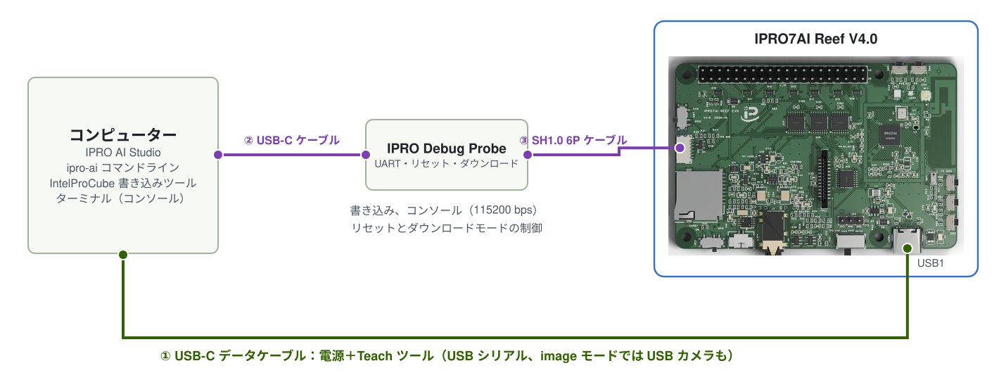

# Edge AI ファームウェアの書き込み

3 つの Teach ツールはすべて Edge AI ファームウェア `ipro_reef_teach` に入っています。このページを終えると、Reef は専用のパーティションテーブル、起動モード、声紋モデルで起動し、コンピューターは現在のモードの USB デバイスを認識し、IPRO AI Studio がボードを見つけられるようになります。ファームウェアの書き込みは 1 回だけです。以後、画像とセンサーのモデルは Studio から USB-C でデプロイするので、書き込みは不要です。

## 前提条件 { #prerequisites }

- IPRO7AI Reef EVK V4.0 と、Reef の USB-C（USB1）に接続するデータケーブル。書き込み中のボードへの電源供給もこのケーブルで行います。
- IPRO Debug Probe。USB-C ケーブルでコンピューターに、両端のピン順が逆になった SH1.0 6 ピンケーブルで Reef の U6 に接続します。[デバッグコネクター U6](../hardware/boards/reef-evk.md#debug-connector) を参照してください。プローブは Reef に電源を供給しません。
- IntelProCube v0.6.3 コマンドライン書き込みツール（`ipro_iot_tool_macos`、`ipro_iot_tool_linux`、`ipro_iot_tool.exe`）。ツール自身のディレクトリから実行します。SDK には含まれていません。INTELPRO にお問い合わせください。
- ファームウェアのファイル：IPRO Edge AI パッケージの `firmware/` フォルダー、または SDK V2.2.0 からのビルド（[ツールチェーン](../get-started/environment.md)と Python 3 が必要）。



日常の Teach の利用には Reef の USB-C（①）だけが必要です。書き込みやコンソールの表示には、プローブ（② と ③）を追加します。コンソールはプローブの「IPRO7 UART」シリアルポートで、115200 baud、8N1 です。書き込みは 921600 baud で行います。

## 書き込むファイル { #files }

| ファイル | 内容 | 入手先 |
|---|---|---|
| `ipro_reef_teach_IPRO7.bin` | Edge AI ファームウェア | パッケージの `firmware/`、または SDK のビルド出力 `apps/ai/ipro_reef_teach/build/build_out/` |
| `partition_reef_teach.toml` | Edge AI ファームウェアのパーティションテーブル | パッケージの `firmware/`、または SDK の `apps/ai/ipro_reef_teach/` |
| `model_b.spkb` | 声紋モデル（437,200 B、CRC `db073b9e`） | パッケージの `firmware/`、または SDK の `apps/ai/ipro_reef_teach/model/` |
| `reef_teach_mfg.bin` | mfg ペイロード：起動モードと声紋モデル | パッケージの `firmware/`（`image` モードで起動）、または `mfg_payload.py` で作成 |

画像とセンサーのモデルは mfg ペイロードに含まれません。後で IPRO AI Studio からデプロイします。

## SDK からのビルド（オプション） { #build }

パッケージの `firmware/` のファイルを使う場合、このセクションは飛ばしてください。SDK のルートで実行します：

<div class="ipro-steps" markdown>

1. **ファームウェアをビルドします**

    ```bash
    make -C apps/ai/ipro_reef_teach
    ```

    出力：`apps/ai/ipro_reef_teach/build/build_out/ipro_reef_teach_IPRO7.bin`。アプリの `.config` で Reef（`CONFIG_IPRO7AI_REEF=y`）、2 MB の Flash、AI サポート、ウォッチドッグがすでに選択されており、ほかに選ぶ設定はありません。

2. **mfg ペイロードを作成します**：`--mode` は起動するモードで、`image`、`voice`、`sensor` のいずれかです（デフォルトは `image`）。

    ```bash
    python3 apps/ai/ipro_reef_teach/mfg_payload.py \
        --voice apps/ai/ipro_reef_teach/model/model_b.spkb \
        --mode image -o reef_teach_mfg.bin
    ```

    ペイロードにはモードセクター、声紋モデル、そのコミットレコードが含まれるため、ボードは起動時に CRC チェック済みの声紋モデルを見つけられます。

</div>

## 書き込み手順 { #flashing }

<div class="ipro-steps" markdown>

1. **接続します**：電源用に Reef の USB-C をコンピューターに、IPRO Debug Probe をコンピューターと Reef の U6 に接続します。画像認識を使う場合は、ボードの電源を切った状態で先に OV5640 カメラのケーブルを FPC1 に差し込み、SW7 を CAM にします。

2. **シリアルポートを確認します**：シリアルポートを一覧表示します（macOS では `ls /dev/cu.*`、Windows ではデバイス マネージャーの **ポート (COM と LPT)**）。ターミナルプログラムでプローブの「IPRO7 UART」ポートを 115200 baud で開き、SW2（RESET）を押して、起動ログから書き込み対象のボードであることを確認します。macOS では必ず `/dev/cu.*` を使ってください。

3. **ダウンロードモードに入ります**。次のいずれかの方法を使います：

    - **コンソールで `reboot_dl`（推奨）**：Edge AI ファームウェアはどのモードでもシェルを備えています。これを入力してから、ターミナルプログラムを閉じます。ダウンロードモードではコンソールに何も出力されません。
    - **プローブ経由**：Windows と Linux では、IntelProCube がプローブを介して自動的に Reef をダウンロードモードにします。macOS では代わりに IntelProCube ディレクトリの `utils/ipro_flash.sh` を使います。このスクリプトはプローブを見つけて Reef をダウンロードモードにし、引数をそのまま `ipro_iot_tool_macos` に渡します（`--port` は省略できます）。
    - **ボタン**：SW1（BOOT）を押したまま SW2（RESET）を押して離し、その後 SW1 を離します。

    ファームウェアがハングしてコンソールに何も表示されない場合、`reboot_dl` は使えません。プローブかボタンを使ってください。ダウンロードモードからであれば、書き込み直すことができます。

4. **ファームウェア、パーティションテーブル、mfg ペイロードを書き込みます**。IntelProCube のディレクトリで実行します。`--chip-variant IPRO7AI` は Reef の Flash ピン設定で、必須です。`--skip-ota` と `--pt` で Edge AI ファームウェア専用のパーティションテーブルを指定します。

    === "macOS"

        ```bash
        ./ipro_iot_tool_macos --chipname ipro7 --chip-variant IPRO7AI \
            --port /dev/cu.usbserial-XXXX --baudrate 921600 --skip-ota \
            --pt <SDK>/apps/ai/ipro_reef_teach/partition_reef_teach.toml \
            --firmware ipro_reef_teach_IPRO7.bin \
            --mfg reef_teach_mfg.bin
        ```

    === "Linux"

        ```bash
        ./ipro_iot_tool_linux --chipname ipro7 --chip-variant IPRO7AI \
            --port /dev/ttyUSB0 --baudrate 921600 --skip-ota \
            --pt <SDK>/apps/ai/ipro_reef_teach/partition_reef_teach.toml \
            --firmware ipro_reef_teach_IPRO7.bin \
            --mfg reef_teach_mfg.bin
        ```

    === "Windows"

        ```powershell
        .\ipro_iot_tool.exe --chipname ipro7 --chip-variant IPRO7AI --port COM5 --baudrate 921600 --skip-ota --pt <SDK>\apps\ai\ipro_reef_teach\partition_reef_teach.toml --firmware ipro_reef_teach_IPRO7.bin --mfg reef_teach_mfg.bin
        ```

    `--firmware`、`--mfg`、`--pt` にはファイルの実際のパスを指定してください。パッケージのファイルを使う場合は、`--pt` にパッケージの `firmware/` 内の `partition_reef_teach.toml` を指定します。

5. **`[All Success]` を確認します**：書き込みツールは失敗した場合も終了コード 0 で終了するため、出力に `[All Success]` があることだけが成功を意味します。その後、ツールがボードをリセットし、ボードは Flash から起動します。

6. **USB デバイスを確認します**：Reef の USB-C をコンピューターに接続すると、コンピューターは現在のモードの USB デバイスを認識します。パッケージの mfg ペイロードは `image` モードで起動するため、**IPRO7 UVC Cam** という名前のカメラとシリアルポートが表示されます。

</div>

!!! warning "Studio の Board ページから Edge AI ファームウェアを書き込まないでください"
    IPRO AI Studio の **Board** ページには **Flash** ボタンがありますが、これは標準の 2 MB パーティションテーブルで単一のファームウェアイメージを書き込むもので、mfg ペイロードは書き込みません。Edge AI ファームウェアには専用のパーティションテーブルと mfg ペイロードが必要です。このページの IntelProCube コマンドを使ってください。

## ファームウェアのみの更新 { #firmware-only }

後でファームウェアだけを更新するには、同じコマンドを `--mfg` なしで実行します。ボードのモード、3 つのツールのモデル、登録済みの声紋は保持されます：

```bash
./ipro_iot_tool_macos --chipname ipro7 --chip-variant IPRO7AI \
    --port /dev/cu.usbserial-XXXX --baudrate 921600 --skip-ota \
    --pt <SDK>/apps/ai/ipro_reef_teach/partition_reef_teach.toml \
    --firmware ipro_reef_teach_IPRO7.bin
```

起動モードを変更する場合や、出荷時の声紋モデルに戻す場合は、`mfg_payload.py` でペイロードを作成し、`--mfg` で書き込みます。以前に標準パーティションテーブルの別のファームウェアを使っていたボードでは、Edge AI ファームウェアを書き込んだ後、画像とセンサーのモデルをもう一度デプロイしてください。

## パーティションテーブルと mfg パーティション { #mfg-slots }

`partition_reef_teach.toml` はファームウェアのパーティションを縮小して mfg パーティションを拡大し、3 つのツールのモデルを同時に格納できるようにしています。その他のパーティションは、IntelProCube の標準 2 MB テーブルと同じ位置にあります。

| パーティション | 標準 2 MB テーブル | Edge AI ファームウェアのテーブル | 格納内容 |
|---|---|---|---|
| FW | 0x003000、1180 KB | 0x003000、640 KB | ファームウェア |
| mfg | 0x12A000、824 KB | 0x0A3000、1364 KB | 起動モードと 3 つのモデルスロット |
| media | 0x1FB000、16 KB | 0x1FB000、16 KB | 声紋認識：登録済みの声紋としきい値 |

mfg パーティションのレイアウト（オフセットは mfg の先頭から）：

| オフセット | サイズ | 格納内容 | モデル用の容量 |
|---|---|---|---|
| 0x000000 | 4 KB | パーティションヘッダー | |
| 0x001000 | 4 KB | 起動モード（`RTMD`）。空の場合は `image` | |
| 0x002000 | 448 KB | 声紋モデル（`model_b.spkb`、437 KB） | 444 KB |
| 0x072000 | 512 KB | 画像モデル（`.inm`＋クラス名。MobileNetV2 0.35 は 461 KB） | 508 KB |
| 0x0F2000 | 256 KB | センサーモデル（`.inm`＋前処理パラメーター。Large は 191 KB） | 252 KB |
| 0x132000 | 140 KB | 空き | |

各スロットの最後の 4 KB はコミットレコードです。デプロイ時、ボードはまず RAM 上でモデルのサイズ、CRC-32、形式を確認し、次にコミットレコードを消去して「インストール中」のレコードを書き込み、モデルを書き込んで読み戻し、最後にコミットワードを書き込みます。そのため、電源断、リセット、ケーブルの抜けが起きても、残るのは古いモデル、新しいモデル、またはモデルなしのいずれかで、中途半端なモデルが残ることはありません。

ボードがモデルなしと報告する場合、その理由は起動ログ、`ipro-ai model list`、画像ツールのカメラ映像に表示されます：

| 理由 | 意味 | 対処 |
|---|---|---|
| `empty` | スロットにモデルがない | モデルをデプロイします |
| `install_interrupted` | 前回のデプロイが完了していない | もう一度デプロイします |
| `crc` | コミット済みのモデルが CRC と一致しない | もう一度デプロイします |
| `too_big` | スロットの内容がこのファームウェアのスロットサイズを超えている | もう一度デプロイします |
| `no_xip` | パーティションを読み取れない | 正しいパーティションテーブルでファームウェアを書き込み直します |

## モードの切り替え { #modes }

Edge AI ファームウェアは一度に 1 つのツールを実行し、これをモードと呼びます。モードは Flash に保存され、再起動後も保持されます。切り替えるとボードが再起動し（約 2 秒）、3 つのモデルはどれも消去されません。

| モード | ツール | USB デバイス | VID:PID | Studio のページ | コンソールコマンド |
|---|---|---|---|---|---|
| `image` | 画像認識 | IPRO7 UVC Cam：USB カメラ＋シリアル | 3896:0705 | **Teach** | `teach` |
| `voice` | 声紋認識 | IPRO Reef Voice：シリアル | 3896:0720 | **Audio** | `spk` |
| `sensor` | センサー認識 | IPRO Reef Sensor：シリアル | 3896:0721 | **Sensor** | `sens` |

切り替え方法：

- **IPRO AI Studio**：使いたいツールのページを開きます。ボードが別のモードのときは、ページに **Switch to Teach**、**Switch to Audio**、**Switch to Sensor** のいずれかが表示されます。ページは自動的にボードを再び見つけます。
- **コンソール**：`mode` で現在のモードを表示し、`mode image`、`mode voice`、`mode sensor` で切り替えて再起動します。

    ```text
    mode
    mode: image (of image voice sensor); `mode <image|voice|sensor>` restarts into another
    ```

- **コマンドライン**：`ipro-ai deploy <package.ipkg> --switch` はデプロイの前にパッケージのモードに切り替えます。`ipro-ai model list --all` は 3 つのモードを順に切り替えて各モデルを一覧表示し、元に戻します。
- **USB コマンド**：声紋ツールとセンサーツールのシリアルプロトコルでは `APP` と `APP <mode>`、画像ツールでは 16 バイトの `TAPP` ヘッダーを使います。形式は IPRO7AI Edge AI Programming Guide に記載されています。

## 起動ログ { #boot-log }

SW2（RESET）を押すか、コンソールで `reboot` と入力します。起動ログには最初に現在のモードが表示され、最後の行でツールの準備ができたことを示します。`voice` モードの例：

```text
RTCH:   mode: voice (`mode <image|voice|sensor>` to switch)
SPKM: model 'b3-e12': 437200 B, trunk 16/16 layers on the NPU, ...
RTCH: voice ready - shell `spk`, IPRO AI Studio Audio page over USB-C
```

各モードの最後の行：

| モード | 準備完了の行 |
|---|---|
| `image` | ``image Teach ready - shell `teach`, IPRO AI Studio Teach page over USB-C`` |
| `voice` | `voice ready - …`。有効な声紋モデルがない場合は `voice NO MODEL: flash the voice model to its mfg slot - …` |
| `sensor` | ``sensor Teach ready - shell `sens`, IPRO AI Studio Sensor page over USB-C; model: deployed``。モデルがデプロイされていない場合は、`model:` の後に理由が表示されます |

`sensor` モードの起動ログには、モデルのサイズ、NPU 層数、クラス数、データソース、ウィンドウを示す `SENM: model …` 行もあります。ウォッチドッグが有効な場合、どのモードでも `[WDT] AON watchdog armed: …` が表示されます。

## ウォッチドッグ { #watchdog }

Edge AI ファームウェアは AON ウォッチドッグを有効にします（`CONFIG_APP_WATCHDOG=y`、公称 8 秒）。NPU が破損したモデルを実行した場合などにシステムが停止すると、ウォッチドッグがボードを再起動し、ボードは元のモードとモデルのまま復帰します。Reef のウォッチドッグクロックは速めに動作するため、実際には約 5.6～8 秒で発動します。ダウンロードモードに入る前にウォッチドッグは停止されるので、書き込みには影響しません。

| コンソールコマンド | 機能 |
|---|---|
| `watchdog` | ウォッチドッグの状態：タイムアウト、フィード間隔、フィード回数 |
| `watchdog test` | フィードを停止し、ウォッチドッグがボードを再起動することを確認します |

ボードが勝手に再起動する場合（コンソールに起動ログが再び表示される）は、[トラブルシューティング](troubleshooting.md#runtime)を参照してください。

## 動作確認 { #verify }

1. IntelProCube の出力に `[All Success]` があります。
2. コンソールの起動ログに `mode:` と、そのモードの準備完了の行が表示されます。
3. コンピューターがそのモードの USB デバイス（例：**IPRO7 UVC Cam**）を認識します。
4. `ipro-ai device info --json` の `version` に `"fw": "ipro_reef_teach"` と `"platform": "2.0"` が表示され、`caps.modes` が `["image", "voice", "sensor"]` になっています。

## トラブルシューティング { #troubleshooting }

| 症状 | 原因 | 対処 |
|---|---|---|
| ツールは終了したが、出力に `[All Success]` がない | 書き込みに失敗した。ツールは失敗時も 0 で終了する | ボードがダウンロードモードになっていること、ポートが正しいことを確認して、もう一度書き込みます |
| ハンドシェイクは成功するが、Flash ID が `00000000`、ErrorCode が `003D` | `--chip-variant IPRO7AI` が指定されていない | `--chip-variant IPRO7AI` を追加して、もう一度書き込みます |
| ハンドシェイクに失敗する、またはポートを開けない | ターミナルプログラムがまだポートを使用している、またはボードがダウンロードモードではない | ターミナルプログラムを閉じます。もう一度ダウンロードモードに入ります |
| macOS で `utils/ipro_flash.sh` が `[Errno 83] Device error`、ErrorCode `0003` を報告する | プローブが Reef をダウンロードモードにした直後、プローブのポートが一時的に消える | 1～2 秒待ってから、同じコマンドをもう一度実行します |
| コンソールに何も表示されない | ケーブルの両端のピン順が逆になっていない、または開いているプローブのポートが違う | 両端のピン順が逆のケーブルを使います。「IPRO7 UART」ポートを 115200 baud で開きます |
| 別のボードに書き込んでしまった | 複数のボードが接続されていて、`--port` で別のボードを指定した | 書き込む前に起動ログでボードを確認します。迷ったらボードを 1 台だけ接続します |
| 起動後、カメラ映像に `NO MODEL: NO MFG PARTITION` と表示される | `partition_reef_teach.toml` 以外のテーブルでファームウェアを書き込んだ | 正しいパーティションテーブルで書き込み直します |

## 次のステップ { #next-steps }

- [画像認識](image.md)：パッケージの mfg ペイロードは `image` モードで起動します。
- [声紋認識](voice.md)、[センサー認識](sensor.md)：Studio の **Switch to …** またはコンソールの `mode` で切り替えます。
