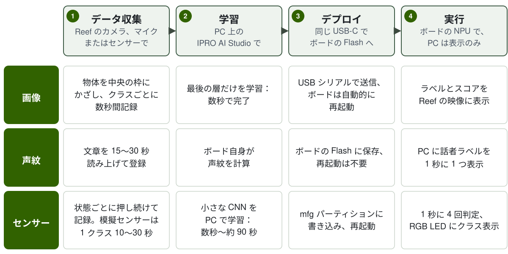

# IPRO AI Teach

IPRO AI Teach を使うと、コードを書かずに IPRO7AI Reef EVK に認識を教えられます。ボード自身のカメラ、マイク、またはセンサー信号でデータを集め、コンピューター上の IPRO AI Studio で学習し、同じ USB-C ケーブルでデプロイします。モデルは IPRO7AI の NPU が実行します。画像、声紋、センサーの 3 つの認識ツールは、1 つの Edge AI ファームウェア `ipro_reef_teach` に入っています。一度に実行するツールは 1 つで、切り替えても 3 つのモデルはすべてボードに残ります。

!!! info "入手方法"
    IPRO AI Studio（macOS と Windows）は [GitHub](https://github.com/INTELPRO-INC/ipro-ai-studio/releases/latest) からダウンロードできます。そのまま書き込める Edge AI ファームウェアのファイルは IPRO Edge AI パッケージで提供されます。INTELPRO にお問い合わせください。SDK には Edge AI ファームウェアのソース `apps/ai/ipro_reef_teach` と、ブラウザー版の画像 Teach `tools/teach_web` が含まれています。

!!! abstract "概要"
    - 1 つのファームウェアに 3 つのモード：`image`（画像認識）、`voice`（声紋認識）、`sensor`（センサー認識）。モードは Flash に保存され、切り替えるとボードが再起動します（約 2 秒）。
    - コンピューター側では IPRO AI Studio の **Teach**、**Audio**、**Sensor** ページを使います。学習はコンピューターの CPU で実行され、GPU は不要です。
    - 推論はすべてボードの NPU で実行されます。画像、音声、センサーデータはどこにもアップロードされず、声紋認識の音声がボードの外に出ることもありません。
    - ハードウェア：IPRO7AI Reef EVK V4.0。ファームウェアの書き込みは 1 回だけで、以後の新しいモデルは USB-C で転送します。

## 紹介ビデオ { #video }

<video controls preload="metadata" playsinline width="100%" poster="/ipro-sdk-docs/assets/videos/ipro-ai-teach-2-intro.jpg">
  <source src="/ipro-sdk-docs/assets/videos/ipro-ai-teach-2-intro.mp4" type="video/mp4">
</video>

ボードの紹介、書き込み、各ツールのデータ収集からボード上での認識までを紹介します（約 3 分、中国語のナレーションと中国語字幕）。

## 3 つのツール { #tools }

| | 画像認識 | 声紋認識 | センサー認識 |
|---|---|---|---|
| 機能 | カメラ映像中央の枠内にある物体を分類します | 誰が話しているかを 1 秒ごとに表示します。登録済みの人は名前で、それ以外の人は Speaker 1、Speaker 2… と表示します | センサー信号から機械や環境の状態を判定します。教えていない状態には `UNKNOWN` と答えます。正常状態だけを学習して異常検知を行うこともできます |
| データソース | OV5640 カメラモジュール | ボードの PDM マイク | ファームウェアに内蔵の 5 種類の模擬センサー、ボードのマイク、または追加したセンサー |
| ファームウェアのモード | `image` | `voice` | `sensor` |
| USB デバイス（VID:PID） | IPRO7 UVC Cam（3896:0705）、USB カメラ＋シリアル | IPRO Reef Voice（3896:0720）、シリアル | IPRO Reef Sensor（3896:0721）、シリアル |
| IPRO AI Studio のページ | **Teach** | **Audio** | **Sensor** |
| クラス数または人数 | 2～8 クラス（BACKGROUND を含む） | ボードの Flash に最大 19 人を保存 | 最大 8 クラス（UNKNOWN を有効にすると教えられるのは 7 クラス） |
| 結果の頻度 | カメラのフレームごと | 1 秒に 1 回 | 1 秒に 4 回 |
| 結果の表示先 | Reef のカメラ映像上に描画 | Audio ページのタイムライン。聞き取り中は RGB LED が赤く点灯 | Sensor ページ。RGB LED の色でクラスを表示 |

声紋認識はコンピューター上で学習しません。人を登録すると、ボード自身が声紋を計算して Flash に保存します。コンピューターはコマンドを送り、結果を表示するだけです。

## 必要なもの { #requirements }

| 項目 | 説明 | 画像 | 声紋 | センサー |
|---|---|---|---|---|
| IPRO7AI Reef EVK V4.0 | [IPRO7AI Reef EVK](../hardware/boards/reef-evk.md) を参照 | ● | ● | ● |
| OV5640 カメラモジュール | FLEX-24 ケーブルを FPC1 に接続し、SW7 を CAM にします | ● | | |
| USB-C データケーブル | Reef の USB-C とコンピューターを接続します。電源供給、ツールとの接続、モデルの転送に使います。充電専用ケーブルは使えません | ● | ● | ● |
| コンピューター | Apple シリコン搭載の macOS 11 以降、または 64 ビット Windows（x64） | ● | ● | ● |
| IPRO AI Studio | 0.4.2。[IPRO AI Studio のインストール](install.md)を参照 | ● | ● | ● |
| IPRO Debug Probe | Reef のデバッグコネクター U6 に接続します。ファームウェアの書き込みとコンソールの表示にのみ必要です | ● | ● | ● |
| IntelProCube v0.6.3 | コマンドラインの書き込みツール。ファームウェアの書き込みにのみ必要です | ● | ● | ● |
| Edge AI ファームウェアのファイル | IPRO Edge AI パッケージの `firmware/`、または SDK からビルドします。[Edge AI ファームウェアの書き込み](firmware.md)を参照 | ● | ● | ● |

センサー認識に外部センサーは不要です。ファームウェアに 5 種類の模擬センサーがあるので、Reef 1 台と USB-C ケーブル 1 本で全体の流れを試せます。独自のセンサーを使うには、ファームウェアにデータソースを追加します。[センサー認識](sensor.md#own-sensor)を参照してください。

## 全体の流れ { #workflow }

1. **IPRO AI Studio をインストールします。** macOS または Windows に Studio をインストールして起動し、カメラの使用を許可します。[IPRO AI Studio のインストール](install.md)を参照してください。

2. **Edge AI ファームウェアを書き込みます（1 回のみ）。** IPRO Debug Probe を介し、IntelProCube で `ipro_reef_teach`、そのパーティションテーブル、mfg ペイロード（起動モードと声紋モデル）を書き込みます。出力に `[All Success]` が表示された場合だけが成功です。[Edge AI ファームウェアの書き込み](firmware.md)を参照してください。

3. **USB-C を接続してボードを確認します。** コンピューターは現在のモードの USB デバイス（例：**IPRO7 UVC Cam**）を認識します。Studio の各ページはこのデバイスでボードを見つけます。ボードが別のモードのときは、ページに **Switch to …** ボタンが表示されます。

4. **データを集めます。** 画像：物体を枠に入れて **Hold to record** を押し続けます。声紋：**TEACH A VOICE** に名前を入力し、**Record** を押して読み上げます。センサー：データソースを選び、状態ごとに **Hold to record** を押し続けます。

5. **学習します。** 画像とセンサーでは **Train** を押します。コンピューター上で数秒から約 90 秒で完了します。声紋は登録した時点で使えるので、学習するものはありません。

6. **デプロイします。** **Deploy** を押します。Studio が **Compile the model**、**Send and write**、**Restart the board** を実行し、ボードが再起動して新しいモデルを読み込みます。

7. **ボードで実行して確認します。** 画像の結果はカメラ映像上に描画されます。声紋では **Start listening** を押してタイムラインを見ます。センサーでは **On the board** エリアが 1 秒に 4 回更新されるのを確認します。

## このセクションのページ { #pages }

-   **[IPRO AI Studio のインストール](install.md)**

    ---

    macOS と Windows への Studio のインストール、初回起動、カメラの許可、Studio がボードを見つける仕組み、`ipro-ai` コマンドライン。

-   **[Edge AI ファームウェアの書き込み](firmware.md)**

    ---

    ファームウェアの入手またはビルド、mfg ペイロードの作成、IntelProCube での書き込み、ファームウェアのみの更新、mfg パーティション、モードの切り替え、起動ログ、ウォッチドッグ。

-   **[画像認識](image.md)**

    ---

    `image` モードへの切り替え、カメラの確認、クラスの作成、記録、学習、デプロイ、ボード上での結果確認、サンプルの追加と再学習。

-   **[声紋認識](voice.md)**

    ---

    `voice` モードへの切り替え、話者の登録、リアルタイムの識別、匿名話者への名前付け、声紋の削除、しきい値と Stranger モード。

-   **[センサー認識](sensor.md)**

    ---

    模擬センサーとマイク、記録、学習オプション、UNKNOWN と異常検知、デプロイ、リアルタイムの結果、独自センサーの追加。

-   **[ブラウザー版の画像 Teach](browser.md)**

    ---

    Studio をインストールせず、SDK の `tools/teach_web` を使って Chrome または Edge で画像 Teach を行います。

-   **[トラブルシューティング](troubleshooting.md)**

    ---

    ボードが見つからない、モードが違う、カメラ映像が黒い、書き込みの失敗、デプロイの拒否、ウォッチドッグによる再起動などの原因と対処。

## 本リリースの制限事項 { #limitations }

- 一度に実行できるツールは 1 つです。モードを切り替えるとボードが再起動します（約 2 秒）。
- 各ツールのモデルスロットは 1 つです。コミット前にデプロイが中断されると、そのツールはモデルのない状態になります。もう一度デプロイしてください。ロールバック先となる以前のモデルはありません。
- モデルは整合性（サイズ、CRC-32）を確認されますが、署名は検証されません。ボードの USB にアクセスできるコンピューターであれば、CRC が正しいモデルをデプロイできます。これをセキュリティ機能とみなさないでください。
- 画像認識には OV5640 カメラモジュールが必要です。また「わからない」という答えはなく、教えていない物体は最も似たクラスに分類されます。
- コンソールは ASCII のみ受け付けます。漢字を含む話者名は Studio の Audio ページで入力してください。
- 本リリースの Edge AI ファームウェアは IPRO7AI Reef EVK に対応しています。ほかの IPRO7AI ボードでは、パーティション、カメラとマイクのピンをご自身で確認してください。
