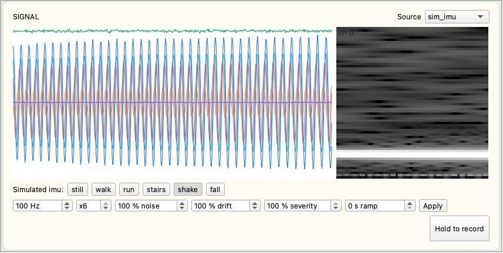
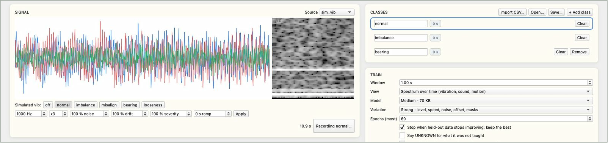
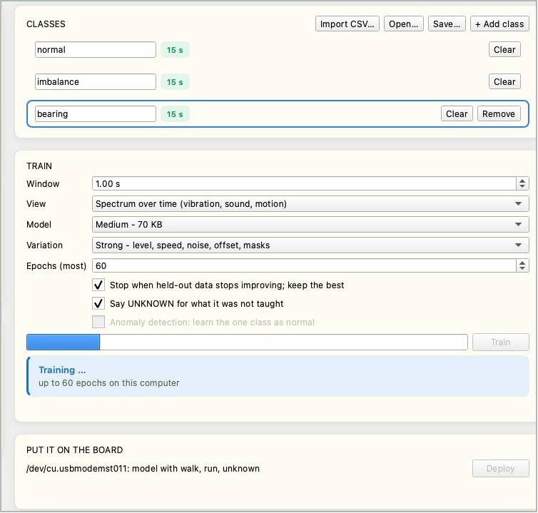
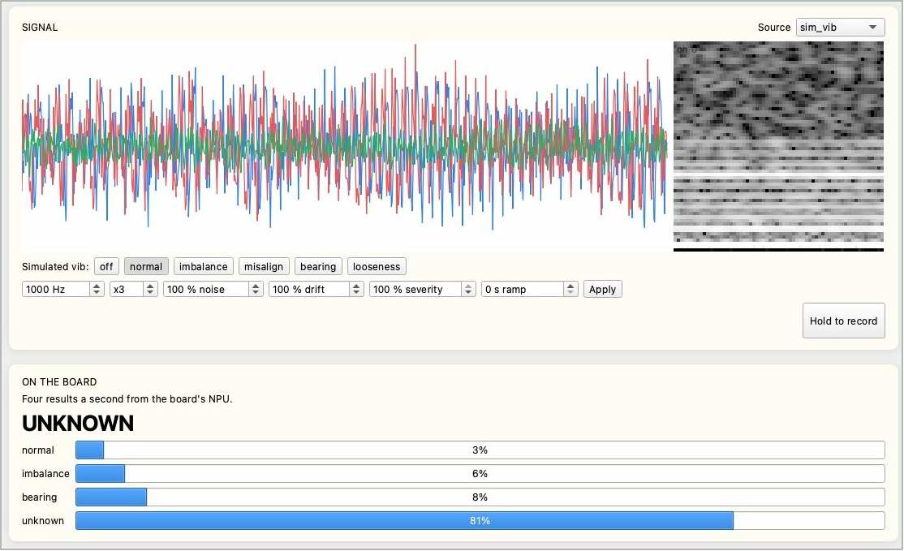

# センサー認識

Reef は、モーターがアンバランスかどうか、人が歩いているのか転倒したのかといった、機械や環境の状態をセンサー信号から判別できるようになります。各状態を記録してコンピューターで学習し、ボードにデプロイすると、以後はボードの NPU が 1 秒に 4 回判定します。すべて IPRO AI Studio の **Sensor** ページで行います。ファームウェアには 5 種類の模擬センサーがあるので、独自のセンサーを配線する前でも、Reef 1 台と USB-C ケーブル 1 本で全体の流れを試せます。

## 前提条件 { #prerequisites }

- Edge AI ファームウェアを書き込んだ IPRO7AI Reef EVK。[Edge AI ファームウェアの書き込み](firmware.md)を参照してください。センサーモデルは Studio がデプロイするので、ほかに書き込むものはありません。
- Reef の USB-C とコンピューターを接続する USB-C データケーブル。
- インストール済みの IPRO AI Studio。[IPRO AI Studio のインストール](install.md)を参照してください。
- 模擬センサーやボードのマイクを使う場合、ほかのハードウェアは不要です。独自のセンサーを使うには、先にファームウェアにデータソースを追加する必要があります。[独自センサーの追加](#own-sensor)を参照してください。

## 仕組み { #how-it-works }

- データソース（模擬センサー、マイク、または独自センサー）のサンプルは、ボード上の 1 MB のリングバッファーに入り、そのまま USB-C で Studio にストリーミングされます。
- Studio は信号の各区間（「ウィンドウ」）を 64×64×8 の特徴マップに変換し、小さな CNN 全体をコンピューター上で学習して、NPU モデルにコンパイルします。
- デプロイ時、モデルは前処理パラメーター、クラス名、データソースとともにセンサーモデルスロットに格納され、ボードは自動的に再起動します。
- ボードは Studio とまったく同じ前処理を行って NPU を実行し、1 秒に 4 回結果を Studio に送り、現在のクラスを RGB LED の色で示します。

## ボードの接続 { #connect }

<div class="ipro-steps" markdown>

1. **`sensor` モードに切り替えます**：Sensor ページを開いて上部の **Switch to Sensor** を押すか、コンソールで `mode sensor` と入力します。起動ログに現在のモデルが表示されます。例：

    ```text
    SENM: model 63672 B, 5/5 layers on the NPU, 6 classes, sim_vib 1000 Hz x3, window 1000, spectrogram
    ```

    モデルがデプロイされていない場合は、この行に理由が表示されます。

2. **USB-C を接続します**：コンピューターに **IPRO Reef Sensor** という名前のシリアルポートが表示されます。

3. **Sensor ページを開きます**：Studio のレールで **Sensor** をクリックします（macOS では Command+6、Windows では Ctrl+6）。

4. **ステータス行を確認します**：**Board** に `ready` と表示され、**Source** に現在のデータソース、サンプリングレート、チャネル数が表示されます（例：`sim_vib 1000 Hz x3`）。ボードが見つからない場合は、**Put it on the board** エリアに `Connect a Reef running the Edge AI firmware to its own USB-C port.` と表示されます。

</div>

## Sensor ページ { #page-layout }

| エリア | 内容 |
|---|---|
| ステータス行 | **Board**、**Source**、**Held-out accuracy**（検証用に取り分けたデータでのスコア。90% 以上で緑）、**Last deploy**（前回のデプロイの時間） |
| **Signal** | リアルタイムの波形（左）とスペクトル（右）。右上の **Source** でデータソースを選びます |
| 模擬状態とパラメーター | 模擬センサーのときに表示されます。上段のボタンで模擬状態を切り替え、下段でサンプリングレート、チャネル数、ノイズ、ドリフト、強度、ランプを設定して **Apply** で適用します |
| **Hold to record** | 押している間、選択中のクラスを記録し、離すと止まります |
| **Classes** | クラスの一覧。各行に名前、記録した秒数、**Clear**、**Remove** があります。一覧の上には **Import CSV…**、**Open…**、**Save…**、**+ Add class** があります |
| **Train** | 学習オプション、プログレスバー、**Train** ボタン、結果、混同行列 |
| **Put it on the board** | ボードのシリアルポートと現在のモデル、**Deploy** ボタン。デプロイの進行状況はその下に表示されます |
| **On the board** | ボードの結果（1 秒に 4 回）。現在の判定が大きな文字で、各クラスの確率がその下に表示されます |

## データソースの選択 { #source }

**Signal** エリア右上の **Source** でデータソースを選びます。ソースを変更すると、Studio が推奨のウィンドウ長と表示方法を設定します。

| ソース | チャネル（単位） | サンプリングレート | 模擬できる状態 | 推奨のウィンドウと表示 |
|---|---|---|---|---|
| `sim_vib` | 3 軸加速度 x、y、z（g） | 1 kHz | `off`、`normal`、`imbalance`、`misalign`、`bearing`（軸受の故障）、`looseness` | 1 秒、スペクトル |
| `sim_imu` | 加速度 ax、ay、az（g）、角速度 gx、gy、gz（500 dps） | 100 Hz | `still`、`walk`、`run`、`stairs`、`shake`、`fall` | 2.56 秒、スペクトル |
| `sim_env` | 温度、気圧、湿度 | 10 Hz | `normal`、`heating`、`cooling_fail`、`leak`、`door_open`、`sensor_fault` | 60 秒、波形 |
| `sim_motor` | 三相電流 A、B、C（A） | 2 kHz | `off`、`normal`、`overload`、`phase_loss`、`broken_bar`（回転子バーの破損）、`bearing`、`unbalanced`（相の不平衡） | 2 秒、スペクトル |
| `sim_sound` | 音圧（1 チャネル） | 8 kHz | `quiet`、`hum`、`alarm`、`knock`、`hiss`（空気漏れ）、`voice` | 0.5 秒、スペクトル |
| `mic` | Reef の PDM マイク（100 Hz ハイパス） | 16 kHz | （実際の音） | 1 秒、スペクトル |

模擬センサーは記録のたびに速度、レベル、ノイズを新たに決め、さらにレベルが 10 秒ごとにゆっくりドリフトします。そのため、同じ状態の 2 回の記録は、同じ機械の 2 回の運転と同じように異なります。

模擬センサーでは、波形の下に 2 段のコントロールがあります：

- **状態ボタン**：例：`Simulated vib: off normal imbalance misalign bearing looseness`。クリックすると模擬状態が切り替わります。Reef のキー SW4 でも状態を順に切り替えられます。
- **パラメーター**：設定して **Apply** を押します。

| パラメーター | 範囲 | 意味 |
|---|---|---|
| Sample rate (Hz) | 1～16000 | 模擬のサンプリング周波数 |
| Channels (x) | 1～6 | 模擬チャネル数 |
| noise (%) | 0～1000 | ノイズの強さ |
| drift (%) | 0～1000 | ドリフトの強さ |
| severity (%) | 0～100 | 状態の特徴の強さ。30% は故障の初期段階 |
| ramp (s) | 0～3600 | 新しい状態がゼロから設定した強さに達するまでの時間。進行する故障を模擬します |



## 記録 { #record }

<div class="ipro-steps" markdown>

1. **クラスに名前を付けます**：一覧には最初から `normal` と `fault` があります。名前をクリックすると変更できます。クラスを増やすには **+ Add class** を押します（最大 8 クラス）。名前には英字、数字、`_ - .` を 15 文字まで使え、スペースは使えません（スペースはアンダースコアになります）。

2. **クラスを選択し、状態を設定します**：記録するクラスをクリックし（枠が青くなります）、機械をその状態にします。模擬センサーでは、対応する状態ボタンを押します。

3. **Hold to record を押し続けます**：記録中はボタンに `Recording <class>…` と表示され、離すと止まります。クラスの横の秒数が加算され、10 秒以上になると緑色になります。

4. **すべてのクラスを順に記録します**：間違えた場合は **Clear** でそのクラスの記録を削除できます。**Remove** はクラスを削除します。

</div>



記録のヒント：

- 模擬センサーでは、1 クラスあたり 10～30 秒で十分です。
- **1 回の記録はウィンドウ長の 2 倍以上押し続けてください。** 各記録の最後の 4 分の 1 は採点用に取り分けられるため、記録が短すぎるクラスは採点できません。1 ウィンドウより短いと `too short: hold for at least one window` と表示されます。
- データストリームが途切れた場合、ページに `the stream skipped: kept as <N> takes` と表示され、記録は N 個に分けて保持されます。
- 温度などの変化の遅い信号は、少なくとも 15 ウィンドウ分と長めに記録します。

**CSV のインポート**：別の場所で記録したデータを、**Import CSV…** で選択中のクラスに追加できます。

- 1 チャネル 1 列、1 サンプル 1 行のカンマ区切りです。ヘッダー行はスキップされます。
- サンプリングレートはボードの現在のデータソースと、列数はそのチャネル数と一致する必要があります。一致しない場合、ページに `<N> columns` のエラーが表示されます。
- ボルトや g ではなく、ボードがストリーミングする生のカウント値を使ってください。スペクトルの下限は 1 カウントなので、単位に変換したデータはリアルタイムの信号とは違って見えます。

## 学習 { #train }

| オプション | 選択肢 | 説明 |
|---|---|---|
| **Window** | 0.05～60 秒（デフォルト 1.00 秒） | 1 回の判定で見る信号の長さ。ソースを変更すると設定されます |
| **View** | Spectrum over time (vibration, sound, motion) | スペクトルの時間変化。振動、音、動き向け |
| | Waveform (slow signals: temperature, pressure) | 生の波形。温度や気圧などの変化の遅い信号向け |
| **Model** | Small - fastest, 21 KB | 最小・最速 |
| | Medium - 70 KB (default) | ほとんどの場合の出発点 |
| | Large - most capacity, 200 KB | 容量が最大。クラスが多い場合や違いがわずかな場合向け |
| **Variation** | Strong - level, speed, noise, offset, masks (default) | 学習時にレベル、速度、ノイズ、オフセット、マスクの変化を加えます。ほとんどの信号に適しています |
| | Light - level and a little noise | レベルの変化とわずかなノイズのみ。強い変化で隠れてしまう、ごくわずかでゆっくりした特徴向け |
| **Epochs (most)** | 5～300（デフォルト 60） | 学習エポック数の上限 |
| Stop when held-out data stops improving; keep the best | チェックあり（デフォルト） | 検証用データで 8 エポック改善がなければ停止し、最良のエポックを保持します |
| Say UNKNOWN for what it was not taught | チェックの有無を選択 | 追加の UNKNOWN クラスを学習します。下記を参照 |
| Anomaly detection: learn the one class as normal | 記録済みのクラスがちょうど 1 つの場合のみ | 異常検知。下記を参照 |

<div class="ipro-steps" markdown>

1. **オプションを設定して Train を押します**：プログレスバーが進み、ページに `Training… up to <n> epochs on this computer` と表示されます。記録のあるクラスが 2 つ以上（異常検知ではちょうど 1 つ）必要で、満たさない場合は `Not ready to train` と表示されます。

    

2. **結果を確認します**：`Trained in <seconds> s` と、学習ウィンドウ数、各記録の末尾から取り分けた検証用ウィンドウ数が表示されます。検証用のスコアは、ボードで実行する int8 モデルで計算されます。

3. **混同行列（`true \ said`）を確認します**：各行が実際のクラス、各列がモデルの判定です。対角線以外にある数字はすべて誤りです。

</div>

`<k> of <n> classes have no held-out data` と表示された場合、一部のクラスの 1 回あたりの記録が短すぎます。ウィンドウ長の 2 倍以上の長さで記録し直してください。学習時間はクラス数、記録の長さ、モデルサイズ、UNKNOWN の有無によって変わります。INTELPRO の測定では、約 4 秒（15 秒ずつ 2 クラス）から約 90 秒（15 秒ずつ 3 クラス、Medium、UNKNOWN 有効）でした。

**UNKNOWN と答えるように教える**：**Say UNKNOWN for what it was not taught** にチェックを入れると、Studio は記録から多くのバリエーションを作って追加の UNKNOWN クラスとして学習し、クラスごとにスコアの下限を設定します。誰も記録していない状態に対して、ボードは既知のクラスに無理に当てはめず、`UNKNOWN` と答えます。UNKNOWN を有効にすると、教えられるクラスは最大 7 つです（8 つ目は UNKNOWN が使います）。

**正常状態だけを記録する：異常検知**：記録のあるクラスがちょうど 1 つ（通常は「normal」）のとき、**Anomaly detection: learn the one class as normal** にチェックを入れられます。Studio は正常データに人工的な異常（新しいトーン、打撃音、ノイズバースト、レベルの急変やドリフト、張り付いた値、大きな速度変化、出力の止まったチャネル、クリッピング、ピークや高調波の増大、チャネルのゲイン変化、ゆっくりしたうなり）を加え、モデルは「正常」と「それ以外のすべて」を区別することを学習します。こうして、記録したことのない故障が `ANOMALY` として検出されます。Studio は、変化を加えた正常データの約 1% が異常と判定されるように判定しきい値を設定します。記録できる故障については、通常は異常検知よりも分類（故障ごとに 1 クラス）のほうが信頼性が高くなります。

## デプロイ { #deploy }

<div class="ipro-steps" markdown>

1. **ボードを確認します**：**Put it on the board** エリアに、ボードのシリアルポートと現在のモデルが表示されます（例：`/dev/cu.usbmodemXXXX: no model yet`）。

2. **Deploy を押します**：Studio は **Compile the model**（コンパイルしてモデルサイズと NPU 層数を表示）、**Send and write**（ボードが `TDEP OK` と応答）、**Restart the board**（ボードが再起動して新しいモデルを読み込む）を実行し、完了したものにチェックを付けます。

3. **完了を確認します**：ページに **On the board** と `<class names> - results below, four a second.` が表示され、ステータス行の **Last deploy** に時間が表示されます。

</div>

デプロイは通常数秒で終わります。モデルが大きいほど、送信と書き込みに時間がかかります。センサーモデルのスロットは 1 つだけです。書き込みが中断されるとモデルのない状態になるので、もう一度デプロイしてください。

## リアルタイムの結果 { #run }

デプロイ後、**On the board** エリアは 1 秒に 4 回更新されます：

- **大きな文字**：現在の判定。クラス名、`UNKNOWN`（教えていない状態）、または `ANOMALY`（異常検知モードでの異常）のいずれかです。
- **バー**：各クラスの確率。
- Reef の RGB LED も現在のクラスを色で示すので、コンピューターがなくても結果を読み取れます。



模擬センサーでは、教えていない状態に切り替えて、UNKNOWN が機能することを確認できます。ramp を数十秒に設定すると、故障が進行するにつれて判定が変わるタイミングを観察できます。状態が切り替わる瞬間は 1 つのウィンドウに両方の状態が含まれることがあるため、ときどき UNKNOWN が出るのは正常です。連続するいくつかの結果から判断してください。

sensor モードのコンソールコマンド：

| コマンド | 機能 |
|---|---|
| `sens status` | 現在のデータソース、モデル、状態 |
| `sens src <source>` | データソースを切り替えます：`sim_vib`、`sim_imu`、`sim_env`、`sim_motor`、`sim_sound`、`mic` |
| `sens sim <state>` | 模擬センサーの状態を切り替えます（`sens status` で一覧表示） |
| `sens print on` / `sens print off` | すべての結果をコンソールに出力します |

## 動作確認 { #verify }

1. デプロイ後、**On the board** が 1 秒に 4 回更新され、大きな文字が模擬状態ボタンや機械の実際の状態に追従します。
2. 教えたすべての状態について、大きな文字にそのクラス名が表示され、その確率が最も高くなります。
3. UNKNOWN を有効にした場合、教えていない状態に切り替えると `UNKNOWN` と表示されます。
4. RGB LED の色がクラスに応じて変わります。再起動後もモデルが残っています（起動ログに `SENM: model …` と表示されます）。

## 保存と再学習 { #iterate }

- **Save…**：すべての記録をフォルダーに書き出します。クラスごとに 1 つの `.npz` ファイルと、サンプリングレートとクラスの順序を記録した `sensor_teach.json` です。
- **Open…**：**Save…** で保存したフォルダーを開き、記録の追加や再学習を行います。
- 同じフォルダーをコマンドラインから、ウィンドウを使わずに学習してモデルパッケージにし、デプロイすることもできます（`--source` は記録したときのソースにする必要があります）：

    ```bash
    ipro-ai train sensor rec/ --source sim_vib --out vib.ipkg
    ipro-ai deploy vib.ipkg --switch
    ```

    デフォルトは Sensor ページと同じです（Medium、Strong、最大 60 エポック、改善がないまま 8 エポックで停止）。`--size`、`--window`、`--mode spectrogram|wave`、`--unknown`、`--anomaly` などのオプションは、ページの設定に対応します。

## 独自センサーの追加 { #own-sensor }

出荷時の Edge AI ファームウェアのデータソースは、5 種類の模擬センサーとボードのマイクだけで、外部センサーのドライバーはありません。独自のセンサーを使う方法は 2 つあります：

**方法 1：ファームウェアにデータソースを追加する（推奨）**

ファームウェアエンジニアが、SDK の `apps/ai/ipro_reef_teach/sensor/sensor_src.c` にあるソーステーブルにエントリを追加します。I2C や SPI のデバイスは `ipro_ai_source_sampled_register()` で登録し（プラットフォームがタイマーで読み取り関数を呼び出します）、ストリームは `ipro_ai_source_ring_register()` で登録します（割り込みからデータをプッシュできます）。どちらも `components/ai/source/include/ipro_ai_source.h` で宣言されています。ルールは次のとおりです：

- サンプルは int16、チャネルはインターリーブ、全チャネルで同じサンプリングレートです。
- 最大 8 チャネル。1 ウィンドウが 1 MB のリングバッファーに収まれば、サンプリングレートは任意です。プラットフォームのタイマーで呼び出されるポーリング型のソースは、最大 1 kHz（システムティック）です。
- ソースは名前、サンプリングレート、チャネル数、単位を報告します。

Reef の 40 ピンヘッダー J_IO の 3 番ピンと 5 番ピンは I2C（SDA GPIO19、SCL GPIO18、ボード上に 4.7 kΩ のプルアップ）で、3.3 V です。[40 ピンヘッダー J_IO](../hardware/boards/reef-evk.md#j-io) を参照してください。[Edge AI ファームウェアの書き込み](firmware.md)のとおりにビルドして書き込みます。ファームウェアのみを更新するので `--mfg` は省きます。

Studio の変更は不要です。Studio はボードからソースの名前、サンプリングレート、チャネル数を読み取り、新しいソースが **Source** メニューに表示されます。モデルは学習に使ったデータソースを記録しており、ボードはそのソースでのみモデルを実行します。

**方法 2：CSV をインポートする**

同じセンサー、サンプリングレート、チャネル数で別の場所で記録したデータは、**Import CSV…** でクラスに追加できます。デプロイしたモデルを実行するには、やはりボード上に対応するデータソースが必要です。そのため、この方法は学習データを追加するだけで、方法 1 の代わりにはなりません。

## 仕様 { #specs }

| 項目 | 仕様 |
|---|---|
| クラス数 | 最大 8。UNKNOWN を有効にすると教えられるのは最大 7 |
| チャネル数 | 最大 8（模擬センサーは 1～6） |
| サンプリングレート | 1 Hz～16 kHz |
| ウィンドウ長 | 0.05～60 秒。1 MB のリングバッファーによる制限もあります。例：16 kHz・1 チャネルで 32 秒、1 kHz・3 チャネルで 170 秒 |
| 前処理 | スペクトル：チャネルごとに 64 の時間区間、それぞれ 128 点の FFT、周波数分解能はサンプリングレート / 128、1 ウィンドウあたり 128 サンプル以上。波形：各チャネルを 4096 点にリサンプリング |
| モデルの入力 | 64×64×8、int8 |
| ネットワーク | 3×3・ストライド 2 の畳み込み 4 層と 1×1 の分類層。すべての層を NPU で実行 |
| ボード上のモデルサイズ | Small 約 17 KB、Medium 約 64 KB、Large 約 191 KB |
| ボード上の処理時間 | Large モデル：NPU 約 4.6 ms。前処理 約 56 ms（1 秒のウィンドウ、3 チャネル、スペクトル） |
| 結果 | 1 秒に 4 回。USB-C で Studio に送られ、RGB LED にも表示 |
| モデルスロット | センサーモデルスロット、容量 252 KB |

## ヒント { #tips }

- **模擬センサーは流れを学ぶためのものです。** 実際のセンサーでは、新しいデータを集め、学習し直して、現地で検証してください。
- **異常検知は記録した「正常」しか知りません。** 機械のすべての正常な負荷と速度で正常データを記録してください。そうしないと、重めの正常な負荷が異常と判定されたり、実際の過負荷が正常として見逃されたりすることがあります。
- 周波数に明確な特徴がある故障（軸受の故障、緩み、欠相）は最も検出しやすく、振幅が大きくなるだけの故障（過負荷、相の不平衡）は異常検知では検出しにくくなります。こうした故障には分類を使ってください。
- 変化の遅い信号（温度、気圧）には波形表示を使い、1 回の記録を 15 ウィンドウ以上にします。異常検知には正常データを十分に記録してください。
- スペクトル表示には 1 ウィンドウあたり 128 サンプル以上が必要です。サンプリングレートが非常に低い場合は、波形表示か長いウィンドウを使ってください。
- 周波数の差がサンプリングレート / 128 未満の故障は、時間とともにゆっくりしたうなりとしてしか現れません。2 秒以上のウィンドウが必要で、それでも最も難しいケースです。
- モデルは学習に使ったデータソース（名前、サンプリングレート、チャネル数）でのみ動作します。ソースやそのパラメーターを変更したら、学習とデプロイをやり直してください。

## トラブルシューティング { #troubleshooting }

| 症状 | 原因 | 対処 |
|---|---|---|
| **Put it on the board** に `Connect a Reef running the Edge AI firmware to its own USB-C port.` と表示される | `sensor` モードのボードが見つからない | ファームウェアとケーブルを確認します。USB-C は Reef 自身のポートに接続する必要があります。**Switch to Sensor** を押します |
| `Not ready to train` | ボードが接続されていない、または記録のあるクラスが 2 つ未満（異常検知ではちょうど 1 つが必要） | ボードを接続し、各クラスを記録します |
| `too short: hold for at least one window` | 押していた時間が 1 ウィンドウ未満 | もっと長く押し続けます |
| `<k> of <n> classes have no held-out data` | 一部のクラスの 1 回あたりの記録が短すぎる | 毎回ウィンドウ長の 2 倍以上押し続けます |
| **Import CSV…** で `<N> columns` と表示される | CSV の列数がソースのチャネル数と一致しない | 1 チャネル 1 列、1 サンプル 1 行にします |
| **Open…** で `Not a Sensor Teach folder` と表示される | フォルダーに `sensor_teach.json` がない | **Save…** で保存したフォルダーを開きます |
| デプロイが `the board did not come back with the model within 30 s` で失敗する | ボードが 30 秒以内に新しいモデルで復帰しなかった | USB-C を抜き差しし、コンソールの起動ログを確認して、もう一度デプロイします |
| デプロイが `the board refused it: …` で失敗し、メッセージに `size` が含まれる | モデルがスロットより大きい | より小さい **Model**（Medium または Small）を選びます |
| ソースを変更した後、学習済みのモデルが動作しない | モデルは学習に使ったソースでのみ動作する | 新しいソースで記録し直して学習します |
| リアルタイムの結果で、状態の切り替わり時に `UNKNOWN` が表示される | ウィンドウに両方の状態が含まれている | 正常です。連続するいくつかの結果から判断してください |
| 重いが正常な負荷で、異常検知がアラームを出す | 正常データがその負荷をカバーしていない | すべての正常な負荷と速度で正常データを記録し、学習し直します |

その他の問題は[トラブルシューティング](troubleshooting.md)を参照してください。

## 次のステップ { #next-steps }

- [Edge AI ファームウェアの書き込み](firmware.md)：データソースを追加した後、ファームウェアのみを更新します。
- IPRO7AI Edge AI Programming Guide：データソース、前処理、アプリケーションフレームワークのインターフェース全体を記載しています。INTELPRO から入手できます。[ドキュメント](../documents/index.md)を参照してください。
