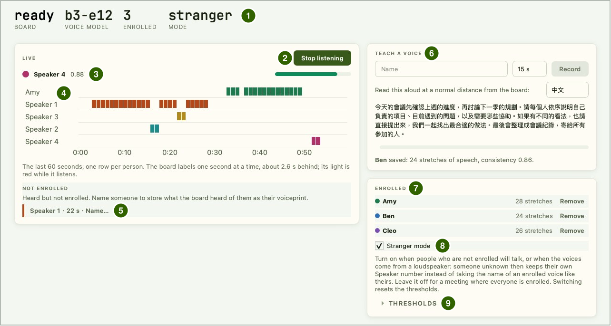
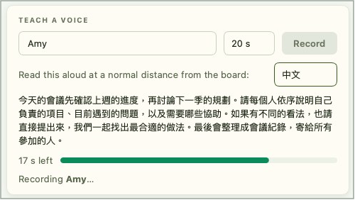
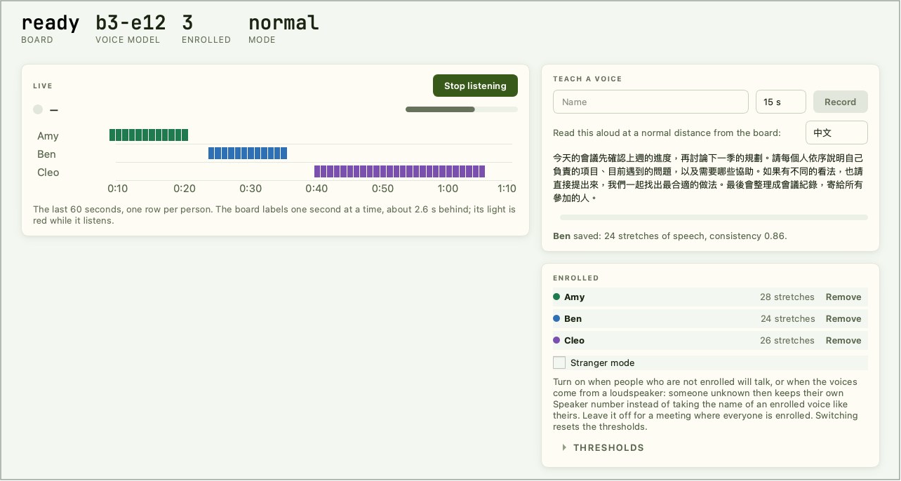

# 声紋認識

1 人あたり約 20 秒間、文章を読み上げて登録します。その後、Reef は 1 秒ごとに誰が話しているかを表示します。登録済みの人は名前で、それ以外の人は Speaker 1、Speaker 2 などと表示され、後から名前を付けることもできます。計算はすべてボード上で行われ、声紋はボードの Flash に保存され、音声がボードの外に出ることはありません。コンピューターでは IPRO AI Studio の **Audio** ページを使います。このページの図中の名前（Amy、Ben、Cleo）は例です。

!!! note "録音の前に同意を得てください"
    登録や聞き取りを行う前に、その場にいる全員の同意を得てください。

## 前提条件 { #prerequisites }

- Edge AI ファームウェアを書き込み、mfg ペイロードに声紋モデル `model_b.spkb` を含めた IPRO7AI Reef EVK。[Edge AI ファームウェアの書き込み](firmware.md)を参照してください。
- Reef の USB-C とコンピューターを接続する USB-C データケーブル。声紋認識はボードの PDM マイクを使うため、カメラは不要です。
- インストール済みの IPRO AI Studio。[IPRO AI Studio のインストール](install.md)を参照してください。
- 静かな部屋。登録と聞き取りには Reef 自身のマイクを使います。

## 仕組み { #how-it-works }

- ボードの PDM マイクの音声は 16 kHz にリサンプリングされ、直近 32 秒を保持するリングバッファーに入ります。
- ボードは 1 秒ごとに直近 2.6 秒を取り出してログメルスペクトログラムを計算し、NPU 上の声紋ネットワークと、CPU 上のプーリング層と全結合層に通して、192 個の値からなる声紋を得ます。
- **登録** では、読み上げ中の発話を含む 2.6 秒の区間をそれぞれ声紋に変換して平均し、結果を Flash の media パーティションに保存します。
- **聞き取り** 中は、毎秒の声紋を登録済みの人と比較します（コサイン類似度）。最も高いスコアが名前しきい値に達すれば、その名前を表示します。誰も達しない場合は現在の匿名話者と比較し、新規話者しきい値を下回れば新しい匿名話者を作ります。
- コンピューターはコマンドを送り、ボードから返されたラベルを表示するだけです。録音中や聞き取り中は Reef の RGB LED が赤く点灯します。

## ボードの接続 { #connect }

<div class="ipro-steps" markdown>

1. **`voice` モードに切り替えます**：Audio ページを開いて上部の **Switch to Audio** を押すか、コンソールで `mode voice` と入力します。再起動後、コンソールに次のように表示されます：

    ```text
    SPKM: model 'b3-e12': 437200 B, trunk 16/16 layers on the NPU, ...
    RTCH: voice ready - shell `spk`, IPRO AI Studio Audio page over USB-C
    ```

    `NO MODEL` と表示される場合、ボードに有効な声紋モデルがありません。[声紋モデルの変更](#voice-model)を参照してください。

2. **USB-C を接続します**：コンピューターに **IPRO Reef Voice** という名前のシリアルポートが表示されます。

3. **Audio ページを開きます**：Studio のレールで **Audio** をクリックします（macOS では Command+7、Windows では Ctrl+7）。ページが自動的にボードを見つけるので、シリアルポートを選ぶ必要はありません。

4. **ステータス行を確認します**：**BOARD** に `ready`、**VOICE MODEL** に `b3-e12` と表示されます。**ENROLLED** は登録済みの人数、**MODE** は `normal` または `stranger` です。

</div>

ボードの USB シリアルポートを開けるプログラムは一度に 1 つだけです。Audio ページを使っている間は、このポートを開いているほかのプログラムを閉じてください。Audio ページから離れると、聞き取りは停止します。

## Audio ページ { #page-layout }



| 番号 | エリア | 機能 |
|---|---|---|
| 1 | ステータス行 | **BOARD**（ボードの状態）、**VOICE MODEL**（声紋モデル）、**ENROLLED**（登録人数）、**MODE**（`normal` または `stranger`） |
| 2 | **Start listening** | 聞き取りを開始します。聞き取り中は **Stop listening** と表示され、もう一度押すと停止します |
| 3 | 現在の話者 | 名前と類似度スコア |
| 4 | タイムライン（**LIVE**） | 直近 60 秒。1 人 1 行、1 秒 1 ブロック |
| 5 | **NOT ENROLLED** | 聞き取ったが登録されていない人。1 人につき 1 つのタグ（例：`Speaker 1 · 22 s · Name…`）。タグをクリックすると、その人に名前を付けられます |
| 6 | **TEACH A VOICE** | 名前を入力し、読み上げ時間（15 s、20 s、30 s）を選んで **Record** を押すと登録します。右側で読み上げる文章の言語（中文または English）を選びます。結果はその下に表示されます |
| 7 | **ENROLLED** | 登録済みの人。1 人 1 行で、声紋に含まれる音声区間の数と **Remove** ボタンがあります |
| 8 | **Stranger mode** | Stranger モードのオン・オフ。[しきい値と Stranger モード](#thresholds)を参照してください |
| 9 | **THRESHOLDS** | 展開すると、名前しきい値と新規話者しきい値を設定できます |

## 話者の登録 { #enroll }

<div class="ipro-steps" markdown>

1. **名前を入力し、時間を選びます**：**TEACH A VOICE** に名前を入力し（スペースや漢字も使えます）、読み上げ時間を選びます（デフォルトは 20 s）。聞き取り中は登録できないので、先に **Stop listening** を押してください。

2. **位置に着きます**：読み上げる人は、後で話すときと同じ場所に、ボードからいつもの距離で座ります。

3. **Record を押して読み上げます**：表示された文章を、時間が終わるまで読み続けます。残り秒数がプログレスバーの横に、`Recording <name>…` がその下に表示されます。

    

4. **結果を確認します**：時間が終わると、ページに `<name> saved: <n> stretches of speech, consistency <value>.` と表示され、名前が **ENROLLED** の一覧に追加されます。stretches of speech は声紋に使われた音声区間の数、consistency（一貫性）はそれらがどれだけ似ているかを示します。

</div>

**consistency が 0.8 未満の場合は登録し直してください**：ボードに近づき、その人が実際に聞き取られる場所と声で行います。この場合は Studio が知らせます。同じ名前でもう一度登録すると声紋が置き換えられます。その前に、ページが **Record again** ダイアログで確認します。

登録に失敗すると、ページに `Could not save <name>:` と理由が表示されます：

| メッセージ | 対処 |
|---|---|
| `Too little speech was heard. …` | もっと大きな声で、または近くで話し、時間が終わるまで読み続けます |
| `The board's voice list is full. Remove someone first.` | 一覧がいっぱいです。先に誰かを削除します |
| `The board has no voice model.` | ボードに声紋モデルがありません。[声紋モデルの変更](#voice-model)を参照してください |
| `The board's microphone did not start.` | マイクが起動しませんでした。USB-C を抜き差ししてから、もう一度試します |
| `Recording was cancelled.` | 登録がキャンセルされました。もう一度 **Record** を押します |
| `The board refused: check the name, or wait for what it is doing to finish.` | 名前を確認するか、ボードが現在の処理（聞き取りなど）を終えるまで待ちます |

## リアルタイムの話者識別 { #listen }

<div class="ipro-steps" markdown>

1. **静かにして Start listening を押します**：聞き取りを開始するたびに、ボードはその時点から背景ノイズの追跡を始めます。押すときは、できるだけ部屋を静かにしてください。RGB LED が赤く点灯します。

2. **話し始めます**：ボードは直近 2.6 秒に対するラベルを 1 秒に 1 つ送るため、ラベルは発話から約 2.6 秒遅れて表示されます。無音の区間にはラベルが付きません。タイムラインの色は **ENROLLED** 一覧の点の色と対応しています。

3. **停止するには Stop listening を押します。**

</div>

## 匿名話者への名前付け { #name-speaker }

登録されていない人は、ボードが 3 秒間その声を聞くと、タイムラインに Speaker 1、Speaker 2… として表示され、**NOT ENROLLED** エリアに `Speaker 2 · 26 s · Name…` のようなタグとして表示されます（26 s はボードがその人の声を聞いた時間）。

1. そのタグの **Name…** をクリックします。
2. **Name a speaker** ダイアログで名前を入力して確定します。

ボードは直前に聞いたその話者の音声を声紋として保持し、以後はその名前を表示します。読み上げは不要です。



## 声紋の削除 { #remove }

**ENROLLED** 一覧の人の横にある **Remove** を押して確定すると、その人の声紋が削除されます。全員を削除すると、ステータス行の **ENROLLED** は 0 になり、一覧に `Nobody enrolled yet.` と表示されます。タイムラインにすでに表示されている内容は変わりません。

## しきい値と Stranger モード { #thresholds }

**THRESHOLDS** を展開して 2 つのしきい値（コサイン類似度、0.1～0.95）を設定し、**Set** を押します。しきい値とモードは声紋とともにボードに保存され、再起動後も保持されます。

| しきい値 | 通常モードのデフォルト | Stranger モードのデフォルト | 効果 |
|---|---|---|---|
| **Name match** | 0.60 | 0.50 | 音声区間が登録済みの人に対してこの類似度に達すると、その人の名前が表示されます。高くすると名前で表示される人が減って匿名が増え、低くするとその逆になります |
| **New speaker** | 0.50 | 0.50 | 認識されなかった声は、現在のすべての匿名話者との類似度がこの値を下回ると、新しい匿名話者になります。1 人が複数に分かれる場合は下げ、別々の人が 1 人にまとめられる場合は上げます |

**Stranger mode** のチェックを入れる・外すとモードが切り替わり、ステータス行の **MODE** に `stranger` または `normal` と表示されます。切り替えると、両方のしきい値がそのモードのデフォルトに戻ります。コンソールの `spk mode stranger` と `spk mode normal` でも同じことができます。

Stranger モードでは、登録されていない人が別の人の名前で表示されにくくなります。ボードは比較の前に、室内のすべての声に共通する成分（マイク、部屋、スピーカーの影響）を取り除き、ボードが聞いた未登録の人はそれぞれ自分の Speaker 番号を保ちます。

| 状況 | 推奨 |
|---|---|
| 登録されていない人も話す、または声がスピーカーや録音から流れる | Stranger モードをオンにします |
| その場にいる全員が登録済み | オフのままにします。話者が離れていると、Stranger モードでは登録済みの人が匿名として表示されることが多くなります |

Stranger モードには質の良い登録が必要です。consistency の低い人は匿名として表示されることが多くなり、未登録の 2 人が 1 つの番号にまとめられることもあります。consistency が 0.8 未満のときは、必ず登録し直してください。

## コンソールコマンド { #console }

voice モードのコンソール（U6、115200 baud）では、デバッグ用に Audio ページと同じ操作ができます：

| コマンド | 機能 |
|---|---|
| `spk status` | モデル、状態、登録一覧、USB 接続 |
| `spk enroll 20 <name>` | 20 秒間の読み上げで登録します（8～30 秒） |
| `spk live on` / `spk live off` / `spk stop` | 聞き取りの開始／聞き取りの停止／現在の処理の停止 |
| `spk del <name>` | 人の声紋を削除します |
| `spk name <k> <name>` | 匿名話者 k に名前を付けます |
| `spk thresh <name> <new>` | 両方のしきい値を設定します（例：`spk thresh 0.60 0.50`） |
| `spk mode normal` / `spk mode stranger` | 通常モードまたは Stranger モードに切り替えます。両方のしきい値がそのモードのデフォルトに戻ります |
| `spk echo on` | すべてのイベント行と、毎秒の登録済み全員に対するスコアを出力します |

コンソールは ASCII のみ受け付けます。漢字を含む名前は Audio ページで入力してください。

## 動作確認 { #verify }

1. 登録後、名前が **ENROLLED** 一覧にあり、consistency が 0.8 以上です。
2. **Start listening** の後、RGB LED が赤く点灯します。登録済みの人が話し始めてから約 2.6 秒後に、その人の行にブロックが表示され、現在の話者にその人の名前と類似度が表示されます。
3. 登録されていない人が話すと、タイムラインに Speaker k が表示され、**NOT ENROLLED** にその人のタグが表示されます。
4. 再起動後に Audio ページに戻っても、**ENROLLED** の数は変わりません。

## 声紋モデルの変更 { #voice-model }

声紋モデル `model_b.spkb`（モデル名 `b3-e12`）は mfg ペイロードとともに書き込まれます。代わりに USB でデプロイするには、モデルパッケージを作成し、コマンドラインから声紋ツールにデプロイします：

```bash
ipro-ai model pack model_b.spkb -o voice.ipkg
ipro-ai deploy voice.ipkg --switch
```

登録済みの声紋はモデルの CRC に結び付いています。別の声紋モデルに変更すると登録一覧はクリアされ、全員が登録し直す必要があります。ファームウェアのみを更新した場合は、モデルと登録済みの人はどちらも保持されます。IPRO AI Studio 0.4.2 の Audio ページには、モデルをデプロイするボタンはありません。

## 仕様と制限 { #specs }

| 項目 | 仕様 |
|---|---|
| 音声入力 | Reef の PDM マイク、16 kHz にリサンプリング、100 Hz ハイパス |
| ラベル | 1 秒に 1 つ、直近 2.6 秒の音から判定 |
| 声紋 | 192 個の値。ボード上で 1 声紋あたり約 140 ms（うち前処理が約 118 ms、NPU が約 9 ms） |
| 声紋モデル | `model_b.spkb`（b3-e12）、437,200 B。トランクの全 16 層を NPU で実行 |
| 登録の長さ | Audio ページでは 15、20、30 秒。コンソールでは 8～30 秒 |
| 保存人数 | Flash の media パーティション（16 KB）に 19 人。それ以上は RAM に保持され、再起動で失われます |
| 発話の検出 | エネルギーによる判定：追跡している背景ノイズより 3 dB 大きければ発話とみなします |
| モデルスロット | 声紋モデルスロット、容量 444 KB |

- 別のマイクで登録した声紋は、Reef で聞いた同じ人の声とあまり一致しません。登録と聞き取りには Reef 自身のマイクを使ってください。
- スピーカーで再生すると、異なる人の声紋が似てきます。スピーカーや録音でテストするときは Stranger モードをオンにしてください。
- 話者ごとに 2.6 秒より短い区間や、2 人が同時に話している区間は、個別にラベル付けできません。
- 発話の検出は音の大きさで判定するため、音楽やテレビも発話とみなされます。継続的な背景音から離れた、静かな部屋で使ってください。
- 匿名話者は聞き取り中にクラスタリングされ、後からまとめられることはありません。1 人が 2 人に分かれた場合は、どちらかに名前を付けるか、新規話者しきい値を調整してください。
- なまり、残響、話す距離は場所によって異なります。実際に使う前に現地で試し、必要に応じてしきい値やモードを調整してください。

## トラブルシューティング { #troubleshooting }

| 症状 | 原因 | 対処 |
|---|---|---|
| Audio ページに `The board has no voice model.` と表示される、またはコンソールに `NO MODEL` と表示される | ボードに有効な声紋モデルがない | `--mfg` 付きで書き込み直すか、`ipro-ai deploy` で声紋モデルをデプロイします |
| Audio ページに `The board did not answer.` と表示される、またはボードが見つからない | ほかのプログラムがボードのシリアルポートを使用している、またはボードが `voice` モードではない | そのポートを使っているほかのプログラムを閉じます。**Switch to Audio** を押します |
| 登録されていない人に、登録済みの人の名前が表示され続ける | 通常モードとしては名前しきい値が低い。特にスピーカー再生時 | Stranger モードをオンにするか、**Name match** を上げます |
| 登録済みの人が Speaker k と表示されることが多い | 実際の使用時とは異なる場所、マイク、音量で登録した、または名前しきい値が高すぎる | 実際の位置で Reef のマイクを使って登録し直すか、**Name match** を少し下げます |
| 1 人が複数の話者に分かれる | 新規話者しきい値が高すぎる | **New speaker** を下げるか、どちらかに名前を付けます |
| 誰も話していないのにラベルが表示される | 音楽、テレビ、その他の継続的な音が発話とみなされている | 背景音を取り除き、静かな部屋で使います |
| 声紋モデルを変更した後、登録済みの人が全員いなくなった | 声紋はモデルに結び付いている | 新しいモデルで登録し直します |

その他の問題は[トラブルシューティング](troubleshooting.md)を参照してください。

## 次のステップ { #next-steps }

- [センサー認識](sensor.md)：同じ Reef で機械や環境の状態を判別します。
- [Edge AI ファームウェアの書き込み](firmware.md#modes)：モードの切り替えと USB デバイスの一覧。
