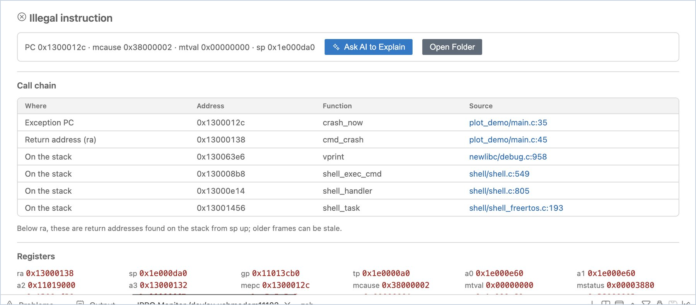
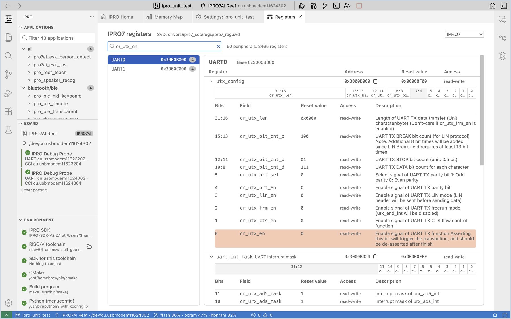

# デバッグと解析

ボードがクラッシュしたり、想定外の動作をしたりしたときは、これらのツールを使って、原因となったコード行、その時点のレジスターとメモリの状態、レジスターのフィールドの意味を調べられます。本リリースでは、JTAG によるデバッグは利用できません。

## クラッシュアドレスの自動デコード { #crash-decode }

IPRO7 のファームウェアがクラッシュすると、例外が発生したプログラムアドレス（MEPC）、リターンアドレス（ra）、スタックバックトレースをシリアルポートに出力します。IPRO Monitor は、各アドレスの下にデコード結果を灰色の行で追加表示します（画面上では矢印で始まります。下の例では `->` で示しています）。例：

```text
MEPC   : 0x13000146
    -> 0x13000146 crash_now  …/apps/user/plot_demo/main.c:30
```

デコード結果は、関数名と、ソースコードのファイル名および行番号です。

!!! warning "重要"
    デコードには現在のアプリケーションの最新ビルドの ELF ファイルを使用するため、ボード上のファームウェアが現在のビルドと一致している必要があります。サイドバーの **Board** ビューに「Runs other firmware」と表示されている場合、デコード結果は信頼できません。先に書き込み直してください。

## クラッシュダンプ { #crash-dump }

アドレスだけでは不十分な場合は、クラッシュの後にボードからレジスターと RAM 全体をコンピューターに送らせることができます。IDE は、スタックから完全なコールチェーンを見つけ出します。

<div class="ipro-steps" markdown>

1. **クラッシュダンプを有効にします。** アプリケーションの `.config` に `CONFIG_EXCEPTION_DUMP=y` を追加し（[設定（Kconfig）](develop.md#kconfig)で `EXCEPTION_DUMP` を検索できます）、ビルドして書き込みます。

2. **シリアルモニターを開いた状態で、ボードをクラッシュさせます。**

    **期待される結果**：「The board crashed and offers a crash dump of its RAM and registers. Collect it? It takes about a minute; the board waits for 2 minutes.」という通知が表示されます。

3. **収集します。** **Collect Crash Dump** をクリックします。

    **期待される結果**：進行状況に「Receiving the crash dump from &lt;port&gt;…」と表示されます。転送が完了すると（256 KB の OCRAM と 8 MB の PSRAM で、実測で約 64 秒）、エディター領域に **Crash Dump** が開きます。

4. **クラッシュダンプを読みます。** **Crash Dump** の内容を確認します。

    **期待される結果**：

    - 最上部に例外の種類（例：`Illegal instruction`）が表示され、次の行に概要（PC、mcause、mtval、sp）が表示されます。
    - **Call chain** の表には、例外の PC、リターンアドレス（ra）、スタック上で見つかったリターンアドレスが順に並びます。各行にはアドレス、関数、ソースの位置があり、ソースの位置をクリックするとその行が開きます。
    - **Registers** には、クラッシュ時のすべてのレジスターが一覧表示されます。

5. **説明を求めます（任意）。** 必要に応じて **Ask AI to Explain** をクリックします。AI アシスタントがコールチェーンに沿ってコードを読み、原因を説明します。**Open Folder** をクリックすると、送られてきた生のファイルを確認できます。

</div>



!!! note
    - コールチェーンで ra より下にある項目は、sp からスタックを上にたどって見つかったリターンアドレスです。リストの下にあるものほど、以前の処理で残った古いデータである可能性が高くなります。
    - クラッシュダンプは、アプリケーションの `build/crash/<date>` フォルダーに保存されます。後で再び確認するには、IPRO メニューから **Crash Dumps…** を選択します。
    - 転送中にブロックがチェックに失敗した場合は、ページに「The dump is incomplete」と表示され、受信できた部分が一覧表示されます。

## レジスターリファレンス { #registers }

**Register Reference** は、チップの SVD ファイルにあるすべての周辺機能、レジスター、フィールドを一覧表示します。ドライバーを書くときやレジスターダンプを読むときに、その場で参照できます。

<div class="ipro-steps" markdown>

1. **開きます。** IPRO Home で **Register reference (SVD)** をクリックします。

    **期待される結果**：「IPRO7 registers」が開き、その横に SVD ファイルの場所と、周辺機能およびレジスターの総数が表示されます（IPRO7 は周辺機能 50、レジスター 2465）。右上でチップを切り替えられます。

2. **検索します。** 検索ボックスに周辺機能、レジスター、フィールドの名前（例：`cr_utx_en`）を入力するか、アドレスを直接入力します（例：UART0 であれば `0x3000B000`）。

    **期待される結果**：左側に周辺機能とそのベースアドレス、右側にレジスターとそのアドレス、リセット値、アクセス属性が表示されます。レジスターを展開すると、32 ビットのフィールドマップと各フィールドの説明が表示されます。

3. **アドレスをコピーします。** レジスターの横にある **Copy the address** をクリックすると、そのアドレスがクリップボードにコピーされます。

</div>


