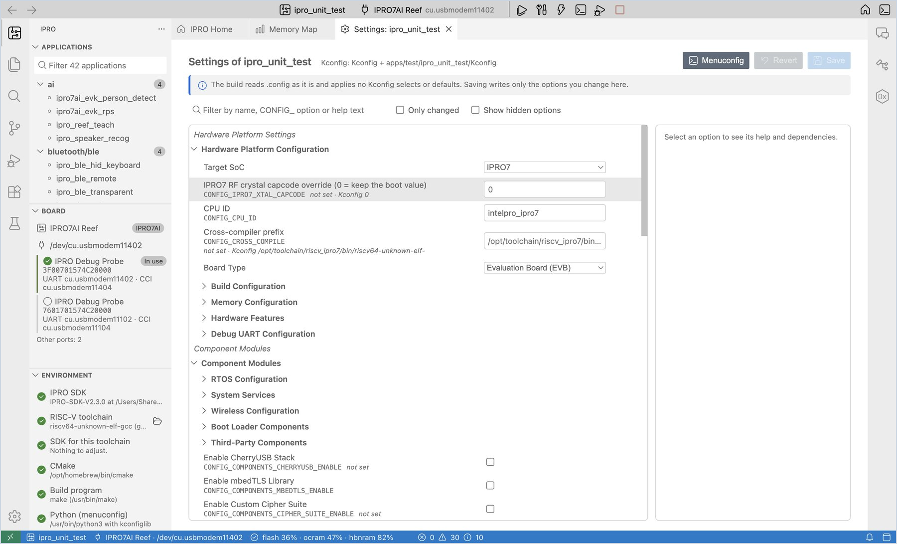
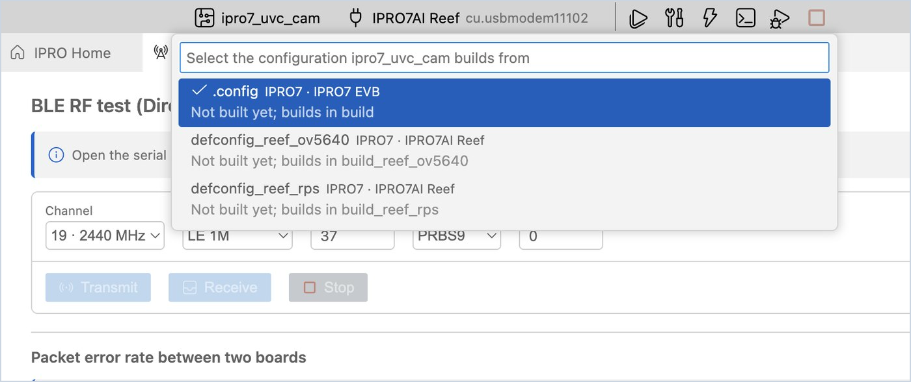
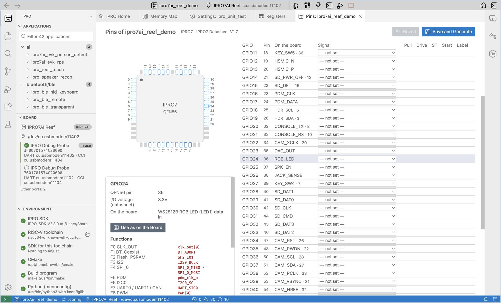
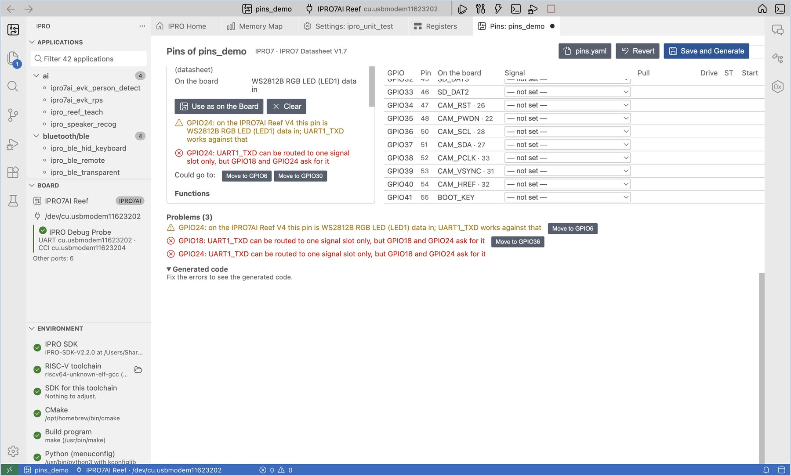
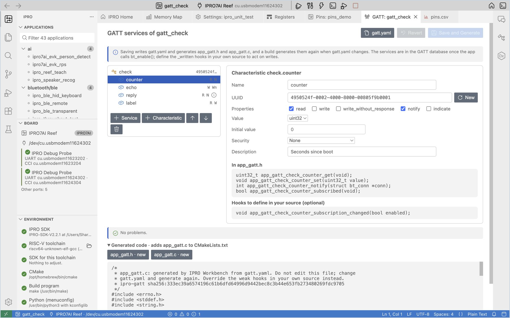
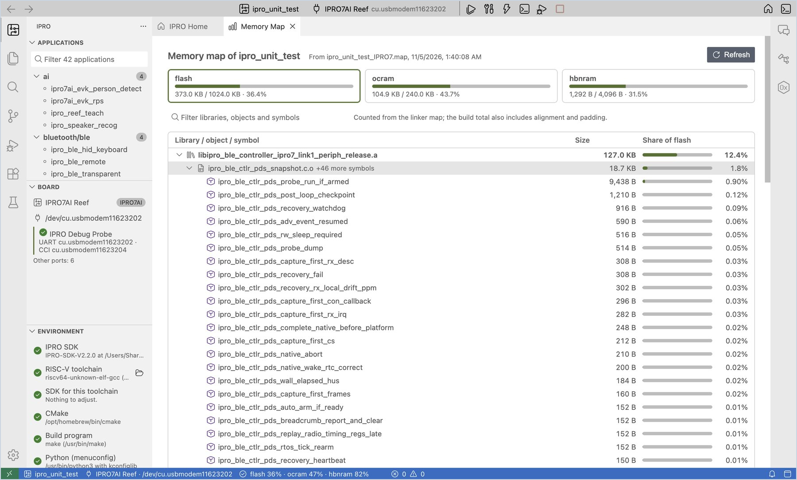

# アプリケーションの開発

コードを書くときによく使うビューとして、設定（Kconfig）の変更、ピンの設定、GATT サービスの設定、ビルドエラーへの対処、メモリの使われ方の確認を説明します。例には IPRO7AI Reef EVK V4.0 を使用します。

## 設定（Kconfig）を変更する { #kconfig }

各アプリケーションの機能とパラメーターは、その `.config` に記録されています。**Settings** ビューではこれをフォームで編集できるため、ターミナルを開く必要はありません。

<div class="ipro-steps" markdown>

1. **Settings を開きます。** アプリケーションを右クリックして **Settings (Kconfig)…** を選択します（または IPRO Home の **Settings (Kconfig)** をクリックします）。

    **期待される結果**：**Settings: &lt;application&gt;** タブが開き、左側にすべてのオプションが Kconfig のメニューごとに、右側に選択したオプションのヘルプが表示されます。

2. **オプションを変更します。** 検索ボックスに変更したいオプション（例：`LOG_BUFFER_SIZE`）を入力し、値を `512` に変更します。

    **期待される結果**：その行の左側に緑のマークが付き、タブのタイトルに未保存を示す点が表示され、右上のボタンが **Save 1** に変わります。右側のパネルには、そのオプションの型、範囲、依存関係、`.config` での元の値、Kconfig のデフォルト値が表示されます。

3. **保存します。** **Save** をクリックします（macOS では `Cmd+S`、Windows では `Ctrl+S`）。

    **期待される結果**：「Saved 1 settings to .config of … (the previous file is .config.old). The next build configures again.」という通知が表示されます。

</div>



!!! warning "重要"
    SDK のビルドは `.config` を直接読み込み、Kconfig の select やデフォルト値を適用しません。**Settings** は変更した行だけを書き込みます。menuconfig であればほかのオプションも変更される場合は、それらが画面に一覧表示され、**Take Them Too** で一緒に反映するかどうかを選べます。

そのほかの使い方：

- **Only changed** にチェックを入れると、まだ保存していない変更だけが表示されます。**Revert** をクリックすると、すべての変更を破棄します。
- **Show hidden options** にチェックを入れると、依存関係が満たされていないオプションが表示されます。menuconfig では非表示になりますが、ビルドでは読み込まれます。
- テキストのインターフェースを使いたい場合は、右クリックして **Menuconfig** を選択すると、同じ設定をターミナルで編集できます。**Open .config** を選択すると、ファイルを直接編集できます。

## 別構成 { #configurations }

一部のアプリケーションには、`.config` のほかに、別のボードや用途向けの構成ファイル `defconfig_<name>` または `config_<name>` があります。IDE はそれらを一覧表示し、選択したファイルからビルドします。ビルドはアプリケーションフォルダー内の `build_<name>`（`config_<name>` の場合は `build_config_<name>`）に出力されます。これはコマンドラインで `make DEFCONFIG=<file>` を実行したときと同じフォルダーで、アプリケーション自体の `.config` は変更されません。設定（Kconfig）、ピン設定、GATT 設定も、選択したファイルを読み書きします。

手順では `ipro7_uvc_cam` を使用します。その `.config` は IPRO7 EVB 用で、IPRO7AI Reef EVK V4.0 用の別構成が 2 つあります。

<div class="ipro-steps" markdown>

1. **アプリケーションを選択します。** サイドバーの **Applications** で **ipro7_uvc_cam**（`multimedia` カテゴリー）をクリックします。

    **期待される結果**：ステータスバーのアプリケーション名の横に、歯車と `.config` が表示されます。アプリケーションが `.config` からビルドされることを示しています。ほかの構成ファイルがないアプリケーションには、この項目はありません。

2. **構成の一覧を開きます。** ステータスバーの `.config` をクリックします（または IPRO メニューの **Select Configuration…**、コマンドパレットの `IPRO: Select Configuration…` を選択します）。

    **期待される結果**：「Select the configuration ipro7_uvc_cam builds from」という見出しの一覧に、`.config`、`defconfig_reef_ov5640`、`defconfig_reef_rps` が表示されます。各行にはチップとボード（例：`IPRO7 · IPRO7AI Reef`）と、「Built in build」または「Not built yet; builds in build_reef_rps」という行が表示されます。使用中の構成にはチェックマークが付きます。

3. **選択します。** `defconfig_reef_rps` を選択します。

    **期待される結果**：「ipro7_uvc_cam now builds for IPRO7AI Reef (defconfig_reef_rps).」という通知が表示され、ステータスバーに `defconfig_reef_rps`、ツールバーのボードに IPRO7AI Reef が表示されます（ボードはアプリケーションの構成に従います。[設定](reference.md#settings)の `ipro.board.id` を参照してください）。選択したファイルが以前と同じボード用の場合、通知は表示されません。

4. **ビルドします。** **Build** をクリックします。

    **期待される結果**：**IPRO Build** が `Configuration: defconfig_reef_rps -> …/build_reef_rps/.config` で始まり、ファームウェアが `build_reef_rps/build_out/` に出力されます。IDE は選択したファイルをビルドフォルダーに `.config` としてコピーします。アプリケーションフォルダーの `.config` は変更されません。

5. **元に戻します。** ステータスバーの項目をもう一度クリックし、`.config` を選択します。

    **期待される結果**：ステータスバーに `.config` が表示され、ビルドと書き込みで再び `build` フォルダーが使われます。

</div>



!!! note
    - `defconfig_*` ファイルだけがあり `.config` がないアプリケーション（例：`ipro6_fmac`）も、**Applications** に表示されるようになりました。アプリケーション名と同じ名前のファイル、なければ最初のファイルから開始します。
    - 構成が 1 つしかないアプリケーションでは、**Select Configuration…** は「&lt;application&gt; has one configuration: .config.」と表示するだけです。
    - 構成を選択している場合、**Clean** はその構成のビルドフォルダーを削除します。
    - IDE はアプリケーションごとに選択した構成を記憶し、再起動後も保持します。

## ピンを設定する { #pins }

**Pin Configuration** では、パッケージ図と表で各 GPIO の機能を割り当て、競合とボードの配線をチェックし、初期化コード `app_pins.h` と `app_pins.c` を生成します。

<div class="ipro-steps" markdown>

1. **Pin Configuration を開きます。** アプリケーションを右クリックして **Pin Configuration…** を選択します（または IPRO Home の **Pins** をクリックします）。

    **期待される結果**：左側に QFN56 のパッケージ図、右側に GPIO の表が表示されます。**Board** は自動的に IPRO7AI Reef V4 に設定され、**On the board** 列には各ピンがボード上で何に接続されているかが表示されます。40 ピンヘッダーにつながるピンには、ヘッダーのピン番号も表示されます。

2. **ピンを割り当てます。** GPIO24 の行をクリックし、**Signal** で **GPIO_OUT (as on the board)** を選択して、**Label** に `RGB_LED` と入力します。

    **期待される結果**：パッケージ図のピン 24 が青色になります。右側のパネルには、そのピンで使用できる機能、I/O 電圧、ボードの配線が表示されます。下部の **Generated code** にある `app_pins.c` に GPIO24 の行が追加され、「No problems.」と表示されます。

3. **競合を試します。** GPIO24 の信号を `UART1_TXD` に変更します。

    **期待される結果**：ピン 24 が琥珀色になり、**Problems** に、このピンは Reef V4 で RGB LED に配線されているという警告が、この信号を移せる空きピン（**Could go to**）とともに表示されます。**Move to GPIO…** をクリックすると、設定をそのピンに移動できます。確認したら、GPIO24 を **GPIO_OUT (as on the board)** に戻します。

4. **信号で検索します。** 検索ボックスに `SDH_0` と入力します。

    **期待される結果**：表には SDH_0 を割り当てられるピンだけが表示され、パッケージ図ではそれらのピンが枠で囲まれます。検索文字列を消去すると、表全体が元に戻ります。

5. **保存してコードを生成します。** **Save and Generate** をクリックします（`Cmd+S` / `Ctrl+S`）。

    **期待される結果**：「Saved pins.yaml and generated app_pins.h and app_pins.c.」という通知が表示されます。アプリケーションフォルダーに `pins.yaml`、`app_pins.h`、`app_pins.c` が作成され、`CMakeLists.txt` に `app_pins.c` の行が追加されます。

6. **生成されたコードを呼び出します。** `main.c` に `#include "app_pins.h"` を追加し、`ipro_platform_init();` の次の行で `app_pins_init();` を 1 回呼び出してから、**Build, Flash and Monitor** をクリックします。

    **期待される結果**：アプリケーションは通常どおり動作します。以降は `pins.yaml` が変更されるたびに、ビルド中の **IPRO Build** にまず `pins: wrote app_pins.c from pins.yaml` と表示され、それからコンパイルが始まります。

</div>





| 機能 | 説明 |
|---|---|
| **Only pins in use** | 設定済みのピンだけを一覧表示し、確認しやすくする |
| **Export CSV** | ハードウェアエンジニア向けのピン一覧 `pins.csv` を書き出す |
| **Export Zephyr pinctrl** | 同じピン設定を Zephyr の pinctrl フラグメント `app_pins_pinctrl.dtsi` として書き出す |
| **Use as on the Board** | 選択したピンを、ボード上での用途に設定する |

!!! note
    - `app_pins.h` と `app_pins.c` は IDE が生成するファイルです。手動で編集しないでください。手動で編集されたファイルを IDE がそのまま上書きすることはなく、先に **Overwrite** するかどうかを確認します。
    - `pins.yaml` にエラーがあるとビルドが停止し、エラーは **Problems** パネルに一覧表示されます。
    - ピンのデータは IPRO7 のデータシートに基づいています。

## GATT サービスを設定する { #gatt }

**GATT Configuration** では、BLE アプリケーションの GATT サービスとキャラクタリスティックをツリーとフォームで定義し、`gatt.yaml` に保存して、`app_gatt.h` と `app_gatt.c` を生成します。生成されるのは、サービスごとに 1 つの `BT_GATT_SERVICE_DEFINE` と、キャラクタリスティックごとに値の読み取り、値の変更、通知の送信を行う関数です。アプリケーション側で GATT 属性テーブルを書く必要はありません。

アプリケーションの `.config` には、`ipro_ble_remote` と同じように `CONFIG_BLUETOOTH_LE_ENABLE=y` と `CONFIG_BT_PERIPHERAL=y` が必要です。

<div class="ipro-steps" markdown>

1. **GATT Configuration を開きます。** アプリケーションを右クリックして **GATT Configuration…** を選択します（または IPRO Home の **GATT services** をクリックします）。

    **期待される結果**：**GATT: &lt;application&gt;** タブが開きます。`gatt.yaml` がまだない場合は、最初にサービスを追加するよう促す説明が上部に表示されます。

2. **サービスを追加します。** **+ Service** をクリックし、名前を `sensor` に変更します。

    **期待される結果**：左側の一覧に `sensor` が表示されます。UUID にはすでにランダムな 128 ビット UUID が入っており、**New** をクリックすると別の UUID に変わります。

3. **キャラクタリスティックを追加します。** **+ Characteristic** をクリックし、名前を `counter` に変更し、プロパティの **read** と **notify** にチェックを入れ、値の型に `uint32` を選択して、説明に `Seconds since boot` と入力します。

    **期待される結果**：右側の **In app_gatt.h** に `app_gatt_sensor_counter_get`、`_set`、`_notify`、`_subscribed` が一覧表示され、その下に、自分で定義できるフック `app_gatt_sensor_counter_subscription_changed` が表示されます。「No problems.」と表示されます。

4. **無効な UUID を試します。** UUID を `2a1` に変更します。

    **期待される結果**：問題の一覧に `sensor.counter: "2a1" is not a 16-bit UUID such as 2a19 or a 128-bit UUID` と表示され、生成コードの代わりに「Fix the errors to see the generated code.」と表示されます。**New** をクリックして、有効な UUID に戻します。

5. **保存してコードを生成します。** **Save and Generate** をクリックします（`Cmd+S` / `Ctrl+S`）。

    **期待される結果**：「Saved gatt.yaml and generated app_gatt.h and app_gatt.c.」という通知が表示されます。アプリケーションフォルダーに `gatt.yaml`、`app_gatt.h`、`app_gatt.c` が作成され、`CMakeLists.txt` に `app_gatt.c` の行が追加されます。

6. **生成された関数をコードで使用します。** `#include "app_gatt.h"` を追加し、自分のタスクで値を更新して、購読しているピアに通知します。サービスをスキャンするピアがボードを見つけられるように、アドバタイズデータにサービスの UUID を入れます。

    ```c
    #include "app_gatt.h"

    static const struct bt_data ad[] = {
        BT_DATA_BYTES(BT_DATA_FLAGS, (BT_LE_AD_GENERAL | BT_LE_AD_NO_BREDR)),
        BT_DATA_BYTES(BT_DATA_UUID128_ALL, APP_GATT_SENSOR_UUID_VAL),
    };

    /* Once a second, in your own task (not in an interrupt) */
    app_gatt_sensor_counter_set(seconds);
    if (app_gatt_sensor_counter_subscribed()) {
        app_gatt_sensor_counter_notify(NULL);   /* NULL: every subscribed peer */
    }
    ```

    **Build, Flash and Monitor** をクリックします。

    **期待される結果**：**IPRO Build** にまず `gatt: wrote app_gatt.c from gatt.yaml` と表示され、それからコンパイルが始まります。スマートフォンやコンピューターの BLE ツール（例：nRF Connect）で接続すると、`sensor` サービスと `counter` が表示されます。通知を購読すると、1 秒ごとに新しい値が届きます。

</div>



| 設定 | 意味 |
|---|---|
| プロパティ | read、write、write_without_response、notify、indicate。notify または indicate を選ぶと、ピアが購読できるように CCC が追加される |
| 値の型 | `uint8` から `int32`（固定サイズ、リトルエンディアンで送信）、`bytes`、`string`（最大長は 1〜512 バイト） |
| 初期値 | 整数型では数値（`0x1f` も可）、`string` ではテキスト、`bytes` では 16 進数（例：`01 02 ff`） |
| セキュリティ | 暗号化されたリンクや認証付き（MITM 保護）ペアリングを要求する場合は、`.config` に `CONFIG_BT_SMP=y` が必要 |
| 説明 | Characteristic User Description に入り、BLE ツールに表示される |

キャラクタリスティックごとに生成される関数（サービス `sensor`、キャラクタリスティック `counter` の場合）：

| 関数 | 用途 |
|---|---|
| `app_gatt_sensor_counter_get` / `_set` | ピアが読み取る値を読み取る、変更する |
| `app_gatt_sensor_counter_notify` / `_indicate` | 現在の値を購読中のピアに送信する（notify / indicate がある場合） |
| `app_gatt_sensor_counter_subscribed` | ピアが購読しているかどうか |
| `app_gatt_sensor_counter_written`（フック） | ピアが書き込んだ後、値が保存された状態で呼び出される。同じ名前の関数を自分のソースに定義する |
| `app_gatt_sensor_counter_subscription_changed`（フック） | ピアが通知をオンまたはオフにしたときに呼び出される |

!!! note
    - `app_gatt.h` と `app_gatt.c` は IDE が生成するファイルです。手動で編集しないでください。フックは weak 関数で、自分のソースに同じ名前の関数を定義すると置き換えられます。手動で編集されたファイルを IDE がそのまま上書きすることはなく、先に **Overwrite** するかどうかを確認します。
    - `gatt.yaml` にエラーがあるとビルドが停止し、エラーは **Problems** パネルに一覧表示されます。
    - 20 バイトを超える通知は、ピアが ATT MTU を引き上げた後でなければ全体が届きません。1 回の通知で送れるのは最大 244 バイトです。
    - サービスを変更する前にペアリングしたピアは、古いサービス一覧を保持していることがあります。ピアの Bluetooth 設定でデバイスの登録を解除し、もう一度ペアリングしてください。

## ビルドとエラー { #build }

<div class="ipro-steps" markdown>

1. **ビルドします。** **Build** をクリックします（`Cmd+Alt+B` / `Ctrl+Alt+B`）。

    **期待される結果**：成功すると「Built &lt;application&gt; in N s」という通知が表示され、続いてメモリ使用量が表示されます。

2. **エラーの箇所に移動します。** コードにエラーがある場合は、「&lt;application&gt; did not compile. First error at &lt;file&gt;:&lt;line&gt;: &lt;message&gt;」という通知が表示されます。**Go to Error** をクリックすると、エディターがその行にジャンプします。**Problems** パネルには、すべてのエラーと警告が一覧表示されます。

3. **修正して再度ビルドします。** コードを修正して、もう一度ビルドします。必要に応じて、通知の **Ask AI to Fix** をクリックすることもできます（[AI アシスタント](ai.md#fix-build)を参照）。

</div>

| コマンド | 使用する場面 |
|---|---|
| **Build** | 通常はこれを使用します。変更されたファイルだけを再コンパイルします。 |
| **Reconfigure and Build** | `CMakeLists.txt` やビルドプロファイルを変更した後に使用します。CMake の構成をやり直します。 |
| **Clean** | アプリケーションの `build` フォルダー（[別構成](#configurations)を選択している場合はその構成のビルドフォルダー）を削除し、次回のビルドを最初からやり直します。 |

ビルドプロファイル（Debug / Release / MinSizeRel）は `ipro.build.profile` 設定で選択します。[設定](reference.md#settings)を参照してください。

## メモリの使われ方を確認する { #memory }

<div class="ipro-steps" markdown>

1. **メモリマップを開きます。** ビルドが成功した後、ステータスバーのメモリ使用量か、IPRO Home の **What uses the memory** をクリックします。

    **期待される結果**：「Memory map of &lt;application&gt;」が開き、flash、ocram、hbnram のタブがそれぞれ表示されます。その下に、ライブラリ、オブジェクトファイル、シンボルがサイズ順に、その領域に占める割合とともに一覧表示されます。シンボルをダブルクリックすると、ワークスペース内でそのシンボルを検索します。

2. **絞り込みます。** フィルターボックスにライブラリ、オブジェクトファイル、シンボルの名前を入力すると、一致する項目だけが表示されます。

</div>



- **(the application itself)** は、アプリケーションフォルダー内のオブジェクトファイルです。
- **(merged strings and constants)** は、すべてのオブジェクトで共有される文字列プールです。ログの文字列が多いと大きくなります。
- 数値はリンカーマップファイルから集計しています。ビルド出力の合計にはアラインメントとパディングも含まれるため、両者はわずかに異なる場合があります。

### サイズの変化とメモリバジェット { #memory-budget }

<div class="ipro-steps" markdown>

1. **サイズの変化を確認します。** コードを変更して再度ビルドし、**IPRO Build** の出力の最後の数行を確認します。

    **期待される結果**：例えば `Memory since the last build: flash +3,072 B, ocram 0 B, …` に続いて、変化の大きかったシンボル（例：`+3,072 B  my_table  (flash, (application) main.c.o)`）が表示されます。ビルド完了の通知でも、使用量の後に変化量が追加されます（例：`flash 8.2% (+3,072 B)`）。初回のビルドの後やクリーンの後は、比較する前回のビルドがないため、これらの行は表示されません。

2. **メモリバジェットを設定します。** 設定を開き（macOS では `Cmd+,`、Windows では `Ctrl+,`）、`ipro.build` を検索して、**Memory Budget** に各領域の上限の割合（例：`{ "flash": 90, "ocram": 95 }`）を入力します。

    **期待される結果**：上限を超えると、「… is over its memory budget: flash 92.1% > 90%.」という通知が表示されます。**Memory Map** をクリックすると、何がメモリを使っているかを確認できます。

3. **バジェットを超えたときにビルドを失敗させます（任意）。** さらに **Fail Over Budget** にチェックを入れると、バジェットを超えたビルドは失敗します。その場合、**Build, Flash and Monitor** は書き込みの前に停止します。

</div>
