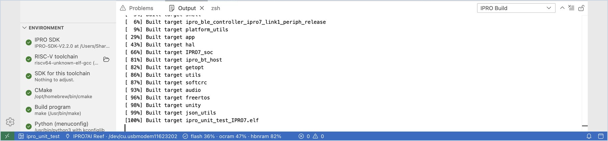
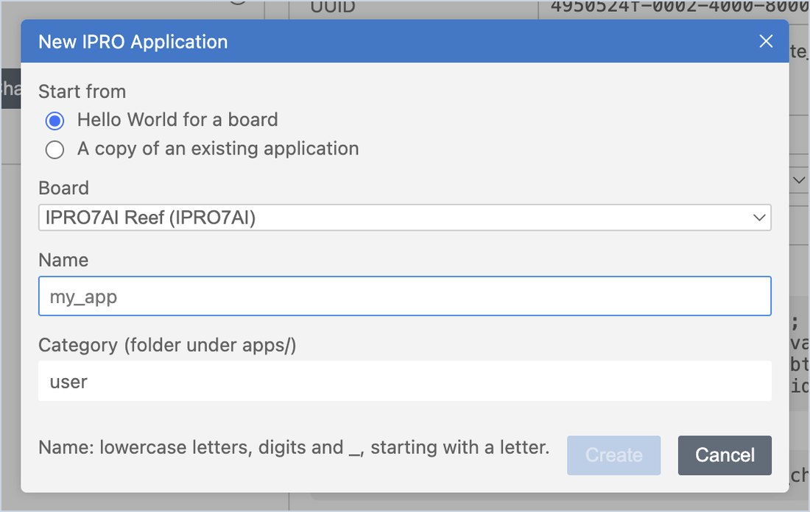
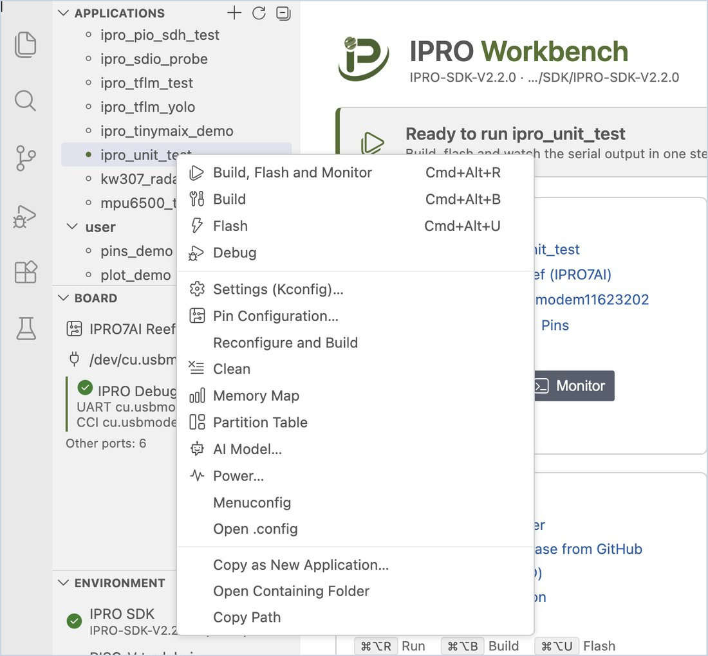

# 初めての実行

SDK に付属するユニットテスト `ipro_unit_test` を使って「ビルド → 書き込み → ボードの出力を確認」の流れを 1 回通し、コンピューター、プローブ、ボードがすべて正常に動作することを確認します。その後、最初の自分のアプリケーションを作成します。最後には、IPRO7AI Reef EVK V4.0 の IPRO Monitor に `ALL TESTS PASSED`、続いて `Hello from my_app` が表示されます。

## 前提条件 { #prerequisites }

- IPRO Workbench がインストールされ、**Environment** のすべての行にチェックが付き、IPRO SDK が開いていること。[IPRO Workbench のインストール](install.md)を参照してください。
- IPRO7AI Reef EVK V4.0 が IPRO Debug Probe を介して接続され、サイドバーの **Board** にプローブとそのポートが表示されていること。[ボードを接続する](install.md#connect-board)を参照してください。

## ipro_unit_test を実行する { #unit-test }

1. **アプリケーションを選択します。** サイドバーの **Applications** で **ipro_unit_test** をクリックします（`test` カテゴリーにあります。検索ボックスに `unit` と入力しても見つかります）。

    **期待される結果**：ツールバーとステータスバーの両方に `ipro_unit_test` と表示され、IPRO Home のバナーに「Ready to run ipro_unit_test」と表示されます。

2. **ビルド、書き込み、モニターを行います。** IPRO Home で **Build, Flash and Monitor** をクリックします（macOS では `Cmd+Alt+R`、Windows では `Ctrl+Alt+R`）。アプリケーション一覧でアプリケーションをダブルクリックしても実行できます。

    **期待される結果**（この順に表示されます）：

    1. **Output** の **IPRO Build** にコンパイルの過程が表示され、最後に flash、ocram、hbnram の使用量が一覧表示されます。
    2. **IPRO Flash** に書き込みの進行状況が表示され、最後の行は `[All Success]` になります。
    3. 下に **IPRO Monitor** ターミナルが開き、ボードが再起動し、テストが終わると `ALL TESTS PASSED` が表示されます。

3. **ステータスバーと IPRO Home を確認します。**

    **期待される結果**：ステータスバーにメモリ使用量（例：`flash 36% · ocram 47% · hbnram 82%`）が表示され、IPRO Home の **Application** カードにも使用量のバーが表示されます。サイドバーの **Board** には「Runs ipro_unit_test (built …)」という行が追加されます。これは、いまビルドしたファームウェアをボードが実行していることを示します。

| 出力 | 内容 |
|---|---|
| **IPRO Build** | CMake の構成とコンパイル、メモリ使用量、前回のビルドからのサイズの変化 |
| **IPRO Flash** | IntelProCube による書き込みの過程。成功すると最後の行は `[All Success]` |
| **IPRO Monitor** | ボードのシリアル出力（ターミナル）。ボードに直接コマンドを入力できます |

いずれかのステップが失敗すると、IDE はそのステップで停止し、**Go to Error**、**Retry**、**Select Port** などの対処用のボタンとともに説明を表示します。よくあるメッセージについては、[トラブルシューティング](troubleshooting.md#messages)を参照してください。

!!! tip
    ビルドだけ、書き込みだけ、またはモニターを開くだけを行うには、ツールバーの個別のボタンか、次のショートカットを使用します。ビルド `Cmd+Alt+B`、書き込み `Cmd+Alt+U`、モニター `Cmd+Alt+M`（Windows では `Cmd` を `Ctrl` に置き換えます）。

## 自分のアプリケーションを作成する { #own-app }

1. **新しいアプリケーションを開始します。** **Applications** 一覧の上にある **+**（**New Application…**）か、IPRO Home の **New application from a template or an example** をクリックします。

2. **フォームに入力します。** **Start from** で **Hello World for a board** を、**Board** で **IPRO7AI Reef** を選択し（IPRO6S EVK の場合は **IPRO6S EVK** を選択します。[IPRO6S EVK 用のアプリケーションを作成する](flash.md#ipro6s-new-app)を参照）、名前に `my_app` と入力します。カテゴリーは `user` のままにして、**Create** をクリックします。

    名前に使用できるのは英小文字、数字、アンダースコアだけで、先頭は英字にする必要があります。

    **期待される結果**：一覧に `user/my_app` が表示されて現在のアプリケーションになり、エディターでその `main.c` が開きます。

3. **実行します。** **Build, Flash and Monitor** をクリックします。

    **期待される結果**：IPRO Monitor に `Hello from my_app` が表示されます。

0.2.0 では、**Start from** の選択肢が図より 3 つ多くなっています。ほかの欄は同じです。選択肢は次のとおりです。

| Start from | ボード | 作成されるもの |
|---|---|---|
| **Hello World for a board** | すべて | 最小のアプリケーション。`Hello from <name>` を出力します |
| **BLE peripheral for a board (GATT services from gatt.yaml)** | IPRO7 と IPRO7AI のボード | アドバタイズする BLE ペリフェラル。`gatt.yaml` と、そこから生成した `app_gatt.h` と `app_gatt.c`、`app_ble.c`（Bluetooth の起動、アドバタイズ、書き込まれたときの処理）が含まれます。**With OTA** については後述します |
| **Wi-Fi station for the IPRO6S EVK (a copy of ipro6_demo, Wi-Fi configuration)** | IPRO6S EVK | `.config` を Wi-Fi 構成にした `ipro6_demo` のコピー。そのまま [Wi-Fi スループット（iperf）](measure.md#iperf)を実行できます |
| **AI vision for the IPRO7AI Reef (a copy of ipro7_uvc_cam: USB camera with a model on the NPU)** | IPRO7AI Reef EVK V4.0 | `.config` をじゃんけん認識の構成 `defconfig_reef_rps` にした `ipro7_uvc_cam` のコピー。通常の Web カメラ `defconfig_reef_ov5640` は 2 つ目の[別構成](develop.md#configurations)として残ります |
| **A copy of an existing application** | コピー元と同じ | 選択したアプリケーションのコピー。名前が出てくる箇所はすべて新しい名前に置き換えられます |

Wi-Fi station と AI vision の選択肢は、SDK に `ipro6_demo`（`defconfig_ipro6_lpwifi` を含む）と `ipro7_uvc_cam`（`defconfig_reef_rps` を含む）がある場合にだけ表示されます。

### BLE ペリフェラルを作成する { #own-app-ble }

1. **フォームに入力します。** **New IPRO Application** の **Start from** で **BLE peripheral for a board (GATT services from gatt.yaml)** を、**Board** で **IPRO7AI Reef** を選択し、名前に `my_ble` と入力して **Create** をクリックします。

    **期待される結果**：「Created my_ble in user.」という通知が表示され、一覧に `user/my_ble` が表示されます。そのフォルダーには `gatt.yaml`、`app_gatt.h`、`app_gatt.c`、`app_ble.c`、`main.c`、`README.md` があります。

2. **実行します。** **Build, Flash and Monitor** をクリックします。

    **期待される結果**：IPRO Monitor に `advertising as IPRO-my_ble` が表示されます。スマートフォンの BLE アプリ（例：nRF Connect）で `IPRO-my_ble` が見つかり、接続すると `demo` サービスが表示されます。サービスには `counter`（read、notify：起動からの秒数）と `message`（read、write：最大 20 バイトのテキスト。書き込まれるとボードが出力します）があります。

3. **サービスを変更します。** アプリケーションを右クリックして **GATT Configuration…** を選択します。[GATT サービスを設定する](develop.md#gatt)を参照してください。

**With OTA**（IPRO7AI のボードのみ、SDK V2.3.0）：「With OTA: over BLE and the console UART, an A/B partition table, boot2 (2 MB boards)」にチェックを入れると、アプリケーションには SDK の `ipro_ota` コンポーネントの設定（`CONFIG_IPRO_OTA`、`CONFIG_IPRO_OTA_BLE`、`CONFIG_IPRO_OTA_UART`）と A/B パーティションテーブル `partition_cfg_2M_ota_ab.toml` も追加され、IDE はこのテーブルを **Flash with** に選択します。書き込み時には boot2 も一緒に書き込まれ、以降の更新は [OTA パッケージ](flash.md#ota)としてボードに送ります。SDK に OTA コンポーネントがない場合はチェックを入れられず、ツールチップに「This SDK has no OTA component (components/sys/ipro_ota).」と表示されます。

既存のサンプルから始めるには、一覧でアプリケーションを右クリックして **Copy as New Application…** を選択するか、**Start from** で **A copy of an existing application** を選択します。新しいアプリケーションは SDK の `apps/<category>/<name>` に作成されます。

## アプリケーションのコンテキストメニュー { #app-menu }

**Applications** 一覧でアプリケーションを右クリックすると、次の操作を直接実行できます。

| 項目 | 用途 |
|---|---|
| **Build, Flash and Monitor** / **Build** / **Flash** / **Debug** | ツールバーと同じ |
| **Settings (Kconfig)…** / **Menuconfig** / **Open .config** | アプリケーションの設定を変更する。[アプリケーションの開発](develop.md#kconfig)を参照 |
| **Pin Configuration…** | GPIO の機能を割り当て、コードを生成する |
| **GATT Configuration…** | BLE のサービスとキャラクタリスティックを定義し、コードを生成する。[GATT サービスを設定する](develop.md#gatt)を参照 |
| **Reconfigure and Build** / **Clean** | CMake の構成をやり直してビルドする／ビルド結果を削除する |
| **Memory Map** | メモリの使われ方を確認する |
| **Partition Table** / **AI Model…** / **Power…** | [書き込みとボード](flash.md)と[テストと測定](measure.md#power)を参照 |
| **Copy as New Application…** | このアプリケーションを元に新しいアプリケーションを作成する |
| **Open Containing Folder** / **Copy Path** | フォルダーをエクスプローラー（Finder）で開く／フォルダーのパスをコピーする |

## 次のステップ { #next-steps }

- [アプリケーションの開発](develop.md)：設定（Kconfig）、ピン、GATT サービス、ビルドエラー、メモリの使われ方。
- [書き込みとボード](flash.md)：書き込み時に IDE がチェックする内容、パーティションテーブル、AI モデル、IPRO6S EVK。
- [シリアルモニター](monitor.md)：フィルター、タイムスタンプ、ログ、シリアルプロッター、2 つ目のポート。
