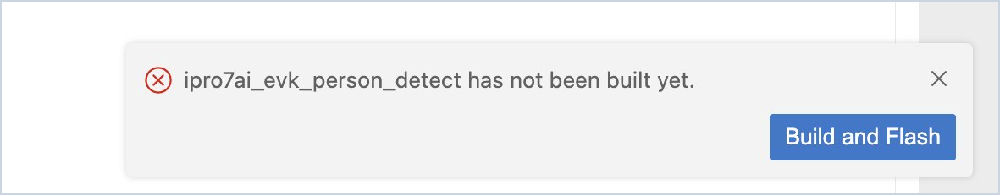
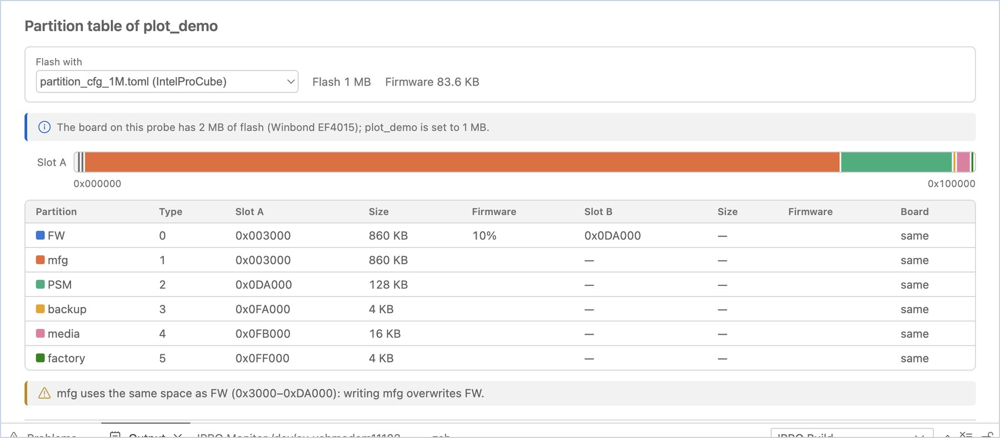
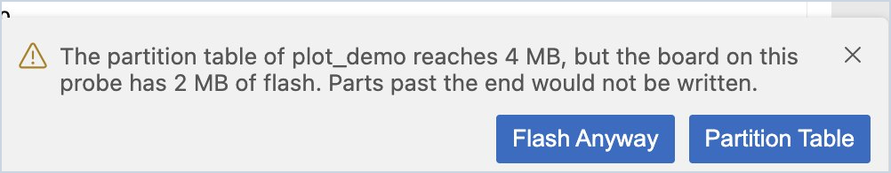
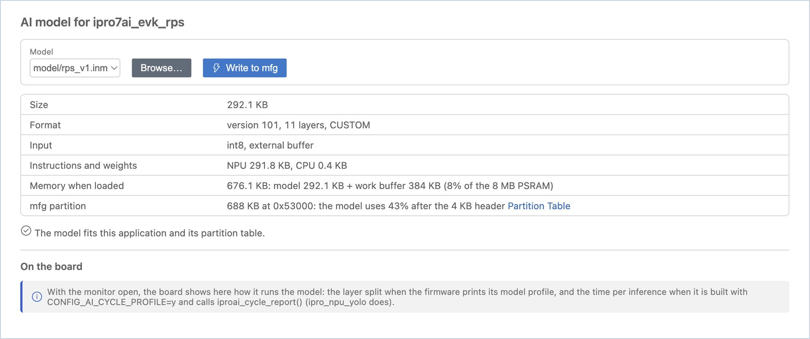
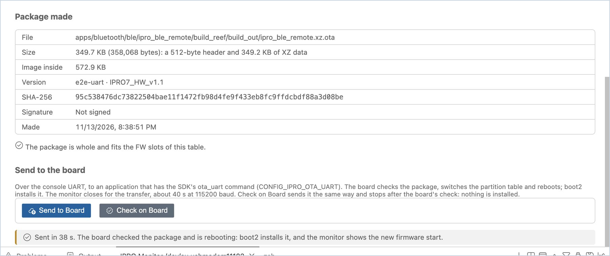
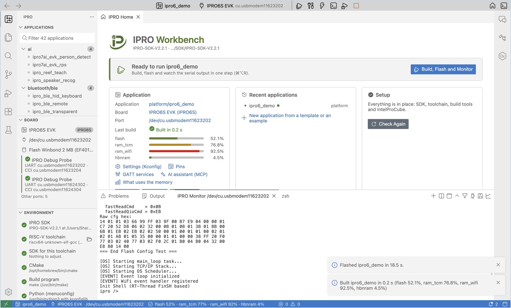
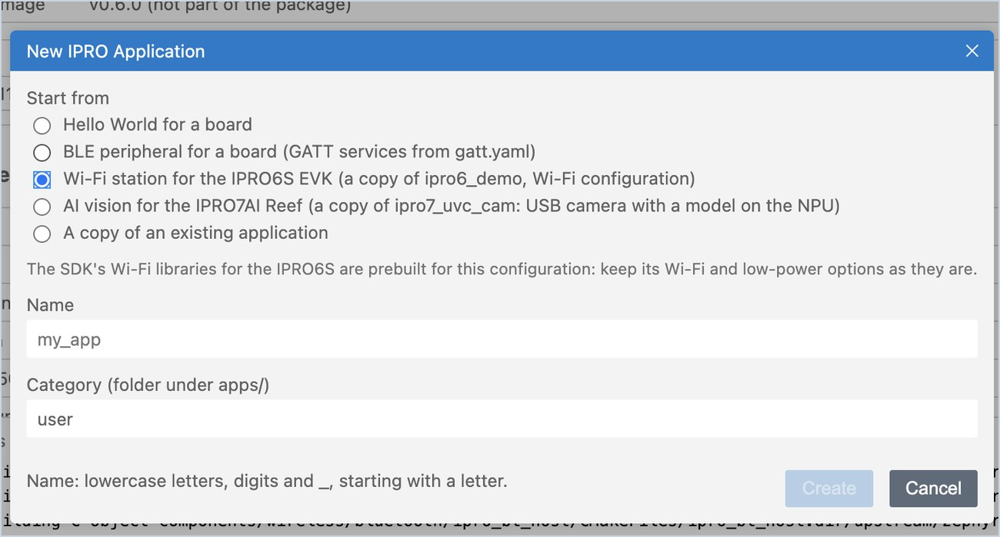

# 書き込みとボード

書き込み時に IDE が行うチェック、パーティションテーブル、ボードの Flash、ファームウェアの確認、AI モデルの書き込み、[OTA パッケージ](#ota)、[ボード自身の USB からの書き込み](#usb-flash)について説明します。最後のセクションでは、[IPRO6S EVK](#ipro6s) と、IPRO7 シリーズとの違いを説明します。それ以外のセクションのボードは IPRO Debug Probe に接続した IPRO7AI Reef EVK V4.0 で、書き込みには IntelProCube を使用します。

## 書き込み { #flash }

<div class="ipro-steps" markdown>

1. **書き込みます。** アプリケーションを選択してビルドした後、**Flash** をクリックします（`Cmd+Alt+U` / `Ctrl+Alt+U`）。

    **期待される結果**：**Output** パネルが **IPRO Flash** に切り替わり、IntelProCube による書き込みの進行状況が表示されます。最後の行は `[All Success]` です。「Flashed &lt;application&gt; in N s.」という通知が表示されます。

2. **モニターはいったん閉じてから再び開きます。** 書き込みの前に、IDE はすべてのシリアルモニターを自動的に閉じます（1 つのポートを 2 つのプログラムが同時に使用することはできません）。**Build, Flash and Monitor** の場合は、書き込みに成功した後でモニターが再び開きます。

</div>

!!! warning "重要"
    IntelProCube は、書き込みに失敗してもエラーを報告しないことがあります。IDE は、出力に `[All Success]` が表示されたときにだけ書き込み成功とみなします。さらに、ボードの再起動後には、ボードが出力するビルド時刻もチェックします（[ボードの Flash とファームウェアの確認](#board-flash)を参照）。

書き込みに失敗すると、IDE は原因に応じたボタンを表示します。



| 状況 | IDE の動作 |
|---|---|
| アプリケーションがビルドされていない | 「has not been built yet」と表示し、**Build and Flash** を提示する |
| IntelProCube が見つからない | **Install IntelProCube**、または既存のものを指定する **Browse…** を提示する |
| ボードが応答しない | プローブのケーブルと電源の確認を促し、このボードを手動でダウンロードモードにする方法を添えて（IPRO7AI Reef EVK V4.0 の場合：「To enter download mode by hand: hold SW1 (BOOT), tap SW2 (RESET), then release SW1.」）、**Select Port** と **Retry** を提示する |
| ボードは応答するが、その Flash が応答しない（別のボードの Flash ピンで書き込んだ） | 「The board on … answered, but its flash did not: it was flashed as …, and the flash pins of that board are not this one's. Select the board that is connected, then retry.」と表示し、**Select Board**、**Retry**、**Show Output** を提示する |
| ポートがほかのプログラムで使用中 | そのプログラムを閉じてから **Retry** するよう促す |
| パーティションテーブルがボードの Flash より大きい | 書き込みの前に確認する。**Flash Anyway** を選ぶか、代わりに **Partition Table** を開くことができる |
| このボードに必要なパーティションテーブルが IntelProCube にない | 書き込まない（そのテーブルがないとボードが起動しないため）。**Partition Table** と **Install IntelProCube** を提示する |
| パーティションテーブルが boot2 用のレイアウトで、IntelProCube にそのチップ用の boot2 イメージがない | 書き込まない（boot2 なしで書き込んだボードは起動しないため）。**Partition Table** と **Install IntelProCube** を提示する |
| IntelProCube が古い（IPRO6S EVK には 0.7.0.1 以降が必要） | 書き込まない（そのバージョンで書き込んだボードは起動しないため）。**Install IntelProCube** と **Browse…** を提示する |

パーティションテーブルに boot2 用の領域がある場合（OTA 用の A/B テーブルなど、boot2 用のレイアウト）、IDE は IPRO7 でも IPRO6S でも、IntelProCube に付属する boot2 をファームウェアと一緒に書き込みます。このとき **IPRO Flash** では、パーティションテーブルの行の後に `boot2: … (the partition table is laid out for boot2)` という行が表示され、ボードは boot2 を経由して起動します。

## パーティションテーブル { #partitions }

パーティションテーブルは、ファームウェア、OTA スロット B、AI モデル（mfg）などのデータを Flash のどこに配置するかを決めるものです。

<div class="ipro-steps" markdown>

1. **パーティションテーブルを開きます。** アプリケーションを右クリックして **Partition Table** を選択します（または IPRO Home の **Tools** にある **Partition table** をクリックします）。

    **期待される結果**：「Partition table of &lt;application&gt;」が開きます。**Flash with** には今回の書き込みで使用するパーティションテーブル（デフォルトでは、IntelProCube が `.config` の Flash サイズから選ぶもの）が表示され、その横に `.config` で設定された Flash サイズとファームウェアのサイズが表示されます。IDE がボードの Flash を把握している場合は、比較の行が追加されます（例：「The board on this probe has 2 MB of flash (Winbond EF4015); ipro_unit_test is set to 1 MB.」）。その下には、Flash マップ（スロット A とスロット B に 1 行ずつ）、各パーティションのアドレスとサイズ、FW パーティションのうちファームウェアが占める割合が表示されます。

2. **表の下にあるチェック結果を確認します。**

    **期待される結果**：問題がなければ何も表示されません。問題がある場合は、その説明が表示されます。例えば、1M パーティションテーブルの mfg と FW が同じ領域を共有している（AI モデルを書き込むとファームウェアが上書きされる）、2M パーティションテーブルの FW スロット B が mfg と重なっている（OTA 更新で AI モデルが上書きされる）、ファームウェアがスロット A より大きい、などです。

3. **別のテーブルを使用します。** アプリケーションが独自のパーティションテーブルを同梱している場合は、ページに「This application ships …」と表示されます。**Flash with** には、アプリケーション独自のテーブルのほかに、IntelProCube がそのチップ用に持つすべてのテーブル（`(IntelProCube)` と表示されます。例：boot2 や OTA 用のレイアウト）も一覧表示されるため、テーブルを先にアプリケーションにコピーする必要はありません。いずれかを選択すると、以降このアプリケーションの書き込みにはすべてそのテーブルが使われます。

4. **ボードと比較します。** シリアルモニターを開いた状態で **Reset Board** をクリックします。

    **期待される結果**：**On the board** で、ボードが起動時に出力するパーティションテーブルと比較され、各パーティションに「same」「differs」「not on the board」のいずれかが表示されます。すべて一致すると「The board printed the same table at its last boot.」と表示されます。

</div>



!!! warning
    書き込みでは、**Flash with** で選択したパーティションテーブルが書き込まれます。ボード上のパーティションテーブルと異なる場合、位置が変わるパーティション（例：mfg の AI モデル）のデータは失われます。

## ボードの Flash とファームウェアの確認 { #board-flash }

ボードは起動時に、Flash の ID とファームウェアのビルド時刻を出力します。シリアルモニターを開いていると、IDE はこれらのメッセージを読み取り、サイドバーの **Board** ビューに表示します。

| 表示 | 意味 |
|---|---|
| Flash Winbond 2 MB (EF4015) | このプローブに接続されたボードの Flash とそのサイズ |
| Chip ID … | 書き込み時に IntelProCube が読み取ったチップ ID |
| Runs ipro_unit_test (built …) | ボードが起動時に出力したビルド時刻が、このアプリケーションの最新ビルドのファームウェアと一致している |
| Runs other firmware (built …) | ボードは最新ビルドを実行していない。そのビルドは書き込んだ後に初めて実行される |

書き込みの直後に「other firmware」と表示された場合は、書き込みが実際にはボードに届いていない可能性があります。IDE は警告を表示し、**Flash Again** を提示します。

**Board** には接続されているすべてのプローブが一覧表示されるため、1 台のコンピューターに 2 台のボードを接続しているときに便利です。使用中のプローブには **In use** が付き、各プローブの下には「Last flashed: &lt;application&gt; · &lt;board&gt; · &lt;time&gt;」が表示されるので、どのボードに何を書き込んだかがわかります。別のプローブをクリックすると、その UART を使用します。

パーティションテーブルがボードの Flash より大きな領域を使う場合（例：2 MB のボードに 4 MB のパーティションテーブルを選択した場合）、末尾を超えた部分が書き込まれないままにならないよう、IDE は書き込みの前に確認します。**Partition Table** をクリックして別のテーブルを選ぶか、正しいことを確認したうえで **Flash Anyway** をクリックします。



## AI モデル { #ai-model }

IPRO7AI の NPU モデル（`.inm`）は通常、Flash の mfg パーティションに置かれ、ファームウェアにはリンクされません。モデルを更新するときは mfg だけを書き込めばよく、ファームウェアを書き込み直す必要はありません。モデルをファームウェアにリンクするアプリケーションもあります。このセクションの最後の注記を参照してください。

<div class="ipro-steps" markdown>

1. **モデルを選択します。** アプリケーションを右クリックして **AI Model…** を選択します（または IPRO Home の **Tools** にある **AI model** をクリックします）。**Model** でアプリケーションフォルダー内の `.inm` を選択するか、**Browse…** をクリックして別のファイルを選択します。

    **期待される結果**：モデルのサイズ、フォーマットのバージョン、レイヤー数、入力、NPU 命令・CPU 命令・重みの各サイズ、読み込み後に使用するメモリ（モデルとワークバッファーの合計を 8 MB の PSRAM と比較）、書き込み先の mfg パーティションが表示されます。最後の行には「The model fits this application and its partition table.」、または収まらない理由が表示されます。

2. **書き込みます。** 収まる場合は **Write to mfg** をクリックします。

    **期待される結果**：「Wrote … to the mfg partition in N s.」という通知が表示されます。書き込まれるのはモデルだけで、ファームウェアは変更されません。

3. **ボード上で確認します。** ボードがモデルを実行している間（シリアルモニターを開いた状態）、**On the board** に各レイヤーが NPU と CPU のどちらで実行されているかが表示されます。ファームウェアを `CONFIG_AI_CYCLE_PROFILE=y` でビルドし、`iproai_cycle_report()` を呼び出している場合は、推論 1 回あたりの時間と、NPU と CPU の使用率も表示されます。

</div>



!!! note
    - IntelProCube の 1M パーティションテーブルにはモデル用の独立した領域がない（mfg が FW と重なっている）ため、IDE は書き込みを拒否します。**Partition Table** で、アプリケーションに付属するパーティションテーブル（例：独立した mfg を持つもの）を選択してから、モデルを書き込みます。
    - アプリケーションがモデルをファームウェアにリンクしている場合、ページには「This application links the model into its firmware (…): it runs the copy it was built with, and a model written to mfg does not change that. Rebuild and flash the application to change the model.」と表示され、**Write to mfg** はセカンダリーボタンになります。

## OTA パッケージ { #ota }

**OTA Package** は、アプリケーションの最新ビルドから boot2 用の OTA パッケージ（`.xz.ota`）を作成します。IntelProCube がパーティションテーブル用のイメージを作成し、SDK の `tools/create_ota.py` がそれを圧縮します。作成するだけではボードには何も書き込まれません。IPRO SDK V2.3.0 では、このページからコンソール UART 経由でボードの `ota_uart` コマンドにパッケージを送り、インストールさせることも、ボードで検査だけさせることもできます。OTA の仕組み、パッケージの形式、BLE での送信については [OTA アップデート](../guides/ota.md)を参照してください。

| 必要なもの | 詳細 |
|---|---|
| チップ | IPRO7、IPRO7AI（boot2 用の OTA パッケージは IPRO7 アプリケーション用です） |
| パーティションテーブル | boot2 用の領域があり、2 つ目の FW スロットを持つ A/B テーブル。例：`ipro_ble_remote` に付属する `partition_cfg_2M_remote_ab.toml`。IntelProCube の通常のテーブルには boot2 用の領域がなく、パッケージを作成できません |
| ボードへの送信（SDK V2.3.0） | アプリケーションに `CONFIG_IPRO_OTA=y` と `CONFIG_IPRO_OTA_UART=y` があり、ボードに boot2 と A/B テーブルが書き込まれていること |

手順では、IPRO7AI Reef EVK V4.0 で IPRO SDK V2.3.0 の `ipro_ble_remote` を使用します。その `defconfig_reef` には上記の設定が含まれています。

<div class="ipro-steps" markdown>

1. **アプリケーションとその構成を選択します。** **Applications** で **ipro_ble_remote** をクリックし、ステータスバーの `.config` をクリックして `defconfig_reef` を選択します（[別構成](develop.md#configurations)を参照）。

    **期待される結果**：「ipro_ble_remote now builds for IPRO7AI Reef (defconfig_reef).」という通知が表示され、ステータスバーに `defconfig_reef` が表示されます。

2. **A/B テーブルを選択します。** アプリケーションを右クリックして **Partition Table** を選択し、**Flash with** で `partition_cfg_2M_remote_ab.toml` を選択します。

    **期待される結果**：Flash マップに、FW の A と B の 2 行が表示されます。

3. **ビルド、書き込み、モニターを行います。** **Build, Flash and Monitor** をクリックします。

    **期待される結果**：**IPRO Flash** に `boot2: … (the partition table is laid out for boot2)` という行が表示され、最後は `[All Success]` です。IPRO Monitor には、まず `[BOOT2]` で始まる数行が表示され、続いてアプリケーションの起動メッセージが表示されます。

4. **OTA Package を開きます。** IPRO Home の **Tools** にある **OTA package** をクリックします（またはコマンドパレットで `IPRO: OTA Package…` を選択します）。

    **期待される結果**：「OTA package of ipro_ble_remote」と、これが最新ビルドの boot2 用 OTA パッケージであることを示す行、**Firmware**、**Partition table**、**FW slots**（例：「A …, B …」）、**boot2 image**（「v… (not part of the package)」）の表が表示されます。不足しているものがある場合は、表の下に赤字で説明が表示され（例：「Build the application first: the package is made from its firmware.」）、**Make Package** はクリックできません。

5. **パッケージを作成します。** **Version** の初期値は現在時刻です（例：`202611131542`）。空白を含まない 15 文字以内の文字列に変更できます。**Make Package** をクリックします。

    **期待される結果**：作成中はボタンが「Making…」になり、**IPRO Flash** に IntelProCube と `create_ota.py` の出力が表示されます。続いて「Package made」に、**File**（`apps/bluetooth/ble/ipro_ble_remote/build_reef/build_out/ipro_ble_remote.xz.ota`）、**Size**（「… (… bytes): a 512-byte header and … of XZ data」）、**Image inside**、**Version**、**SHA-256**、**Signature**、**Made** が一覧表示され、最後に「The package is whole and fits the FW slots of this table.」と表示されます。

6. **ボードで検査させます。** モニターを開いた状態で、「Send to the board」の下にある **Check on Board** をクリックします。

    **期待される結果**：モニターが閉じ、進行状況に「Sending the OTA package of ipro_ble_remote to &lt;port&gt; for the board to check」と表示されます。続いて「Sent in N s. The board found the package whole and installed nothing: it is in FW slot B, and the firmware that runs is the one that ran before.」と表示され、モニターが再び開きます。

7. **送信してインストールします。** **Send to Board** をクリックします。

    **期待される結果**：進行状況に「Sending the OTA package of ipro_ble_remote to &lt;port&gt;」と表示されます。115200 baud で約 40 秒かかります。続いて「Sent in N s. The board checked the package and is rebooting: boot2 installs it, and the monitor shows the new firmware start.」と表示されます。再び開いたモニターには、boot2 がパッケージをインストールする様子と、新しいファームウェアの起動メッセージが表示されます。

</div>



!!! note
    - **Signature** は、パッケージのヘッダーに署名ブロックがあるかどうかを示します。「Signed: the header carries a signature block」または「Not signed」です。このページで作成するパッケージには署名がありません。署名付きパッケージについては [OTA アップデート](../guides/ota.md)を参照してください。
    - パッケージの送信中に **Stop** をクリックすると、「Stopped. The board asks for the rest for about 20 seconds, then gives up and returns to its shell; nothing was installed.」と表示されます。
    - パッケージが FW スロット B より大きい場合、またはパッケージ内のイメージが FW スロット A より大きい場合は、「Package made」の下に警告またはエラーが表示されます。
    - [新しいアプリケーション](first-run.md#own-app-ble)で **With OTA** にチェックを入れて作成した BLE ペリフェラルには、上記の設定と A/B テーブルがすでにあります。手順 3 から始めてください。

## ボード自身の USB から書き込む { #usb-flash }

一部のボードは、コンソールをボード自身の USB ポート（USB CDC）に持っており（例：IPRO7AI Sensor Tag）、IPRO Debug Probe を必要としません。選択したポートがそのような USB ポートの場合、**Flash** は boot2 の USB ダウンローダーを経由して書き込みます。IDE が自分でファームウェアを書き込み、検証してから起動するため、Python も SDK の `tools/ipro_dl.py` も不要で、どのバージョンの IPRO SDK でも使えます。macOS と Windows 11 の両方で動作します（0.2.1 から）。Windows では、ボードがダウンローダーに入っている間、別の COM ポートとして現れます。

IDE は次の場合にこの方法を使い、それ以外の場合はプローブ経由で IntelProCube を使って書き込みます。

- 選択したポートが boot2 の USB ダウンローダーそのものである（ファームウェアのないボード、またはすでにダウンローダーに入っているボード）。
- 選択したポートがプローブのポートではなく、アプリケーションの構成に `CONFIG_CHERRYUSB_DEVICE_CDC=y` と `CONFIG_SHELL=y`（USB 上のコンソールとシェル）がある。IDE はまずコンソールで `reboot_usb` を入力し、動作中のボードをダウンローダーで再起動させます。

手順では、IPRO7AI Sensor Tag で IPRO SDK V2.3.0 の [`ipro7ai_sensor_tag_demo`](https://github.com/INTELPRO-INC/IPRO-SDK/tree/IPRO-SDK-V2.3.0/apps/platform/ipro7ai_sensor_tag_demo) を使用します。

<div class="ipro-steps" markdown>

1. **ボードを接続します。** IPRO7AI Sensor Tag の USB ポートを USB ケーブルでコンピューターに接続します。

2. **アプリケーションを選択してビルドします。** **Applications** で **ipro7ai_sensor_tag_demo**（`platform` カテゴリー）をクリックし、**Build** をクリックします。

    **期待される結果**：ビルドの通知が表示され、ファームウェアが `build/build_out/ipro7ai_sensor_tag_demo_IPRO7.bin` に出力されます。

3. **ボードのポートを選択します。** ツールバーのボード名をクリックし、**Select Port…** を選択します。

    **期待される結果**：一覧が「IPRO Debug Probes」や「Other USB serial ports」などの見出しでグループ分けされて表示されます。ボードのポートは「Other USB serial ports」の下にあります（例：macOS では `/dev/cu.usbmodemXXXX`、Windows では `COM5`）。それを選択します。

4. **書き込みます。** **Flash** をクリックします（`Cmd+Alt+U` / `Ctrl+Alt+U`）。

    **期待される結果**：**IPRO Flash** に次のように表示されます。

    ```text
    Flashing over the board's own USB, through boot2's USB downloader
    Typing reboot_usb on /dev/cu.usbmodemXXXX: the board restarts into the downloader
    boot2's USB downloader is on /dev/cu.usbmodemYYYY
    [usbflash] rescue handshake OK on /dev/cu.usbmodemYYYY
    ```

    続いて消去と書き込みの進行状況（`[usbflash] write …`）と `[usbflash] verify OK` が表示されます。Windows ではポート名は `COM5`、`COM6` のようになります。「Flashed ipro7ai_sensor_tag_demo in N s.」という通知が表示され、ボードは新しいファームウェアで再起動し、IDE はボードのポートを再び選択します（ポート名が変わった場合、**IPRO Flash** の最後の行は `The board is back on …` です）。

5. **出力を確認します。** **Serial Monitor** をクリックします。

    **期待される結果**：1 秒に 20 行の `name:value` が表示されます（例：`ax:0.012 ay:-0.004 az:1.003 …`）。これらの値は[センサーダッシュボード](monitor.md#dashboard)で表示できます。

</div>

!!! note
    - この方法で書き込まれるのはファームウェアだけです。パーティションテーブル、boot2、mfg はそのまま残り、**Partition Table** で選択したテーブルは使われません。
    - ボードがダウンローダーに入らない場合（例：USB コンソールのないファームウェア）、IDE は「The board did not start boot2's USB downloader. Flash again, and while it waits (20 s), unplug the board's USB cable and plug it in: boot2 listens for the downloader at power-on.」と表示します。その指示に従ってください。

## IPRO6S EVK { #ipro6s }

IPRO Workbench は、IPRO SDK の IPRO6 アプリケーション（`.config` に `CONFIG_CHIP="IPRO6"` があるもの）のビルド、書き込み、モニターを行えます。ボードは IPRO6S EVK です。このセクションでは、IPRO SDK V2.3.0 の `platform/ipro6_demo` を使用します。チップ、そのアプリケーション、コマンドラインからの書き込みについては [IPRO6S](../hardware/chips/ipro6s.md) を参照してください。

| 項目 | バージョン |
|---|---|
| IPRO Workbench | 0.2.1 |
| IPRO SDK | V2.3.0（2.2.1 以降でもビルド、書き込み、モニターは行えますが、**Board** にボードが実行しているファームウェアが表示されません） |
| IntelProCube | 0.7.0.1 以降（IPRO6S 用のパーティションテーブル `partition_cfg_fw_direct.toml` を含む） |

### ipro6_demo のビルド、書き込み、モニター { #ipro6s-run }

<div class="ipro-steps" markdown>

1. **プローブとボードを接続します。** IPRO Debug Probe を USB ケーブルでコンピューターに接続し、次にプローブを IPRO6S EVK に接続します。

    **期待される結果**：サイドバーの **Board** に、**IPRO Debug Probe** とその 2 つのポート（UART と CCI）が表示されます。

2. **アプリケーションを選択します。** サイドバーの **Applications** で **ipro6_demo** をクリックします（`platform` カテゴリーにあります。検索ボックスに `ipro6` と入力することもできます）。

    **期待される結果**：ツールバーに `ipro6_demo` と表示され、ボードは自動的に **IPRO6S EVK** に変わります。サイドバーの **Board** に表示されるチップのラベルは `IPRO6S` です。ボードはアプリケーションのチップに従うため、自分で選択する必要はありません。

3. **2 台のボードを接続している場合はポートを選択します。** 2 台のボード（例：Reef と IPRO6S EVK をそれぞれ別のプローブで）を同時に接続している場合は、ツールバーのボード名をクリックして **Select Port…** を選択し、IPRO6S EVK につないだプローブの UART を選びます。ボードが 1 台だけの場合、この手順は不要です。

4. **ビルド、書き込み、モニターを行います。** **Build, Flash and Monitor** をクリックします（`Cmd+Alt+R` / `Ctrl+Alt+R`）。

    **期待される結果**：次の順に表示されます。

    1. **IPRO Build** で `[100%] Built target ipro6_demo_IPRO6.elf` までコンパイルが進みます。
    2. **IPRO Flash** の最初の行は「Partition table: …/chips/ipro6/partition/partition_cfg_fw_direct.toml」です。その後のコマンドには `--chipname ipro6 --chip-variant IPRO6S` と `--pt …/partition_cfg_fw_direct.toml` が含まれ、最後の行は `[All Success]` です。
    3. **IPRO Monitor** が開いてボードが再起動し、出力の最後に `Init Shell (RT-Thread FinSH based)` とプロンプト `ipro />` が表示されます。
    4. サイドバーの **Board** に「Runs ipro6_demo (built …)」という行が追加されます。IPRO SDK V2.3.0 の IPRO6 ファームウェアは起動時に `Build:<time>,<date>` を出力し、IDE はそれとボード上のファームウェアを照合します。

5. **ボードのコマンドを一覧表示します。** モニターで `help` と入力し、Enter を押します。

    **期待される結果**：ボードがコマンドの一覧を表示します。その中に、Wi-Fi のコマンド（`stack_wifi`、`wifi_sta_connect`、`wifi_ap_start`）と `iperf` があります。[Wi-Fi スループット（iperf）](measure.md#iperf)（[テストと測定](measure.md)のセクション）では、これらのコマンドを使用します。

</div>



!!! warning "重要"
    IPRO6S EVK には、必ず `partition_cfg_fw_direct.toml` を使って書き込みます。このテーブルは IDE が自動的に選択します。IntelProCube のバージョンが古く、このテーブルを含んでいない場合、IDE は書き込みを行わず、「IntelProCube has no partition_cfg_fw_direct.toml, the partition table ipro6_demo flashes with. Without one the board would not boot. Update IntelProCube, or choose a partition table for ipro6_demo.」と表示します。**Install IntelProCube** をクリックして新しいバージョンをインストールし、もう一度書き込んでください。

### IPRO6S EVK 用のアプリケーションを作成する { #ipro6s-new-app }

<div class="ipro-steps" markdown>

1. **新しいアプリケーションの作成を開始します。** **Applications** の一覧の上にある **+**（**New Application…**）をクリックします。

2. **フォームに入力します。** **Start from** で **Hello World for a board** を選択し、**Board** で **IPRO6S EVK** を選択し、名前に `my_wifi_app` と入力して、**Create** をクリックします。

    **期待される結果**：一覧に新しい `user/my_wifi_app` が追加され、ツールバーのボードが **IPRO6S EVK** になり、エディターにその `main.c` が開きます。

3. **実行します。** **Build, Flash and Monitor** をクリックします。

    **期待される結果**：IPRO Monitor に `Hello from my_wifi_app` と表示されます。

</div>



Wi-Fi アプリケーションの場合は、代わりに **Start from** で **Wi-Fi station for the IPRO6S EVK (a copy of ipro6_demo, Wi-Fi configuration)** を選択し、名前を入力して **Create** をクリックします。

**期待される結果**：ダイアログに「The SDK's Wi-Fi libraries for the IPRO6S are prebuilt for this configuration: keep its Wi-Fi and low-power options as they are.」という注記が表示されます。新しいアプリケーションは、`.config` を Wi-Fi 構成にした `ipro6_demo` のコピーで、必要な Wi-Fi ライブラリも一緒にコピーされます。書き込んだ後、モニターで `help` と入力すると、`ipro6_demo` と同じ Wi-Fi コマンドと `iperf` が一覧表示され、そのまま [Wi-Fi スループット（iperf）](measure.md#iperf)に使えます。

### IPRO7 シリーズとの違い { #ipro6s-differences }

IPRO6 シリーズのボードは、起動時にパーティションテーブルと Flash の ID を出力しません。ファームウェアのビルド時刻（`Build:` の行）は IPRO SDK V2.3.0 から出力されます。IPRO6S EVK では、次の機能が異なります。

| 機能 | IPRO6S EVK の場合 |
|---|---|
| ボード上のファームウェアの確認（**Board** の「Runs …」の行） | IPRO SDK V2.3.0：IPRO7 シリーズと同じです。2.2.1 以前：表示されません。書き込みは、**IPRO Flash** の `[All Success]` とモニターの起動メッセージで確認します。 |
| パーティションテーブルとボードの比較（**On the board**） | 比較されません。**Partition Table** には、書き込みで使われるテーブルがこれまでどおり表示されます。 |
| 起動時のボードの Flash の検出 | 起動時には検出されません。一度書き込むと、**Board** に、IntelProCube が書き込み中に読み取った Flash が表示されます（例：「Flash Winbond 2 MB」）。 |
| クラッシュアドレスのデコード | IPRO7 シリーズと同じです。IPRO6S のファームウェアは同じ形式のクラッシュレポートを出力し、IPRO Monitor がそれをデコードします。[クラッシュアドレスの自動デコード](debug.md#crash-decode)を参照してください。 |
| AI モデル | 適用されません（NPU は IPRO7AI の機能です）。 |
| OTA パッケージ | 適用されません（boot2 用の OTA パッケージは IPRO7 アプリケーション用です）。 |

ビルド、書き込み、シリアルモニター、設定（Kconfig）、[別構成](develop.md#configurations)、ピン設定、メモリマップ、[Wi-Fi スループット（iperf）](measure.md#iperf)は、ほかのページで説明しているとおりに動作します。IPRO6S の Wi-Fi メモリプロファイルも Wi-Fi スループットのページで設定します。[Wi-Fi メモリプロファイル](measure.md#wifi-profile)を参照してください。
