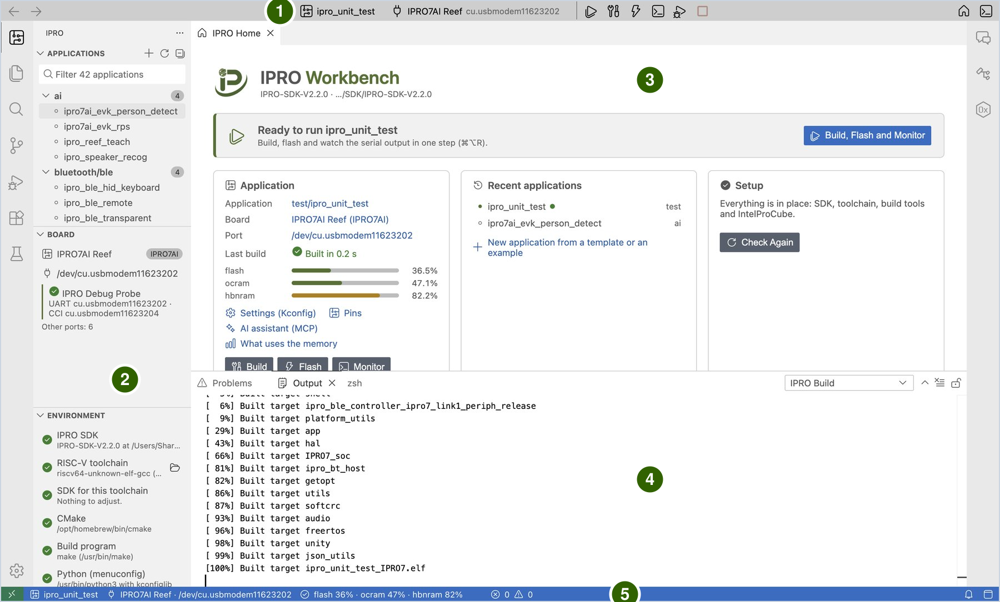

# IPRO Workbench

IPRO Workbench は、INTELPRO が IPRO シリーズのチップ向けに提供する統合開発環境（IDE）です。1 つのウィンドウで IPRO SDK アプリケーションのビルド、ボードへの書き込み、ボードのシリアル出力の確認を行えます。さらに、C/C++ のコードナビゲーション、ピン設定、メモリ解析、クラッシュ解析、ボード上でのテスト、RF と消費電力の測定、そして自分でビルドと書き込みを行える AI アシスタントも備えています。

このセクションのページでは、[IPRO7AI Reef EVK V4.0](../hardware/boards/reef-evk.md) と IPRO Debug Probe を例に説明します。各手順には、行う操作と表示される内容を記載しています。画面が一致しない場合は[トラブルシューティング](troubleshooting.md)を参照してください。VS Code で作業する場合は [VS Code 拡張機能](../guides/vscode.md)を参照してください。

!!! info "提供状況"
    macOS 版と Windows 版の IPRO Workbench 0.1.0（プレビュー）は、[GitHub の IPRO Workbench リリースページ](https://github.com/INTELPRO-INC/ipro-workbench/releases/tag/v0.1.0)で公開しています。GitHub アカウントは不要です。Linux 版はまだありません。[IPRO Workbench のインストール](install.md)を参照してください。

## できること { #features }

| 機能 | 説明 |
|---|---|
| 環境の整備 | SDK、RISC-V ツールチェーン、CMake、Python、IntelProCube、ボードを自動的にチェックし、不足しているものは GitHub からワンクリックでインストールします。 |
| ビルド、書き込み、モニター | 1 つのボタンでビルド、書き込み、シリアルモニターの起動を行います。各ステップの出力は個別に表示され、いずれかのステップが失敗するとそこで停止して理由を説明します。 |
| アプリケーション管理 | SDK 内のアプリケーションをカテゴリー別に一覧表示します。ボードの Hello World や既存のサンプルから新しいアプリケーションを作成します。 |
| 設定（Kconfig） | アプリケーションの `.config` をフォームで編集し、変更したオプションだけを書き込みます。各オプションのヘルプと依存関係も表示します。 |
| ピン設定 | パッケージ図と表で各 GPIO の機能を割り当て、競合とボードの配線をチェックし、初期化コードを生成します。 |
| メモリ解析 | flash、ocram、hbnram を使用しているライブラリ、オブジェクトファイル、シンボルを表示します。ビルドごとのサイズの変化を比較し、メモリバジェットを設定できます。 |
| 書き込みとボード | パーティションテーブルの表示とチェック、ボードの Flash の検出、ボード上で動作しているファームウェアの確認、mfg パーティションへの AI モデルの書き込みを行います。 |
| シリアルモニター | フィルター、タイムスタンプ、保存と全ログの記録、シリアルプロッター、2 つ目のポートの同時モニターに対応します。 |
| デバッグと解析 | クラッシュアドレスをソース行に自動でデコードし、クラッシュダンプを収集・解析し、レジスターとそのフィールドを参照できます。 |
| テストと測定 | ボード上のテスト結果を **Testing** ビューに表示します。RF テスト（BLE DTM）、消費電力の波形、電池寿命の見積もりも行えます。 |
| AI アシスタント | 内蔵の IPRO AI アシスタントが、ビルド、出力の読み取り、設定やピンの変更を自分で行います。IDE の外部の AI アシスタント（Claude Code など）も、MCP を通じて同じツール群を使用できます。 |

## ウィンドウの各領域 { #window }

| 番号 | 領域 | 用途 |
|---|---|---|
| 1 | ツールバー | 現在のアプリケーション、ボード、ポートと、ビルド、書き込み、モニターなどのボタンがあります。アプリケーション名やボード名をクリックすると変更できます。 |
| 2 | IPRO サイドバー | **Applications** には SDK 内のアプリケーション、**Board** にはプローブとそのポート、ボード上で動作しているファームウェア、**Environment** にはチェック結果が項目ごとに表示されます。 |
| 3 | エディター領域 | IPRO Home、ソースコード、そして設定、ピン、メモリマップ、パーティションテーブルなどのビューはすべてここに開きます。 |
| 4 | 下部パネル | **Output** の **IPRO Build**、**IPRO Flash**、**IPRO Setup** には、それぞれビルド、書き込み、インストールの過程が表示されます。**Terminal** の **IPRO Monitor** がシリアルモニターです。 |
| 5 | ステータスバー | 現在のアプリケーション、ボード、メモリ使用量を表示します。環境に不足があるときもここで知らせます。 |

IPRO Home 上部のバナーには、常に次のステップが表示されます。SDK を開く前は SDK を開くよう促し、環境に不足があるときは環境を整えるよう促し、すべての準備ができると実行できることを知らせます。

## 対応環境 { #requirements }

| 項目 | 内容 |
|---|---|
| コンピューター | macOS 12 以降（Apple シリコン）、Windows 11（x64） |
| IPRO SDK | IPRO SDK 2.2.0 |
| チップ | IPRO7、IPRO7AI |
| ボード | [IPRO7AI Reef EVK V4.0](../hardware/boards/reef-evk.md) |
| 書き込みと接続 | IPRO Debug Probe（USB）。書き込みには IntelProCube を使用します |
| 表示言語 | 繁体字中国語、英語 |

## 作業の流れ { #workflow }

1. **インストールして環境を整えます。** IPRO Workbench をインストールし、**Fix Environment** で SDK とツールをインストールしたら、SDK を開き、IPRO Debug Probe を介してボードを接続します。[IPRO Workbench のインストール](install.md)を参照してください。

2. **最初のアプリケーションを実行します。** `ipro_unit_test` を選択して **Build, Flash and Monitor** をクリックし、`ALL TESTS PASSED` が表示されるのを待ちます。その後、自分のアプリケーションを作成します。[初めての実行](first-run.md)を参照してください。

3. **開発します。** フォームで設定（Kconfig）を変更し、ピンを割り当ててコードを生成し、ビルドエラーを修正し、メモリの使われ方を確認します。[アプリケーションの開発](develop.md)を参照してください。

4. **書き込みます。** IDE のチェックを受けながら書き込み、パーティションテーブルをボードと比較し、AI モデルを mfg パーティションに書き込みます。[書き込みとボード](flash.md)を参照してください。

5. **モニターします。** ボードのシリアル出力を表示、フィルター、タイムスタンプ付与、保存し、出力される数値をグラフにします。[シリアルモニター](monitor.md)を参照してください。

6. **デバッグと測定を行います。** クラッシュアドレスをデコードし、クラッシュダンプを収集し、レジスターを参照します。さらに、ボードテスト、RF テスト、消費電力の解析を実行します。[デバッグと解析](debug.md)と[テストと測定](measure.md)を参照してください。

## 完全版マニュアル { #manual }

IPRO Workbench Operation Manual V1.1 は、IPRO Workbench 0.1.0 を対象とした PDF です。[英語版](https://github.com/INTELPRO-INC/ipro-workbench/releases/download/v0.1.0/IPRO-Workbench-Operation-Manual-V1.1-en.pdf)（53 ページ）と[繁体字中国語版](https://github.com/INTELPRO-INC/ipro-workbench/releases/download/v0.1.0/IPRO-Workbench-Operation-Manual-V1.1-zh-TW.pdf)（52 ページ）があります。[ドキュメント](../documents/index.md)にも掲載しています。

## このセクションのページ { #pages }

-   **[IPRO Workbench のインストール](install.md)**

    ---

    インストーラーのダウンロードと検証、macOS と Windows へのインストール、表示言語、開発環境の整備、SDK を開く、ボードの接続。

-   **[初めての実行](first-run.md)**

    ---

    `ipro_unit_test` のビルド、書き込み、モニター、自分のアプリケーションの作成、アプリケーションのコンテキストメニュー。

-   **[アプリケーションの開発](develop.md)**

    ---

    設定（Kconfig）、ピン設定と生成コード、ビルドとエラー、メモリマップ、サイズの変化とメモリバジェット。

-   **[書き込みとボード](flash.md)**

    ---

    書き込みとそのチェック、パーティションテーブル、ボードの Flash とファームウェアの確認、mfg への AI モデルの書き込み。

-   **[シリアルモニター](monitor.md)**

    ---

    モニターを開いてコマンドを入力する、フィルター、タイムスタンプ、保存と全ログ、シリアルプロッター、2 つ目のポート。

-   **[デバッグと解析](debug.md)**

    ---

    クラッシュアドレスの自動デコード、完全なコールチェーンを含むクラッシュダンプ、レジスターリファレンス。

-   **[テストと測定](measure.md)**

    ---

    Testing ビューでのボードテスト、BLE Direct Test Mode での RF テスト、消費電力の波形と電池寿命の見積もり。

-   **[AI アシスタント](ai.md)**

    ---

    AI 機能の有効化、ビルドエラーの修正やクラッシュの解析の依頼、IDE の外部の AI アシスタントから MCP を通じて使用する方法。

-   **[トラブルシューティング](troubleshooting.md)**

    ---

    画面のメッセージ、ツールバーとサイドバーの状態、macOS と Windows の問題、問題を報告するときに送るもの。

-   **[ショートカット、コマンド、設定](reference.md)**

    ---

    キーボードショートカット、IPRO コマンド、`ipro.*` 設定、MCP ツール、IDE が使用するファイルとフォルダー。

## 本リリースの範囲 { #limitations }

これらのページは IPRO Workbench 0.1.0 プレビューを対象としています。本リリースには次の制限事項があります。

- インストーラーは Apple や Microsoft の署名を受けていないため、IPRO Workbench を初めて開くときやインストールするときに、オペレーティングシステムが確認を表示します（対処方法は[インストール](install.md#install)を参照してください）。
- JTAG によるデバッグはまだ利用できません。ボードがクラッシュした場合は、代わりに[デバッグと解析](debug.md)で説明しているクラッシュのデコードとクラッシュダンプを使用してください。
- 自動更新はデフォルトでオフです。新しいバージョンを入手するには、リリースページからダウンロードして再度インストールしてください。
- シリアルモニターのフィルターは、IDE が自動で読み取る内容（ビルドスタンプ、パーティションテーブル、テスト結果）も非表示にします。これらの操作を行う前にフィルターを解除してください。
- Linux 版はまだありません。
