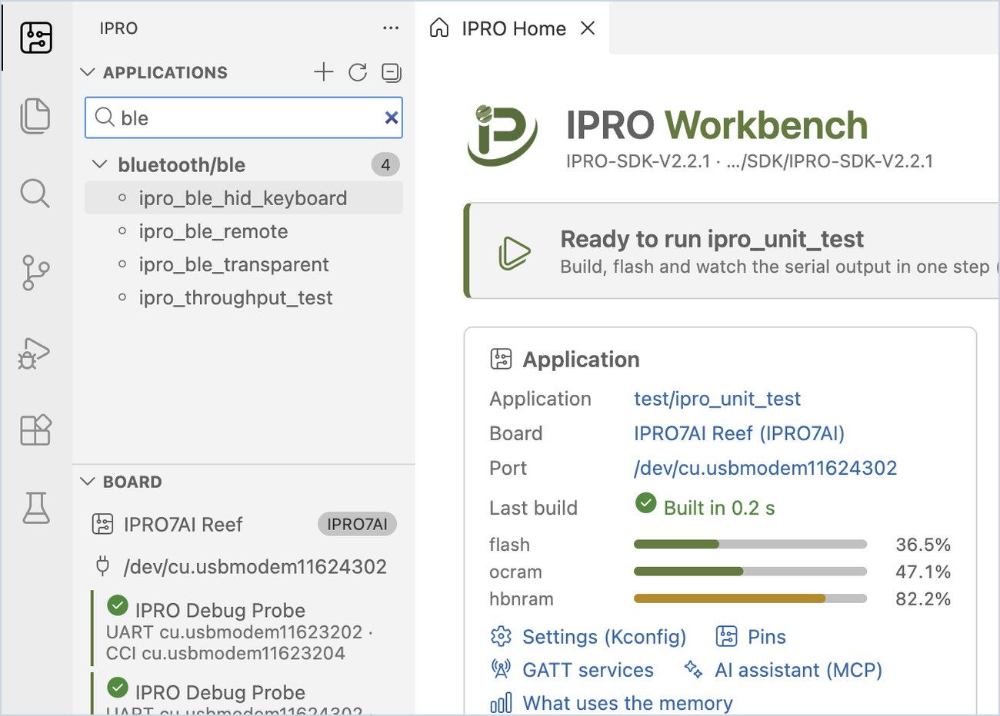

# IPRO Workbench のインストール

このページでは、IPRO Workbench のインストールから、IDE がボードを認識するまでを説明します。完了すると、IPRO Home のバナーに「Ready to run」と表示されます。対象は IPRO Workbench 0.2.1 です。ボタンなどのインターフェースのラベルは、英語のインターフェースでの表記のまま太字で示します。

## 前提条件 { #prerequisites }

| 項目 | 内容 |
|---|---|
| コンピューター | macOS 12 以降（Apple シリコン）または Windows 11（x64）で、GitHub にアクセスできること。IDE、ツール、SDK で合計約 4 GB のディスク容量が必要です。 |
| インストーラー | macOS：`IPRO-Workbench-0.2.1-mac-arm64.dmg`、Windows：`IPRO-Workbench-0.2.1-win-x64.exe`。GitHub の IPRO Workbench リリースページからダウンロードします（[ダウンロードと検証](#download)を参照）。GitHub アカウントは不要です。 |
| IPRO SDK | IPRO SDK V2.3.0（[SDK を開く](#open-sdk)ときに GitHub からインストールできます）。古い SDK でも使用できますが、「SDK V2.3.0」と記載した機能は使えません |
| ボード | [IPRO7AI Reef EVK V4.0](../hardware/boards/reef-evk.md)、または IPRO6S EVK |
| プローブとケーブル | IPRO Debug Probe と、それをコンピューターに接続する USB ケーブル |
| macOS で追加で必要なもの | Xcode Command Line Tools と、Homebrew の CMake および Ninja（[開発環境を整える](#environment)を参照） |

## ダウンロードと検証 { #download }

| ファイル | システム | サイズ |
|---|---|---|
| [`IPRO-Workbench-0.2.1-mac-arm64.dmg`](https://github.com/INTELPRO-INC/ipro-workbench/releases/download/v0.2.1/IPRO-Workbench-0.2.1-mac-arm64.dmg) | macOS 12 以降、Apple シリコン | 201 MB |
| [`IPRO-Workbench-0.2.1-win-x64.exe`](https://github.com/INTELPRO-INC/ipro-workbench/releases/download/v0.2.1/IPRO-Workbench-0.2.1-win-x64.exe) | Windows 11、x64 | 161 MB |

<div class="ipro-steps" markdown>

1. **インストーラーをダウンロードします。** IPRO Workbench 0.2.1 のリリースページ <https://github.com/INTELPRO-INC/ipro-workbench/releases/tag/v0.2.1> を開き、**Assets** から使用しているシステム用のインストーラーをダウンロードします。

2. **ダウンロードしたファイルを検証し**、破損や差し替えがないことを確認します。

    === "macOS"

        ```bash
        shasum -a 256 IPRO-Workbench-0.2.1-mac-arm64.dmg
        ```

    === "Windows"

        ```powershell
        (Get-FileHash .\IPRO-Workbench-0.2.1-win-x64.exe -Algorithm SHA256).Hash
        ```

    **期待される結果**：同じファイルについて、下記の値と同じ値が表示されます（Windows では大文字で表示されます）。リリースページの `SHA256SUMS.txt` にもこれらの値が記載されています。

    ```text title="IPRO Workbench 0.2.1 インストーラーの SHA-256"
    # IPRO-Workbench-0.2.1-mac-arm64.dmg
    85320f4ef469bb8e436f6cd0575d6f2410502e05040da3f137e3d343a17533f9
    # IPRO-Workbench-0.2.1-win-x64.exe
    0beb0daffcbd30f6b37e2f252ee9b75c00e41507b426da3045036319e4918660
    ```

</div>

リリースページにある ZIP、`latest-mac.yml`、`latest.yml`、blockmap の各ファイルは、内蔵の更新機能で使用するものです。ダウンロードする必要はありません。2 つの操作マニュアルの PDF については、[完全版マニュアル](index.md#manual)を参照してください。

## インストール { #install }

<div class="ipro-steps" markdown>

1. **プログラムをインストールします**

    === "macOS"

        `IPRO-Workbench-0.2.1-mac-arm64.dmg` を開き、**IPRO Workbench** を「アプリケーション」フォルダーにドラッグします。

    === "Windows"

        1. `IPRO-Workbench-0.2.1-win-x64.exe` をダブルクリックします。
        2. 「Windows によって PC が保護されました」と表示される場合があります。**詳細情報** をクリックしてアプリ名を確認し、**実行** をクリックします。
        3. インストーラーのウィザードでインストール対象のユーザーを尋ねられたら、現在のユーザーのみにインストールする方を選択します（管理者権限は不要です）。続いてインストール先のフォルダーを変更できます。**Install** をクリックし、完了したら **Finish** をクリックします。

        **期待される結果**：スタートメニューとデスクトップに IPRO Workbench が表示されます。

2. **IPRO Workbench を開きます**

    === "macOS"

        「アプリケーション」から IPRO Workbench を開きます。

        初めて開いたときに、macOS が開発元を検証できないと表示した場合は、「システム設定 → プライバシーとセキュリティ」を開き、下にスクロールして IPRO Workbench の項目で **このまま開く** をクリックし（macOS のバージョンによって表記が異なります）、もう一度 IPRO Workbench を開きます。

    === "Windows"

        スタートメニューから IPRO Workbench を開きます。

    **期待される結果**：IPRO Workbench のウィンドウが表示され、中央に IPRO Home、左側に IPRO サイドバー（**Applications**、**Board**、**Environment**）があります。macOS と Windows で同じ外観です。

</div>

!!! tip
    IT 担当者が一括展開する場合は、サイレントインストール `IPRO-Workbench-0.2.1-win-x64.exe /S` を使用するか、`/D=<folder>` でインストール先を指定します（`/D` は最後のパラメーターにする必要があります）。

## 表示言語 { #language }

IPRO Workbench は繁体字中国語、英語、簡体字中国語、日本語で表示できます。初回起動時はシステムの言語に従います。システムが繁体字中国語（台湾、香港、マカオ）、簡体字中国語、日本語の場合はその言語、それ以外の場合は英語で表示されます。後から言語を変更するには、`Cmd+Shift+P`（Windows では `Ctrl+Shift+P`）を押してコマンドパレットを開き、`Configure Display Language` と入力して言語を選択し、表示に従って再起動します。

## 開発環境を整える { #environment }

IPRO Workbench は、開発に必要なすべてのツールを自動的にチェックし、その結果をサイドバーの **Environment** に一覧表示します。

| 項目 | 用途 | **Fix Environment** でインストールできるか |
|---|---|---|
| IPRO SDK | アプリケーション、ドライバー、サンプルのソース | できます。GitHub から最新リリースをインストールします |
| RISC-V toolchain | ファームウェアをコンパイルします | できます（Windows では 14.2.1 をインストールします。13.1.1 では SDK のビルド済みライブラリをリンクできません） |
| CMake, Build program | ビルドを生成して実行します | Windows ではできます（Ninja、Python と 1 つのパッケージ）。macOS では Homebrew でインストールします |
| Python (menuconfig) | 設定（Kconfig）と Menuconfig | kconfiglib パッケージは別途インストールが必要です（下記参照） |
| IntelProCube | 書き込み | できます（IPRO6S EVK に必要な 0.7.0.1 以降をインストールします） |
| clangd (code navigation) | 定義へのジャンプ、入力中のエラー表示 | できます。clangd 拡張機能がダウンロードします（Fix の後、拡張機能がインストールするかどうかをもう一度確認します） |
| OpenOCD (debugging) | JTAG デバッグ（本リリースではまだ利用できません） | Windows ではできます。これがなくてもビルドと書き込みは動作します |
| Board | IPRO Debug Probe を検出します | プローブを接続するだけです |
| SDK for this toolchain | Windows のみ：IPRO SDK 2.2.1 以前を Windows でビルドできるようにします | できます |
| macOS quarantine | macOS のみ：ブラウザーでダウンロードしたツールはシステムにブロックされます | できます。確認後にフラグを削除します |

<div class="ipro-steps" markdown>

1. **IPRO Home 上部のバナーを確認します。** 不足があるときは「Finish the setup」と表示され、まだ不足している項目の数が示されます。

2. **macOS では、先に Xcode Command Line Tools とビルドツールをインストールします。** 「ターミナル」で次を実行します（インストール済みの場合は不要です）。

    ```bash
    xcode-select --install
    brew install cmake ninja
    ```

3. **Fix Environment をクリックします。**

    **期待される結果**：下部の **Output** パネルが **IPRO Setup** に切り替わり、各項目を GitHub からダウンロードしてインストールする様子が表示されます。ツールはホームフォルダーの `IPRO/tools/<tool>/<version>`（Windows では `%USERPROFILE%\IPRO\tools`）にインストールされます。完了すると **Environment** のすべての行に緑のチェックマークが付き、IPRO Home のバナーが次のステップに進みます。一般的なネットワーク環境では約 2 分かかります。

4. **kconfiglib がない場合はインストールします。** **Python (menuconfig)** の行に kconfiglib がないと表示された場合は、その行に表示されているコマンドをターミナルで実行し、**Environment** 上部の **Check Again** をクリックします。

    === "macOS"

        ```bash
        python3 -m pip install kconfiglib
        ```

    === "Windows"

        ```powershell
        python -m pip install kconfiglib windows-curses
        ```

5. **既存のツールを使用します（任意）。** ツールチェーンや IntelProCube がすでにコンピューターにある場合は、再インストールする必要はありません。**Environment** の該当する行でフォルダーアイコン（**Use one already on this computer…**）をクリックし、ツールがあるフォルダーを選択します。IPRO6S EVK に書き込むには、IntelProCube が 0.7.0.1 以降である必要があります。バージョンは、IntelProCube のフォルダーにある `RELEASE_INFO.txt` で確認できます。

6. **（macOS）quarantine フラグを解除します。** **macOS quarantine** の行は、ブラウザーやチャットアプリでダウンロードしたツールがあり、実行時にシステムにブロックされることを示します。その行の鍵アイコンをクリックし、確認すると IDE がフラグを削除します。

</div>

## SDK を開く { #open-sdk }

IPRO Workbench は、IPRO SDK のフォルダーをワークスペースとして使用します。

<div class="ipro-steps" markdown>

1. **SDK フォルダーを開きます。** IPRO Home で **Open SDK…** をクリックし、IPRO SDK のフォルダー（例：ホームフォルダーの `IPRO/SDK/IPRO-SDK-V2.3.0`）を選択します。SDK がまだない場合は、**Install SDK from GitHub…** をクリックします。一覧には SDK のリリースが表示され、「latest」または「preview」の印が付きます。

    **期待される結果**：サイドバーの **Applications** に SDK 内のアプリケーションがカテゴリー別に一覧表示され、検索ボックスに「Filter N applications」と表示されます。

2. **一覧を絞り込みます。** 検索ボックスにキーワード（例：`ble`）を入力すると、一致するアプリケーションだけが一覧に残ります。入力を消去すると、すべてが再び表示されます。

</div>



SDK そのものと、IDE を使わずに入手する方法については、[はじめに](../get-started/index.md)で説明しています。

## ボードを接続する { #connect-board }

<div class="ipro-steps" markdown>

1. **プローブとボードを接続します。** IPRO Debug Probe を USB ケーブルでコンピューターに接続し、次にプローブを Reef V4 に接続します（プローブはボードの[デバッグコネクター U6](../hardware/boards/reef-evk.md#debug-connector) に取り付けます。IPRO6S EVK も同じように接続します）。

    **期待される結果**：サイドバーの **Board** に **IPRO Debug Probe** と 2 つのポートが表示されます。例えば macOS では `UART cu.usbmodemXXXX · CCI cu.usbmodemYYYY`、Windows では `UART COM5 · CCI COM6` です。ツールバーのボード名の横にも、同じ UART ポートが表示されます。

2. **ツールバーに琥珀色で「no probe」と表示される場合**、IDE はプローブを見つけられていません。USB ケーブルを確認し、できるだけハブを介さずにコンピューターに直接接続します。

</div>

!!! note
    プローブには 2 つのポートがあります。UART はボードのコンソールで（シリアルモニターと書き込みの両方で使用します）、CCI は別のインターフェースです。IDE は UART を自動的に選択します。手動で変更するには、ツールバーのボード名をクリックして **Select Port…** を選択します。

## トラブルシューティング { #troubleshooting }

| 症状 | 対処 |
|---|---|
| 初回起動時に、macOS が開発元を検証できないと表示する | 「システム設定 → プライバシーとセキュリティ」を開き、**このまま開く** をクリックします（[インストール](#install)を参照）。 |
| インストール時に「Windows によって PC が保護されました」と表示される | **詳細情報** をクリックし、アプリ名が IPRO-Workbench であることを確認してから **実行** をクリックします。 |
| CMake またはビルドプログラムがないと表示される（macOS） | macOS では、IDE はビルドツールをインストールしません。ターミナルで `xcode-select --install` と `brew install cmake ninja` を実行し、**Check Again** を押します。 |
| Python の行に kconfiglib がないと表示される | その行に表示されている `pip install` コマンドを実行し（上記の[手順 4](#environment) を参照）、**Check Again** を押します。 |
| ツールバーに琥珀色で「no probe」と表示される | IDE が IPRO Debug Probe を見つけられません。USB ケーブルを確認し、可能であればプローブをコンピューターに直接接続します。接続すると、数秒以内に自動的に表示されます。 |

その他の問題については、[トラブルシューティング](troubleshooting.md)を参照してください。

## 次のステップ { #next-steps }

- [初めての実行](first-run.md)：`ipro_unit_test` をビルド、書き込み、モニターし、自分のアプリケーションを作成します。
- [ショートカット、コマンド、設定](reference.md)：すべてのショートカット、IPRO コマンド、`ipro.*` 設定を 1 か所にまとめています。
