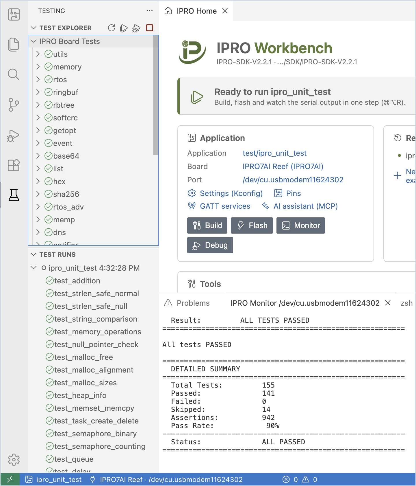
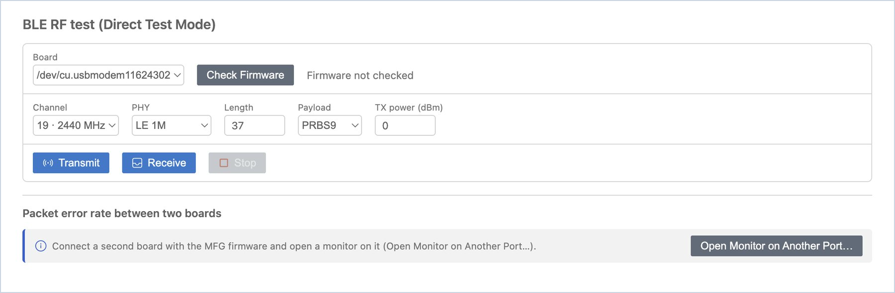
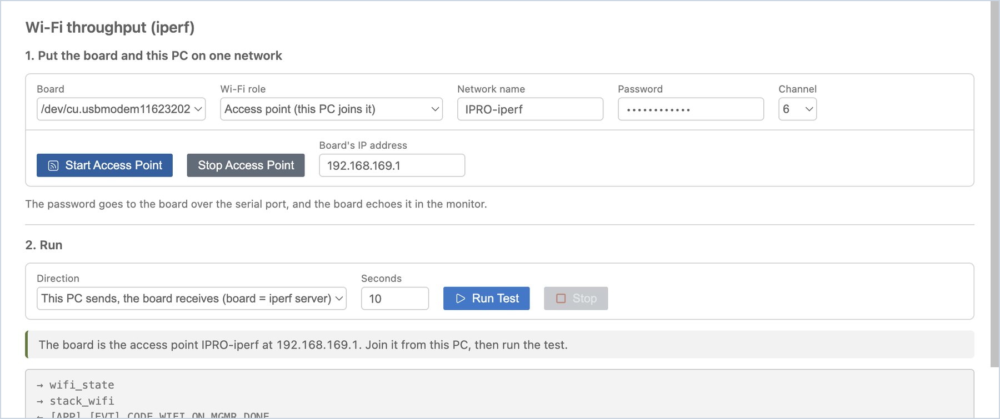
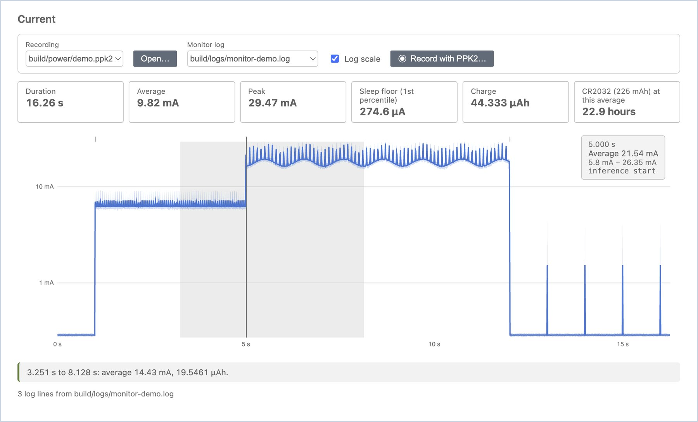

# テストと測定

ボード上でのテストの実行、BLE の RF の測定、Wi-Fi スループットの測定、消費電流の波形の確認について説明します。これらのツールページはすべて、[IPRO Home](index.md#home) の **Tools** カードまたは IPRO メニューから開きます。

## ボードテスト { #board-tests }

アプリケーションが SDK の Unity テストフレームワークを使用している場合（例：`ipro_unit_test`）、ボードが出力したテスト結果は IDE の **Testing** ビューに集められます。

<div class="ipro-steps" markdown>

1. **テストを実行します。** アプリケーションを選択して一度書き込んだ後、サイドバーの **Board** ビュー上部にあるビーカーのアイコン（**Run Tests on Board**）をクリックします。

    **期待される結果**：「Resetting the board with the monitor open…」という通知が表示され、ボードがプローブを介して再起動します。左側が **Testing** ビューに切り替わり、**Test Runs** に今回の実行（例：「ipro_unit_test 2:10:16 PM」）が表示され、各テストの前に合格、失敗、スキップの記号が付きます。**Test Explorer** では、**IPRO Board Tests** にすべてのテストグループ（utils、memory、rtos…）が一覧表示されます。

2. **失敗したテストを開きます。** 失敗したテストをダブルクリックすると、そのテストのソースコードが失敗した行で開きます。

3. **実行のたびに結果が反映されます。** **Build, Flash and Monitor** を実行したときも、結果は自動的に **Testing** ビューに送られます。

</div>



!!! note
    - **Testing** ビューは、ボードが起動後に出力するテストの行を読み取ります。そのため、モニターはプローブの UART（コンソール）ポートで開いている必要があります。モニターのフィルターは結果に影響しません。
    - ボードが再起動しない場合、IDE は「The board did not restart. Is the monitor on the console port of an IPRO Debug Probe?」と表示します。

## RF テスト（BLE DTM） { #rf-test }

**RF Test** は、INTELPRO の MFG ファームウェアを使用して、ボードに BLE Direct Test Mode で送信または受信をさせます。スペクトラムアナライザーや無線通信テスターでの測定、または 2 台のボード間のパケットエラー率（PER）の測定に使用します。

<div class="ipro-steps" markdown>

1. **ファームウェアを確認します。** ボードに MFG ファームウェアを書き込み、シリアルモニターを開きます。IPRO Home の **Tools** にある **RF test (DTM)** をクリックし（または IPRO メニューから **RF Test (DTM)…** を選択し）、**Check Firmware** をクリックします。MFG ファームウェアは IPRO SDK に含まれていません。INTELPRO の営業担当者にお問い合わせください。

    **期待される結果**：「MFG firmware 1.01」と表示されます。ボードが応答しない場合は、「The board did not answer. Is it running the MFG firmware?」と表示されます。

2. **送信または受信します。** チャネル、PHY、長さ、ペイロード、送信電力を選択し、**Transmit** または **Receive** をクリックします。終了するには **Stop** をクリックします。

    **期待される結果**：送信中は「Transmitting on 2402 MHz (1M, 37 bytes, every 625 µs).」のようなメッセージが表示されます。受信を停止すると、「Received M packets in N s; against a DTM transmitter at the standard rate that is a PER of X%.」と表示されます。

    **Receive** だけをクリックした場合、PER はボードが受信中であることを報告した時点から数え、期待されるパケット数は DTM の標準レートから推定します。この推定は、送信側がその間ずっと送信している場合に成り立ちます。IDE に両側を制御させるには、次の手順のように 2 台のボードで測定します。

3. **2 台のボードで PER を測定します。** 両方のボードを同じコンピューターに接続し、2 台目のボードにも MFG ファームウェアを書き込み、**Open Monitor on Another Port…** をクリックしてそのモニターを開きます。**Packet error rate between two boards** で受信側と秒数を選択し、**Measure PER** をクリックします。

    **期待される結果**：結果の表に、時刻、チャネル、PHY、送信数（期待値）、受信数、PER の行が追加されます。

    2 台のボードが別々のコンピューターに接続されている場合は、それぞれのコンピューターで IPRO Workbench を開きます。まず一方でチャネルを選んで **Transmit** をクリックし、次にもう一方で同じチャネルを選んで **Receive** をクリックし、数秒後に **Stop** をクリックします。受信側に、受信したパケット数と推定 PER が表示されます。

</div>



!!! tip
    近くに Wi-Fi があると、Wi-Fi のチャネルと重なる BLE チャネル（例：2440 MHz 付近）では多くのパケットが失われます。PER を測定するときは、近くの Wi-Fi と重ならないチャネル（例：2478 MHz）を選んでください。

!!! note
    テストを開始するたびに、MFG ファームウェアはまず BLE コントローラーを起動する必要があります（約 2.5 秒）。IDE はその応答を待ってからテストを開始します。

## Wi-Fi スループット（iperf） { #iperf }

**Wi-Fi throughput** は、このコンピューターとボードの間で TCP の iperf テストを実行し、Wi-Fi スループットを測定します。コンピューター側は IPRO Workbench 自身が実行するため、iperf をインストールする必要はありません。ボード側のコマンドは、IDE がシリアルモニターを通じて入力します。

ボード上のアプリケーションには、SDK の Wi-Fi シェルコマンドと `iperf` コマンドが必要です。IPRO6S EVK では、IPRO SDK V2.3.0 の `platform/ipro6_demo`（書き込みについては、[IPRO6S EVK](flash.md#ipro6s)（[書き込みとボード](flash.md)のセクション）を参照してください）、または[新しいアプリケーション](first-run.md#own-app)の「Wi-Fi station for the IPRO6S EVK」で作成したコピーを使用します。このページでは、IPRO6S の Wi-Fi の起動、ネットワークのスキャン、ボードの MAC と信号強度の表示、[Wi-Fi メモリプロファイル](#wifi-profile)の設定も行えます。

| Wi-Fi の役割 | 使用する場面 |
|---|---|
| **Station (joins the network this PC is on)** | 推奨の方法で、ページの初期設定です。コンピューターがすでに接続している Wi-Fi ネットワーク（2.4 GHz）にボードが参加します。コンピューターのネットワークはそのままです。 |
| **Access point (this PC joins it)** | 使用できる Wi-Fi ネットワークがない場合に使用します。ボードがアクセスポイントになり、コンピューターの Wi-Fi をボードに接続する必要があります。その間、コンピューターは通常インターネットに接続できません。この役割を選択すると、ページに「As an access point the board measured far lower throughput than as a station (ipro6_demo on the IPRO6S EVK). Use Station for throughput figures.」と表示されます。 |

### ボードをネットワークに接続する { #iperf-network }

<div class="ipro-steps" markdown>

1. **アプリケーションを書き込みます。** `ipro6_demo` を選択して IPRO6S EVK に書き込み、シリアルモニターを開いたままにします。

2. **ページを開きます。** IPRO Home の **Tools** にある **Wi-Fi throughput** をクリックします（または IPRO メニューから **Wi-Fi Throughput (iperf)…** を選択します）。

    **期待される結果**：**Wi-Fi Throughput (iperf)** タブが開き、「1. Put the board and this PC on one network」と「2. Run」の 2 つの部分が表示されます。モニターが開いていない場合は、モニターを開くよう促すヒントが上部に表示され、**Open Monitor** ボタンが提示されます。

3. **スキャンします（任意）。** **Wi-Fi role** は **Station (joins the network this PC is on)** のままにして、**Scan** をクリックします。

    **期待される結果**：ステータスメッセージに「The board is scanning…」、続いて「The board hears N networks. Pick one to fill in its name.」と表示されます。下の表には、信号の強い順に最大 12 のネットワークについて、**Network name**、**Signal (dBm)**、**Channel**、**Security**、**Access points** が一覧表示されます（それより多い場合は「The 12 strongest of N networks.」と表示されます）。スペースを含む名前には「(has a space: the board's shell cannot take it)」と表示されます。行をクリックすると、**Network name** に入力されます。

    ボードで Wi-Fi がまだ動作していない場合、IDE はスキャンの前に `stack_wifi` を送って Wi-Fi を起動します。ネットワークへの参加でも同様です。

4. **ネットワークに参加します。** **Network name** にコンピューターが接続している Wi-Fi ネットワークの名前を入力し（または前の手順で選択し）、**Password** にそのパスワードを入力して、**Join Network** をクリックします。

    **期待される結果**：ステータスメッセージに「The board is joining &lt;network name&gt;…」、続いて「The board joined &lt;network name&gt;; its address is &lt;board's IP&gt;.」と表示され、**Board's IP address** が自動的に入力されます。その下の行には「Board's MAC: …」（Wi-Fi の起動時に読み取った値。ボードの eFuse に MAC がない場合は「(not the MAC in the board's eFuse)」が付きます）と「Signal … dBm on channel …」が表示されます。下のログには、IDE がボードに送信したコマンド（→ で始まる行）とボードの応答（← で始まる行）として `wifi_state`、`stack_wifi`（Wi-Fi が動作していなかった場合）、`wifi_sta_connect`、`wifi_sta_info` が一覧表示されます。このログでは、パスワードは `********` と表示されます。約 40 秒以内にボードが参加できなかった場合は、「The board did not join &lt;network name&gt;. Check the name and password.」というメッセージが表示されます。

    代わりにアクセスポイントモードを使用するには、**Wi-Fi role** で **Access point (this PC joins it)** を選択し、作成するネットワークの名前、8〜63 文字のパスワード、チャネルを入力して、**Start Access Point** をクリックします。

    **期待される結果**：「The board is the access point &lt;network name&gt; at 192.168.169.1. Join it from this PC, then run the test.」と表示されます。その後、コンピューターの Wi-Fi 設定でそのネットワークに接続します。

</div>



!!! warning "重要"
    - ネットワーク名とパスワードにスペースを含めることはできません。ボードのシェルがスペースを受け付けないためです。どちらかにスペースがあると、IDE は何も送信せず、「The network name must be 1 to 32 characters without spaces」または「The password must be 8 to 63 characters without spaces.」と表示します。
    - パスワードはシリアルポート経由でボードに送られ、ボードはそれをシリアルモニターにエコーします（ツールページ自体のログには表示されません）。**Log To File** がオンの場合、パスワードはモニターのログファイルにも残ります。モニターの出力やログファイルをほかの人に渡す前に、その行を削除してください。

### テストを実行する { #iperf-run }

<div class="ipro-steps" markdown>

1. **テストを実行します。** **Direction** は **This PC sends, the board receives (board = iperf server)** のままにし、**Seconds** にテスト時間（デフォルトは 10）を入力して、**Run Test** をクリックします。

    **期待される結果**：ステータスメッセージに「This PC (&lt;PC's IP&gt;) sends to the board (&lt;board's IP&gt;) for 10 s…」と表示され、その下の行に、ボードとコンピューターがそれぞれ集計した 1 秒ごとの Mbit/s が表示されます。終了すると、ステータスメッセージに「Done: … Mbit/s by the board's count, … Mbit/s by this PC's.」と表示され、結果の表に、方向、時間、転送量、ボードの集計値、この PC の集計値、ボード側の 1 秒ごとの数値からなる行が追加されます。

2. **逆方向を測定します。** **Direction** を **The board sends, this PC receives (board = iperf client)** に変更し、もう一度 **Run Test** をクリックします。

    **期待される結果**：結果の表の先頭に、新しい行「Board → PC」が追加されます。

3. **停止してネットワークから切断します。** テストを途中で終了するには、**Stop** をクリックします。作業が終わったら、**Leave Network**（アクセスポイントモードでは **Stop Access Point**）をクリックして、ボードを Wi-Fi ネットワークから切断します。

</div>

| 方向 | 接続を待ち受ける側 | 備考 |
|---|---|---|
| この PC が送信し、ボードが受信する（デフォルト） | ボード（iperf サーバー、TCP ポート 5001） | コンピューターのファイアウォールを変更する必要はありません |
| ボードが送信し、この PC が受信する | このコンピューター（TCP ポート 5001） | コンピューターのファイアウォールで、TCP 5001 の受信を許可する必要があります。Windows はデフォルトでブロックします。下記を参照してください |

!!! note
    - **Windows のファイアウォール**：ボードが送信してコンピューターが受信する場合に、ステータスメッセージが「The board did not connect to this PC on TCP port 5001. A firewall on this PC may block incoming connections…」であれば、Windows 版は、受信を許可するコマンドと、その許可を再び削除するコマンドを添えて表示します。管理者としてコマンドプロンプトを開き、受信を許可します。

        ```powershell
        netsh advfirewall firewall add rule name="IPRO Workbench iperf" dir=in action=allow protocol=TCP localport=5001
        ```

        テストの後、規則を削除します。

        ```powershell
        netsh advfirewall firewall delete rule name="IPRO Workbench iperf"
        ```

        「セキュリティが強化された Windows Defender ファイアウォール」で、TCP ポート 5001 を許可する受信の規則を手動で追加することもできます。コンピューターからボードへの送信には、規則は不要です。
    - **待ち受けたままのボード側サーバー**：ボードの iperf サーバーが接続を待ち始めると、コンピューターからの接続か、ボードの再起動でしか終了しません。そのため IDE は、ボードにサーバーを開始させる前に、このコンピューターがボードのネットワーク上のアドレスを持っていることを確認します。持っていない場合は、「This PC has no address on the board's network (…). Join the same Wi-Fi network, then run again.」というメッセージが表示されます。サーバーがすでに待ち受けている場合（ステータスメッセージが「This PC could not reach the board's iperf server…」または「An earlier iperf is still running on the board…」の場合）は、表示される **Reset Board** ボタンをクリックします。ボードが再起動したら、**Join Network** からやり直します。
    - ボードとコンピューターは、それぞれ独自に集計します。ボードは受信した（または送信した）データから、コンピューターは送信した（または受信した）データから算出します。2 つの数値にわずかな差があるのは正常です。
    - 2 つの Wi-Fi の役割で測定した数値を、互いに比較することはできません。アクセスポイントに接続したボードのスループットを評価するには、Station モードを使用してください。

### Wi-Fi メモリプロファイル { #wifi-profile }

IPRO6S の station が RAM を Wi-Fi スループットとアプリケーションに残すヒープにどう配分するかは、ビルド設定である Wi-Fi メモリプロファイルで決まります。アクティブなアプリケーションが IPRO6 の Wi-Fi アプリケーション（例：`ipro6_demo`）の場合、**Wi-Fi Throughput (iperf)** ページの下部に「Memory profile of &lt;application&gt; (a build setting)」という部分があります。

<div class="ipro-steps" markdown>

1. **使用中のプロファイルを確認します。** `ipro6_demo` を選択し、**Wi-Fi Throughput (iperf)** を開いて下部までスクロールします。

    **期待される結果**：「How the IPRO6 station splits its RAM between Wi-Fi throughput and the heap the application has. The figures are the SDK's measurements on ipro6_demo; compare the profiles with them, not networks.」と下の表が表示されます。使用中のプロファイルの行には「In the configuration」と表示され、ほかの行には **Use** があります。

    | プロファイル | 接続後の空きヒープ | PERF に対するスループット |
    |---|---|---|
    | PERF：スループット優先 | 約 36 KB | 100 % |
    | BALANCED：一般的な製品向け | 約 170 KB | 40〜75 % |
    | APP：RAM の大部分をアプリケーションに | 約 210 KB | 25〜50 % |

2. **プロファイルを変更します。** BALANCED の行の **Use** をクリックします。

    **期待される結果**：IDE は使用中の構成（`.config`、または選択した[別構成](develop.md#configurations)）にプロファイルを書き込みます。BALANCED の行に「In the configuration」と表示され、「The configuration now says BALANCED; what is built is still PERF. The profile also changes the linker script, so it takes a build from clean.」という警告と **Clean and Build** ボタンが表示されます。

3. **クリーンビルドします。** **Clean and Build** をクリックします。

    **期待される結果**：**IPRO Build** が最初からビルドし、成功すると警告が消えます。書き込んだ後、もう一度[テストを実行](#iperf-run)して、スループットを比較します。

</div>

## 消費電力 { #power }

**Power** は、Nordic Power Profiler Kit II（PPK2）の電流の記録を読み込み、平均、ピーク、スリープ電流、電荷量を算出し、CR2032 でボードがどれだけ動作するかを見積もります。

<div class="ipro-steps" markdown>

1. **記録を開きます。** アプリケーションを右クリックして **Power…** を選択し（または IPRO Home の **Tools** にある **Power** をクリックし）、**Open…** をクリックして、Power Profiler で保存した `.ppk2` または CSV ファイルを選択します。

    **期待される結果**：記録時間、平均、ピーク、スリープ時の下限（1 パーセンタイル）、電荷量と、「CR2032 (225 mAh) at this average」での持続時間が表示されます。その下には電流波形があり、**Log scale** に切り替えられます。

2. **波形にマウスポインターを合わせます。**

    **期待される結果**：その時点の時刻、平均電流、範囲が表示されます。例：「8.128 s, Average 282.3 µA, 271.4 µA – 292.5 µA」。

3. **区間を測定します。** 波形上の区間をドラッグします。

    **期待される結果**：その区間の平均電流と電荷量が下に表示されます。例：「3.251 s to 8.128 s: average 11.91 mA, 16.1279 µAh.」

4. **モニターログを重ねて表示します。** 記録中にシリアルモニターの **Log To File** とタイムスタンプがオンになっていた場合は、**Monitor log** でそのログを選択します。

    **期待される結果**：各ログ行が、波形の上に短い目盛りで示されます。目盛りにマウスポインターを合わせると、その時点の電流とログのテキストが表示され、「コードのどの部分がどれだけ電力を使ったか」を確認できます。

</div>


